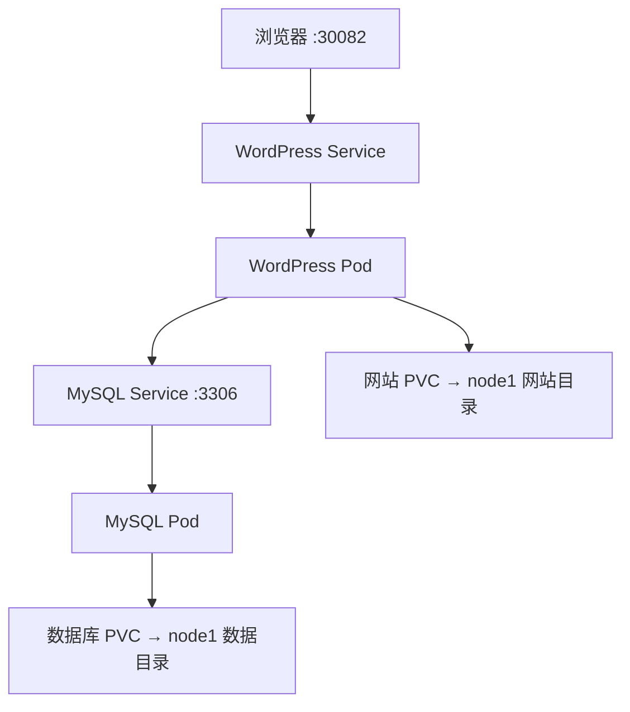

> 文章中的一些配置文件、脚本等，可以到 [XVSHIFU/k8s-study-notes](https://github.com/XVSHIFU/k8s-study-notes) 找到对应内容

## **1、项目设计**


| 项目       | 配置                                   |
| ---------- | -------------------------------------- |
| Namespace  | `wordpress-demo`                       |
| 网站       | WordPress，1 个副本                    |
| 数据库     | MySQL，1 个副本                        |
| 网站入口   | `192.168.194.142:30082`                |
| 数据库入口 | 集群内部 `wordpress-mysql:3306`        |
| 数据存储   | node1 上两个独立 local PV              |
| 更新策略   | `Recreate`，先停止旧 Pod，再创建新 Pod |



## **2．准备存储目录**

**在 node1 上执行：**

```bash
mkdir -p /data/wordpress-demo/mysql
mkdir -p /data/wordpress-demo/html

df -h /data
```

两个目录应为空，并确保磁盘有足够空间。

不用手动设置 `777` 权限，官方镜像的初始化程序会处理所需目录权限。

**回到 master，检查节点：**

```bash
kubectl get nodes -L kubernetes.io/hostname
kubectl top nodes
```

确认 node1 为 `Ready`，其 `kubernetes.io/hostname` 标签值是 `node1`。

检查计划使用的端口：

```bash
kubectl get svc -A | grep 30082
```

没有输出表示当前 Service 列表中没有占用这个端口。

---

## **3．创建项目目录**

在 **master** 执行：

```bash
mkdir -p ~/wordpress-demo
cd ~/wordpress-demo
```

在这里创建四个配置文件：


| 文件                        | 用途                    |
| --------------------------- | ----------------------- |
| `kustomization.yaml`        | 组织资源、生成 Secret   |
| `storage.yaml`              | 两个 PV 和两个 PVC      |
| `mysql-deployment.yaml`     | 数据库及内部 Service    |
| `wordpress-deployment.yaml` | 网站及 NodePort Service |

### **① `kustomization.yaml`**

`vim kustomization.yaml`

配置文件：[wordpress-demo/kustomization.yaml](wordpress-demo/kustomization.yaml)。在 master 的 `~/wordpress-demo/` 中使用此文件。

生成两个独立的随机密码，保存在本地文件中。**首次部署执行一次即可：**

```shell
umask 077

printf 'root-password=%s\npassword=%s\n' \
  "$(openssl rand -hex 24)" \
  "$(openssl rand -hex 24)" > passwords.env
```

Kustomize 会从这个文件生成 Secret，并自动处理 YAML 中对 `mysql-pass` 的引用。

### **② `storage.yaml`**

`vim storage.yaml`

配置文件：[wordpress-demo/storage.yaml](wordpress-demo/storage.yaml)。在 master 的 `~/wordpress-demo/` 中使用此文件。

这里通过 `volumeName` 明确指定 PVC 使用哪个 PV，避免两份存储绑定混淆。

`5Gi` 是声明容量；普通目录不会因此自动获得磁盘配额限制。

### **③ `mysql-deployment.yaml`**

`vim mysql-deployment.yaml`

配置文件：[wordpress-demo/mysql-deployment.yaml](wordpress-demo/mysql-deployment.yaml)。在 master 的 `~/wordpress-demo/` 中使用此文件。

MySQL 首次启动会根据环境变量创建数据库和用户；已有数据目录时不会重新初始化。网站使用普通数据库用户 `wordpress`，不用 root。

### **④ `wordpress-deployment.yaml`**

`vim wordpress-deployment.yaml`

配置文件：[wordpress-demo/wordpress-deployment.yaml](wordpress-demo/wordpress-deployment.yaml)。在 master 的 `~/wordpress-demo/` 中使用此文件。

WordPress 官方镜像通过 `WORDPRESS_DB_*` 环境变量配置数据库连接。这里使用 Apache 变体，容器直接提供 HTTP 服务。

存活探针只检查 Web 端口，避免数据库暂时不可用时反复重启网站

就绪探针检查登录页面

---

## **4．部署并检查**

创建命名空间：

```bash
kubectl create namespace wordpress-demo
```

校验配置并部署：

```bash
kubectl apply -k . --dry-run=server

kubectl apply -k .
```

**注意是 `-k .`，不是 `-f kustomization.yaml`**，因为需要先由 Kustomize 生成最终资源。

查看存储：

```bash
kubectl get pvc -n wordpress-demo
```


等待数据库和网站就绪：

```bash
kubectl rollout status deployment/wordpress-mysql \
  -n wordpress-demo --timeout=300s

kubectl rollout status deployment/wordpress \
  -n wordpress-demo --timeout=300s
```

查看结果：

```bash
kubectl get pods,svc -n wordpress-demo -o wide
```


- 两个 Pod 都是 `1/1 Running`，运行在 node1。
- WordPress Service 显示 `80:30082/TCP`。
- MySQL Service 只提供集群内的 3306 端口。

第一次需要拉取镜像、初始化数据库，可能较慢

在 Headlamp 中选择 `wordpress-demo`，查看 Deployments、Pods、Services 和 PVC


---

## **5．初始化网站**

浏览器中访问：

```text
http://192.168.194.142:30082
```


按页面完成：

1. 选择语言。
2. 设置网站标题，例如“K8s 学习博客”。
3. 创建 WordPress 管理员账号和密码。
4. 登录后台。

**这里设置的是网站管理员账号，不是 MySQL 用户。**


发布一篇文章，


---

### **5.1．查看上传的图片文件**

在 Headlamp 中：

选择 `wordpress-demo` 命名空间 → **Pods** → 打开 `wordpress-…` Pod → 进入 `wordpress` 容器的终端。

```bash
ls -R /var/www/html/wp-content/uploads/
```


也可以在 master 上执行：

```bash
kubectl exec -n wordpress-demo deployment/wordpress -- \
  find /var/www/html/wp-content/uploads -type f
```

同一张图片可能有多个尺寸的文件，这是 WordPress 自动生成的缩略图。

### **5.2．查看数据库中的文章**

在 master 上进入 MySQL 容器：

```shell
kubectl exec -it -n wordpress-demo deployment/wordpress-mysql -- sh
```

在容器内使用部署时设置的账号连接数据库：

```shell
MYSQL_PWD="$MYSQL_PASSWORD" mysql -u "$MYSQL_USER" "$MYSQL_DATABASE"
```

出现 `mysql>` 后，查询文章：

```sql
SELECT ID, post_title, post_status, post_date
FROM wp_posts
WHERE post_type = 'post';
```

查看已经发布的文章正文：

```sql
SELECT ID, post_title, post_content
FROM wp_posts
WHERE post_type = 'post'
  AND post_status = 'publish'\G
```

这里能看到你在网页后台编写的文章。正文可能包含 HTML 和 WordPress 编辑器标记。


查询图片等附件的记录：

```sql
SELECT ID, post_title, post_mime_type
FROM wp_posts
WHERE post_type = 'attachment';
```

**图片文件在 WordPress 目录里，图片的名称、类型及关联信息等记录在数据库里。**


退出数据库和容器：

```text
exit
exit
```

### **5.3．查看它们对应的 Kubernetes 存储**

在 master 上：

```bash
kubectl get pvc -n wordpress-demo
```

查看本项目的两个 PV：

```bash
kubectl get pv wordpress-demo-mysql-pv wordpress-demo-html-pv
```


按我们这次的配置，实际数据落在 **node1**：


| node1 上的目录               | 内容                           |
| ---------------------------- | ------------------------------ |
| `/data/wordpress-demo/mysql` | MySQL 数据文件                 |
| `/data/wordpress-demo/html`  | WordPress 文件，包括上传的图片 |

因此，登录 **node1** 后也能直接查找图片：

```bash
find /data/wordpress-demo/html/wp-content/uploads -type f
```

数据库目录可以查看文件列表：

```bash
ls -lh /data/wordpress-demo/mysql
```


但**文章需要通过 SQL 查询**，不能通过 `cat` 数据库文件读取，也不要直接修改这些文件。

## **6．验证持久化与自动恢复**

**先删除 WordPress Pod：**

```bash
kubectl delete pod -n wordpress-demo \
  -l app=wordpress,tier=frontend
```

观察：

```bash
kubectl get pods -n wordpress-demo -w
```

等新 WordPress Pod 达到 `1/1 Running`，按 `Ctrl+C`。


刷新网站，检查文章和图片。


**再删除 MySQL Pod：**

```bash
kubectl delete pod -n wordpress-demo \
  -l app=wordpress,tier=mysql
```

继续观察：

```bash
kubectl get pods -n wordpress-demo -w
```

等新 MySQL Pod 就绪后，刷新网站。


数据库重建期间网站可能暂时提示连接失败，恢复后文章、账号等应仍然存在。


| 数据                       | 实际存放位置     |
| -------------------------- | ---------------- |
| 文章、用户、网站设置       | MySQL 数据卷     |
| 上传图片、插件、主题等文件 | WordPress 文件卷 |

**只删除 Pod，不删除 PVC、PV 或宿主机数据目录。**

---

## **7．问题排查**

先执行：

```bash
kubectl get pods,pvc -n wordpress-demo

kubectl get events -n wordpress-demo \
  --sort-by=.metadata.creationTimestamp
```


| 现象             | 优先检查                                 |
| ---------------- | ---------------------------------------- |
| PVC Pending      | PV 是否创建、名称是否匹配                |
| Pod Pending      | node1 是否可调度、资源是否足够           |
| ImagePullBackOff | 镜像拉取的具体错误                       |
| CrashLoopBackOff | 容器日志、目录权限、内存限制             |
| 数据库连接失败   | MySQL 是否 Ready、两端数据库配置是否一致 |

查看日志：

```bash
kubectl logs -n wordpress-demo deployment/wordpress-mysql --tail=80

kubectl logs -n wordpress-demo deployment/wordpress --tail=80
```

---

## **8．暂停与恢复**

完成实验后，如果想保留项目但减少资源占用：

```bash
kubectl scale deployment wordpress wordpress-mysql \
  -n wordpress-demo --replicas=0
```

恢复：

```bash
kubectl scale deployment wordpress wordpress-mysql \
  -n wordpress-demo --replicas=1
```

缩容到零会停止容器，PVC、PV 和磁盘数据仍保留。再次执行 `kubectl apply -k .` 也会按照文件中的 `replicas: 1` 恢复副本。

## **9．中文语言包排查记录**

本次问题链路：**Fake-IP 解析 → WordPress URL 校验失败 → curl 下载 → 解压 → 新进程设置语言**。先在 WordPress Pod 内检查 DNS 结果和下载 URL；若代理返回 Fake-IP，WordPress 内置下载流程可能因 URL 校验失败而无法安装语言包。此次改用 `curl` 获取对应版本的官方中文语言包，解压到持久化的 `wp-content/languages`，再启动新进程并在后台设置站点语言为简体中文。
