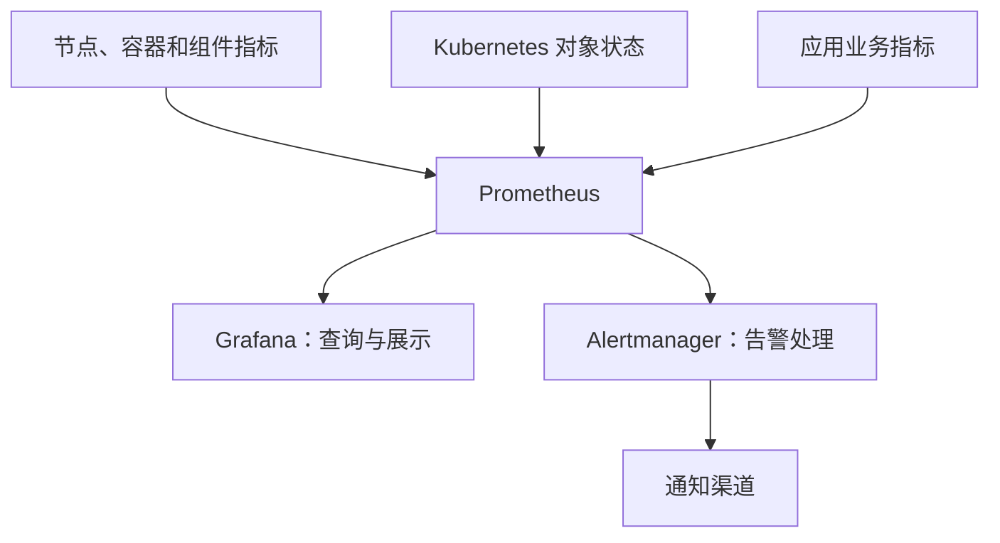

# 04 Kubernetes 集群监控与告警

这次实验用 kube-prometheus-stack 搭建监控，再接入应用指标，练习 PromQL、告警邮件、持久化和 HTTPS 访问。


| 节点   | IP              | 用途                             |
| ------ | --------------- | -------------------------------- |
| master | 192.168.194.141 | 控制平面、执行 kubectl 和 Helm   |
| node1  | 192.168.194.142 | Prometheus 本地数据卷            |
| node2  | 192.168.194.143 | Grafana、Alertmanager 本地数据卷 |

Kubernetes 版本为 v1.37.1，Chart 固定为 92.10.1，Release 和命名空间都叫 monitoring。实验文件放在 `/root/k8s-monitoring`。

## 1．监控体系与组件

### 1.1 监控的目的与范围

监控通过持续采集数据，帮助我们**了解运行状态、发现异常、分析原因，并在满足条件时告警**。

Kubernetes 监控通常分为四层：


| 层次     | 监控内容                                     |
| -------- | -------------------------------------------- |
| 节点     | CPU、内存、磁盘、网络                        |
| 集群组件 | API Server 请求延迟和错误率、etcd 状态等     |
| 工作负载 | 容器资源用量、重启次数、Pod 状态、可用副本数 |
| 应用业务 | 请求量、错误率、响应时间、业务处理量         |

**资源正常不等于业务正常**：应用连接数据库失败时，CPU 可能很低，但请求已经报错。

监控常涉及三类数据：

- **指标（Metrics）**：数值及其变化，例如 CPU 使用率。
- **日志（Logs）**：具体事件记录，例如数据库连接失败。
- **链路追踪（Traces）**：一次请求经过哪些服务、分别耗时多久。

### 1.2 Metrics Server 与 Prometheus


| 对比项     | Metrics Server                 | Prometheus                           |
| ---------- | ------------------------------ | ------------------------------------ |
| 主要用途   | 近期资源查询、资源型自动扩缩容 | 持续监控、历史查询、规则计算与告警   |
| 指标范围   | 主要是节点、Pod 的 CPU 和内存  | 取决于采集配置，可覆盖基础设施和业务 |
| 历史查询   | 不提供完整历史查询能力         | 保存时间序列，可查询历史变化         |
| 常见使用者 | `kubectl top`、资源型 HPA      | Grafana、PromQL 查询、告警规则       |

Metrics Server 从 kubelet 获取资源指标，再通过 Kubernetes Metrics API 提供给使用者。**安装 Prometheus 不会自动替换 HPA 的指标来源。**

### 1.3 核心组件职责


| 组件             | 核心职责                                     |
| ---------------- | -------------------------------------------- |
| **Prometheus**   | 采集、存储、查询指标，计算告警规则           |
| **Grafana**      | 查询数据源，展示图表和仪表盘                 |
| **Alertmanager** | 接收告警，分组、去重、静默，并路由到通知渠道 |

**Prometheus 判断是否触发告警，Alertmanager 处理告警和通知。** Grafana 展示的数据通常来自 Prometheus，而不是自己采集。

### 1.4 指标由谁提供？


| 指标提供者                               | 提供的内容                 | 示例                        |
| ---------------------------------------- | -------------------------- | --------------------------- |
| **node-exporter**                        | 节点操作系统和硬件指标     | 可用内存、磁盘空间          |
| **kubelet 相关接口，包括 cAdvisor 指标** | 节点、Pod 和容器资源指标   | 容器 CPU 使用时间、内存用量 |
| **kube-state-metrics**                   | Kubernetes 对象状态指标    | 期望副本数、可用副本数      |
| **Kubernetes 组件自身**                  | 组件运行指标               | API Server 请求延迟         |
| **应用自身**                             | 埋点产生的业务指标         | HTTP 请求总数               |
| **专用 exporter**                        | 从特定系统读取并转换的指标 | 数据库连接数、查询数        |

**Exporter** 是将被监控系统的数据转换并暴露为可采集指标的程序。

关键区别：

- **node-exporter**：机器运行得怎么样。
- **kube-state-metrics**：Kubernetes 对象处于什么状态。
- **容器资源指标**：容器实际消耗了多少资源。
- **业务指标**：应用实际提供服务的情况。

### 1.5 Pull、指标端点与数据流

Prometheus 通常采用 **Pull：主动、定期请求目标的 HTTP 指标接口**，这个动作称为 **scrape（抓取）**。接口路径常见为 `/metrics`，但可以配置。

**Target（采集目标）**就是 Prometheus 要抓取的具体端点。



箭头表示数据流向；采集请求由 Prometheus 主动发起。

采集过程是：

1. 目标暴露指标接口。
2. Prometheus 定期抓取。
3. Prometheus 将数值和时间保存起来。
4. 查询或告警规则使用这些数据。

**接口抓取成功不等于业务正常**：指标端点可能正常，但应用的业务错误率很高。

### 1.6 指标名、标签、样本与时间序列

以一个指标为例：

```
http_requests_total{method="GET",code="200"} 1250
```


| 部分                         | 含义               |
| ---------------------------- | ------------------ |
| `http_requests_total`        | 指标名：测量什么   |
| `method="GET"`、`code="200"` | 标签：区分不同维度 |
| `1250`                       | 本次观测值         |

这表示：符合这组标签的 HTTP 请求累计数量为 1250。

**指标名 + 完整标签集合，确定一条时间序列。** 标签值不同，就是不同序列：

```
http_requests_total{method="GET",code="200"}
http_requests_total{method="GET",code="500"}
```

同一序列持续记录“时间戳 + 数值”，便形成历史变化：


| 时间     | 累计请求数 |
| -------- | ---------- |
| 10:00:00 | 1250       |
| 10:00:30 | 1280       |
| 10:01:00 | 1330       |

其中每一个带时间戳的观测值称为**样本**。

不要随意把用户 ID、请求 ID 等大量不同的值作为标签，否则会产生过多时间序列，增加资源消耗。

### 1.7 Helm、Chart、values 与 Release

这些概念负责**安装和配置**：


| 名称            | 含义                                     |
| --------------- | ---------------------------------------- |
| **Helm**        | Kubernetes 包管理工具                    |
| **Chart**       | 安装包，包含资源模板、默认参数和元数据   |
| **values.yaml** | 安装参数，例如副本数、资源限制、存储配置 |
| **Release**     | 一个 Chart 安装后形成的实例              |

关系为：

**Chart 模板 + values 参数 → Kubernetes 资源 → 一次 Release。**

同一个 Chart 可以安装多次，形成不同 Release。**Chart 版本与其中的 Prometheus 等应用版本不是同一个版本号。**

### 1.8 Operator、CRD 与自定义资源

**Operator** 是持续运行的控制器，负责把应用的实际状态调整到声明的期望状态。

**CRD** 用于向 Kubernetes 注册新的资源类型；**自定义资源（CR）**是该类型的具体对象。


| 概念       | 作用                                   |
| ---------- | -------------------------------------- |
| CRD        | 定义 Kubernetes 新认识的资源类型及字段 |
| 自定义资源 | 声明具体需求                           |
| Operator   | 读取这些声明并协调实际资源             |

Prometheus Operator 常用的自定义资源：


| 类型               | 用途                                                 |
| ------------------ | ---------------------------------------------------- |
| **Prometheus**     | 声明 Prometheus 实例配置，以及选择哪些监控和规则对象 |
| **Alertmanager**   | 声明 Alertmanager 实例配置                           |
| **ServiceMonitor** | 选择 Service，描述对应端点的指标采集方式             |
| **PodMonitor**     | 直接选择 Pod，描述指标采集方式                       |
| **PrometheusRule** | 定义告警规则和记录规则                               |

其中，**记录规则**用于把表达式的计算结果预先保存为新的时间序列。

Operator 将这些声明转换为运行资源和配置；**真正采集指标、计算规则的仍是 Prometheus**。仅创建 CRD 不会自动实现这些功能。

### 1.9 kube-prometheus-stack 是什么？

**kube-prometheus-stack 是一个 Helm Chart，用来组织部署完整的 Kubernetes 监控栈。**

它通常包括：

- Prometheus Operator。
- Prometheus、Alertmanager、Grafana。
- node-exporter、kube-state-metrics。
- 采集配置、告警规则和仪表盘。

具体启用内容由 **Chart 版本和 values 配置**决定。

各层关系可以这样记：


| 层次                       | 对应工具或组件                             |
| -------------------------- | ------------------------------------------ |
| 安装                       | Helm + kube-prometheus-stack Chart         |
| 配置参数                   | values.yaml                                |
| 持续管理                   | Prometheus Operator                        |
| 声明采集和规则             | ServiceMonitor、PodMonitor、PrometheusRule |
| 提供指标                   | exporter、kubelet、组件和应用              |
| 采集、存储、查询、规则计算 | Prometheus                                 |
| 图表展示                   | Grafana                                    |
| 告警处理与通知             | Alertmanager                               |

## 2．部署监控系统

### 2.1 添加仓库与固定版本

```bash
helm repo add prometheus-community \
  https://prometheus-community.github.io/helm-charts
helm repo update prometheus-community
helm search repo prometheus-community/kube-prometheus-stack --versions | head -n 11
helm show chart prometheus-community/kube-prometheus-stack --version 92.10.1

mkdir -p ~/k8s-monitoring
cd ~/k8s-monitoring
helm show values prometheus-community/kube-prometheus-stack \
  --version 92.10.1 > values-default-92.10.1.yaml
```

这次查询到的 Chart 信息：

```text
name: kube-prometheus-stack
version: 92.10.1
appVersion: v0.94.1
kubeVersion: '>=1.25.0-0'
```

`appVersion` 不是整个监控栈里所有软件的版本。实际运行的 Prometheus 为 v3.15.0，Alertmanager 为 v0.34.1，Grafana 为 13.2.4。

### 2.2 配置与安装

初次部署只配置副本、采集周期和资源，持久化在后面添加。下面将 Grafana 内存写成实验最后使用的值，避免重复经历内存不足。

```yaml
prometheus:
  prometheusSpec:
    replicas: 1
    retention: 2d
    scrapeInterval: 30s
    evaluationInterval: 30s
    resources:
      requests:
        cpu: 200m
        memory: 512Mi
      limits:
        memory: 2Gi

alertmanager:
  alertmanagerSpec:
    replicas: 1
    resources:
      requests:
        cpu: 50m
        memory: 64Mi
      limits:
        memory: 256Mi

grafana:
  persistence:
    enabled: false
  resources:
    requests:
      cpu: 100m
      memory: 1Gi
    limits:
      memory: 2Gi
```

保存为 `values.yaml` 后安装：

```bash
helm install monitoring prometheus-community/kube-prometheus-stack \
  --version 92.10.1 \
  --namespace monitoring --create-namespace \
  -f values.yaml --wait --timeout 15m

kubectl get pods -n monitoring -o wide
kubectl get svc -n monitoring
```

初次安装输出：

```text
NAME: monitoring
NAMESPACE: monitoring
STATUS: deployed
REVISION: 1
```

监控组件包括一个 Prometheus、一个 Alertmanager、一个 Grafana、一个 Operator、一个 kube-state-metrics，以及每个节点上的 node-exporter。Grafana 的 `3/3` 包括主容器和两个 sidecar，不是三个 Grafana 副本。

以后调整配置用 `helm upgrade`，不要重复 install：

```bash
cp -p values.yaml "values.yaml.backup-$(date +%Y%m%d-%H%M%S)"
helm upgrade monitoring prometheus-community/kube-prometheus-stack \
  --version 92.10.1 -n monitoring \
  -f values.yaml --wait --timeout 15m
```

### 2.3 临时访问与 Targets

查看 Grafana 管理员密码：

```bash
kubectl get secret monitoring-grafana -n monitoring \
  -o jsonpath='{.data.admin-password}' | base64 -d
echo
```

分别开终端转发端口：

```bash
kubectl port-forward -n monitoring svc/monitoring-grafana \
  3000:80 --address 192.168.194.141

kubectl port-forward -n monitoring svc/monitoring-kube-prometheus-prometheus \
  9090:9090 --address 192.168.194.141

kubectl port-forward -n monitoring svc/monitoring-kube-prometheus-alertmanager \
  9093:9093 --address 192.168.194.141
```

浏览器访问对应 IP 和端口。`port-forward` 是临时进程，终端退出、按 Ctrl+C 或目标 Pod 重建后需要重新启动。后面配置 Ingress 后就不再依赖它。

Prometheus 的 Targets 页面用来查看采集目标。实验初期共 28 个目标，其中 22 个 UP、6 个 DOWN。

.png)

## 3．PromQL 与 Grafana 面板

### 3.1 常用查询

`up` 表示抓取结果：1 为成功，0 为失败。标签用于筛选，聚合函数用于汇总。

```promql
up
up{job="node-exporter"}
up == 0
count(up)
sum(up)
count(up) - sum(up)
```

本次查询结果分别能看到三个 node-exporter，以及总目标数 28、成功数 22、失败数 6。

**Gauge** 表示可升可降的当前值，如内存；**Counter** 表示累计值，如请求总数，进程重启后可能归零。查看 Counter 的变化速度通常用 `rate()`。

```promql
# 可用内存，单位 GiB
node_memory_MemAvailable_bytes{job="node-exporter"} / 1024 / 1024 / 1024

# 最近 5 分钟 CPU 时间增长速率
rate(node_cpu_seconds_total{job="node-exporter"}[5m])
```

`[5m]` 是计算窗口，不是采集间隔。采集间隔本次为 30 秒。

### 3.2 节点 CPU 与内存面板

在 Grafana 新建仪表盘，添加可视化，数据源选择 Prometheus，查询切换到 Code 模式。

CPU 非空闲率：

```promql
100 * (1 - avg by (instance) (
  rate(node_cpu_seconds_total{job="node-exporter",mode="idle"}[5m])
))
```

内存使用率：

```promql
100 * (1 -
  node_memory_MemAvailable_bytes{job="node-exporter"}
  / node_memory_MemTotal_bytes{job="node-exporter"}
)
```

两个面板使用相同的显示设置：


| 设置      | 值              |
| --------- | --------------- |
| 可视化    | Time series     |
| 查询类型  | Range           |
| 单位      | Percent (0-100) |
| Min / Max | 0 / 100         |
| 图例      | `{{instance}}`  |
| 堆叠      | 关闭            |
| 时间范围  | 最近 15 分钟    |

公式已经乘了 100，所以不能再选 Percent (0.0-1.0)。不同节点的使用率不要堆叠，否则上方曲线看起来像多个节点之和。

.png)

本次仪表盘保存为 **Prometheus**，UID 为 `adz289z`，后面添加请求累计数和请求速率，共四个面板。

## 4．观察负载与 HPA 扩缩容

### 4.1 实验对象

使用 `nginx-demo` 命名空间已有的 nginx：


| 项目                | 配置                             |
| ------------------- | -------------------------------- |
| Deployment          | nginx                            |
| Service             | 10.97.61.147:80，NodePort 30081  |
| CPU request / limit | 100m / 500m                      |
| HPA                 | nginx-hpa，最少 2、最多 4 个副本 |
| 扩缩容目标          | CPU 为 request 的 50%            |
| 数据卷              | nginx-data，RWO，本地 PV         |

HPA 的 50% 是相对于 CPU request，不是节点总 CPU，也不是 limit。这里对应平均每个 Pod 约 50m CPU。

```bash
kubectl get hpa nginx-hpa -n nginx-demo
kubectl describe hpa nginx-hpa -n nginx-demo
kubectl get pods -n nginx-demo -l app=nginx -o wide
kubectl get endpointslices -n nginx-demo \
  -l kubernetes.io/service-name=nginx
```

### 4.2 加压与观察

```bash
yum install -y httpd-tools
curl -sS -o /dev/null -w 'HTTP %{http_code}\n' http://10.97.61.147/
ab -t 300 -n 100000000 -c 20 http://10.97.61.147/
```

另开终端观察：

```bash
kubectl get hpa nginx-hpa -n nginx-demo -w
kubectl top pods -n nginx-demo -l app=nginx
kubectl get pods -n nginx-demo -l app=nginx -o wide
```

本次压测中有请求超时，但已经触发扩容，nginx 从 2 个变成 4 个副本。停止请求后 CPU 降到 1%，副本数没有立刻下降；经过缩容稳定窗口后回到 2。

实际 HPA 事件：

```text
Normal  SuccessfulRescale  New size: 4; reason: cpu resource utilization (percentage of request) above target
Normal  SuccessfulRescale  New size: 2; reason: All metrics below target
```

最终状态：

```text
Deployment pods: 2 current / 2 desired
resource cpu on pods (as a percentage of request): 1% (1m) / 50%

NAME    READY   UP-TO-DATE   AVAILABLE
nginx   2/2     2            2

HTTP 200
```

`ScalingLimited=True / TooFewReplicas` 在这里表示按负载计算的副本数小于 `minReplicas: 2`，因此保留两个副本。

.png)

这次四个 nginx Pod 都在 node1，与本地数据卷的节点约束有关。RWO 不等于只能被一个 Pod 使用；同一节点上的多个 Pod 可以使用符合条件的 RWO 卷。

## 5．接入应用指标

### 5.1 部署示例应用

示例应用会暴露 HTTP 请求数和请求耗时。配置在 `configs/app-metrics/example-app.yaml`，包含 Namespace、Deployment 和 Service。

```bash
mkdir -p ~/k8s-monitoring/app-metrics
cd ~/k8s-monitoring/app-metrics
kubectl apply -f example-app.yaml
kubectl rollout status deployment/example-app -n metrics-demo

APP_IP=$(kubectl get svc example-app -n metrics-demo -o jsonpath='{.spec.clusterIP}')
curl -fsS "http://${APP_IP}:8080/metrics"
```

刚启动时只有版本指标：

```text
# HELP version Version information about this binary
# TYPE version gauge
version{version="v0.5.0"} 1
```

访问业务接口后才会出现请求指标：

```bash
for i in {1..5}; do
  curl --connect-timeout 3 --max-time 10 -sS \
    -o /dev/null -w 'HTTP %{http_code}\n' "http://${APP_IP}:8080/"
done
curl -fsS "http://${APP_IP}:8080/metrics"
```

输出节选：

```text
HTTP 200
HTTP 200
HTTP 200
HTTP 200
HTTP 200

# TYPE http_requests_total counter
http_requests_total{code="200",method="get"} 5
# TYPE http_request_duration_seconds histogram
http_request_duration_seconds_count{code="200",handler="found",method="get"} 5
http_request_duration_seconds_sum{code="200",handler="found",method="get"} 6.619400000000001e-05
```

Histogram 中 `_bucket` 是累计桶，`_count` 是次数，`_sum` 是耗时总和。

### 5.2 创建 ServiceMonitor

本次 Prometheus 的选择器：

```text
serviceMonitorSelector={"matchLabels":{"release":"monitoring"}}
serviceMonitorNamespaceSelector={}
```

因此 ServiceMonitor 必须带 `release: monitoring`。命名空间选择器 `{}` 允许发现所有命名空间里的 ServiceMonitor，但不会自动采集所有 Service。

```yaml
apiVersion: monitoring.coreos.com/v1
kind: ServiceMonitor
metadata:
  name: example-app
  namespace: metrics-demo
  labels:
    release: monitoring
spec:
  selector:
    matchLabels:
      app: example-app
  endpoints:
  - port: web
    path: /metrics
    interval: 30s
```

```bash
kubectl apply -f example-app-servicemonitor.yaml
kubectl get svc example-app -n metrics-demo \
  -o jsonpath='labels={.metadata.labels}{"\n"}ports={.spec.ports}{"\n"}'
```

实际 Service 信息：

```text
labels={"app":"example-app"}
ports=[{"name":"web","port":8080,"protocol":"TCP","targetPort":"web"}]
```

这里有三层选择关系：Prometheus 选择 ServiceMonitor；ServiceMonitor 根据标签选择 Service；Service 再选择 Pod。`endpoints.port: web` 对应的是 **Service 端口名称**。

### 5.3 请求计数与请求速率

Prometheus 查询：

```promql
up{namespace="metrics-demo",service="example-app"}
http_requests_total{namespace="metrics-demo",service="example-app"}
```

Grafana 添加累计请求数面板，以及下面的每秒请求速率面板：

```promql
sum by (code) (
  rate(http_requests_total{namespace="metrics-demo",service="example-app"}[2m])
)
```

速率面板 Min=0、小数位=2、图例 `{{code}}`。找不到 requests/sec 单位时，可以输入自定义单位 `suffix:次/秒`。单位只影响显示，不改变查询值。

产生约三分钟请求：

```bash
for i in {1..180}; do
  curl --connect-timeout 3 --max-time 10 -sS \
    -o /dev/null -w 'HTTP %{http_code}\n' "http://${APP_IP}:8080/"
  sleep 1
done
```

实验先请求了 5 次，再请求 10 次，随后循环 180 次，最终累计数为 **195**。循环约在 17:31 结束，速率随后逐渐回到 0，而累计数保持不变。

.png)

.png)

## 6．告警、静默与恢复

### 6.1 编写告警规则

保存为 `app-metrics/example-app-rule.yaml`：

```yaml
apiVersion: monitoring.coreos.com/v1
kind: PrometheusRule
metadata:
  name: example-app
  namespace: metrics-demo
  labels:
    release: monitoring
spec:
  groups:
  - name: example-app.rules
    rules:
    - alert: ExampleAppUnavailable
      expr: |
        (sum(up{namespace="metrics-demo",service="example-app"}) < 1)
        or
        absent(up{namespace="metrics-demo",service="example-app"})
      for: 1m
      labels:
        severity: warning
        namespace: metrics-demo
        service: example-app
      annotations:
        summary: "示例应用没有可成功抓取的实例"
        description: "连续 1 分钟没有成功抓取的 example-app 目标，请检查应用副本、Service 和采集配置。"
```

```bash
kubectl apply -f example-app-rule.yaml
kubectl get prometheusrule example-app -n metrics-demo
```

`sum(up)<1` 处理没有成功抓取实例的情况；`absent()` 处理目标序列消失的情况。`for: 1m` 表示条件持续一分钟后才进入 Firing。

### 6.2 触发和恢复

```bash
kubectl scale deployment example-app -n metrics-demo --replicas=0
```

Prometheus 告警从 Inactive → Pending → Firing，随后出现在 Alertmanager。

在 Alertmanager 创建 Silence，匹配以下标签：

```text
alertname = ExampleAppUnavailable
namespace = metrics-demo
service = example-app
```

静默只抑制通知，不会让 Prometheus 的告警条件消失。维护结束后可以主动结束静默。

恢复应用：

```bash
kubectl scale deployment example-app -n metrics-demo --replicas=1
kubectl rollout status deployment/example-app -n metrics-demo --timeout=180s
curl -sS -o /dev/null -w 'HTTP %{http_code}\n' "http://${APP_IP}:8080/"
```

本次业务访问恢复为 `HTTP 200`，采集 `up=1`，Prometheus 告警回到 Inactive。

.png)

## 7．把监控数据保存到磁盘

### 7.1 数据与本地卷

最初三个组件都用 emptyDir，Pod 重建会丢失数据。实验改为 Local PV：


| 组件         | 节点  | 容量声明 | 目录                                 | 属主      |
| ------------ | ----- | -------- | ------------------------------------ | --------- |
| Prometheus   | node1 | 10Gi     | /var/lib/k8s-monitoring/prometheus   | 1000:2000 |
| Grafana      | node2 | 1Gi      | /var/lib/k8s-monitoring/grafana      | 472:472   |
| Alertmanager | node2 | 1Gi      | /var/lib/k8s-monitoring/alertmanager | 1000:2000 |

这些是本地目录卷，PV 的容量声明不是目录配额。数据跟节点走，不能靠 Pod 调度到其他节点自动恢复。

node1 执行：

```bash
install -d -m 0750 -o 1000 -g 2000 /var/lib/k8s-monitoring/prometheus
```

node2 执行：

```bash
install -d -m 0750 -o 472 -g 472 /var/lib/k8s-monitoring/grafana
install -d -m 0750 -o 1000 -g 2000 /var/lib/k8s-monitoring/alertmanager
```

StorageClass 使用 `kubernetes.io/no-provisioner`、`WaitForFirstConsumer`、`Retain`。PV 配置节点亲和性，三个卷分别带 `monitoring-storage: prometheus/grafana/alertmanager` 标签。

完整清单见 `configs/monitoring-local-pv.yaml` 和 `configs/grafana-pvc.yaml`。

```bash
kubectl apply -f monitoring-local-pv.yaml
kubectl apply -f grafana-pvc.yaml
```

Grafana PVC 刚创建时显示 Pending，是因为 `WaitForFirstConsumer` 要等使用它的 Pod 出现才绑定。

### 7.2 保留原有数据

本次不是空白安装，需要先把 emptyDir 里的数据保存下来，再切换 PVC。

- **Grafana**：用 Python SQLite 的 `backup()` 备份运行中的数据库，执行 `PRAGMA integrity_check`；再复制插件等文件，数据库使用一致性备份。不要直接复制正在写入的 `grafana.db` 及 WAL 文件。
- **Prometheus**：本次没有启用管理快照接口，采用停写后备份。短暂停止所在节点 kubelet，正常停止 Prometheus 容器，复制整个数据目录，再恢复 kubelet。包含 TSDB 数据块、WAL 和 chunks_head。
- **Alertmanager**：同样停写后复制数据目录，保留 `silences` 和 `nflog`，然后恢复运行。

停止 kubelet 的脚本用了 EXIT trap 恢复服务，避免复制失败后忘记启动。旧 Pod UID、容器 ID 和 emptyDir 路径每次都要重新查询，不能照抄历史值。

实际备份结果：

```text
Grafana 数据库文件大小：2637824 bytes
完整性检查：ok
Grafana 数据目录：53M

Prometheus 容器状态：CONTAINER_EXITED 退出码：0
备份复制校验通过
Prometheus 数据目录：230M

Alertmanager 容器状态：CONTAINER_EXITED 退出码：0
nflog：0 bytes
silences：325 bytes
```

### 7.3 values 中启用 PVC

Prometheus 在 `prometheus.prometheusSpec` 下添加：

```yaml
storageSpec:
  disableMountSubPath: true
  volumeClaimTemplate:
    spec:
      storageClassName: monitoring-local
      accessModes: [ReadWriteOnce]
      resources:
        requests:
          storage: 10Gi
      selector:
        matchLabels:
          monitoring-storage: prometheus
```

Alertmanager 在 `alertmanager.alertmanagerSpec` 下添加，字段名为 **storage**：

```yaml
storage:
  disableMountSubPath: true
  volumeClaimTemplate:
    spec:
      storageClassName: monitoring-local
      accessModes: [ReadWriteOnce]
      resources:
        requests:
          storage: 1Gi
      selector:
        matchLabels:
          monitoring-storage: alertmanager
```

Grafana 配置：

```yaml
deploymentStrategy:
  type: Recreate
  rollingUpdate: null
persistence:
  enabled: true
  type: pvc
  existingClaim: monitoring-grafana-data
initChownData:
  enabled: false
```

数据已经放在卷根目录，所以使用 `disableMountSubPath: true`。Grafana 目录权限提前准备好，关闭初始化 chown，使用 Recreate 切换 Pod。

升级前可以先查看渲染结果：

```bash
helm template monitoring prometheus-community/kube-prometheus-stack \
  --version 92.10.1 -n monitoring -f values.yaml \
  --show-only templates/prometheus/prometheus.yaml > prometheus-preview.yaml

grep -n -A 20 'storage:' prometheus-preview.yaml
```

然后执行前面的 `helm upgrade`。本次分组件迁移，最终三个 PVC 都为 Bound，三个主组件均正常运行。

### 7.4 查询旧数据

Grafana 重新打开后原仪表盘还在。Prometheus 同时查询当前数据和迁移前 18:40 的历史数据：

```bash
PROM_IP=$(kubectl get svc monitoring-kube-prometheus-prometheus \
  -n monitoring -o jsonpath='{.spec.clusterIP}')

curl -fsSG "http://${PROM_IP}:9090/api/v1/query" \
  --data-urlencode 'query=up{namespace="metrics-demo",service="example-app"}'

curl -fsSG "http://${PROM_IP}:9090/api/v1/query" \
  --data-urlencode 'query=up{namespace="metrics-demo",service="example-app"}' \
  --data-urlencode 'time=2026-10-17T18:40:00+08:00'
```

两次都返回 `status: success`、值为 `1`。Alertmanager 也能查到原来创建的静默记录，其状态为 expired。

.png)

## 8．域名、HTTPS 与入口认证

### 8.1 Traefik 入口

本次 Traefik Service 使用 NodePort：


| 协议  | 节点端口 | Traefik entryPoint |
| ----- | -------- | ------------------ |
| HTTP  | 30090    | web                |
| HTTPS | 30443    | websecure          |

虽然 Service 的 EXTERNAL-IP 显示 pending，仍可通过节点 IP 和 NodePort 访问。

Windows hosts 添加：

```text
192.168.194.141 grafana.demo.test prometheus.demo.test alertmanager.demo.test
```

域名分流到以下 Service：


| 域名                   | Service                                 | Service 端口 |
| ---------------------- | --------------------------------------- | ------------ |
| grafana.demo.test      | monitoring-grafana                      | 80           |
| prometheus.demo.test   | monitoring-kube-prometheus-prometheus   | 9090         |
| alertmanager.demo.test | monitoring-kube-prometheus-alertmanager | 9093         |

### 8.2 创建证书

```bash
cd ~/k8s-monitoring
mkdir -p tls
(
  set -e
  umask 077
  test ! -e tls/monitoring.key
  test ! -e tls/monitoring.crt
  openssl req -x509 -nodes -newkey rsa:2048 -sha256 -days 365 \
    -keyout tls/monitoring.key -out tls/monitoring.crt \
    -subj '/CN=grafana.demo.test' \
    -addext 'subjectAltName=DNS:grafana.demo.test,DNS:prometheus.demo.test,DNS:alertmanager.demo.test'
)

kubectl create secret tls monitoring-web-tls -n monitoring \
  --cert=tls/monitoring.crt --key=tls/monitoring.key
```

三个域名都要在证书 SAN 中。本次为实验自签名证书，Windows 导入信任的是 `.crt`，私钥 `.key` 保留在服务器上。

### 8.3 HTTPS 与重定向

HTTPS Ingress 指定 `ingressClassName: traefik`，使用 `websecure`、`router.tls: "true"` 和 `monitoring-web-tls`。

HTTP 入口挂接以下 Middleware：

```yaml
apiVersion: traefik.io/v1alpha1
kind: Middleware
metadata:
  name: redirect-https
  namespace: monitoring
spec:
  redirectScheme:
    scheme: https
    port: "30443"
    permanent: false
```

Ingress 的注解为：

```yaml
traefik.ingress.kubernetes.io/router.entrypoints: web
traefik.ingress.kubernetes.io/router.middlewares: monitoring-redirect-https@kubernetescrd
```

测试时用 `--resolve` 临时指定域名解析，用 `--cacert` 校验证书：

```bash
curl --noproxy '*' --cacert tls/monitoring.crt \
  --resolve grafana.demo.test:30443:192.168.194.141 \
  -sS -D - -o /dev/null https://grafana.demo.test:30443/
```

实际返回：Grafana 为 `302 /login`，Prometheus 为 `302 /query`，Alertmanager 为 `200`。HTTP 入口返回 `302`，Location 指向对应的 `https://域名:30443/`。

.png)

三个域名页面能访问后，就可以关闭旧的 port-forward 窗口。

### 8.4 Prometheus 与 Alertmanager 加密码

Grafana 自带登录。Prometheus 和 Alertmanager 的域名入口通过 Traefik BasicAuth 增加认证，使用账号 `monitor`。

```bash
(
  set -euo pipefail
  umask 077
  AUTH_TMP=$(mktemp -d)
  trap 'rm -rf "$AUTH_TMP"' EXIT
  htpasswd -cB "$AUTH_TMP/users" monitor
  kubectl create secret generic monitoring-web-auth -n monitoring \
    --from-file=users="$AUTH_TMP/users"
)
```

Middleware：

```yaml
apiVersion: traefik.io/v1alpha1
kind: Middleware
metadata:
  name: monitoring-basic-auth
  namespace: monitoring
spec:
  basicAuth:
    secret: monitoring-web-auth
    removeHeader: true
```

HTTPS Ingress 拆成两个：`monitoring-https` 只负责 Grafana；`monitoring-protected-https` 负责另两个域名，并添加注解：

```yaml
traefik.ingress.kubernetes.io/router.middlewares: monitoring-monitoring-basic-auth@kubernetescrd
```

完整配置保存在 `configs` 中。测试命令加上 `--user monitor`，curl 会交互询问密码。

实际结果：

```text
prometheus 未认证：HTTP/2 401
alertmanager 未认证：HTTP/2 401
prometheus 已认证：HTTP/2 302，location: /query
alertmanager 已认证：HTTP/2 200
```

这层认证保护 Traefik 入口；集群内直接访问 Service 不经过它。

## 9．QQ 邮箱告警通知

### 9.1 SMTP 与授权码

使用 `smtp.qq.com:587`，通过 STARTTLS 加密。QQ 邮箱里先开启 SMTP，取得授权码。授权码和邮箱登录密码不是一回事。

在 node2 测试连接：

```python
import smtplib
import ssl

with smtplib.SMTP("smtp.qq.com", 587, timeout=15) as smtp:
    code, _ = smtp.ehlo()
    print("EHLO 状态码：", code)
    print("支持 STARTTLS：", smtp.has_extn("starttls"))
    smtp.starttls(context=ssl.create_default_context())
    smtp.ehlo()
    print("TLS 连接成功，证书验证通过")
```

实际输出：

```text
EHLO 状态码：250
支持 STARTTLS：True
TLS 连接成功，证书验证通过
```

在 master 创建 Secret，授权码不写进 values 或笔记：

```bash
(
  set -euo pipefail
  set +x
  umask 077
  SMTP_TMP=$(mktemp -d)
  trap 'rm -rf "$SMTP_TMP"' EXIT
  read -r -s -p '请输入 QQ 邮箱 SMTP 授权码：' SMTP_PASSWORD
  printf '\n'
  test -n "$SMTP_PASSWORD"
  printf '%s' "$SMTP_PASSWORD" > "$SMTP_TMP/password"
  unset SMTP_PASSWORD
  kubectl create secret generic alertmanager-qq-smtp -n monitoring \
    --from-file=password="$SMTP_TMP/password"
)
```

### 9.2 邮件路由

在 `alertmanager.config` 中添加邮箱接收器，默认路由仍使用 null，只将示例应用告警发邮件：

```yaml
global:
  resolve_timeout: 5m
route:
  receiver: "null"
  group_by: [namespace, alertname]
  group_wait: 30s
  group_interval: 1m
  repeat_interval: 4h
  routes:
  - receiver: qq-email
    matchers:
    - 'alertname="ExampleAppUnavailable"'
    - 'namespace="metrics-demo"'
    - 'service="example-app"'
receivers:
- name: "null"
- name: qq-email
  email_configs:
  - to: "1878368767@qq.com"
    from: "1878368767@qq.com"
    smarthost: "smtp.qq.com:587"
    auth_username: "1878368767@qq.com"
    auth_password_file: /etc/alertmanager/secrets/alertmanager-qq-smtp/password
    require_tls: true
    send_resolved: true
```

同时在 `alertmanager.alertmanagerSpec` 下挂载 Secret：

```yaml
secrets:
- alertmanager-qq-smtp
```

升级后的 Helm Revision 为 8，Alertmanager 为 2/2 Running，日志显示配置加载成功。

```text
Completed loading of configuration file
/etc/alertmanager/secrets/alertmanager-qq-smtp
```

日志中的 `TLS is disabled` 指 Alertmanager 自身的 Web 监听，并不表示 SMTP STARTTLS 没开启。

### 9.3 故障与恢复邮件

这次实验时间线（北京时间）：


| 时间     | 操作或现象                     |
| -------- | ------------------------------ |
| 14:56:01 | example-app 缩容到 0           |
| 14:58    | 收到 Firing 邮件               |
| 15:00:31 | 恢复为 1 个副本，访问 HTTP 200 |
| 15:01    | 收到 Resolved 邮件             |

告警先经过 `for: 1m`，再经过通知分组等待，因此邮件不会在缩容瞬间到达。`send_resolved: true` 用来发送恢复通知。

.png)

.png)

## 10．常见问题与日常检查

### 10.1 Grafana 一会儿能打开，一会儿断开

本次原因是 Grafana OOM，Pod 中主容器被杀死后重启。查看：

```bash
kubectl describe pod -n monitoring <Grafana-Pod名>
kubectl logs -n monitoring <Grafana-Pod名> -c grafana --previous --tail=80
kubectl top pods -n monitoring -l app.kubernetes.io/name=grafana --containers
```

关键输出：

```text
Reason: OOMKilled
Exit Code: 137
Limits:
  memory: 1Gi
```

在 **node2** 上查询内核日志，出现：

```text
oom-kill:constraint=CONSTRAINT_MEMCG
Memory cgroup out of memory: Killed process ... (grafana)
```

这说明触发了容器内存限额。节点还有空闲内存，也可能发生容器 OOM。本次把 Grafana request 调到 1Gi、limit 调到 2Gi。之后观察到内存曾达到 1148Mi，26 分钟时为 334Mi，重启数为 0。

不要只看重启后的低内存就判断之前没有超限；插件进程等也在同一个容器内存预算内。

### 10.2 六个采集目标 DOWN

controller-manager、scheduler、etcd 和三个 kube-proxy 的指标接口只监听回环地址，Prometheus 无法通过节点 IP 访问。

master 上的输出：

```text
127.0.0.1:2381   etcd
127.0.0.1:10249  kube-proxy
127.0.0.1:10257  kube-controller-manager
127.0.0.1:10259  kube-scheduler
```

本次先保留默认监听，没有展开修改控制平面。节点、容器、应用指标和本次告警实验可以继续使用。

### 10.3 没有数据时按链路找


| 现象                         | 先看什么                                                             |
| ---------------------------- | -------------------------------------------------------------------- |
| 应用 /metrics 无请求指标     | 先访问业务接口，产生请求                                             |
| Targets 没出现应用           | ServiceMonitor 自身标签、Prometheus 选择器                           |
| Target DOWN                  | Service 端口名、EndpointSlice、Pod 就绪状态、网络                    |
| Grafana 空图                 | 数据源、PromQL 标签、时间范围                                        |
| 告警规则没出现               | PrometheusRule 标签和 ruleSelector                                   |
| PVC Pending                  | StorageClass、标签、节点亲和性、是否有消费者                         |
| 预览里没有 storage           | 检查 values 层级，Prometheus 用 storageSpec，Alertmanager 用 storage |
| 域名提示 no available server | 后端 Ready 状态，是否刚好发生重启                                    |

### 10.4 开机后检查

```bash
systemctl is-active containerd kubelet
kubectl get nodes -o wide
kubectl get pods -n monitoring -o wide
kubectl get pvc -n monitoring
kubectl get pv -l monitoring-storage
```

服务通常随系统启动，不需要重新安装监控栈。使用域名入口时也不用重新开三个端口转发。

## 11．配置归档与恢复

### 11.1 保存仪表盘与配置

Grafana 导出的仪表盘 JSON 包含面板配置。分享链接或快照不能代替这个 JSON。实验导出文件为 `Prometheus-dashboard-backup.json`：

```text
标题：Prometheus
UID：adz289z
面板数量：4
```

最终服务器归档：

```text
/root/k8s-monitoring/config-archive-final-20261018-151515-Uutfnu.tar.gz
```

归档包含 values、PV/PVC、Ingress、Middleware、示例应用、ServiceMonitor、PrometheusRule、仪表盘 JSON、版本记录和恢复说明。

它是配置备份，不包含 Prometheus 历史指标、Grafana 数据库、Alertmanager 运行状态、TLS 私钥和各类 Secret。这些需要另外保管。

### 11.2 下载并核对文件

Windows PowerShell：

```powershell
$name = "config-archive-final-20261018-151515-Uutfnu.tar.gz"
scp "root@192.168.194.141:/root/k8s-monitoring/$name" "$env:USERPROFILE\Downloads\"
$actual = (Get-FileHash "$env:USERPROFILE\Downloads\$name" -Algorithm SHA256).Hash
$actual -eq "2a5ae7217931e2d6dcbad3355f6c85e5a0da333fabb35a90650a75b0aa585933"
```

实际输出：

```text
config-archive-final-20261018-151515-Uutfnu.tar.gz 100% 7228
True
```

这份归档已经下载到 Windows Downloads，哈希与 master 一致。

### 11.3 恢复时的顺序

1. 准备 Kubernetes、Helm、Traefik 和 Middleware CRD。
2. 核对节点名称，准备本地目录及权限，恢复需要保留的旧数据。
3. 创建 monitoring 命名空间，应用 Local PV 和 Grafana PVC。
4. 创建 SMTP Secret，再使用固定 Chart 版本和 values 安装监控栈。
5. 应用示例应用、ServiceMonitor、PrometheusRule。
6. 创建 TLS 和 BasicAuth Secret，应用 Middleware 与 Ingress。
7. 配置客户端 hosts、证书信任，导入仪表盘 JSON并检查数据源。
8. 查看采集目标、历史数据、告警通知和域名访问。

本次学习从监控部署走到了应用指标、告警邮件、数据持久化和访问入口，常用配置与原始截图都保存在本笔记包中。
