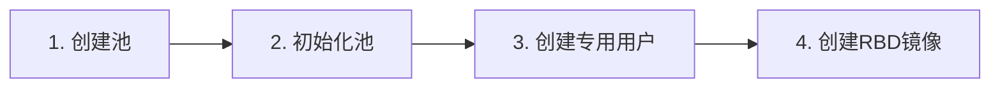

## 存储背景与阅读说明

本文整理 CEPH125 的 Ceph 分布式存储学习笔记，按架构、部署、存储接口、集群维护和 OpenStack 集成展开，保留课程实验命令、观察结果与自测内容。

> **版本范围**：主要基于 RHCS 3.0 课程环境，使用 ceph-ansible，包含 FileStore 相关操作；OpenStack 集成章节涉及 RHOSP 10。本文是该版本的学习记录，不是面向所有版本的安装手册。主机名、内网地址、账户及目录均沿用实验环境；课程脚本、镜像和课件需自行准备，本文未附带这些文件。

- **本地文件系统**：如 NTFS、ext4，通常使用本机块设备，容量和性能受设备及主机资源约束。
- **分布式文件系统**：在多个节点上组织数据，提供文件和目录访问；不同系统的元数据架构、语义和扩展限制并不相同。
- **对象存储**：按对象键访问数据，S3 等接口使用 Bucket 组织对象。Bucket 与 Ceph 底层的 Pool 不是同一概念。
- **Ceph**：以 RADOS 为基础，提供 RBD 块存储、RGW 对象接口和 CephFS 文件系统。对象经 PG 和 CRUSH 映射到 OSD，扩容效果仍受硬件、网络、数据分布及工作负载影响。

原理参考：[Ceph 架构文档](https://docs.ceph.com/en/latest/architecture/)。该链接用于理解总体架构，具体命令仍以本文课程版本为准。

阅读时可先看架构总览，再按需求进入 RBD、RGW 或 CephFS；维护部分集中讨论 CRUSH、集群映射、故障处理与性能观测，最后介绍 OpenStack 集成。

## Ceph 架构与部署

### 总览

> 这一节存放每一章新学到的关于 Ceph 的概念，建立总体框架。

#### 整体结构

Ceph 是以 **RADOS**[^rados] 为底层的分布式统一存储，同一集群可以提供块、对象和文件存储。

```text
客户端
├─ RBD：块存储
├─ S3 / Swift → RGW：对象存储
└─ POSIX → CephFS：文件存储，MDS 处理元数据
                     ↓
RADOS：Pool → Object → PG → CRUSH → OSD
```

#### 核心组件

- **MON**[^mon]：维护 Cluster Map[^cluster-map]、Cephx 认证和 Quorum[^quorum]，不保存业务数据。
- **MGR**[^mgr]：收集集群指标，提供管理、监控和 Dashboard[^dashboard] 接口。
- **OSD**[^osd]：保存对象，并负责副本、恢复、回填和数据校验。
- **MDS**[^mds]：管理 CephFS 的目录和文件元数据，文件内容仍存入 OSD。
- **RGW**[^rgw]：把 S3/Swift 请求转换为对 RADOS 对象的访问。

#### 数据定位与保护

对象存入指定 **Pool**[^pool]，经哈希进入 **PG**[^pg]，再由 **CRUSH Rule**[^crush] 按主机、机架等故障域映射到一组 OSD。客户端从 MON 获取最新地图后计算位置并直接访问 OSD，不需要中央查询服务器。

- **多副本或纠删码**：在多个故障域保存冗余数据。
- **Recovery / Backfill**[^recovery]：OSD 故障或布局变化时恢复、迁移数据。
- **Scrub / Deep-scrub**[^scrub]：检查对象及其副本的一致性。
- **Cephx**[^cephx]：通过用户、Keyring 和 Capabilities 限制 Pool、Namespace、对象或目录访问。

#### 三种存储方式

- **RBD 块存储**[^rbd]
  - Image 被切分为对象存入 RADOS，可通过 krbd、librbd 或 iSCSI[^rbd-clients] 使用。
  - 支持条带、缓存、快照、克隆、Flatten 和增量导入导出[^rbd-features]。
  - RBD Mirror 使用 Journal 在集群间复制镜像，用于灾难恢复[^rbd-mirror]。

- **RGW 对象存储**
  - 提供 S3 和 Swift API[^object-apis]，管理用户、密钥、Bucket、配额、策略、版本和生命周期。
  - 多站点由 Realm、Zonegroup、Zone、Period 和 Epoch 组成，负责元数据与对象同步[^rgw-multisite]。

- **CephFS 文件存储**[^cephfs]
  - 使用 Metadata Pool 和 Data Pool，客户端可通过 Kernel Client 或 FUSE 挂载[^cephfs-client]。
  - Layout 控制文件对象使用的 Pool、条带和对象大小[^layout]。

#### 集群映射与一致性

Cluster Map 记录 MON、OSD、PG 和 CRUSH 等集群状态，每次变化都会产生新的 **Epoch**。MON 通过 Paxos、Leader Election、Quorum 和 Lease[^mon-consensus] 保证地图一致，再把最新地图传播给客户端和 OSD。

#### 部署与运维

- 使用 `ceph-ansible` 按角色部署守护进程；配置可来自配置文件或运行时设置。
- 通过 Health、容量、PG 状态以及 OSD 的 `up/down`、`in/out`[^osd-state] 判断集群状态。
- Nearfull、Backfillfull 和 Full 阈值用于防止 OSD 空间耗尽；Cluster Flags 用于维护保护[^capacity-protection]。
- 故障 OSD 需要从 CRUSH、Cephx 和 OSD Map 中安全移除或替换。
- 日常运维还包括 MON Quorum 恢复、Primary Affinity[^primary-affinity]、滚动升级以及恢复速度控制。

#### 调优与排错

调优遵循“先观测、找瓶颈、再修改、最后验证”，重点关注延迟、吞吐量和 IOPS。排错按照客户端、网络、OSD、磁盘逐层进行，并使用 Health、Performance Counter、`osd perf`、Admin Socket 和压测工具收集证据[^performance-tools]。

Recovery、Backfill、Scrub 与业务 I/O 会争抢资源，需要在集群恢复速度和客户端性能之间权衡。

#### OpenStack 集成

- **Glance** 镜像、**Cinder** 卷和 **Nova** 临时磁盘可使用不同的 RBD Pool 与 Cephx 用户[^openstack-services]。
- Glance 与 Cinder 同用 Ceph 时可利用 RBD Clone，减少复制并加快资源创建。
- RGW 可接入 Keystone，作为兼容 Swift API 的 OpenStack 对象存储服务。

[^rados]: **RADOS**（Reliable Autonomic Distributed Object Store，可靠的自主分布式对象存储）：Ceph 的底层对象存储系统。

[^rbd]: **RBD**（RADOS Block Device，RADOS 块设备）：Ceph 提供的块存储接口。

[^rgw]: **RGW**（RADOS Gateway，RADOS 网关）：把 S3/Swift 请求转换为 RADOS 对象操作。

[^cephfs]: **CephFS**（Ceph File System，Ceph 文件系统）：Ceph 提供的 POSIX（Portable Operating System Interface，可移植操作系统接口）文件系统。

[^mon]: **MON**（Monitor，监视器）：维护集群映射、认证和仲裁状态。

[^mgr]: **MGR**（Manager，管理器）：提供集群指标、管理模块和监控接口。

[^osd]: **OSD**（Object Storage Daemon，对象存储守护进程）：保存对象并执行复制、恢复和校验。

[^mds]: **MDS**（Metadata Server，元数据服务器）：管理 CephFS 的文件和目录元数据。

[^cluster-map]: **Cluster Map**（集群映射）：描述 MON、OSD、PG、CRUSH 等集群状态。

[^quorum]: **Quorum**（仲裁）：能够形成多数派并对外提供 MON 服务的集合。

[^dashboard]: **Dashboard**（管理仪表盘）：用于观察和管理 Ceph 集群的 Web 界面。

[^pool]: **Pool**（存储池）：在 RADOS 中组织 Object（对象）的逻辑容器。

[^pg]: **PG**（Placement Group，放置组）：连接对象与 OSD 的数据分布、恢复基本单位。

[^crush]: **CRUSH**（Controlled Replication Under Scalable Hashing，可扩展散列下的受控复制）：按照 Rule（规则）和故障域计算 PG 应映射到哪些 OSD。

[^recovery]: **Recovery**（恢复）/ **Backfill**（回填）：修复缺失副本或因布局变化而迁移数据。

[^scrub]: **Scrub**（校验）/ **Deep-scrub**（深度校验）：检查对象元数据或对象内容及副本的一致性。

[^cephx]: **Cephx**（Ceph 身份认证机制）：使用 Keyring（密钥环文件）和 Capabilities（能力权限）限制 Pool、Namespace（命名空间）、对象或目录访问。

[^rbd-clients]: **krbd**（Kernel RBD，内核 RBD 客户端）/ **librbd**（RBD Client Library，RBD 客户端库）/ **iSCSI**（Internet Small Computer Systems Interface，互联网小型计算机系统接口）：RBD 的客户端接入方式。

[^rbd-features]: **Image**（镜像）/ **Snapshot**（快照）/ **Clone**（克隆）/ **Flatten**（扁平化）：RBD 的数据组织和派生能力。

[^rbd-mirror]: **RBD Mirror**（RBD 镜像复制）使用 Journal（日志）在集群间复制镜像。

[^object-apis]: **S3**（Simple Storage Service，简单存储服务）/ **Swift**（OpenStack 对象存储接口）/ **API**（Application Programming Interface，应用程序编程接口）：RGW 提供的对象存储访问方式；Bucket 表示存储桶。

[^rgw-multisite]: **Realm**（领域）/ **Zonegroup**（区域组）/ **Zone**（区域）/ **Period**（配置周期）/ **Epoch**（版本号）：RGW 多站点配置和版本层次。

[^cephfs-client]: **Metadata Pool**（元数据池）/ **Data Pool**（数据池）/ **Kernel Client**（内核客户端）/ **FUSE**（Filesystem in Userspace，用户空间文件系统）：CephFS 的存储池和客户端接入方式。

[^layout]: **Layout**（布局）：控制 CephFS 文件对象使用的 Pool、条带和对象大小。

[^mon-consensus]: **Epoch**（版本号）/ **Paxos**（一致性算法）/ **Leader Election**（领导者选举）/ **Quorum**（仲裁）/ **Lease**（租约）：MON 维护并传播一致集群映射的机制。

[^osd-state]: **up/down**（进程运行/停止）与 **in/out**（参与/退出数据分布）：OSD 的两组独立状态。

[^capacity-protection]: **Nearfull**（接近满）/ **Backfillfull**（禁止回填）/ **Full**（已满）/ **Cluster Flags**（集群标志）：容量和维护保护机制。

[^primary-affinity]: **Primary Affinity**（主 OSD 倾向权重）：控制某个 OSD 被选为 PG Primary 的倾向程度。

[^performance-tools]: **Health**（健康状态）/ **Performance Counter**（性能计数器）/ **Admin Socket**（管理套接字）/ **IOPS**（Input/Output Operations Per Second，每秒输入/输出操作数）：集群监控、调优和排错术语。

[^openstack-services]: **Glance**（镜像服务）/ **Cinder**（块存储服务）/ **Nova**（计算服务）/ **Keystone**（身份认证服务）：与 Ceph 集成的 OpenStack 服务。

### Ceph存储功能

优势：

- 多站点和灾难恢复选项

- 去中心化

- 自我修复

RADOS（可靠自治分布式对象存储）系统将数据作为对象存储在逻辑存储池中，并使用“可扩展散列的受控制复制” (CRUSH)算法自动计算该对象应存储的位置。任何客户端都可以使用此算法来确定对象的位置，因此它不需要与中央查找服务器通信来查找它。客户端可以通过直接与存储该对象的客户端服务器进行通信来获取该对象。同样，CRUSH算法允许集群软件自动缩放、重新平衡对象、保护数据并从故障中恢复。


### Ceph 架构


Ceph 是基于包含以下要素的模块化和分布式架构：

- 对象存储后端（RADOS, 可靠自治分布式对象存储）
- 多种方法与 RADOS 交互
- 一个基于自我修复和自我管理的软件对象存储

Ceph存储后端：

- 监视器（MONs）：集群的指挥中心，其他组件都要先找它才能互相找到对方
- 对象存储设备（OSDs）：仓库管理员，真正存放数据的地方，同时负责把数据多复制几份，也可以进行修复、再平衡

图示：每个方块表示一个向集群提供OSD的服务器，每个圆圈表示集群中的一个ceph监视器。仔细查看一台服务器后就会发现，它提供了四个OSD，由四个磁盘支持，每个磁盘都用一个格式化的文件系统。


- 管理器（MGRs）：仪表盘，收集各种运行指标，通过 Web 浏览器面板和 REST API 公开集群信息
- 元数据服务器（MDSs）：存储 CephFS 文件系统用的元数据（目录索引，记录文件名、目录结构的等信息），以允许客户端高效的 POSIX 命令执行


### 安装部署

#### ceph125:

```bash
rht-vmctl reset all
ssh root@servera
yum -y install ceph-ansible
cd /usr/share/ceph-ansible
```


> ### 外部内容拷贝：
>
> 添加或修改网卡为 NAT
>
> 
>
> `ip address add dev br0 192.168.194.101/24`
>
> `ip route add 0.0.0.0/0 via 192.168.194.2`
>
> `scp -r kiosk@192.168.1.191:/content/ceph-yml /content`
>
> 


#### root@f0

```bash
[root@foundation0 ~]# cp -r /home/kiosk/Documents/ceph-yml/ /content/
[root@foundation0 ~]# ll /content/ceph-yml/
total 84
-rwxr--r--. 1 root root 19112 May 30 13:12 all.yml
-rwxr--r--. 1 root root   889 May 30 13:12 ansible.cfg
-rwxr--r--. 1 root root  1119 May 30 13:12 clients.yml
-rwxr--r--. 1 root root  1125 May 30 13:12 hosts
-rwxr--r--. 1 root root  1040 May 30 13:12 install.bak
-rwxr--r--. 1 root root   776 May 30 13:12 install.sh
-rwxr--r--. 1 root root  1592 May 30 13:12 mdss.yml
-rwxr--r--. 1 root root  9455 May 30 13:12 osds.yml
-rwxr--r--. 1 root root   431 May 30 13:12 reinst.sh
-rwxr--r--. 1 root root  2346 May 30 13:12 rgws.yml
-rwxr--r--. 1 root root  3354 May 30 13:12 site.yml
-rwxr--r--. 1 root root   259 May 30 13:12 ssh-expec2
-rwxr--r--. 1 root root   214 May 30 13:12 ssh-expect
-rwxr--r--. 1 root root   449 May 30 13:12 ssh-expect1
-rwxr--r--. 1 root root   175 May 30 13:12 ssh-expect2
[root@foundation0 ~]# 

```


#### servera

```bash

[student@servera]# scp -r kiosk@172.25.254.250:/content/ceph-yml .
 cd ceph-yml
 chmod +x reinst.sh 
./reinst.sh 

# 生成 SSH 密钥对
ssh-keygen #-t rsa -b 4096 -N "" -f ~/.ssh/id_rsa 

./install.sh
# 若脚本报目录权限错误，先检查报错路径、属主和权限；不要直接删除 /tmp 等系统目录。


## 这里有脚本 install.sh ，以下内容就比较繁琐了

## 执行剧本时，会出现 Ansible 无法连接到目标主机，主机密钥验证失败、SSH 公钥验证失败
## 解决：
# 1. 分发 SSH 公钥到所有主机
# 已存在密钥对，跳过生成；直接复制公钥
for host in servera serverc serverd servere; do
    ssh-copy-id $host
done
# 2. 手动接收主机密钥
ssh servera exit
ssh serverc exit
ssh serverd exit
ssh servere exit

# 3. 验证连通性 
ansible all -i /etc/ansible/hosts -m ping

[root@servera ceph-ansible]# ansible all -i /etc/ansible/hosts -m ping
serverc | SUCCESS => {
    "changed": false, 
    "failed": false, 
    "ping": "pong"
}
serverd | SUCCESS => {
    "changed": false, 
    "failed": false, 
    "ping": "pong"
}
servere | SUCCESS => {
    "changed": false, 
    "failed": false, 
    "ping": "pong"
}
servera | SUCCESS => {
    "changed": false, 
    "failed": false, 
    "ping": "pong"
}


# 之后重新执行剧本：
ansible-playbook site.yml


# 确认 unreachable=0、failed=0 后，继续用 ceph -s 验证集群状态。
PLAY RECAP ********************************************************************************************
servera                    : ok=130  changed=27   unreachable=0    failed=0   
serverc                    : ok=189  changed=31   unreachable=0    failed=0   
serverd                    : ok=176  changed=27   unreachable=0    failed=0   
servere                    : ok=181  changed=29   unreachable=0    failed=0   


```


#### 安装好之后，切换到 ceph 用户：

```bash
[ceph@servera ~]$ ceph -s
  cluster:
    id:     5254aa72-22aa-4f6f-bc2f-114099f210d1
    health: HEALTH_OK
 
  services:
    mon: 3 daemons, quorum serverc,serverd,servere
    mgr: serverd(active), standbys: servere, serverc
    mds: cephfs-1/1/1 up  {0=servera=up:active}
    osd: 9 osds: 9 up, 9 in
    rgw: 1 daemon active
 
  data:
    pools:   6 pools, 48 pgs
    objects: 208 objects, 3359 bytes
    usage:   972 MB used, 169 GB / 170 GB avail
    pgs:     48 active+clean
 
[ceph@servera ~]$ 

```


### Ceph CLI 命令

属于**集群管理、监控、配置**范畴，主要与 Monitor 服务交互，用于查看集群状态、管理存储池、管理用户认证、调整配置等。


```bash
ceph -s
ceph -w
ceph df
ceph osd df
ceph auth get-or-create
ceph auth list
ceph auth caps
ceph auth del
```

```bash
[ceph@serverc ~]$ ceph -s
  cluster:
    id:     5254aa72-22aa-4f6f-bc2f-114099f210d1
    health: HEALTH_OK
 
  services:
    mon: 3 daemons, quorum serverc,serverd,servere
    mgr: serverd(active), standbys: servere, serverc
    mds: cephfs-1/1/1 up  {0=servera=up:active}
    osd: 9 osds: 9 up, 9 in
    rgw: 1 daemon active
 
  data:
    pools:   7 pools, 80 pgs
    objects: 209 objects, 3672 bytes
    usage:   972 MB used, 169 GB / 170 GB avail
    pgs:     80 active+clean
 
[ceph@serverc ~]$ ceph -w
  cluster:
    id:     5254aa72-22aa-4f6f-bc2f-114099f210d1
    health: HEALTH_OK
 
  services:
    mon: 3 daemons, quorum serverc,serverd,servere
    mgr: serverd(active), standbys: servere, serverc
    mds: cephfs-1/1/1 up  {0=servera=up:active}
    osd: 9 osds: 9 up, 9 in
    rgw: 1 daemon active
 
  data:
    pools:   7 pools, 80 pgs
    objects: 209 objects, 3672 bytes
    usage:   972 MB used, 169 GB / 170 GB avail
    pgs:     80 active+clean
 

2026-05-30 17:13:16.384103 mon.serverc [INF] mon.1 172.25.250.13:6789/0 
^C[ceph@serverc ~]$ ceph df
GLOBAL:
    SIZE     AVAIL     RAW USED     %RAW USED 
    170G      169G         972M          0.56 
POOLS:
    NAME                    ID     USED     %USED     MAX AVAIL     OBJECTS 
    cephfs_data             1         0         0        82640M           0 
    cephfs_metadata         2      2246         0        82640M          21 
    .rgw.root               3      1113         0        82640M           4 
    default.rgw.control     4         0         0        82640M           8 
    default.rgw.meta        5         0         0        82640M           0 
    default.rgw.log         6         0         0        82640M         175 
    mypool1                 7       313         0        82640M           1 
[ceph@serverc ~]$ ceph osd df
ID CLASS WEIGHT  REWEIGHT SIZE   USE  AVAIL  %USE VAR  PGS 
 0   hdd 0.01849  1.00000 19444M 108M 19336M 0.56 1.00  24 
 1   hdd 0.01849  1.00000 19444M 108M 19336M 0.56 1.00  20 
 2   hdd 0.01849  1.00000 19444M 108M 19336M 0.56 1.00  14 
 3   hdd 0.01849  1.00000 19444M 108M 19336M 0.56 1.00  19 
 4   hdd 0.01849  1.00000 19444M 108M 19336M 0.56 1.00  14 
 5   hdd 0.01849  1.00000 19444M 108M 19336M 0.56 1.00  21 
 6   hdd 0.01849  1.00000 19444M 108M 19336M 0.56 1.00  20 
 7   hdd 0.01849  1.00000 19444M 108M 19336M 0.56 1.00  14 
 8   hdd 0.01849  1.00000 19444M 108M 19336M 0.56 1.00  14 
                    TOTAL   170G 972M   169G 0.56          
MIN/MAX VAR: 1.00/1.00  STDDEV: 0
[ceph@serverc ~]$ 
[ceph@serverc ~]$ ceph auth list
installed auth entries:

mds.servera
	key: AQCieBpqWR6YNBAAGDN16u64hgRWsdiLx77L4g==
	caps: [mds] allow
	caps: [mon] allow profile mds
	caps: [osd] allow rwx
osd.0
	key: AQAIeBpqa1MQFxAAHamziSzGTgncmjQVTGPQSA==
	caps: [mgr] allow profile osd
	caps: [mon] allow profile osd
	caps: [osd] allow *
osd.1
	key: AQAReBpqFHsACRAAQ6jzzUe0NboRR+uyDW/GQA==
	caps: [mgr] allow profile osd
	caps: [mon] allow profile osd
	caps: [osd] allow *
osd.2
	key: AQAXeBpq/aLNLxAAVQXin0E2nUsLZtXQFukkCA==
	caps: [mgr] allow profile osd
	caps: [mon] allow profile osd
	caps: [osd] allow *
osd.3
	key: AQA4eBpqKy70BBAAflVNoSy/R1o6YOu6hQQAXA==
	caps: [mgr] allow profile osd
	caps: [mon] allow profile osd
	caps: [osd] allow *
osd.4
	key: AQBAeBpqb9K1MxAAbSmMBSYoA2XgJyl7Vk81nA==
	caps: [mgr] allow profile osd
	caps: [mon] allow profile osd
	caps: [osd] allow *
osd.5
	key: AQBMeBpq7Wt3BxAABM+nlXgy6ozBP3uSexvugg==
	caps: [mgr] allow profile osd
	caps: [mon] allow profile osd
	caps: [osd] allow *
osd.6
	key: AQBreBpq6yMhEBAAsRP/errmTzZdzIr8VbvWrw==
	caps: [mgr] allow profile osd
	caps: [mon] allow profile osd
	caps: [osd] allow *
osd.7
	key: AQB2eBpqUW/CFRAA85WQxs5JUNSshmy7Ui1fAA==
	caps: [mgr] allow profile osd
	caps: [mon] allow profile osd
	caps: [osd] allow *
osd.8
	key: AQB8eBpqWBEFOBAArEwGnYZOCO7jMlEpGFC/iw==
	caps: [mgr] allow profile osd
	caps: [mon] allow profile osd
	caps: [osd] allow *
client.admin
	key: AQDJdxpqDeG9IxAAqENMj0AQqmjgv5/k9qfjDQ==
	caps: [mds] allow *
	caps: [mgr] allow *
	caps: [mon] allow *
	caps: [osd] allow *
client.bootstrap-mds
	key: AQDKdxpqocIEAxAA0wworlZiKPXA9/OX3Wao3Q==
	caps: [mon] allow profile bootstrap-mds
client.bootstrap-osd
	key: AQDJdxpq/sFyLBAAzf6xRlFlYQVSC1+ASaTEuw==
	caps: [mon] allow profile bootstrap-osd
client.bootstrap-rbd
	key: AQDKdxpqQ6HPDRAAJyQ1nD6oY4R93DAgfPxzHA==
	caps: [mon] allow profile bootstrap-rbd
client.bootstrap-rgw
	key: AQDJdxpqYXErNhAAqrNRTtl6pJ0Q5aqvDGtfUA==
	caps: [mon] allow profile bootstrap-rgw
client.rgw.servera
	key: AQCveBpqkvs1JBAA/LBJKdQpx6qBgTvHeXcnWw==
	caps: [mon] allow rw
	caps: [osd] allow rwx
mgr.serverc
	key: AQDLdxpqIq7wMRAAyhUT1OwYKthWXvR8GE0/Rw==
	caps: [mds] allow *
	caps: [mon] allow profile mgr
	caps: [osd] allow *
mgr.serverd
	key: AQDMdxpqu+HZCRAAaWjJY2LrkffSwDAgdOuX6A==
	caps: [mds] allow *
	caps: [mon] allow profile mgr
	caps: [osd] allow *
mgr.servere
	key: AQDMdxpqpSNwHBAAuaVVlUe6mUmZhQ7yK35ZuQ==
	caps: [mds] allow *
	caps: [mon] allow profile mgr
	caps: [osd] allow *
[ceph@serverc ~]$ 
```


### rados 命令

rados 程序支持对 RADOS 对象存储的管理，

属于**数据对象操作**范畴，直接与 OSD 服务交互，用来对指定存储池（pool）中的对象（object）进行增删改查，不涉及集群配置。


```
rados -p pool_name ls

rados -p pool_name put object_name file_path

rados -p pool_name get object_name file_path

rados -p pool_name stat object_name

rados -p pool_name rm object_name
```


```bash
[ceph@serverc ~]$ rados lspools
[ceph@serverc ~]$ ceph osd pool create mypool1 32
[ceph@serverc ~]$ rados list
[ceph@serverc ~]$ rados -p mypool1 put ofstab /etc/fstab
[ceph@serverc ~]$ rados -p mypool1 ls
ofstab
[ceph@serverc ~]$ 

```


## 配置 ceph

### 红帽ceph存储池


### PG 数量

存储管理员可以配置CRUSH规则集，以便Ceph使用包含特定类型存储设备(如SSD)的OSD或位于不同物理位置的设备存储对象。

池中放置组的数量对性能有重大影响。 如果在池中配置太少的放置组，则需要在每个 PG 中存储太多的数据，Ceph 将无法很好地执行。 如果在池中配置太多的放置组，OSD 将需要大量的 RAM 和 CPU 时间，Ceph 也无法很好地执行。 通常，池应配置为每个 OSD 包含 100-200 个放置组。

默认情况下，创建池时，Ceph 检查每个 OSD 的 PGS 数量不超过200个。 如果违反，则不会创建池。如果一个池已经达到这个限制， `ceph health` 命令会显示一个警告， 此限制由`/etc/ceph/ceph.conf`配置文件中的`mon_max_pg_per_osd`参数控制。


### 配置一个复制池

ceph复制池通过创建对象的多个副本来保护数据。然后将这些副本存储在池中的不同OSD中，万一一个或多个OSD失败，这样可以保护对象中的数据。

```bash 
ceph osd pool create pool-name pg-num [pgp-num] [replicated] [crush-ruleset-name] [expected-num-objects]

ceph osd pool create myfirstpool 50 50 
```

- **pool-name** 要创建的新池名
- **pg-num** 池中的pg数量 
- **pgp-num**  池的有效放置组的数量。通常，这应等于放置组的总数
- **replicated** 指定这是一个复制池，如果不包含在命令中，则通常是默认值。
- **crush-ruleset-name**   要用于此池的CRUSH规则集的名称`osd_pool_default_crush_replicated_ruleset` 配置参数将设置默认值。
- **expected-num-objects** 池中预期的对象数。如果您事先知道这个数字，ceph 可以在池创建时在 OSD 的 XFS 文件系统上准备一个文件夹结构。否则，随着对象数的增加，ceph 会在运行时重新组织此目录结构。这会带来时间延迟。

### 管理池

在创建池之后，管理员必须显式地指示能够使用它的Ceph应用程序的类型：

- Ceph块设备(也称为RADOS块设备或RBD)
- Ceph对象网关(也称为RADOS网关或RGW)
- Ceph文件系统(CephFS)


```bash
# 将应用类型与新池关联
ceph osd pool application enable pool-name app

app 可以是 rbd,rgw,cephfs
```


#### 列出集群中的存储池

```bash
ceph osd lspools
ceph osd pool ls detail
ceph df
ceph osd pool stats
```


#### 设置池配额

```bash
ceph osd pool set-quota pool-name max_objects obj-count max_bytes bytes
```


#### 重命名一个池

```bash
ceph osd pool rename current-name new-name
```

#### 为pool创建快照

```bash
# 创建快照
ceph osd pool mksnap pool-name snap-name
# 删除复制池
ceph osd pool rmsnap pool-name snap-name

# 使用池快照，检索并回滚到特定快照
# 从快照中下载文件
rados -p pool-name -s snap-name get object-name file
# 使用快照进行回滚
rados -p pool-name rollback object-name snap-name 
```


#### 修改pool

```bash
# 设置池参数
ceph osd pool set pool-name parameter value

# 获取池参数
ceph osd pool get pool-name parameter

# 列出所有的参数及其值
ceph osd pool get pool-name all

# 删除一个池
ceph osd pool delete pool-name pool-name --yes-i-really-really-mean-it
```


#### 在池中配置 Namespaces

Ceph 中的**命名空间**是存储池内的**逻辑分组**，主要优势在于：

- **精细访问控制**：可将用户或应用程序限制在池的特定命名空间中，避免暴露整个池。
- **降低资源消耗**：多个应用共享一个池（通过不同命名空间），减少所需的池数量，从而降低 OSD 上 PG 的数量（PG 计算成本较高）。
- **使用方式**：客户端存储/检索对象时必须同时指定池和命名空间名称。
- **默认行为**：每个池自带一个空名称的默认命名空间。

```bash
# 将本机上的 /etc/services 文件内容，以对象名 srv 存储到 mytestpool 存储池的 system 命名空间下。如果该对象已存在，则会覆盖。
rados -p mytestpool -N system put srv /etc/services

rados -p mytestpool -N system ls

rados -p mytestpool --all ls 

rados -p mytestpool --all ls --format=json | python -m json.tool
```

```bash
[ceph@serverc ~]$ rados -p mypool -N system put testconf /etc/ceph/ceph.conf
[ceph@serverc ~]$ rados -p mypool put testkey /etc/ceph/ceph.client.admin.keyring
[ceph@serverc ~]$ rados -p mypool -N system ls
testconf
[ceph@serverc ~]$ rados -p mypool ls
testkey
[ceph@serverc ~]$ rados -p mypool --all ls
system	testconf
	    testkey
[ceph@serverc ~]$
```


### 创建纠删码池（不常用）


纠删码池中存储对象时，对象被分割为多个数据块，数据块存储再单独的OSD 中，并且根据数据块计算了一些编码块，也将其存储在不同的 OSD 中，如果包含块的 OSD 失败，则可以使用编码块来重建对象的数据。

工作原理：

- 每个对象的数据被划分为k个数据块chunks
- 计算M个编码块
- 编码块大小与数据块大小相同
- 对象存储在总共(k+m)个OSD上。


- 纠删码池需要比复制池更少的存储，以获得类似级别的数据保护。 这可以降低存储集群的成本和规模。
- **编码块的计算增加了纠删码池的CPU和内存开销，降低了性能。** 
- 在 Red Hat CephStorage3 中，对于纠删码池，不支持需要部分对象写入的操作。 这限制了纠删码池的应用范围，比如需要执行对象写入和追加操作的Ceph 对象网关等应用。

```bash
ceph osd pool create pool-name pg-num [pgp-num] erasure [erasure-code-profile] [crush-ruleset-name] [expected_num_objects]
```

- pool-name是新池的名称
- pg-num 是这个池的安置组(PGs）总数量
- pgp-num 是这个池的有效安置组数量。 通常，这应该等于安置组的总数。  
- erasure指定这是一个纠删码池。  
- erasure-code-profile 纠删码配置文件是要使用的配置文件的名称。 您可以使用`ceph osd erasure-code-profile set`命令创建新的配置文件， 配置文件定义了要使用的k值和m值以及纠删码插件。 默认情况下，Ceph使用default配置文件。 
- crush-ruleset-name 是要用于此池的CRUSH规则集的名称。 如果没有设置，Ceph将使用纠删码配置文件中定义的配置文件。  
- expected-num-objects  预期对象数。 如果您事先知道这个数字，Ceph可以在OSD的XFS文件系统中预备一个适合的文件夹结构。否则，随着对象数的增加，客户端会在运行时重新组织此目录结构。这次重组影响延迟时间。

> 请记住，不能减少创建池中放置组的数量，但可以增加放置组的数量。红帽提供了一个在线工具来帮助您估计每个池计算器的池的放置组数量[http://access.redhat.com/labs/cephpgc/]。


### 修改 ceph 配置文件

红帽ceph服务进程及客户端，默认配置文件均为`/etc/ceph/ceph.conf`

如果您使用Ansible管理Red Hat Ceph Storage集群配置，它将在其所有节点和客户端保持Ceph配置文件同步。 

配置文件格式为ini格式，每个分段都有一个使用[name]头定义的名称，以及若干定义为键值对的参数。 

为指定的守护进程的指定段名：

- [global] 段存储所有守护进程通用的一般配置和设置。 它适用于读取配置文件的任何进程，包括客户端。 您还可以在其他具体分段中重写这里的参数。 

- [mon] 段存储与监视器(MON)有关的配置。 

- [osd] 段存储与OSD守护进程相关的配置。 

- [mgr] 段存储与管理人员(MGR)有关的配置。 

- [mds] 段存储与元数据服务器(MDS)相关的配置。

- [client] 段存储适用于所有Ceph客户机的配置。
  

可以使用数字号（#）或分号(；）注释配置文件中的行，或添加注释。 

红帽Ceph存储集群节点上的/usr/share/doc/ceph/sample.ceph.conf文件提供了示例配置。


#### 实例的设置

管理员可以为服务分段中的实例再设置分组。新的分段名称采用[daemon-type.instance-ID]的格式。例如，对于serverc上的mon，分段名称为[mon.serverc] 

相同应用也可以用于[osd], [mgr], [mds], 和 [client] 分段.  

然而OSD daemons 实例ID总是是数字，例如 [osd.0].  对于客户端，实例 ID 是用户名，比如 [client.operator3].

元变量：是由ceph定义的变量。可以使用它简化文件的配置：

- \$cluster    Red HatCeph存储集群的名称。 默认情况下将其设置为ceph，并在/etc/sysconfig/ceph文件中定义。
- \$type  服务进程的类型。对于监视器，这被设置为mon，OSD使用osd，元数据服务器使用mds，管理器使用mgr，客户端应用程序使用client。
- \$id   服务进程实例ID。 对于serverc上的Monitor，这将设置为serverc。 为osd.1它是1。 对于客户端应用程序，它是用户名
- \$name  服务进程名称和实例ID。 等同于\$type.\$id。
- \$host  正在运行服务进程的主机名。

[global] 部分定义了集群范围的参数。通常包括以下配置设置： 

- mon hosts   所有监视器列表。 
- mon initial members 在集群启动时必须启动以建立仲裁的监视器列表。  
- 设置启用或禁用组件之间使用cephx身份验证（默认启用）。  
- 在Ceph环境中使用的网络，通常，一个用于OSDs（集群网络)，一个用于客户端(公共网络）。

#### 查看运行时配置

```bash
# 列出所有参数及其当前值
ceph daemon type.id config show

# 获取特定参数的值
ceph daemon type.id config get parameter

```


#### 使用Ansible管理Ceph配置

每次在部署或更新红帽存储集群时，ansible 都会在每个节点上重新创建`/etc/ceph/ceph.conf`文件。

运行`site.yml`剧本，它会在每个节点的`/etc/ceph/ceph.d/`工作目录下构建配置文件，然后把这些结果文件安装到`/etc/ceph/ceph.conf`

在`/usr/share/ceph-ansible/group_vars/all.yml`变量文件中，编辑`ceph_conf_overrides`变量以添加新的分段或配置参数。Ansible 将变量转换为INI格式并将其添加`eph.conf`文件中。


#### 启动和停止服务

使用systemctl命令管理Ceph服务。

- ceph.target  对当前节点上的所有ceph守护进程启动或停止，查看状态
- ceph-type.target  对当前节点的指定类型的所有守护进程启动或停止，查看状态


### 管理ceph身份验证

用户管理授权集群中客户端、应用程序和守护进程之间的通信。 为了安全地认证用户，Ceph使用了基于共享密钥的cephx认证协议。

Ceph使用用户帐户有几个目的：

- 用于Ceph守护进程之间的内部通信。
- 用于通过librados库访问集群的客户端应用程序
- 用于ceph管理


#### Key-ring 文件

对于身份验证，客户端必须配置一个Ceph用户名和一个包含用户密钥的key-ring文件。 Ceph用户需要这个key-ring文件来访问Red Hat Ceph Storage集群。

Ceph自动为您创建的每个用户帐户生成key-ring文件。 但是，您仍然需要将该文件复制到需要的客户机系统或应用程序服务器。

在客户系统上，librados使用`/etc/ceph/ceph.conf`配置文件里的keyring参数定位key-ring文件的位置，默认的位置在 `/etc/ceph/$cluster.$name.keyring.` 例如：`client.openstack`账户的`key-ring`文件是`/etc/ceph/ceph.client.openstack.keyring.`

密钥环文件将密钥存储为纯文本。 必须使用适当的Linux文件权限来保护它，以便它只能由需要访问的Linux用户读取。 只在需要验证的系统上为 Ceph 用户部署 keyring 文件。

cephx协议不作为纯文本传输共享的密钥。相反，客户端需要从监视器为用户请求一个会话密钥，该监视器使用与客户端的共享密钥，加密会话秘钥给客户端。如果客户端知道其密钥，则它可以解密会话密钥，并使用会话密钥从监视器请求凭据，以完成到集群后台的身份验证。这类似于kerberos协议的工作方式，这个`cephx key-ring`文件可与 kerberos 的 keytab 文件相媲美。


#### 命令行工具

使用命令行工具，如 ceph、rados 和 rbd，管理员可以使用 `--id` 和 `--keyring` 选项指定用户帐户和密钥环文件。如果没有它们，则默认是 `client.admin` 用户。

```bash
ceph --id operator3 osd lspools
```

使用`-id`选项时不要带`client.`前缀。id选项自动加这个前缀。 作为替代，您可以使用`-name`选项，这需要你加`client.`前缀。如果将`key-ring`文件存储在其默认位置，则不需要`--keyring`选项。


#### cephx 的能力

- `r`  读取权限。 每个用户帐户应该至少在监视器上有读取访问权限，以便能够检索CRUSH映射。
- `w` 写入权限。客户端需要写入权限来存储和修改OSD上的对象。对于管理器，w授予启用或禁用模块的权利。
- `x`  执行扩展对象类的授权。这允许客户端对对象执行额外的操作，例如设置锁`rados lock get`或使用`rbd list`列出RBD映像。
- `*`  所有访问权 `class-read`和`class-write`是x的子集。 您主要在使用RBD的池上使用它们。

```bash
ceph auth get-or-create client.formyapp1 mon 'allow r' osd 'allow rw'
```


#### 使用 Profiles 设置能力

cephx提供预定义能力的配置文件。 管理员在创建用户帐户时可以使用它们来简化用户访问权限的配置。

例如，以下命令使用rbd配置文件来定义新的用户帐户forrbd的访问权限。然后，客户端应用程序可以用此帐户对RADOS设备进行基于块的访问。

```bash
ceph auth get-or-create client.forrbd mon 'profile rbd' osd 'profile rbd'
```


同样，如果是rbd-read-only配置文件，授予的是只读访问权限。ceph使用其他现有配置文件进行后台进程之间的内部通信。您无法创建您自己的配置文件。由ceph内部定义它们。


#### 限制访问

```bash
# 创建formyapp2用户，并限制他们在myapp池上读写的权限
ceph auth get-or-create client.formyapp2 \
> mon 'allow r' \
> osd 'allow rw pool=myapp'

# 仅限制访问任何池中名称以pref开头的对象
ceph auth get-or-create client.formyapp3 \
> mon 'allow r' \
> osd 'allow rw object_prefix pref'

# 按命名空间限制。应用程序可以使用命名空间对池中的对象进行逻辑分组。管理员可以将用户帐户限制为属于特定命名空间的对象
ceph auth get-or-create client.designer \
> mon 'allow r' \
> osd 'allow rw namespace=photos'

# 限制 path。 Ceph文件系统(Ceph FS)使用此方法限制对特定目录的访问。 下面的示例创建一个新的用户帐户 webDesigner，它只能访问 /webcontent 目录及其内容
ceph fs authorize cephfs client.webdesigner /webcontent rw
ceph auth get client.webdesigner

# 限制 Monitor命令。 此方法限制管理员使用特定的命令列表。 下面的示例创建operator1用户帐户并只允许其对两个命令的访问
ceph auth get-or-create client.operator1 mon 'allow r, allow command "auth get-or-create", allow command "auth list"'


```


#### 用户管理

```bash
# 列出现有用户账户
ceph auth list

# 获取特定账户的详细信息
ceph auth get

# 打印密钥
ceph auth print-key client.admin

# 导出和导入用户账户
ceph auth export
ceph auth import

# ceph auth get-or-create命令将创建一个新的用户帐户并生成其密钥。
# 创建具有对所有池的读和写访问权限的 application1用户帐户，并将 keyring文件存储在 /etc/ceph/ceph.client.application1.keyring 中
ceph auth get-or-create client.application1 \
> mon 'allow r' \
> osd 'allow rw' \
> -o /etc/ceph/ceph.client.application1.keyring

# 您可以使用ceph auth caps命令修改用户帐户的能力。ceph auth caps命令覆盖所有现有能力
# 以下示例修改了OSD上的application1用户帐户能力，以只允许对myapp池的读写访问
ceph auth caps client.application1 \
> mon 'allow r' \
> osd 'allow rw pool=myapp'

# 您可以使用空字符串来删除所有能力
ceph auth caps client.application1 osd ''

# ceph auth del命令删除用户帐户
ceph auth del client.application1
```


### lab

**解决方案**

在本实验中，您将练习创建和管理复制池、纠删码池，在配置文件中调整守护进程的关键设置，以及为 Cephx 用户创建和管理能力（capabilities）。

**预期结果**

您应该能够：

- 创建和管理复制池及纠删码池。
- 更新配置文件。
- 创建和管理用户账户及其能力。

**开始之前**

确保 `serverc`、`serverd` 和 `servere` 上的 Red Hat Ceph Storage 集群仍在正常工作。

以 `student` 用户登录 `workstation`，密码为 `student`。

在 `workstation` 上，运行 `lab ceph-config setup` 来配置实验环境。

```bash
[student@workstation ~]$ lab ceph-config setup
```

此脚本会验证集群状态，如果 `mypool` 池不存在则创建它，并将 `mon_allow_pool_delete` 参数设置为 `true`。

---

**步骤**

1. **删除 mypool 池**  
   1.1. 以 `ceph` 用户登录 `serverc`。

   ```bash
   [student@workstation ~]$ ssh ceph@serverc
   ```

   1.2. 删除 `mypool` 池。

   ```bash
   [ceph@serverc ~]$ ceph osd pool delete mypool mypool \
   > --yes-i-really-really-mean-it
   pool 'mypool' removed
   ```

2. **创建一个名为 `blue` 的新复制池，具有 64 个归置组，副本数设为 3，并将应用类型 `rbd` 关联到该池**  
   2.1. 创建 `blue` 复制池，指定 64 个归置组。

   ```bash
   [ceph@serverc ~]$ ceph osd pool create blue 64
   pool 'blue' created
   ```

   2.2. 将副本数设置为 3。

   ```bash
   [ceph@serverc ~]$ ceph osd pool set blue size 3
   set pool 3 size to 3
   ```

   2.3. 将 `rbd` 设置为该池的应用类型。

   ```bash
   [ceph@serverc ~]$ ceph osd pool application enable blue rbd
   enabled application 'rbd' on pool 'blue'
   ```

   2.4. 列出池的详细信息以验证操作。

   ```bash
   [ceph@serverc ~]$ ceph osd pool ls detail
   pool 3 'blue' replicated size 3 min_size 1 crush_rule 0 object_hash rjenkins pg_num 64 pgp_num 64 last_change 771 flags hashpspool stripe_width 0 application rbd
   ```

   

   ```bash
   [ceph@serverc ~]$ ceph osd pool ls detail
   # 用于 CephFS 文件系统，cephfs_data 存储文件数据，cephfs_metadata 存储元数据; 均为复制池;副本数为2（size 2）,最小写入副本数为1，PG数为8，应用类型为 cephfs
   pool 1 'cephfs_data' replicated size 2 min_size 1 crush_rule 0 object_hash rjenkins pg_num 8 pgp_num 8 last_change 4 flags hashpspool stripe_width 0 application cephfs
   pool 2 'cephfs_metadata' replicated size 2 min_size 1 crush_rule 0 object_hash rjenkins pg_num 8 pgp_num 8 last_change 4 flags hashpspool stripe_width 0 application cephfs
   # RGW 对象网关相关池
   # RadosGW 使用的系统吃，用于存储桶索引、元数据、日志、控制信息
   pool 3 '.rgw.root' replicated size 2 min_size 1 crush_rule 0 object_hash rjenkins pg_num 8 pgp_num 8 last_change 53 owner 18446744073709551615 flags hashpspool stripe_width 0 application rgw
   pool 4 'default.rgw.control' replicated size 2 min_size 1 crush_rule 0 object_hash rjenkins pg_num 8 pgp_num 8 last_change 55 owner 18446744073709551615 flags hashpspool stripe_width 0 application rgw
   pool 5 'default.rgw.meta' replicated size 2 min_size 1 crush_rule 0 object_hash rjenkins pg_num 8 pgp_num 8 last_change 58 owner 18446744073709551615 flags hashpspool stripe_width 0 application rgw
   pool 6 'default.rgw.log' replicated size 2 min_size 1 crush_rule 0 object_hash rjenkins pg_num 8 pgp_num 8 last_change 60 owner 18446744073709551615 flags hashpspool stripe_width 0 application rgw
   # 用户创建的池  应用类型 rbd（用于块存储）
   pool 7 'mypool1' replicated size 2 min_size 1 crush_rule 0 object_hash rjenkins pg_num 32 pgp_num 32 last_change 65 flags hashpspool stripe_width 0 application rbd
   # blue 复制池，
   pool 10 'blue' replicated size 3 min_size 1 crush_rule 0 object_hash rjenkins pg_num 64 pgp_num 64 last_change 127 flags hashpspool stripe_width 0 application rbd
   
   [ceph@serverc ~]$ 
   
   ```

   

3. **创建一个名为 `yellow` 的新纠删码池，具有 64 个归置组，每个对象使用 2 个数据块和 1 个编码块，并将应用类型 `rgw` 关联到该池**  
   3.1. 列出已有的纠删码配置集，找到符合要求（2 个数据块和 1 个编码块）的配置集。

   ```bash
   [ceph@serverc ~]$ ceph osd erasure-code-profile ls
   default
   ceph125
   ```

   3.2. 查看 `default` 配置集的详细信息。

   ```bash
   [ceph@serverc ~]$ ceph osd erasure-code-profile get default
   k=2
   m=1
   plugin=jerasure
   technique=reed_sol_van
   ```

   数据块数量 `k=2` 和编码块数量 `m=1` 满足要求。
   3.3. 使用 `default` 配置集创建 `yellow` 纠删码池，指定 64 个归置组。

   ```bash
   [ceph@serverc ~]$ ceph osd pool create yellow 64 64 erasure default
   pool 'yellow' created
   ```

   3.4. 将 `rgw` 设置为该池的应用类型。

   ```bash
   [ceph@serverc ~]$ ceph osd pool application enable yellow rgw
   enabled application 'rgw' on pool 'yellow'
   ```

   3.5. 列出池的详细信息以验证操作。

   ```bash
   [ceph@serverc ~]$ ceph osd pool ls detail
   ...省略部分输出...
   pool 4 'yellow' erasure size 3 min_size 3 crush_rule 2 object_hash rjenkins pg_num 64 pgp_num 64 last_change 143 flags hashpspool stripe_width 8192 application rgw
   ```

4. **配置 Red Hat Ceph Storage 集群，禁止删除池（将 `mon_allow_pool_delete` 设为 `false`），并将 `mon_max_pg_per_osd` 配置参数设置为 400（仅当当前值低于 400 时）。这些更改应在重启后持久生效。**  
   4.1. 通过查询 `serverc` 上的 Monitor 获取 `mon_max_pg_per_osd` 的当前值。

   ```bash
   [ceph@serverc ~]$ ceph daemon mon.serverc config get mon_max_pg_per_osd
   {
       "mon_max_pg_per_osd": "200"
   }
   ```

   当前值为 200，低于本实验要求的 400，因此需要将其设置为 400。
   4.2. 以 `student` 用户登录 `servera`（您的部署节点）。

   ```bash
   [ceph@serverc ~]$ ssh student@servera
   student@servera's password: student
   [student@servera ~]$
   ```

   4.3. 在 `/usr/share/ceph-ansible/group_vars/all.yml` 变量文件的 `ceph_conf_overrides` 变量中，将 `mon_allow_pool_delete` 设为 `false`，将 `mon_max_pg_per_osd` 设为 `400`。

   ```bash
   [student@servera ~]$ sudo vi /usr/share/ceph-ansible/group_vars/all.yml
   ...省略部分输出...
   ceph_conf_overrides:
     global:
       mon_osd_allow_primary_affinity: 1
       mon_clock_drift_allowed: 0.5
       osd_pool_default_size: 2
       osd_pool_default_min_size: 1
       mon_pg_warn_min_per_osd: 0
       mon_pg_warn_max_per_osd: 0
       mon_pg_warn_max_object_skew: 0
       mon_allow_pool_delete: false
       mon_max_pg_per_osd: 400
     client:
       rbd_default_features: 1
   ...省略部分输出...
   ```

   > **警告**：请小心缩进，仅修改提到的参数。语法错误可能导致集群配置错误，进而损坏集群。

   4.4. 在 `servera` 上，从 `/usr/share/ceph-ansible` 目录运行 `ansible-playbook site.yml` 命令以应用新配置。

   ```bash
   [student@servera ~]$ cd /usr/share/ceph-ansible
   [student@servera ceph-ansible]$ ansible-playbook site.yml
   ...省略部分输出...
   PLAY RECAP ******************************************************************
   servera    : ok=42   changed=5    unreachable=0    failed=0
   serverc    : ok=211  changed=10   unreachable=0    failed=0
   serverd    : ok=199  changed=6    unreachable=0    failed=0
   servere    : ok=204  changed=9    unreachable=0    failed=0
   ```

   > **注意**：如果部署成功，上述命令输出的每个节点都应显示 `failed=0`。

   4.5. 以 `ceph` 用户登录 `serverc`。

   ```bash
   [student@servera ceph-ansible]$ exit
   [ceph@serverc ~]$
   ```

   4.6. 重启 MON 服务以使监视器加载新参数，并验证 `mon_allow_pool_delete` 和 `mon_max_pg_per_osd` 的值。

   ```bash
   [ceph@serverc ~]$ sudo systemctl restart ceph-mon.target
   [ceph@serverc ~]$ ceph daemon mon.serverc config get mon_allow_pool_delete
   {
       "mon_allow_pool_delete": "false"
   }
   [ceph@serverc ~]$ ceph daemon mon.serverc config get mon_max_pg_per_osd
   {
       "mon_max_pg_per_osd": "400"
   }
   ```

5. **创建 `client.wcolor` 用户账户，授予其在 `blue` 池中读写对象的权限。此用户不得以任何方式访问 `yellow` 池。  
   创建 `client.rcolor` 用户账户，授予其仅能从 `blue` 池中读取名称以 `rgb_` 前缀开头的对象的权限。  
   这两个账户的密钥环文件必须存放在 `servera` 上。  
   最后，从 `servera` 上，将其 `/etc/DIR_COLORS.256color` 文件作为 `rgb_colors` 对象存储到 `blue` 池中。**  

   5.1. 创建 `client.wcolor` 用户账户，授予其对 `blue` 池的读写访问权限。

   ```bash
   [ceph@serverc ~]$ ceph auth get-or-create client.wcolor \
   > mon 'allow r' \
   > osd 'allow rw pool=blue' \
   > -o /etc/ceph/ceph.client.wcolor.keyring
   ```

   由于明确指定了 `pool=blue`，该用户无法访问其他池，因此无法访问 `yellow` 池，符合要求。

   5.2. 创建 `client.rcolor` 用户账户，授予其对 `blue` 池中名称以 `rgb_` 前缀的对象具有读取权限。

   ```bash
   [ceph@serverc ~]$ ceph auth get-or-create client.rcolor \
   > mon 'allow r' \
   > osd 'allow r pool=blue object_prefix rgb_' \
   > -o /etc/ceph/ceph.client.rcolor.keyring
   ```

   注意 `object_prefix` 与其值之间没有等号（=）。

   5.3. 将这两个用户的密钥环文件复制到 `servera` 的 `/etc/ceph/` 目录下。

   ```bash
   [ceph@serverc ~]$ scp /etc/ceph/ceph.client.wcolor.keyring servera:/etc/ceph/
   ceph@servera's password: redhat
   ceph.client.wcolor.keyring                 100%   65    22.5KB/s   00:00
   [ceph@serverc ~]$ scp /etc/ceph/ceph.client.rcolor.keyring servera:/etc/ceph/
   ceph@servera's password: redhat
   ceph.client.rcolor.keyring                 100%   65     0.9KB/s   00:00
   ```

   5.4. 以 `ceph` 用户登录 `servera`。

   ```bash
   [ceph@serverc ~]$ ssh ceph@servera
   ceph@servera's password: redhat
   [ceph@servera ~]$
   ```

   5.5. 在 `servera` 上，使用 `rados` 命令将其 `/etc/DIR_COLORS.256color` 文件作为 `rgb_colors` 对象存储到 `blue` 池中。使用 `client.wcolor` 用户账户（而非默认的 `client.admin`）来测试您为该用户定义的访问权限。

   ```bash
   [ceph@servera ~]$ rados --id wcolor -p blue \
   > put rgb_colors /etc/DIR_COLORS.256color
   ```

   5.6. 验证 `client.rcolor` 用户能否从 `blue` 池中检索 `rgb_colors` 对象。完成后，登出 `servera` 和 `serverc`。

   ```bash
   [ceph@servera ~]$ rados --id rcolor -p blue get rgb_colors /tmp/color.out
   [ceph@servera ~]$ diff /etc/DIR_COLORS.256color /tmp/color.out
   [ceph@servera ~]$ logout
   [ceph@serverc ~]$ logout
   [student@workstation ~]$
   ```

---

**评估**

在 `workstation` 上，运行 `lab ceph-config grade` 命令以确认本练习是否成功完成。修正任何报告的错误，然后重新运行该脚本，直至成功。

```bash
[student@workstation ~]$ lab ceph-config grade
```


---

**清理**

在 `workstation` 上，运行 `lab ceph-config cleanup` 命令以清理本练习环境。

```bash
[student@workstation ~]$ lab ceph-config cleanup
```

本实验到此结束。


## 块存储

**Ceph 块存储 （RADOS Block Device, RBD）**


核心任务：**把 Ceph 底层的对象存储（RADOS）“包装”成一块块可以给服务器/虚拟机用的“硬盘”**，并且管理这些硬盘的生命周期。


### 提供 RADOS 块设备

> 数据存储在固定大小块中的方式就是块设备应用

- 块设备就是“硬盘”，/dev/sda 。数据按固定大小的“块”来读写
- RBD 就是 Ceph 提供的“虚拟硬盘”服务。他把一块虚拟硬盘的数据，打散成无数个小对象，分布存储在集群的 OSD 中。

#### 客户端访问 RBD 

- 内核驱动（krbd）
  - 直接挂载到Linux内部，作为本地块设备（/dev/rdb0）
  - Linux 内核模块将 RBD 映射为块设备
- 用户空间库（librbd）
  - OpenStack、KVM/libvirt 等虚拟化/云平台
  - 由 QEMU/OpenStack 直接调用 librbd，不经过内核，性能较好

注意：无论是哪种方式，实际数据都通过网络（IP）分散存储在 Ceph 集群的多个 OSD 上，不是本地盘。


#### 管理 RBD 的命令

`rbd` 是专门管理 RBD 镜像的命令行工具，类似 `rados` 但更上层、更面向块设备。

默认行为

- 如果不指定池名，默认在名为 **`rbd`** 的池中操作（可通过配置文件 `/etc/ceph/ceph.conf` 中的 `rbd_default_pool` 修改）。

自 Ceph 3.0 起的重要变化

- 自定义池用于 RBD 前，必须先执行 **`rbd pool init <pool-name>`**，这会初始化该池的一些内部元数据（如对象命名空间），让池“认识”RBD 功能。


### 创建 RBD 镜像的标准流程




```bash
# 创建池
ecph osd pool create myrbdpool 64

# 初始化池,必须执行，否则后续创建镜像会报错。这会创建 RBD 所需的内部对象（如 rbd_directory、rbd_trash 等）
rbd pool init myrbdpool

# 创建专用 Cephx 用户
ceph auth get-or-create client.rbduser \
mon 'allow r' \
osd 'allow rw pool=myrbdpool' \
-o /etc/ceph/ceph.client.rbduser.keyring

# 创建 RBD 镜像,在 myrbdpool 池中创建一个名为 myimage、大小为 10GB 的虚拟硬盘。
rbd create myrbdpool/myimage --size 10G
```


#### 删除 RBD 镜像

> **RBD 镜像不能直接从池中删除。使用 `rbd trash mv` 移到垃圾箱，再用 `rbd trash rm` 彻底删除。**

这与普通文件删除不同，主要是为了 **防止误删正在使用的镜像**。

删除流程

1. **软删除（移入垃圾箱）**

   ```bash
   rbd trash mv myrbdpool/myimage
   ```

   → 镜像从活动列表消失，但数据还在，可以恢复。

2. **查看垃圾箱**

   ```bash
   rbd trash ls myrbdpool
   ```

3. **彻底删除**

   ```bash
   rbd trash rm myrbdpool/myimage
   ```

   → 真正释放存储空间。

好处

- 如果镜像正在被虚拟机使用，移动到垃圾箱后可以稍后再删，不会影响正在运行的虚拟机。
- 支持延迟删除（可设置过期时间自动清理）。


#### Command


### 映射RBD images

```bash
# 将 RBD 镜像映射为本地块设备（使用内核模块 krbd）
rbd map
# 解除映射
rbd unmap 
# 查看当前已映射的 RBD 设备列表
rbd showmapped
```


#### 自动映射机制

- **`rbdmap` 服务**：可以根据 `/etc/ceph/rbdmap` 配置文件，在系统启动时自动映射 RBD 镜像，关机时自动解映射。
- **与 `/etc/fstab` 配合**：如果您在 `/etc/fstab` 中挂载了 RBD 设备（比如 `/dev/rbd0` 挂载到 `/mnt`），**务必加上 `_netdev` 选项**，告诉系统这是一个网络设备，需要在网络就绪后再挂载。

#### 多客户端同时映射的风险

> 两个客户端可以同时将块设备映射到**同一个 RBD 镜像**。
>
> - **有利**：可用于高可用（HA）场景，比如共享存储集群。
> - **危险**：如果该块设备上有常规文件系统（如 XFS/EXT4），**同时只能有一个客户端写入**，否则会导致文件系统损坏或数据丢失。


### 调整 RBD 映像格式（内部对象命名规则）

**核心知识点：RBD 镜像在底层其实是由一堆对象组成的，这些对象有固定的命名规则。**

#### RBD 对象的命名规则

```
block_name_prefix.对象号（12位十六进制）
```

- **`block_name_prefix`**：每个 RBD 镜像独有的前缀，用 `rbd info` 可以查到。
- 对象号从 `000000000000` 开始，递增，最大到 `FFFFFFFFFFFF`（12 位十六进制）。

#### 示例解析

```bash
$ rbd info rbdimage
  block_name_prefix: rb.0.0
```

- 这个镜像的所有对象都叫 `rb.0.0.000000000000`、`rb.0.0.000000000001`、……、`rb.0.0.000000000FFF` 等。

```bash
$ rados -p rbd ls
rbd_info          # 池的元数据
rbd_directory     # 记录所有 RBD 镜像的目录
rb.0.0.00000000000
rb.0.0.00000000001a
rb.0.0.00000000014b
```

- `rbd_info` 和 `rbd_directory` 是 RBD 池内部管理的“元数据对象”，存储了池中所有 RBD 镜像的列表和属性。
- 以 `rb.` 开头的就是具体的数据对象。

> **一句话总结**：RBD 镜像只是一个“逻辑概念”，实际数据是以固定命名规则的对象存储在 RADOS 池中的。您可以用 `rados ls` 直接看到这些“幕后”对象。


### RBD 数据分布示意图


**“RBD 镜像 → 对象 → PG → OSD”的映射关系。**


- **一个 RBD 镜像 = 多个对象（Object）**：每个对象大小由 `order` 决定（图中 `order=22` 即 4MB）。
- **每个对象通过 CRUSH 算法映射到某个 PG**：PG 再映射到具体的 OSD 上。
- **数据分布是打散的**：每个对象可能落在不同的 OSD 上，从而实现高性能和高可靠性。

> **一句话总结**：RBD 镜像的每个“片段”（对象）都独立分布在集群的不同 OSD 上，这正是 Ceph 分布式存储的核心魅力。


### RBD Image Order（对象大小）

#### 计算公式

```
对象大小 = 1 << order （单位：字节）
```

- `<<` 是左移运算符。
- `order` 取值范围：**12 ~ 25**
  - `order=12` → `1<<12 = 4096 字节 = 4 KiB`
  - `order=13` → `1<<13 = 8192 字节 = 8 KiB`
  - `order=16` → `1<<16 = 65536 字节 = 64 KiB`
  - `order=22` → `1<<22 = 4194304 字节 = 4 MiB`（**默认值**）
  - `order=25` → `1<<25 = 33554432 字节 = 32 MiB`

#### 如何选择 `order`？

- **较小的对象**（如 4MB）：适合随机读写，因为粒度细，但会产生更多对象，增加元数据开销。
- **较大的对象**（如 32MB）：适合顺序读写（如视频存储），元数据开销小，但随机写性能差。
- **默认 4MB（order=22）** 是通用最佳实践。


### RBD 映像格式参数

**核心知识点：RBD 镜像格式（Format 2）支持更灵活的条带化（Striping）配置。**

| 参数           | 含义                             | 默认值                               |
| :------------- | :------------------------------- | :----------------------------------- |
| `image_format` | 格式版本，当前默认 2（1 已弃用） | 2                                    |
| `stripe_unit`  | 每个对象中存储的连续字节数       | 等于 `object_size`（即单个对象大小） |
| `stripe_count` | 条带跨越的对象数量               | 1                                    |

#### 计算公式（必须满足）

```
stripe_unit * stripe_count = object_size
```


#### 举例说明

- **默认情况**：`stripe_unit = 4MB`，`stripe_count = 1`，所以 `4MB × 1 = 4MB`（对象大小）。
- **自定义条带化**：如果设为 `stripe_unit = 1MB`，`stripe_count = 4`，则 `1MB × 4 = 4MB`（对象大小）。这意味着一个 4MB 的对象内部，数据会以 1MB 为单位分布在多个对象上，适合高吞吐量场景。

#### 为什么需要条带化？

- 提高大文件的并行读写性能。
- 注意：条带化功能需要 `librbd` 支持，`krbd`（内核模块）支持有限。

> **一句话总结**：Format 2 允许您调整 RBD 镜像内部的“条带”布局，以优化特定工作负载的性能。


### 启用 RBD 功能和特性列表

**核心知识点：RBD Format 2 支持多种“可选功能（Feature）”，可以根据需要开启或关闭。**


#### 启用/禁用功能

```
rbd feature enable rbd/test layering      # 启用 layering
rbd feature disable rbd/test layering     # 禁用 layering
```


#### 功能列表详解

| 功能名称           | 说明                                                  | 依赖关系                             |
| :----------------- | :---------------------------------------------------- | :----------------------------------- |
| **layering**       | 支持克隆（Clone）功能，必须启用才能创建快照和保护快照 | 无                                   |
| **striping**       | 支持 v2 条带化，提升性能（仅限 `librbd`）             | 无                                   |
| **exclusive-lock** | 排他锁，用于防止多个客户端同时写入                    | 无                                   |
| **object-map**     | 对象映射，加速快照差量计算（依赖排他锁）              | 需要 `exclusive-lock`                |
| **fast-diff**      | 快速差量比较（依赖 object-map 和 exclusive-lock）     | 需要 `object-map` + `exclusive-lock` |
| **deep-flatten**   | 扁平化所有快照，让克隆完全独立                        | 无                                   |
| **journaling**     | 日志功能，用于 RBD Mirror（跨集群灾备）               | 无                                   |
| **data-pool**      | 支持使用纠删码池作为数据池                            | 无                                   |


#### 重要提醒

- **启用某个功能前，要确认客户端（krbd 或 librbd）是否支持该功能。** 比如 `striping` 目前只支持 `librbd`，如果使用 `krbd` 挂载启用了该功能的镜像会失败。
- 默认创建的 RBD 镜像通常会启用 `layering` 和 `exclusive-lock` 等常用功能。

> **一句话总结**：RBD Format 2 的功能开关让您可以根据场景“按需定制”RBD 镜像的能力。


### RBD 快照（Snapshot）和克隆（Clone）

**核心知识点：快照是只读的“时间点副本”，克隆是基于快照创建的“可读写副本”，利用了 COW（写时复制）技术。**

#### 快照（Snapshot）

- **定义**：RBD 镜像在某个时间点的**只读**副本。
- **特点**：创建快照瞬间完成（COW），不占用额外空间（除非数据变化）。
- **用途**：数据备份、回滚、作为克隆的“母版”。


#### 克隆（Clone）

- **定义**：基于一个**受保护的快照**创建的**可读写（RW）** RBD 镜像。
- **特点**：
  - 初始不占用额外空间，数据从父快照读取（COW）。
  - 当写入新数据时，才在克隆中分配空间存储。
- **用途**：快速创建大量虚拟机（比如从同一个基础镜像克隆出 100 个 VM）。


#### 关键操作流程

1. **创建快照**：`rbd snap create rbd/test@snap1`
2. **保护快照**（克隆前必须）：`rbd snap protect rbd/test@snap1`
3. **创建克隆**：`rbd clone rbd/test@snap1 rbd/test-clone`
4. **查看克隆**：`rbd children rbd/test@snap1`
5. **扁平化（flatten）**（让克隆独立）：`rbd flatten rbd/test-clone`

#### 什么是 Flatten？

- 克隆创建时依赖父快照（如果父快照被删除，克隆就坏了）。
- **Flatten** 会将父快照的所有数据**全部复制**到克隆本身，使克隆脱离父级依赖，变成一个**完全独立的 RBD 镜像**。
- 执行后，`rbd children` 将不再显示该克隆。

> **一句话总结**：快照是“瞬间拍照”（只读），克隆是“拍照后复制出可写副本”（COW），Flatten 是“彻底独立成完整镜像”。


### 快照和克隆管理命令

#### 快照管理命令

| 命令                                    | 说明                               |
| :-------------------------------------- | :--------------------------------- |
| `rbd snap create pool/img@snap`         | 创建快照                           |
| `rbd snap ls pool/img`                  | 列出所有快照                       |
| `rbd snap limit set --limit N pool/img` | 限制快照数量                       |
| `rbd snap limit clear pool/img`         | 取消快照数量限制                   |
| `rbd snap rename pool/img@old@new`      | 重命名快照                         |
| `rbd snap rm pool/img@snap`             | 删除快照                           |
| `rbd snap purge pool/img`               | 删除所有快照                       |
| `rbd snap rollback pool/img@snap`       | 回滚到快照（会覆盖当前数据，谨慎） |
| `rbd snap protect pool/img@snap`        | 保护快照（防止被删除，克隆前必须） |
| `rbd snap unprotect pool/img@snap`      | 取消保护                           |


#### 克隆管理命令

| 命令                          | 说明                     |
| :---------------------------- | :----------------------- |
| `rbd children pool/img@snap`  | 列出基于该快照的所有克隆 |
| `rbd clone parent@snap child` | 创建克隆                 |
| `rbd flatten child`           | 扁平化克隆（使其独立）   |


### RBD Kernel Client（krbd）

**核心定义：** Ceph 客户端利用 **Linux 原生内核模块** 来装载 RBD 映像，将其映射为操作系统识别的块设备。

#### 关键特征

- **设备名称**：映射后生成类似 `/dev/rbd0`、`/dev/rbd1` 的标准块设备文件。
- **实现方式**：前面讲到的 `rbd map` 命令，底层调用的就是 `krbd` 内核模块。
- **管理命令**：PPT 中提到了 **`rbd device list`**（这与之前的 `rbd showmapped` 功能相同，都是列出当前映射的设备列表。不同 Ceph 版本命令略有差异，但作用一致）。
- **数据流**：`Linux Host` → `KRBD` → `RADOS Cluster`（数据经过内核层）。


- 数据读写直接走 Linux 内核的 I/O 栈。


#### 适用场景

- 物理机或虚拟机内部直接挂载虚拟硬盘。
- 需要对块设备进行格式化（如 `mkfs.xfs`）并挂载到目录（如 `/mnt`）的场景。


### librbd-based Clients

**核心定义：** `librbd` 是一个 **用户空间（User Space）** 的 C/C++ 库，为应用程序提供直接访问 RBD 映像的编程接口。

#### 关键特征

- **继承关系**：`librbd` 继承了 `librados` 的能力（将数据块映射到底层对象），并在此基础上实现了快照、克隆等高级功能。
- **典型使用者**：**OpenStack**（Nova 计算节点、Cinder 块存储）、**libvirt** 和 **QEMU/KVM** 虚拟化平台。
- **虚拟化优势**：
  - RBD 镜像可以直接用作 QEMU 虚拟机的磁盘文件（存储 VM 镜像）。
  - 利用 **COW（写时复制）克隆**，多个虚拟机可以基于同一个基础镜像（Parent）快速启动，无需复制整个镜像文件（**Instant Copy**）。
  - **关键限制**：为了支持 COW 克隆，虚拟机磁盘镜像必须存储为 **`raw` 格式**（不能是 qcow2，因为 RBD 自己实现了 COW，不需要 qcow2 再套一层）。


- 虚拟机发出的磁盘 I/O 请求，由 Hypervisor 调用 `librbd` 库，直接发送给 RADOS，**不经过 Linux 内核的块设备层**。

#### 适用场景

- 云计算平台（OpenStack、CloudStack）。
- 需要利用 RBD 高级特性（快照、克隆、条带化）的应用。


### librbd 参数（RBD 缓存机制）

**这是最容易被误解的一点，**

#### 问题：为什么不走 Linux 页面缓存（Page Cache）？

- `krbd` 走内核，数据会经过 Linux 的 Page Cache，由内核统一管理。
- **`librbd` 运行在用户空间**，无法直接利用 Linux 内核的 Page Cache，所以它必须 **自己实现一套缓存机制**，这就是 **RBD Caching**。

#### RBD Caching 的工作原理

1. **位置**：在**客户端本地内存（RAM）** 中缓存数据（而不是在 Ceph 服务端）。
2. **机制**：行为与 Linux Page Cache 类似，使用 **LRU（最近最少使用）算法** 管理缓存空间。
3. **回写模式（Write-back）**：
   - 写入数据时，先写入客户端本地缓存，立即返回“写入成功”，后续再异步刷入 OSD。
   - 这显著提升了写入吞吐量，并且可以**合并连续的 I/O 请求**（减少网络交互次数）。
4. **数据安全性**：
   - 什么时候真正写入 OSD？当操作系统发送 **“隔断/刷新（Flush）”请求** 时，所有脏数据会被强制写入 OSD。
   - PPT 强调：只要 VM/操作系统能正确发送刷新指令（Linux 内核 >= 2.6.32 都支持），使用回写缓存就和物理磁盘自带缓存一样安全。

#### 典型场景举例

- 在 Red Hat OpenStack 平台中，**Nova 计算节点** 使用 `librbd` 访问 RBD 镜像。
- 所有 I/O 请求的客户端（Nova 节点）会**使用自己的本地内存**作为 RBD 缓存，从而加速虚拟机磁盘读写。


### krbd vs librbd

| 对比维度     | **krbd（内核客户端）**                         | **librbd（用户空间库）**                               |
| :----------- | :--------------------------------------------- | :----------------------------------------------------- |
| **运行空间** | **内核空间**（Kernel Space）                   | **用户空间**（User Space）                             |
| **设备呈现** | 映射为 `/dev/rbdX` 块设备                      | 应用程序直接调用 API，不生成块设备文件                 |
| **缓存机制** | 使用 **Linux Page Cache**（内核页缓存）        | 使用 **RBD Caching**（自己实现的内存缓存）             |
| **典型用途** | 物理机挂载、格式化文件系统、手动 `mount`       | OpenStack、KVM/QEMU 虚拟机、云平台                     |
| **支持特性** | 基础读写、映射/解映射                          | 支持**全部高级特性**（快照、克隆、条带化、RBD Mirror） |
| **数据路径** | 应用 → 系统调用 → 内核 VFS → krbd → 网络 → OSD | 应用 → librbd 库 → librados → 网络 → OSD               |

- **想在一台 Linux 服务器上把 Ceph 存储当本地硬盘用（挂载 /dev/rbd0）？用 `krbd` + `rbd map`。**
- **想在 OpenStack 里创建虚拟机，或者用 QEMU 跑 VM 并利用快照/克隆秒级创建？用 `librbd`（不需要 `rbd map`，直接由虚拟化软件调用）。**


### 镜像 RBD 实现灾难恢复


**核心概念：在两个独立的 Ceph 集群之间，异步复制 RBD 镜像数据。**

#### 关键点解读

1. **目的**：当主集群（Primary）发生故障（如机房断电、网络分区）时，可以快速切换到备集群（Secondary），保证业务连续性。
2. **复制机制**：**异步**复制（Asynchronous），即主集群的写入不会等待备集群确认，而是通过后台日志回放的方式同步，因此会有一定的数据延迟（RPO > 0）。
3. **角色切换（Failover）**：
   - 当源（主）RBD 映像不可用时，需要执行 **降级（Demote）** 和 **提升（Promote）** 操作。
   - **降级（Demote）**：将主映像标记为只读/不可用，锁定写入。
   - **提升（Promote）**：将备映像提升为主映像，变为可读写模式。
4. **依赖条件**：
   - 需要安装 **`rbd-mirror`** 软件包。
   - 至少一个 **镜像代理（Mirror Agent）** 运行在能同时访问两个集群的服务器上。
   - 参与复制的 RBD 镜像必须**启用日志功能（Journaling）**，并且必须是 **Format 2**。
   - **重要限制**：使用 `krbd`（内核客户端）访问的 RBD 镜像**不能**使用镜像功能（因为 krbd 不支持 journaling）。

### Mirroring Configurations（两种架构模式）


#### 1. One-way mirroring（单向镜像 / 主备模式 Active-Passive）

- **数据流向**：仅从 **Cluster A → Cluster B**。
- **角色**：Cluster A 始终是 Primary（主），Cluster B 始终是 Secondary（备）。
- **故障切换**：当 A 故障时，手动将 B 提升为 Primary；恢复后，可以反向同步或重新建立关系。
- **适用场景**：大部分灾难恢复场景，简单、成本低。

#### 2. Two-way mirroring（双向镜像 / 双活模式 Active-Active）

- **数据流向**：**双向复制**，两个集群互为镜像。
- **角色**：两个集群都可以同时提供读写服务（但**同一个 RBD 映像**在同一时刻只能有一个 Primary，另一个是 Secondary）。
- **工作机制**：在不同的 RBD 映像上，两个集群可以分别充当 Primary。例如，Image A 的 Primary 在 Cluster A，Image B 的 Primary 在 Cluster B。
- **适用场景**：需要高可用、跨地域负载分摊的复杂场景。

#### 图中的关键组件

- **Image Journal**：每个启用镜像的 RBD 映像都有一个日志，记录所有写入操作。镜像代理会读取这些日志并回放到对端集群。
- **librbd**：客户端通过 `librbd` 访问 RBD 镜像（因为 krbd 不支持 journaling，所以镜像场景下必须使用 `librbd`）。


### Mirroring Modes（两种启用模式）

**核心知识点：镜像可以在“池级别”或“镜像级别”启用。**

| 模式                       | 特点                                                         | 适用场景                                                     |
| :------------------------- | :----------------------------------------------------------- | :----------------------------------------------------------- |
| **Pool mode（池模式）**    | 在池上启用镜像后，该池中**所有新建**的 RBD 镜像都会**自动**启用镜像功能。在源集群创建镜像时，备集群会自动创建对应的辅助镜像。 | 需要全量保护某个池中的所有数据，配置简单，适合统一管理。     |
| **Image mode（镜像模式）** | 必须**显式**为每个 RBD 镜像单独启用镜像功能。需要手动指定哪些镜像需要复制。 | 只想保护部分关键数据，或者想要更精细地控制哪些镜像参与复制。 |


### Configuring RBD Mirroring（配置步骤详解）


#### 前提条件

- 两个 Ceph 集群（图中示例命名为 `prod` 和 `bup`，分别代表生产集群和备份集群）。
- 每个集群节点上，除了自己的 `/etc/ceph/ceph.conf`，还需要有**对端集群的配置文件**（如 `prod.conf`、`bup.conf`），以便镜像代理能同时连接两个集群。

#### 配置步骤解析

##### 第一步：安装 rbd-mirror 软件包

```bash
yum -y install rbd-mirror
```

- 在运行镜像代理的服务器上安装。

##### 第二步：启用并启动服务

```bash
systemctl enable ceph-rbd-mirror.target
systemctl enable ceph-rbd-mirror@admin.service
systemctl start ceph-rbd-mirror@admin.service
```

- `ceph-rbd-mirror@admin.service`：使用 `client.admin` 用户运行镜像代理。也可以使用自定义用户。

##### 第三步：在两端集群启用池镜像（Pool Mode）

```bash
rbd mirror pool enable rbd --cluster bup    # 在备份集群上启用 rbd 池的镜像
rbd mirror pool enable rbd --cluster prod   # 在生产集群上启用 rbd 池的镜像
```

- 这里的 `--cluster` 参数指定了使用哪个集群的配置文件（`prod.conf` 或 `bup.conf`）。

##### 第四步：检查状态

```bash
rbd mirror pool status rbd --cluster bup
# 输出: health: OK, images: 0 total

rbd mirror pool status rbd --cluster prod
# 输出: health: OK, images: 0 total
```

- 此时还没有任何镜像参与复制，所以 `images: 0`。

##### 第五步：查看池镜像信息

```bash
rbd mirror pool info rbd --cluster bup
# Mode: pool
# Peers: none

rbd mirror pool info rbd --cluster prod
# Mode: pool
# Peers: none
```

- `Peers: none` 表示还没有配置对端集群信息。

##### 第六步：添加对端（Peer）

```bash
rbd mirror pool peer add rbd client.admin@prod --cluster bup
# 返回一个 UUID（如 2ece79b9-34b7-42fe-add1-ea9d6a10deb7）
```

- 这条命令的意思是：在**备份集群（bup）**上，为 `rbd` 池添加一个对端（Peer），对端是**生产集群（prod）**，使用 `client.admin` 用户认证。
- 添加后，`rbd mirror pool info rbd --cluster bup` 会显示 `Peers: UUID ... prod client.admin`。

##### 第七步：创建带 journaling 功能的 RBD 镜像（在生产集群上）

```bash
rbd create rbd/prod1 --size=128M \
  --image-feature=exclusive-lock,journaling --cluster prod
```

- **关键**：必须启用 `journaling` 功能（同时 `exclusive-lock` 也是必需的依赖）。

- 创建完成后，在 `prod` 集群上可以看到 `prod1`：

  ```bash
  rbd -p rbd ls --cluster prod
  # prod1
  ```

##### 第八步：验证镜像自动复制到备份集群

```bash
rbd -p rbd ls --cluster bup
# prod1
```

- 因为启用了 **Pool Mode**，所以 `prod1` 在 `prod` 集群创建后，**自动**在 `bup` 集群中生成了同名辅助镜像。

##### 第九步：查看镜像复制状态

```bash
rbd image status rbd/prod1 --cluster prod
# prod1:
#   global_id: b15a1331-...
#   state: down+unknown
#   description: status not found
#   last_update: 1969-12-31 16:00:00
```

- 在主集群上，状态显示 `down+unknown`，因为主集群本身不“回放”日志，它只负责记录。

```bash
rbd image status rbd/prod1 --cluster bup
# prod1:
#   global_id: b15a1331-...
#   state: up+replaying
#   description: replaying, master_position=[...], mirror_position=[...], entries_behind_master=0
#   last_update: 2017-06-22 15:08:21
```

- 在备份集群上，状态显示 `up+replaying`，表示辅助镜像正在“回放”主集群的日志，并且 `entries_behind_master=0` 表示已完全同步（没有落后）。


### 故障转移（Failover）步骤

**当主集群（或主 RBD 映像）不可用时，手动切换到备集群。**

#### 标准操作流程

1. **停止访问主映像**

   - 停止所有使用该 RBD 映像的应用程序和虚拟机，确保没有新数据写入主集群。

2. **降级主映像**（Demote）

   

   ```
   rbd mirror image demote prod/rbd/prod1
   ```

   

   - 将主映像标记为“降级”，锁定写入，不再接受新的 I/O。

3. **提升辅助映像**（Promote）

   

   ```
   rbd mirror image promote bup/rbd/prod1
   ```

   

   - 将备份集群中的辅助映像提升为 Primary，变为可读写模式。

4. **恢复应用访问**

   - 重新配置应用程序/虚拟机，指向新的主集群（原备份集群），恢复业务。

#### 后续恢复（Failback）

- 当原主集群恢复后，可以反向同步数据，再执行一次 Demote/Promote 将角色切回。


### Providing iSCSI Block Storage（iSCSI 块存储概述）

**核心概念：Ceph iSCSI 网关将 RBD 镜像通过标准的 iSCSI 协议导出，让不支持 Ceph 原生协议的客户端（如 Windows、VMware ESXi、老旧 Linux）也能使用 Ceph 存储。**

#### 关键点解读

1. **iSCSI 协议基础**
   - **启动器（Initiator）**：客户端，发起存储请求。
   - **目标器（Target）**：存储设备，接收请求并响应。
   - **IQN（iSCSI Qualified Name）**：全球唯一的标识符，格式如 `iqn.2003-01.com.redhat.iscsi-gw:ceph-igw`。
2. **Ceph iSCSI 网关的技术栈**
   - 每个网关节点运行 **LIO（Linux IO Target）** 内核子系统，这是 Linux 内核自带的 iSCSI 目标实现。
   - LIO 通过**用户空间**与 `librbd` 交互，将 RBD 镜像以 iSCSI LUN（逻辑单元号）的形式导出。
   - **数据流**：`iSCSI Initiator` → `LIO (内核)` → `librbd (用户态)` → `RADOS 集群`
3. **集群层面的优化建议**
   - OSD 和 MON 不需要任何 iSCSI 特定的配置。
   - 但建议**缩短 OSD 故障检测的超时参数**，以避免 iSCSI 客户端因网络延迟而触发超时错误：
     - `osd_client_watch_timeout = 15`（默认 30 秒）
     - `osd_heartbeat_grace = 20`（默认 20 秒，基本不变）
     - `osd_heartbeat_interval = 5`（默认 5 秒，基本不变）

### 部署 iSCSI 网关（部署条件与 Ansible 配置）

**核心知识点：iSCSI 网关可以通过 `ceph-ansible` 自动化部署，需要准备特定的主机组和变量文件。**

#### 部署条件

| 条件           | 说明                                                         |
| :------------- | :----------------------------------------------------------- |
| **操作系统**   | RHEL 7.5 或更高版本                                          |
| **内存要求**   | 每个作为 Target 导出的 RBD 镜像，网关节点需要 **90MiB** 的 RAM（用于缓存和元数据） |
| **Ceph 集群**  | RHCS 3.0 或更高版本                                          |
| **存储池**     | 集群中必须存在一个名为 **`rbd`** 的池（默认池）              |
| **软件仓库**   | 需要启用 `rhel-7-server-rpms` 和 `rhel-7-server-rhceph-3-tools-rpms` |
| **必要软件包** | `ceph-iscsi-config`（自动化配置工具） + `ceph-iscsi-cli`（`gwcli` 命令行管理工具） |

#### Ansible Inventory 配置

在 Ansible 的 inventory 文件中，需要定义 `[iscsi-gws]` 主机组：

```ini
[iscsi-gws]
iscsi-gateway-host-name-1
iscsi-gateway-host-name-2
```


#### group_vars/iscsi-gws.yml 变量详解


这是最核心的配置文件，包含了所有网关导出的定义。

| 变量                 | 说明                                                      | 示例                                       |
| :------------------- | :-------------------------------------------------------- | :----------------------------------------- |
| `gateway_iqn`        | 集群共享的 IQN 名称（所有网关共用同一个 IQN，实现高可用） | `iqn.2003-01.com.redhat.iscsi-gw:ceph-igw` |
| `gateway_ip_list`    | 网关 IP 地址列表（逗号分隔）                              | `"192.0.2.101,192.0.2.102"`                |
| `rbd_devices`        | 要导出为 iSCSI 的 RBD 镜像列表                            | 见下方详解                                 |
| `client_connections` | 客户端 ACL 列表（哪些 Initiator 可以访问哪些 LUN）        | 见下方详解                                 |

##### rbd_devices 字段详解

```yaml
rbd_devices:
- { pool: 'rbd', image: 'iscsi1', size: '20G', host: 'ceph-gw-1', state: 'present' }
- { pool: 'rbd', image: 'iscsi2', size: '20G', host: 'ceph-gw-1', state: 'present' }
```


| 字段    | 说明                                                | 示例        |
| :------ | :-------------------------------------------------- | :---------- |
| `pool`  | RBD 镜像所在的池名称                                | `rbd`       |
| `image` | RBD 镜像名称                                        | `iscsi1`    |
| `size`  | 镜像大小（支持 `rbd` 命令的格式）                   | `20G`       |
| `host`  | 负责管理该 RBD 镜像的网关节点主机名                 | `ceph-gw-1` |
| `state` | 管理状态：`present`（存在/创建）或 `absent`（删除） | `present`   |


##### client_connections 字段详解

```yaml
client_connections:
- { client: 'iqn.1994-05.com.redhat:server1', 
    image_list: 'rbd.iscsi1,rbd.iscsi2', 
    chap: 'server1/redhat', 
    status: 'present' }
```


| 字段         | 说明                                                    | 示例                             |
| :----------- | :------------------------------------------------------ | :------------------------------- |
| `client`     | Initiator 的 IQN                                        | `iqn.1994-05.com.redhat:server1` |
| `image_list` | 该客户端可访问的镜像列表（`pool.image` 格式，逗号分隔） | `rbd.iscsi1,rbd.iscsi2`          |
| `chap`       | CHAP 认证凭据（格式：`用户名/密码`）                    | `server1/redhat`                 |
| `status`     | 导出状态：`present` 或 `absent`                         | `present`                        |


### 运行 Ansible 部署 iSCSI 网关


**配置完成后，重新运行 ceph-ansible playbook：**

```bash
cd /usr/share/ceph-ansible
ansible-playbook site.yml
```

**验证部署是否成功：**

在任意 iSCSI 网关上：

```bash
systemctl enable rbd-target-api
systemctl start rbd-target-api
gwcli ls
```


`gwcli` 是 iSCSI 网关的管理命令行工具，其输出层次结构如下：

```
- / ........................................... [根目录]
  - clusters ................................... [集群信息]
    - ceph ..................................... [HEALTH_OK]
      - pools .................................. [池列表]
        - iscsi ................................ [(x2) 镜像]
        - rbd .................................. [(x2) 镜像]
        - topology ............................. [OSDs: n, MONs: m]
  - disks ...................................... [磁盘列表]
    - pool.image ............................... [RBD 镜像]
  - iscsi-target ............................... [iSCSI 目标]
    - iqn.2003-01.com.redhat.iscsi-gw:ceph-igw [Target 名称]
      - gateways .............................. [网关列表: 1/1]
        - host-name ........................... [IP (UP)]
      - host-groups ........................... [组: 0]
      - hosts ................................. [客户端主机列表]
        - iqn.1994-05.com.redhat:hex-id ...... [Auth: CHAP, Disks: 1]
          - lun 0 ............................. [pool.image, Owner: host-name]
```

### 配置 iSCSI Initiator（客户端配置）

**核心知识点：在客户端（Initiator）上安装必要的软件包并发现/登录 iSCSI Target。**

#### 安装必要软件包

```bash
yum -y install iscsi-initiator-utils      # iSCSI 启动器工具
yum -y install device-mapper-multipath    # 多路径工具（用于高可用）
```


#### 配置多路径（Multipath）

在 iSCSI 网关高可用场景中，客户端需要通过多条路径访问同一个 LUN，多路径软件负责路径管理和故障切换。

```bash
mpathconf --enable --with_multipathd y
vim /etc/multipath.conf
```


`multipath.conf` 中需要针对 LIO 设备配置特定参数：

```
devices {
  device {
    vendor                  "LIO-ORG"
    hardware_handler        "1 alua"
    path_grouping_policy    "failover"
    path_selector           "queue-length 0"
    failback                60
    path_checker            "tur"
    prio                    "alua"
    prio_args               "exclusive_prefix_bit"
    fast_io_fail_tmo        25
    no_path_retry           "queue"
  }
}
```


#### 发现并登录 iSCSI Target

```bash
# 发现 Target（a.b.c.d 是网关 IP）
iscsiadm -m discovery -t st -p a.b.c.d

# 登录 Target
iscsiadm -m node -T iqn.2003-01.com.redhat.iscsi-gw:ceph-igw -l
```


登录成功后，系统会出现新的 SCSI 设备（如 `/dev/sdb`），可以通过多路径管理。


### 监控 iSCSI 网关


**通过安装 `ceph-iscsi-tools` 包和 PCP 监控代理，可以实时监控 iSCSI 网关的运行状态。**

#### 安装监控工具

```bash
yum install ceph-iscsi-tools
```

#### 启用 PCP（Performance Co-Pilot）监控服务

```bash
systemctl enable pmcd
```

#### 注册 LIO 监控代理

```bash
cd /var/lib/pcp/pmdas/lio
./Install
```


> **说明**：PCP 是 Red Hat 企业版 Linux 的系统性能监控框架，`pcp-pmda-lio` 代理可以采集 LIO 的详细运行指标（如 I/O 吞吐量、延迟、连接数等），便于集成到 Grafana 等可视化平台。

------


### 更改 iSCSI 网关配置


**核心知识点：当需要调整 iSCSI 网关的配置时，修改 `group_vars/iscsi-gws.yml` 后重新运行 Ansible Playbook。**

#### 常见变更场景对照表

| 想要做什么                    | 操作                                                         |
| :---------------------------- | :----------------------------------------------------------- |
| **添加更多 RBD 镜像**         | 在 `rbd_devices` 中增加新条目                                |
| **调整现有 RBD 镜像大小**     | 修改 `rbd_devices` 中对应镜像的 `size` 值                    |
| **添加客户端**                | 在 `client_connections` 中增加新条目                         |
| **给客户端增加 RBD 镜像访问** | 在对应客户端的 `image_list` 中添加 `pool.image`              |
| **从客户端移除 RBD 镜像访问** | 从对应客户端的 `image_list` 中移除 `pool.image`              |
| **从系统中删除 RBD 镜像**     | 将 `rbd_devices` 中对应镜像的 `state` 改为 `absent`（**注意**：必须先确保客户端已停止使用该 LUN） |
| **删除客户端**                | 从 `client_connections` 中移除对应条目                       |

------

### 导入和导出 RBD 图像


**核心知识点：RBD 镜像支持导出为外部文件，或从文件导入，支持全量和增量两种方式。**

#### 命令总结

| 命令              | 功能                           | 语法                                                         |
| :---------------- | :----------------------------- | :----------------------------------------------------------- |
| `rbd export`      | 将 RBD 镜像导出到文件（全量）  | `rbd export [{pool}/]{image}[@{snap}] {path}`                |
| `rbd import`      | 从文件导入到 RBD 镜像（全量）  | `rbd import {path} [{pool}/]{image}`                         |
| `rbd export-diff` | 导出增量差异（从某个快照开始） | `rbd export-diff [--from-snap {snap}] [{pool}/]{image}[@{snap}] {path}` |
| `rbd import-diff` | 导入增量差异                   | `rbd import-diff {path} [{pool}/]{image}`                    |
| `rbd merge-diff`  | 合并两个增量差异文件           | `rbd merge-diff {first-path} {second-path} {merged-path}`    |

#### 数据流示例


```
# 场景1：跨集群复制（通过管道和 SSH 直接传输，不落地）
rbd export rbd/img1 - | ssh root@mrtnode rbd import - rbd/img1

# 场景2：合并多个增量文件
rbd merge-diff first second - | rbd merge-diff - third final
```


#### 增量导出/导入的典型场景

- **备份策略**：全量导出（如每周日） + 每日增量导出（从上一个快照开始），节省存储空间和网络带宽。
- **数据迁移**：将 RBD 镜像从旧集群导出，导入到新集群。
- **容灾复制**：配合 RBD Mirror 之外的另一种手动复制方式。

### 补充

#### iSCSI 网关

- **作用**：把 RBD 镜像“伪装”成标准的 iSCSI 存储设备，让那些不支持 Ceph 原生协议的客户端（如 Windows、VMware ESXi）也能挂载使用。
- **本质**：在 Ceph 集群前加一层 iSCSI 目标（target），由它来转换 iSCSI 协议和 RBD 协议。

#### RBD Mirror（灾备复制）

- **作用**：在两个不同的 Ceph 集群之间，异步复制 RBD 镜像的数据。
- **用途**：主集群故障时，可以快速切换到备集群，实现异地灾备（DR）。


### 【Guided Exercise】Managing RADOS Block Devices

**实验指导：管理 RADOS 块设备**

在本实验中，您将配置 3 节点的 Ceph 集群以提供 RADOS 块设备，并让第四台机器上的 Ceph 客户端使用该 RBD 设备。

**预期结果**

您应该能够：
- 创建 RADOS 块设备镜像。
- 获取关于 RADOS 块设备镜像的信息。
- 在服务器上使用内核 RBD 客户端映射 RADOS 块设备镜像。
- 像使用普通块设备一样使用您的 RADOS 块设备镜像。

**开始之前**

本实验的说明假设您已成功完成本课程之前的所有指导实验和练习。您必须至少成功完成《实验指导：扩展红帽 Ceph 存储集群容量》：
- servera 已设置为 Ceph 集群的客户端。
- 用户 student 拥有从 servera 到所有集群节点上 student 账户的基于 SSH 密钥的访问权限，并且对所有集群节点上的 root 和 ceph 账户拥有无密码 sudo 访问权限。
- serverc、serverd 和 servere 组成一个运行中的 3 节点 Ceph 集群。所有三个节点都作为 MON、MGR 和 OSD 主机运行，每个节点有三个 20 GiB 的共置 OSD。

在本实验中，您必须以 ceph 用户身份在 serverc 和 servera 上运行命令。

---

**步骤**

**1. 验证红帽 Ceph 存储集群状态为 HEALTH_OK。**

1.1. 使用 ceph 用户登录 serverc。
```bash
[student@workstation ~]$ ssh ceph@serverc
```

1.2. 使用 `ceph health` 命令验证红帽 Ceph 存储集群状态。
```bash
[ceph@serverc ~]$ ceph health
HEALTH_OK
```

---

**2. 创建一个名为 rbd 的新复制池，具有 32 个归置组。将池的应用类型设置为 rbd。检查集群的使用情况。**

2.1. 创建 rbd 池。
```bash
[ceph@serverc ~]$ ceph osd pool create rbd 32 32
pool 'rbd' created
```

2.2. 将 rbd 设置为该池的应用类型。
```bash
[ceph@serverc ~]$ rbd pool init rbd
```

2.3. 显示池列表和统计信息，以获取新 rbd 池中使用的对象数量和字节数。
```bash
[ceph@serverc ~]$ ceph df
GLOBAL:
SIZE     AVAIL    RAW USED     %RAW USED
170G     169G      988M         0.57
POOLS:
NAME     ID     USED     %USED     MAX AVAIL     OBJECTS
rbd       5      0         0         82632M        0
```
> **注意**：您刚刚创建的 rbd 池的 ID 可能不同。

---

**3. 创建一个名为 client.rbd.servera 的专用 cephx 用户。使用该用户的密钥环配置主机 servera，以便它可以访问包含 RBD 镜像的 rbd 池。**

3.1. 创建 client.rbd.servera 用户名。
```bash
[ceph@serverc ~]$ ceph auth get-or-create client.rbd.servera \
> mon 'profile rbd' osd 'profile rbd' \
> -o /etc/ceph/ceph.client.rbd.servera.keyring
```
- 上一命令中的反斜杠 `\` 是续行符，用于将长命令分多行显示。后续行开头的 `>` 字符是 shell 的续行提示符。输入命令时，您也可以选择单行输入，不带 `\` 字符或续行提示符。

3.2. 验证用户现在已存在。
```bash
[ceph@serverc ~]$ ceph auth list
installed auth entries:
...省略部分输出...
client.rbd.servera
    key: AQAnXoZaQNIcExAAGwdNx0juZXVW7QKs/kV1uA==
    caps: [mon] profile rbd
    caps: [osd] profile rbd
...省略部分输出...
```

---

**4. 从 serverc 注销并登录 servera，复制新 cephx 用户的密钥环文件。确保在连接集群时默认使用新的 client.rbd.servera 用户名。**

4.1. 从 serverc 注销并登录 servera。
```bash
[ceph@serverc ~]$ exit
[student@workstation ~]$ ssh ceph@servera
```

4.2. 将密钥环文件从 serverc 的 `/etc/ceph/` 复制到 servera 的 `/etc/ceph/`。
```bash
[ceph@servera ~]$ scp serverc:/etc/ceph/ceph.client.rbd.servera.keyring \
> /etc/ceph/ceph.client.rbd.servera.keyring
```

4.3. 临时设置用于连接集群的默认 cephx 用户 ID。
```bash
[ceph@servera ~]$ export CEPH_ARGS='--id=rbd.servera'
```

4.4. 验证您可以连接到集群。
```bash
[ceph@servera ~]$ rbd ls
```
> **注意**：`rbd ls` 命令不应产生任何输出。

---

**5. 创建一个新的 RADOS 块设备镜像并将其映射到客户端机器 servera。**

5.1. 在池 rbd 中创建一个名为 test 的测试 RBD 镜像。指定大小为 128 兆字节。
```bash
[ceph@servera ~]$ rbd create rbd/test --size=128M
[ceph@servera ~]$ rbd ls
test
```

5.2. 验证 RBD 镜像的参数。
```bash
[ceph@servera ~]$ rbd info rbd/test
rbd image 'test':
    size 128 MB in 32 objects
    order 22 (4096 kB objects)
    block_name_prefix: rbd_data.xxxxxxxxxxxx
    format: 2
    features: layering
    flags:
    create_timestamp: www mmm dd hh:mm:ss yyyy
```
> **注意**：注意默认分配给 RBD 镜像的参数，例如：
> - 每个对象的大小。
> - 此 RBD 镜像的格式。
> - 为此 RBD 镜像激活的功能。

5.3. 使用内核 RBD 客户端在 servera 上映射 RBD 镜像。
```bash
[ceph@servera ~]$ sudo rbd --id rbd.servera map rbd/test
/dev/rbd0
```
> **注意**：需要使用 `--id`，因为 `sudo` 创建了一个新的 shell 环境，其中 `CEPH_ARGS` 变量未设置。

5.4. 验证 RBD 镜像已在 servera 上映射。
```bash
[ceph@servera ~]$ rbd showmapped
id  pool  image  snap  device
0   rbd   test   -     /dev/rbd0
```

---

**6. 验证映射到 servera 的 RBD 镜像可以像普通磁盘块设备一样使用。**

6.1. 使用 ext4 文件系统格式化该设备。
```bash
[ceph@servera ~]$ sudo mkfs.ext4 /dev/rbd0
mke2fs 1.42.9 (28-Dec-2013)
Discarding device blocks: done
Filesystem label=
OS type: Linux
Block size=1024 (log=0)
Fragment size=1024 (log=0)
Stride=4096 blocks, Stripe width=4096 blocks
32768 inodes, 131072 blocks
6553 blocks (5.00%) reserved for the super user
First data block=1
Maximum filesystem blocks=33685504
16 block groups
8192 blocks per group, 8192 fragments per group
2048 inodes per group
Superblock backups stored on blocks:
    8193, 24577, 40961, 57345, 73729
Allocating group tables: done
Writing inode tables: done
Creating journal (4096 blocks): done
Writing superblocks and filesystem accounting information: done
```

6.2. 为文件系统创建挂载点。
```bash
[ceph@servera ~]$ sudo mkdir /mnt/rbd
```

6.3. 挂载在设备 `/dev/rbd0` 上创建的文件系统。
```bash
[ceph@servera ~]$ sudo mount /dev/rbd0 /mnt/rbd
```

6.4. 更改挂载点的所有权。
```bash
[ceph@servera ~]$ sudo chown ceph:ceph /mnt/rbd
```

6.5. 验证文件系统的使用情况。
```bash
[ceph@servera ~]$ df
Filesystem     1K-blocks   Used Available Use% Mounted on
/dev/vda1       41930624 1708096  40222528   5% /
devtmpfs          913740       0    913740   0% /dev
tmpfs             941640       0    941640   0% /dev/shm
tmpfs             941640   16720    924920   2% /run
tmpfs             941640       0    941640   0% /sys/fs/cgroup
tmpfs             188332       0    188332   0% /run/user/1001
/dev/rbd0         122835    1550    112111   2% /mnt/rbd
```

6.6. 向文件系统中添加一些内容。
```bash
[ceph@servera ~]$ dd if=/dev/zero of=/tmp/testrbd bs=10M count=1
1+0 records in
1+0 records out
10485760 bytes (10 MB) copied, 0.00635129 s, 1.7 GB/s
[ceph@servera ~]$ cp /tmp/testrbd /mnt/rbd/test1
[ceph@servera ~]$ ls /mnt/rbd
lost+found  test1
```

> `dd if=/dev/zero of=/tmp/testrbd bs=10M count=1`
>
> /dev/zero 是 Unix/Linux 系统中的一个特殊设备文件（device file），读取它时，系统会不断返回二进制零：00 00 00 00 00 00 ..
>
> 特殊文件          读取时                     写入时
> /dev/zero     不断返回二进制零         数据被丢弃
>
> /dev/null    立即返回文件结束 EOF    数据被丢弃
>
> 
>
> - dd：按块复制数据的工具。
> - if=/dev/zero：输入文件（input file）是 /dev/zero，它会持续产生二进制 0。
> - of=/tmp/testrbd：输出文件（output file）。
> - bs=10M：每次读写一个 10Mb 的数据块。
> - count=1：一共复制 1 个数据块。


6.7. 验证文件系统的使用情况。

```bash
[ceph@servera ~]$ df
Filesystem     1K-blocks   Used Available Use% Mounted on
/dev/vda1       41930624 1708096  40222528   5% /
devtmpfs          913740       0    913740   0% /dev
tmpfs             941640       0    941640   0% /dev/shm
tmpfs             941640   16720    924920   2% /run
tmpfs             941640       0    941640   0% /sys/fs/cgroup
tmpfs             188332       0    188332   0% /run/user/1001
/dev/rbd0         122835   11790    101871  11% /mnt/rbd
```

6.8. 验证集群的内容。
```bash
[ceph@servera ~]$ ceph df
GLOBAL:
SIZE     AVAIL    RAW USED     %RAW USED
170G     169G      1037M         0.59
POOLS:
NAME     ID     USED      %USED     MAX AVAIL     OBJECTS
rbd       5      21105k    0.01      82577M        17
```

---

**7. 请务必记住，rbd 池中可能存储了多个 RBD 镜像的对象，并且池中的剩余空间与 RBD 镜像中的剩余空间是有区别的。**

将一个对象直接上传到 rbd 池中。观察这与映射到 servera 上 `/dev/rbd0` 的 rbd/test RBD 镜像中的可用空间相比，如何影响 rbd 池中的可用空间。

7.1. 使用 `cp` 命令将更多数据复制到挂载在 `/mnt/rbd` 的 `/dev/rbd0` 文件系统中。确定文件系统（使用 `df`）和 rbd 池（使用 `ceph df`）中已使用的空间量。
```bash
[ceph@servera ~]$ cp /tmp/testrbd /mnt/rbd/test2
[ceph@servera ~]$ cp /tmp/testrbd /mnt/rbd/test3
[ceph@servera ~]$ ls /mnt/rbd
lost+found  test1  test2  test3
[ceph@servera ~]$ df
Filesystem     1K-blocks   Used Available Use% Mounted on
/dev/vda1       41930624 1708096  40222528   5% /
devtmpfs          913740       0    913740   0% /dev
tmpfs             941640       0    941640   0% /dev/shm
tmpfs             941640   16720    924920   2% /run
tmpfs             941640       0    941640   0% /sys/fs/cgroup
tmpfs             188332       0    188332   0% /run/user/1001
/dev/rbd0         122835   32270     81391  29% /mnt/rbd
[ceph@servera ~]$ ceph df
GLOBAL:
SIZE     AVAIL    RAW USED     %RAW USED
170G     169G      1069M         0.61
POOLS:
NAME     ID     USED      %USED     MAX AVAIL     OBJECTS
rbd       5      33389k    0.02      82525M        19
```

7.2. 现在使用 `rados` 将相同内容的一个对象直接上传到 rbd 池中。使用 `test` 作为对象名称。
```bash
[ceph@servera ~]$ rados -p rbd put test /tmp/testrbd
```

7.3. 使用 `df` 和 `ceph df` 比较挂载的 RBD 镜像使用的空间和池使用的空间与上一步中获得的数字。
```bash
[ceph@servera ~]$ ls /mnt/rbd
lost+found  test1  test2  test3
[ceph@servera ~]$ df
Filesystem     1K-blocks   Used Available Use% Mounted on
/dev/vda1       41930624 1708096  40222528   5% /
devtmpfs          913740       0    913740   0% /dev
tmpfs             941640       0    941640   0% /dev/shm
tmpfs             941640   16720    924920   2% /run
tmpfs             941640       0    941640   0% /sys/fs/cgroup
tmpfs             188332       0    188332   0% /run/user/1001
/dev/rbd0         122835   32270     81391  29% /mnt/rbd
[ceph@servera ~]$ ceph df
GLOBAL:
SIZE     AVAIL    RAW USED     %RAW USED
170G     169G      1105M         0.63
POOLS:
NAME     ID     USED      %USED     MAX AVAIL     OBJECTS
rbd       5      55913k    0.03      82488M        22
```
- 挂载在 `/mnt/rbd` 上的文件系统显示复制后使用的空间相同，但 rbd 池中使用的空间增加了。您能解释一下吗？
- 解释是：您将对象直接上传到了 Ceph 池中，而不是上传到 128 MiB RBD 镜像上托管的文件系统中。该对象不是 RBD 镜像的一部分，但它与 RBD 镜像存储在同一个池中。因此，它计入池中对象使用的空间，但不计入镜像使用的空间。

> **重要提示**：多个 RBD 镜像可以将对象存储在同一个 rbd 池中。这是正常的。重要的是要区分 RBD 镜像中的剩余空间（由 `rbd create` 分配了“大小”）与其对象存储所在的池中的剩余空间。

7.4. Ceph RBD 功能使用精简配置，仅在需要存储新数据时才创建额外的 RADOS 对象。验证 RBD 镜像的精简配置。比较 rbd/test RBD 镜像的大小与集群为此特定 RBD 镜像包含的实际字节数，并验证支持 RBD 镜像的现有对象。
```bash
[ceph@servera ~]$ rbd du rbd/test
warning: fast-diff map is not enabled for test. operation may be slow.
NAME         PROVISIONED     USED
test         128M            69632k
[ceph@servera ~]$ rados -p rbd ls
rbd_data.1e63643c9869.000000000000000a
rbd_data.1e63643c9869.0000000000000000
...省略部分输出...
rbd_id.test
rbd_header.1e63643c9869
rbd_directory
rbd_data.1e63643c9869.000000000000000b
rbd_info
rbd_data.1e63643c9869.000000000000000d
...省略部分输出...
test
...省略部分输出...
rbd_data.1e63643c9869.0000000000000003
```
> **注意**：请注意您之前在本实验中上传到 rbd 池的名为 `test` 的对象。

---

**8. 清理环境。卸载文件系统。取消映射 rbd/test RBD 镜像。删除 RBD 镜像。删除临时对象。**

8.1. 卸载 `/mnt/rbd`。
```bash
[ceph@servera ~]$ sudo umount /mnt/rbd
```

8.2. 取消映射 RBD 镜像。
```bash
[ceph@servera ~]$ sudo rbd --id rbd.servera unmap /dev/rbd0
```

8.3. 验证当前没有映射的 RBD 镜像。
```bash
[ceph@servera ~]$ rbd showmapped
```
> **注意**：`rbd showmapped` 命令不应产生任何输出。

8.4. 删除 test RBD 镜像。
```bash
[ceph@servera ~]$ rbd rm rbd/test
Removing image: 100% complete...done.
```

8.5. 删除名为 test 的对象。
```bash
[ceph@servera ~]$ rados -p rbd rm test
```
> **注意**：`rados rm` 命令不应产生任何输出。

8.6. 验证 rbd 池中尚未包含额外数据。
```bash
[ceph@servera ~]$ rados -p rbd ls
rbd_directory
rbd_info
```
> **注意**：rbd 池最初应仅包含上面列出的两个对象。

---

**9. 创建一个新的 RBD 镜像以测试 RBD 镜像快照功能。创建后，通过在文件系统上放置额外内容来更新原始 RBD 镜像，并验证快照有效且与原始 RBD 镜像的状态匹配，并且它是只读的。**

9.1. 创建一个新的 RBD 镜像并在其之上创建文件系统，然后创建包含空文件系统的 RBD 镜像的快照。
```bash
[ceph@servera ~]$ rbd create rbd/snaptest --size=128M
[ceph@servera ~]$ sudo rbd --id rbd.servera map rbd/snaptest
/dev/rbd0
[ceph@servera ~]$ rbd showmapped
id  pool     image      snap  device
0   rbd      snaptest   -     /dev/rbd0
[ceph@servera ~]$ sudo mkfs.ext4 /dev/rbd0
mke2fs 1.42.9 (28-Dec-2013)
Discarding device blocks: done
Filesystem label=
OS type: Linux
Block size=1024 (log=0)
Fragment size=1024 (log=0)
Stride=4096 blocks, Stripe width=4096 blocks
32768 inodes, 131072 blocks
6553 blocks (5.00%) reserved for the super user
First data block=1
Maximum filesystem blocks=33685504
16 block groups
8192 blocks per group, 8192 fragments per group
2048 inodes per group
Superblock backups stored on blocks:
    8193, 24577, 40961, 57345, 73729
Allocating group tables: done
Writing inode tables: done
Creating journal (4096 blocks): done
Writing superblocks and filesystem accounting information: done
[ceph@servera ~]$ rbd snap create rbd/snaptest@firstsnap
```

9.2. 在 servera 上映射快照并验证每个块设备的属性。
```bash
[ceph@servera ~]$ sudo rbd --id rbd.servera map rbd/snaptest@firstsnap
/dev/rbd1
[ceph@servera ~]$ rbd showmapped
id  pool     image      snap        device
0   rbd      snaptest   -           /dev/rbd0
1   rbd      snaptest   firstsnap   /dev/rbd1
[ceph@servera ~]$ sudo blockdev --getro /dev/rbd0
0
[ceph@servera ~]$ sudo blockdev --getro /dev/rbd1
1
```

9.3. 创建额外的挂载点并挂载文件系统。向其中添加一些内容。
```bash
[ceph@servera ~]$ sudo mkdir /mnt/org-rbd
[ceph@servera ~]$ sudo mount /dev/rbd0 /mnt/org-rbd
[ceph@servera ~]$ sudo chown ceph:ceph /mnt/org-rbd
[ceph@servera ~]$ df
Filesystem     1K-blocks   Used Available Use% Mounted on
/dev/vda1       41930624 1708096  40222528   5% /
devtmpfs          913740       0    913740   0% /dev
tmpfs             941640       0    941640   0% /dev/shm
tmpfs             941640   16720    924920   2% /run
tmpfs             941640       0    941640   0% /sys/fs/cgroup
tmpfs             188332       0    188332   0% /run/user/1001
/dev/rbd0         122835    1550    112111   2% /mnt/org-rbd
[ceph@servera ~]$ ls /mnt/org-rbd
lost+found
[ceph@servera ~]$ dd if=/dev/zero of=/mnt/org-rbd/file0 bs=1M count=10
10+0 records in
10+0 records out
10485760 bytes (10 MB) copied, 0.00826383 s, 1.3 GB/s
[ceph@servera ~]$ ls /mnt/org-rbd
file0  lost+found
[ceph@servera ~]$ df
Filesystem     1K-blocks   Used Available Use% Mounted on
/dev/vda1       41930624 1708096  40222528   5% /
devtmpfs          913740       0    913740   0% /dev
tmpfs             941640       0    941640   0% /dev/shm
tmpfs             941640   16720    924920   2% /run
tmpfs             941640       0    941640   0% /sys/fs/cgroup
tmpfs             188332       0    188332   0% /run/user/1001
/dev/rbd0         122835   11790    101871  11% /mnt/org-rbd
```

9.4. 创建额外的挂载点并挂载空文件系统的快照。
```bash
[ceph@servera ~]$ sudo mkdir /mnt/snap-rbd
[ceph@servera ~]$ sudo mount /dev/rbd1 /mnt/snap-rbd
mount: /dev/rbd1 is write-protected, mounting read-only
[ceph@servera ~]$ sudo chown ceph:ceph /mnt/snap-rbd
chown: changing ownership of ‘/mnt/snap-rbd’: Read-only file system
[ceph@servera ~]$ df
Filesystem     1K-blocks   Used Available Use% Mounted on
/dev/vda1       41930624 1708096  40222528   5% /
devtmpfs          913740       0    913740   0% /dev
tmpfs             941640       0    941640   0% /dev/shm
tmpfs             941640   16720    924920   2% /run
tmpfs             941640       0    941640   0% /sys/fs/cgroup
tmpfs             188332       0    188332   0% /run/user/1001
/dev/rbd0         122835   11790    101871  11% /mnt/org-rbd
/dev/rbd1         122835    1550    112111   2% /mnt/snap-rbd
```

9.5. 比较原始可写文件系统的内容与为文件系统创建的只读快照的内容。
```bash
[ceph@servera ~]$ ls /mnt/org-rbd
file0  lost+found
[ceph@servera ~]$ ls /mnt/snap-rbd
lost+found
```

9.6. 清理环境。卸载文件系统。取消映射 RBD 镜像。删除 RBD 镜像。
```bash
[ceph@servera ~]$ sudo umount /mnt/snap-rbd
[ceph@servera ~]$ sudo umount /mnt/org-rbd
[ceph@servera ~]$ df
Filesystem     1K-blocks   Used Available Use% Mounted on
/dev/vda1       41930624 1708228  40222396   5% /
devtmpfs          913740       0    913740   0% /dev
tmpfs             941640       0    941640   0% /dev/shm
tmpfs             941640   16720    924920   2% /run
tmpfs             941640       0    941640   0% /sys/fs/cgroup
tmpfs             188332       0    188332   0% /run/user/1001
[ceph@servera ~]$ sudo rbd --id rbd.servera unmap /dev/rbd0
[ceph@servera ~]$ sudo rbd --id rbd.servera unmap /dev/rbd1
[ceph@servera ~]$ rbd showmapped
[ceph@servera ~]$ rbd snap purge rbd/snaptest
Removing all snapshots: 100% complete...done.
[ceph@servera ~]$ rbd rm rbd/snaptest
Removing image: 100% complete...done.
```

---

**10. 创建一个新的 RBD 镜像以测试 RBD 镜像克隆功能。创建后，验证原始 RBD 镜像和克隆都可以独立更新。**

10.1. 创建一个新的 RBD 镜像并在其之上创建文件系统。
```bash
[ceph@servera ~]$ rbd create rbd/clonetest --size=128M
[ceph@servera ~]$ rbd info rbd/clonetest
rbd image 'clonetest':
    size 128 MB in 32 objects
    order 22 (4096 kB objects)
    block_name_prefix: rbd_data.1f0074b0dc51
    format: 2
    features: layering
    flags:
    create_timestamp: Fri Feb 16 06:05:55 2018
[ceph@servera ~]$ sudo rbd --id rbd.servera map rbd/clonetest
/dev/rbd0
[ceph@servera ~]$ rbd showmapped
id  pool  image      snap  device
0   rbd   clonetest  -     /dev/rbd0
[ceph@servera ~]$ sudo mkfs.ext4 /dev/rbd0
mke2fs 1.42.9 (28-Dec-2013)
Discarding device blocks: done
Filesystem label=
OS type: Linux
Block size=1024 (log=0)
Fragment size=1024 (log=0)
Stride=4096 blocks, Stripe width=4096 blocks
32768 inodes, 131072 blocks
6553 blocks (5.00%) reserved for the super user
First data block=1
Maximum filesystem blocks=33685504
16 block groups
8192 blocks per group, 8192 fragments per group
2048 inodes per group
Superblock backups stored on blocks:
    8193, 24577, 40961, 57345, 73729
Allocating group tables: done
Writing inode tables: done
Creating journal (4096 blocks): done
Writing superblocks and filesystem accounting information: done
```

10.2. 挂载文件系统并添加一些内容。
```bash
[ceph@servera ~]$ sudo mkdir /mnt/source
[ceph@servera ~]$ sudo mount /dev/rbd0 /mnt/source
[ceph@servera ~]$ sudo chown ceph:ceph /mnt/source
[ceph@servera ~]$ dd if=/dev/zero of=/mnt/source/fileonsource bs=1M count=10
10+0 records in
10+0 records out
10485760 bytes (10 MB) copied, 0.00572159 s, 1.8 GB/s
[ceph@servera ~]$ ls /mnt/source
fileonsource  lost+found
```

10.3. 使用 `fsfreeze --freeze` 命令冻结文件系统。创建 RBD 镜像的快照。解冻文件系统。保护快照。基于受保护的快照创建 RBD 镜像的克隆。
```bash
[ceph@servera ~]$ sudo fsfreeze --freeze /mnt/source
[ceph@servera ~]$ rbd snap create rbd/clonetest@clonesnap
[ceph@servera ~]$ sudo fsfreeze --unfreeze /mnt/source
[ceph@servera ~]$ rbd snap protect rbd/clonetest@clonesnap
[ceph@servera ~]$ rbd snap ls rbd/clonetest
SNAPID  NAME        SIZE      TIMESTAMP
6       clonesnap   128 MB    Thu Feb 22 12:30:41 2018
[ceph@servera ~]$ rbd clone rbd/clonetest@clonesnap rbd/realclone
```

10.4. 挂载克隆上的文件系统。验证它最初包含与原始 RBD 镜像相同的数据。向克隆添加一些内容，并验证原始 RBD 镜像未更改。
```bash
[ceph@servera ~]$ sudo mkdir /mnt/clone
[ceph@servera ~]$ sudo rbd --id rbd.servera map rbd/realclone
/dev/rbd1
[ceph@servera ~]$ sudo mount /dev/rbd1 /mnt/clone
[ceph@servera ~]$ df
Filesystem     1K-blocks   Used Available Use% Mounted on
/dev/vda1       41930624 1708136  40222488   5% /
devtmpfs          913740       0    913740   0% /dev
tmpfs             941640       0    941640   0% /dev/shm
tmpfs             941640   16720    924920   2% /run
tmpfs             941640       0    941640   0% /sys/fs/cgroup
tmpfs             188332       0    188332   0% /run/user/1001
/dev/rbd0         122835   11790    101871  11% /mnt/source
/dev/rbd1         122835    1550    112111   2% /mnt/clone
/dev/rbd0         122835   11790    101871  11% /mnt/source
/dev/rbd1         122835   11790    101871  11% /mnt/clone
[ceph@servera ~]$ dd if=/dev/zero of=/mnt/clone/fileonclone bs=1M count=10
10+0 records in
10+0 records out
10485760 bytes (10 MB) copied, 0.00572159 s, 1.8 GB/s
[ceph@servera ~]$ ls -l /mnt/source
total 10252
-rw-rw-r-- 1 ceph ceph 10485760 Feb 16 06:07 fileonsource
drwx------ 2 root root    12288 Feb 16 06:06 lost+found
[ceph@servera ~]$ ls -l /mnt/clone
total 20492
-rw-rw-r-- 1 ceph ceph 10485760 Feb 16 06:11 fileonclone
-rw-rw-r-- 1 ceph ceph 10485760 Feb 16 06:07 fileonsource
drwx------ 2 root root    12288 Feb 16 06:06 lost+found
```

10.5. 清理环境。卸载文件系统。取消映射 RBD 镜像。删除 RBD 镜像。
```bash
[ceph@servera ~]$ sudo umount /mnt/clone
[ceph@servera ~]$ sudo umount /mnt/source
[ceph@servera ~]$ df
Filesystem     1K-blocks   Used Available Use% Mounted on
/dev/vda1       41930624 1708096  40222528   5% /
devtmpfs          913740       0    913740   0% /dev
tmpfs             941640       0    941640   0% /dev/shm
tmpfs             941640   16720    924920   2% /run
tmpfs             941640       0    941640   0% /sys/fs/cgroup
tmpfs             188332       0    188332   0% /run/user/1001
[ceph@servera ~]$ sudo rbd --id rbd.servera unmap /dev/rbd1
[ceph@servera ~]$ sudo rbd --id rbd.servera unmap /dev/rbd0
[ceph@servera ~]$ rbd showmapped
```
> **注意**：`rbd showmapped` 命令不应产生任何输出。
```bash
[ceph@servera ~]$ rbd rm rbd/realclone
Removing image: 100% complete...done.
[ceph@servera ~]$ rbd snap unprotect rbd/clonetest@clonesnap
[ceph@servera ~]$ rbd snap purge rbd/clonetest
Removing all snapshots: 100% complete...done.
[ceph@servera ~]$ rbd rm rbd/clonetest
Removing image: 100% complete...done.
[ceph@servera ~]$ unset CEPH_ARGS
```

本指导实验到此结束。


### 【Guided Exercise】Configuring RBD Mirrors


**实验指导：配置 RBD 镜像**

在本实验中，您将在两个 Ceph 集群之间配置池模式和镜像模式的 RBD 镜像。

**预期结果**

您应该能够：
- 使用 ceph-ansible 部署 RBD 镜像代理。
- 在两个集群之间配置池模式的单向 RBD 镜像。
- 在两个集群之间配置镜像模式的单向 RBD 镜像。
- 检查两个集群之间镜像进程的状态。

**开始之前**

本实验的说明假设您已成功完成本课程之前的所有指导实验和练习。您必须至少成功完成《实验指导：扩展红帽 Ceph 存储集群容量》和《实验：部署红帽 Ceph 存储》。
- servera 已设置为您的 3 节点和单节点集群的 Ansible 部署服务器，并作为 3 节点 Ceph 集群的客户端。
- student 用户拥有从 servera 到所有集群节点上 student 账户的基于 SSH 密钥的访问权限，并且对所有集群节点上的 root 和 ceph 账户拥有无密码 sudo 访问权限。
- serverc、serverd 和 servere 组成一个运行中的 3 节点 Ceph 集群。所有三个节点都作为 MON、MGR 和 OSD 主机运行，每个节点有三个 20 GiB 的共置 OSD。该集群将作为生产集群，其 RBD 镜像将被镜像。
- serverf 是一个运行中的单节点 Ceph 集群，作为 MON、MGR 和 OSD 主机运行，具有三个 20 GiB 的共置 OSD。该集群将作为运行 RBD 镜像代理的备份集群。

在本实验中，您必须以 student 用户身份在 servera 上运行 Ansible 相关命令，并以 ceph 用户身份在 servera 或 serverf 上运行 ceph 相关命令。

---

**步骤**

**1. 准备两个集群以部署 RBD 镜像代理。将运行在 serverc、serverd 和 servere 上的生产集群名称改为 prod。将运行在 serverf 上的备份集群名称改为 bup。**

1.1. 以 student 用户登录 servera。
```bash
[student@workstation ~]$ ssh student@servera
```

1.2. 以 ceph 用户登录 servera。
```bash
[student@servera ~]$ su - ceph
password: redhat
```

1.3. 将生产集群的配置文件复制到部署服务器（servera）。
```bash
[ceph@servera ~]$ scp serverc:/etc/ceph/ceph.conf /etc/ceph/prod.conf
[ceph@servera ~]$ scp serverc:/etc/ceph/*admin*keyring \
> /etc/ceph/prod.client.admin.keyring
```

1.4. 将备份集群的配置文件复制到部署服务器（servera）。
```bash
[ceph@servera ~]$ scp serverf:/etc/ceph/ceph.conf /etc/ceph/bup.conf
[ceph@servera ~]$ scp serverf:/etc/ceph/*admin*keyring \
> /etc/ceph/bup.client.admin.keyring
```

1.5. 将生产集群的配置文件分发到两个集群。
```bash
[ceph@servera ~]$ scp /etc/ceph/prod* serverf:/etc/ceph/
[ceph@servera ~]$ scp /etc/ceph/prod* serverc:/etc/ceph/
```
> **注意**：将要部署 rbd-mirror 代理的主机必须同时拥有两组配置文件。

1.6. 将备份集群的配置文件分发到两个集群。
```bash
[ceph@servera ~]$ scp /etc/ceph/bup* serverf:/etc/ceph/
[ceph@servera ~]$ scp /etc/ceph/bup* serverc:/etc/ceph/
```
> **注意**：将要部署 rbd-mirror 代理的主机必须同时拥有两组配置文件。

---

**2. 验证您的两个集群可达且状态为 HEALTH_OK。**

2.1. 验证生产集群的健康状态。
```bash
[ceph@servera ~]$ ceph -s --cluster prod
cluster:
    id:     43697a23-8550-4d8d-9ce0-932d3f0c3fd6
    health: HEALTH_OK
services:
    mon: 3 daemons, quorum serverc,serverd,servere
    mgr: servere(active), standbys: serverd, serverc
    osd: 9 osds: 9 up, 9 in
data:
    pools: 1 pools, 32 pgs
    objects: 2 objects, 19 bytes
    usage: 973 MB used, 169 GB / 170 GB avail
    pgs: 32 active+clean
```
> **重要提示**：确保显示的 fsid 与您的 3 节点生产集群的 fsid 匹配。

2.2. 验证备份集群的健康状态。
```bash
[ceph@servera ~]$ ceph -s --cluster bup
cluster:
    id:     ae15c222-7971-4266-9d49-36c585c7a3a9
    health: HEALTH_OK
services:
    mon: 1 daemons, quorum serverf
    mgr: serverf(active)
    osd: 3 osds: 3 up, 3 in
data:
    pools: 0 pools, 0 pgs
    objects: 0 objects, 0 bytes
    usage: 321 MB used, 58013 MB / 58334 MB avail
pgs:
```
> **重要提示**：确保显示的 fsid 与您的单节点备份集群的 fsid 匹配。

---

**3. 在备份集群中，配置一个池以将生产集群中 rbd 池的数据镜像到备份集群。镜像始终在两个集群中具有相同名称的池之间配置。**

3.1. 在备份集群中，创建一个名为 rbd 的池，具有 32 个归置组，并使其可用于 RBD 功能。
```bash
[ceph@servera ~]$ ceph osd pool create rbd 32 --cluster bup
pool 'rbd' created
[ceph@servera ~]$ rbd pool init rbd --cluster bup
```

3.2. 验证新池的归置组状态为 active+clean。
```bash
[ceph@servera ~]$ ceph health --cluster bup
HEALTH_OK
```
> **注意**：您可能需要多次执行此命令，直到集群达到 HEALTH_OK 状态。

3.3. 从 servera 上的 ceph 用户注销。
```bash
[ceph@servera ~]$ exit
[student@servera ~]$
```

---

**4. 使用 ceph-ansible playbook 将 RBD 镜像代理部署到 serverf。**

请注意，serverf 上的代理将镜像来自 prod 源集群的 RBD 镜像对象，并将其应用到其本地的 bup 集群。

4.1. 将工作目录更改为用于部署 serverf 上备份集群的 `/home/student/serverf-cluster` 目录。
```bash
[student@servera ~]$ cd /home/student/serverf-cluster
```

4.2. 修改备份集群的 `/home/student/serverf-cluster/serverf-cluster-hosts` 清单文件，将 serverf 添加到 `rbdmirrors` 主机组。RBD 镜像代理将部署到该主机组的成员。
```bash
[student@servera serverf-cluster]$ vi serverf-cluster-hosts
[mons]
serverf
[mgrs]
serverf
[osds]
serverf
[rbdmirrors]
serverf
```
> **注意**：确保在文件末尾添加用粗体显示的两行。

4.3. 从 `./group_vars/rbd-mirrors.yml.sample` 文件创建 `./group_vars/rbd-mirrors.yml` 文件。
```bash
[student@servera serverf-cluster]$ cp ./group_vars/rbd-mirrors.yml.sample \
> ./group_vars/rbd-mirrors.yml
```

4.4. 修改 `./group_vars/rbd-mirrors.yml` 的内容，使用适当的组变量配置镜像代理：
- `ceph_rbd_mirror_configure` 启用 RBD 镜像配置。
- `ceph_rbd_mirror_pool` 选择要镜像的池。
- `ceph_rbd_mirror_remote_cluster` 是源集群的名称（从 serverf 上的 RBD 镜像代理的角度来看是远程的）。
- `ceph_rbd_mirror_remote_user` 是在源集群上进行身份验证的用户。
```bash
[student@servera serverf-cluster]$ vi ./group_vars/rbd-mirrors.yml
---
dummy:
ceph_rbd_mirror_configure: true
ceph_rbd_mirror_pool: "rbd"
ceph_rbd_mirror_remote_cluster: "prod"
ceph_rbd_mirror_remote_user: "admin"
```

4.5. 重新运行 playbook 以部署 RBD 镜像代理。
```bash
[student@servera serverf-cluster]$ ansible-playbook site.yml \
> -i serverf-cluster-hosts
...省略部分输出...
PLAY RECAP ******************************************************************
serverf                    : ok=210  changed=9  unreachable=0  failed=0
```
> **注意**：在 playbook 执行期间，可能会有许多非致命警告，这些不计为失败任务。可以安全地忽略它们。

4.6. 确保 RBD 镜像代理已部署并正在运行。
```bash
[student@servera serverf-cluster]$ ssh ceph@serverf
[ceph@serverf ~]$ ps -e | grep mirror
22255 ?        00:00:00 rbd-mirror
```

---

**5. 本节配置您的两个集群进行池模式的单向镜像。在池模式下，只要 RBD 镜像创建在启用了镜像的池中，RBD 镜像镜像就会自动启动。**

5.1. 在两个集群的 rbd 池上启用池模式镜像。
```bash
[ceph@serverf ~]$ rbd mirror pool enable rbd pool --cluster bup
[ceph@serverf ~]$ rbd mirror pool enable rbd pool --cluster prod
```

5.2. 在两个集群之间链接您的两个池。为此，在备份集群上为 rbd 池创建一个对端。远程对端是名为 prod 的生产集群。代理使用 client.admin 用户名连接到远程集群。
```bash
[ceph@serverf ~]$ rbd mirror pool peer add rbd client.admin@prod --cluster bup
f5ee5f27-f708-4e25-8108-9afe6cdf5b9b
```

5.3. 验证每个集群中每个池的状态。
```bash
[ceph@serverf ~]$ rbd mirror pool info rbd --cluster bup
Mode: pool
Peers:
  UUID                                 NAME  CLIENT
  f5ee5f27-f708-4e25-8108-9afe6cdf5b9b prod  client.admin
[ceph@serverf ~]$ rbd mirror pool info rbd --cluster prod
Mode: pool
Peers: none
[ceph@serverf ~]$ rbd mirror pool status rbd --cluster bup
health: OK
images: 0 total
[ceph@serverf ~]$ rbd mirror pool status rbd --cluster prod
health: OK
images: 0 total
```

5.4. 在生产集群中创建一个测试 RBD 镜像。
```bash
[ceph@serverf ~]$ rbd create rbd/prod1 --size=128M \
> --image-feature=exclusive-lock,journaling --cluster prod
```

5.5. 验证每个集群中每个池的状态。
```bash
[ceph@serverf ~]$ rbd mirror pool status rbd --cluster prod
health: WARNING
images: 1 total
    1 unknown
[ceph@serverf ~]$ rbd mirror pool status rbd --cluster bup
health: OK
images: 1 total
    1 replaying
```
其中：
- `1 unknown`：配置单向镜像时，源集群不知道同步状态。
- `1 replaying`：配置单向镜像时，只有托管 RBD 镜像镜像的集群才知道同步过程的状态。replaying 状态表示源和镜像之间正在进行同步。

5.6. 验证 RBD 镜像在两个集群中都存在。
```bash
[ceph@serverf ~]$ rbd ls --cluster prod
prod1
[ceph@serverf ~]$ rbd ls --cluster bup
prod1
```

5.7. 验证 rbd/prod1 源 RBD 镜像的镜像状态。
```bash
[ceph@serverf ~]$ rbd mirror image status rbd/prod1 --cluster bup
prod1:
    global_id:   c6d6ebbe-3ba8-4680-a0a5-37be7dcd0e3d
    state:       up+replaying
    description: replaying, ...省略部分输出... entries_behind_master=0
    last_update: yyyy-mm-dd hh:mm:ss
[ceph@serverf ~]$ rbd mirror pool status rbd --cluster prod
health: OK
images: 1 total
```
> **注意**：`entries_behind_master` 值表示源和镜像是否同步。当该值达到零（0）时，同步完成。

5.8. 清理环境。删除 RBD 镜像并验证它不再存在于两个集群中。
```bash
[ceph@serverf ~]$ rbd rm rbd/prod1 --cluster prod
Removing image: 100% complete...done.
[ceph@serverf ~]$ rbd ls --cluster prod
[ceph@serverf ~]$ rbd ls --cluster bup
```

---

**6. 本节配置您的两个集群进行镜像模式的单向镜像。在镜像模式下，RBD 镜像镜像由管理员在源集群中按镜像逐个启用。RBD 镜像必须位于您启用了镜像的池中。**

6.1. 在两个集群中创建一个名为 vp 的新池，具有 32 个归置组。在两个集群中使该池可用于 RBD 功能。
```bash
[ceph@serverf ~]$ ceph osd pool create vp 32 --cluster prod
pool 'vp' created
[ceph@serverf ~]$ ceph osd pool create vp 32 --cluster bup
pool 'vp' created
[ceph@serverf ~]$ rbd pool init vp --cluster prod
[ceph@serverf ~]$ rbd pool init vp --cluster bup
```

6.2. 在每个集群中将池配置为镜像模式。将生产集群添加为备份集群中 vp 池的对端。
```bash
[ceph@serverf ~]$ rbd mirror pool enable vp image --cluster prod
[ceph@serverf ~]$ rbd mirror pool enable vp image --cluster bup
[ceph@serverf ~]$ rbd mirror pool peer add vp client.admin@prod --cluster bup
357f7c7c-44a2-481b-8a55-de5e642932c0
```

6.3. 验证每个集群中池的镜像状态。
```bash
[ceph@serverf ~]$ rbd mirror pool info vp --cluster bup
Mode: image
Peers:
  UUID                                 NAME  CLIENT
  357f7c7c-44a2-481b-8a55-de5e642932c0 prod  client.admin
[ceph@serverf ~]$ rbd mirror pool info vp --cluster prod
Mode: image
Peers: none
[ceph@serverf ~]$ rbd mirror pool status vp --cluster bup
health: OK
images: 0 total
[ceph@serverf ~]$ rbd mirror pool status vp --cluster prod
health: OK
images: 0 total
```

6.4. 在 vp 池中创建一个测试 RBD 镜像。
```bash
[ceph@serverf ~]$ rbd create vp/prod1 --size=128M \
> --image-feature=exclusive-lock,journaling --cluster prod
```

6.5. 验证 RBD 镜像在每个集群的 vp 池中是否存在。
```bash
[ceph@serverf ~]$ rbd -p vp ls --cluster prod
prod1
[ceph@serverf ~]$ rbd -p vp ls --cluster bup
```
> **注意**：请记住，在镜像模式下，必须由管理员为每个镜像显式启用镜像。

6.6. 为 vp 池中的 prod1 RBD 镜像启用镜像。
```bash
[ceph@serverf ~]$ rbd mirror image enable vp/prod1 --cluster prod
Mirroring enabled
[ceph@serverf ~]$ rbd -p vp ls --cluster bup
prod1
```

6.7. 验证 RBD 镜像的两个副本现已同步。
```bash
[ceph@serverf ~]$ rbd mirror image status vp/prod1 --cluster bup
prod1:
    global_id:   101bdd53-0e8c-4000-a67c-55f374f8ea48
    state:       up+replaying
    description: replaying, ...省略部分输出... entries_behind_master=0
    last_update: yyyy-mm-dd hh:mm:ss
```
> **注意**：您可能需要多次执行此命令，直到两个 RBD 镜像同步并且上述命令的输出显示 `entries_behind_master=0`。

6.8. 清理环境。删除 RBD 镜像并验证它不再存在于两个集群中。从两个集群的 `/etc/ceph/` 目录中删除 `bup.*` 和 `prod.*` 文件。
```bash
[ceph@serverf ~]$ rbd rm vp/prod1 --cluster prod
Removing image: 100% complete...done.
[ceph@serverf ~]$ rbd -p vp ls --cluster prod
[ceph@serverf ~]$ rbd -p vp ls --cluster bup
[ceph@serverf ~]$ rm /etc/ceph/bup.* /etc/ceph/prod.*
[ceph@serverf ~]$ ssh serverc rm /etc/ceph/bup.* /etc/ceph/prod.*
ceph@serverc's password: redhat
[ceph@serverf ~]$ ssh servera rm /etc/ceph/bup.* /etc/ceph/prod.*
ceph@servera's password: redhat
```

本指导实验到此结束。


### 【Lab】Providing Block Storage with RBD


**实验：使用 RBD 提供块存储**

在本实验中，您将配置 Ceph，使用 RADOS 块设备（RBD）向客户端提供块存储，并练习从 Ceph 集群导入和导出 RBD 镜像。

**预期结果**

您应该能够：
- 创建并准备用于 RBD 的池。
- 创建、管理和使用 RBD 镜像。
- 导出和导入 RBD 镜像。

**开始之前**

本实验的说明假设您已成功完成本课程之前的所有指导实验和练习。
- student 用户拥有从 servera 到所有集群节点上 student 账户的基于 SSH 密钥的访问权限，并且对所有集群节点上的 root 和 ceph 账户拥有无密码 sudo 访问权限。	
- serverc、serverd 和 servere 组成一个运行中的 3 节点 Ceph 集群。所有三个节点都作为 MON、MGR 和 OSD 主机运行，每个节点有三个 20 GiB 的共置 OSD。

以 student 用户登录 workstation，密码为 student。

在 workstation 上，运行 `lab ceph-rbd setup` 来配置实验环境。

```bash
[student@workstation ~]$ lab ceph-rbd setup
```
此脚本会验证集群状态，如果 `rbd` 池不存在则创建它。

---

**步骤**

**1. 在 serverc 上，在您的 3 节点集群中创建一个名为 `rbd125` 的新复制池，具有 32 个归置组。将池的应用类型设置为 `rbd`。**

1.1. 以 ceph 用户登录 serverc。
```bash
[student@workstation ~]$ ssh ceph@serverc
```

1.2. 创建名为 `rbd125` 的复制池，具有 32 个归置组。
```bash
[ceph@serverc ~]$ ceph osd pool create rbd125 32
pool 'rbd125' created
```

1.3. 将 `rbd` 设置为 `rbd125` 池的应用类型。
```bash
[ceph@serverc ~]$ rbd pool init rbd125
```

1.4. 列出 `rbd125` 池的详细信息以验证操作。
```bash
[ceph@serverc ~]$ ceph osd pool ls detail | grep rbd125
pool 6 'rbd125' replicated size 2 min_size 1 crush_rule 0 object_hash rjenkins pg_num 32 pgp_num 32 last_change 411 flags hashpspool stripe_width 0 application rbd
```
> **注意**：上述输出中的池 ID 在您的集群中可能不同。

---

**2. 在 `rbd125` 池中创建一个 128 MiB 的 RADOS 块设备镜像，命名为 `prod125`。**

2.1. 在 `rbd125` 池中创建 128 MiB 的 `prod125` RBD 镜像。
```bash
[ceph@serverc ~]$ rbd create rbd125/prod125 --size=128M
```

2.2. 列出 `rbd125` 池中的镜像以验证操作。
```bash
[ceph@serverc ~]$ rbd -p rbd125 ls
prod125
```

---

**3. 在 servera 上，使用内核 RBD 客户端将 `rbd125` 池中的 `prod125` RBD 镜像映射到本地块设备文件。使用 ext4 文件系统格式化该设备。将文件系统挂载到 `/mnt/prod125`，并将 `/etc/resolv.conf` 文件存储在此新文件系统的根目录下。完成后，卸载并取消映射该设备。**

3.1. 从 serverc 注销并登录 servera。
```bash
[ceph@serverc ~]$ exit
[student@workstation ~]$ ssh ceph@servera
```

3.2. 通过列出 `rbd125` 池中的镜像来验证您可以连接到集群。
```bash
[ceph@servera ~]$ rbd -p rbd125 ls
prod125
```

> - 使用默认的 `client.admin` 用户执行 `rbd -p rbd125 ls` 仍然报错（因为 servera 上没有 admin 密钥环）。
> - 但使用专用用户 `rbd.servera` 执行 `rbd --id rbd.servera -p rbd125 ls` 成功列出了镜像 `prod125`。

3.3. 使用内核 RBD 客户端从 `rbd125` 池映射 `prod125` 镜像。

```bash
[ceph@servera ~]$ sudo rbd map rbd125/prod125
/dev/rbd0
```
> **注意**：上述输出中的设备名称 `/dev/rbd0` 在您的集群中可能不同。在后续操作中，请使用命令返回的名称。

3.4. 使用 ext4 文件系统格式化 `/dev/rbd0` 设备，创建挂载点 `/mnt/prod125`，并将文件系统挂载到该挂载点。
```bash
[ceph@servera ~]$ sudo mkfs.ext4 /dev/rbd0
mke2fs 1.42.9 (28-Dec-2013)
Discarding device blocks: done
Filesystem label=
OS type: Linux
...省略部分输出...
[ceph@servera ~]$ sudo mkdir /mnt/prod125
[ceph@servera ~]$ sudo mount /dev/rbd0 /mnt/prod125
```

3.5. 将 `/etc/resolv.conf` 文件复制到文件系统的根目录 `/mnt/prod125`。
```bash
[ceph@servera ~]$ sudo cp /etc/resolv.conf /mnt/prod125
```

3.6. 列出 `/mnt/prod125` 的内容以验证复制操作。
```bash
[ceph@servera ~]$ ls /mnt/prod125
lost+found  resolv.conf
```

3.7. 卸载并取消映射 `/dev/rbd0` 设备。
```bash
[ceph@servera ~]$ sudo umount /dev/rbd0
[ceph@servera ~]$ sudo rbd unmap rbd125/prod125
```

---

**4. 在 `rbd125` 池中为 `prod125` RBD 镜像创建一个快照，并将其命名为 `beforeprod`。**

4.1. 在 `rbd125` 池中为 `prod125` 镜像创建 `beforeprod` 快照。
```bash
[ceph@servera ~]$ rbd snap create rbd125/prod125@beforeprod
```

4.2. 列出 `rbd125` 池中 `prod125` RBD 镜像的快照以验证操作。
```bash
[ceph@servera ~]$ rbd snap list rbd125/prod125
SNAPID  NAME        SIZE      TIMESTAMP
4       beforeprod  128 MB    Wed Mar 14 09:07:02 2018
```
> **注意**：SNAPID 列中的快照 ID 和 TIMESTAMP 列中的时间戳在您的集群中可能不同。

---

**5. 在 servera 上，将 `prod125` RBD 镜像从 `rbd125` 池导出到 `/home/ceph/prod125.ext4` 文件。将该镜像文件导入到您的 3 节点 Ceph 集群的 `rbd` 池中，并将导入的镜像命名为 `img125`。**

5.1. 从 `rbd125` 池导出 `prod125` RBD 镜像，将导出内容保存到 `/home/ceph/prod125.ext4` 文件。
```bash
[ceph@servera ~]$ rbd export rbd125/prod125 /home/ceph/prod125.ext4
Exporting image: 100% complete...done.
```

5.2. 查看 `/home/ceph/prod125.ext4` 文件的大小以验证导出操作。
```bash
[ceph@servera ~]$ ls -lh /home/ceph/prod125.ext4
-rw-r--r-- 1 ceph ceph 128M Mar 14 09:32 /home/ceph/prod125.ext4
```

5.3. 将 `/home/ceph/prod125.ext4` 文件作为 `img125` RBD 镜像导入到 `rbd` 池中。
```bash
[ceph@servera ~]$ rbd import /home/ceph/prod125.ext4 rbd/img125
Importing image: 100% complete...done.
```

5.4. 列出 `rbd` 池中的镜像以验证导入操作。完成后，从 servera 注销。
```bash
[ceph@servera ~]$ rbd ls
img125
[ceph@servera ~]$ logout
```
> **注意**：`rbd ls` 命令可能会显示来自先前实验的镜像。

---

**评估**

在 workstation 上，运行 `lab ceph-rbd grade` 命令以确认本练习是否成功完成。修正任何报告的错误，然后重新运行该脚本，直至成功。

```bash
[student@workstation ~]$ lab ceph-rbd grade
```

---

**清理**

在 workstation 上，运行 `lab ceph-rbd cleanup` 命令以清理本练习环境。

```bash
[student@workstation ~]$ lab ceph-rbd cleanup
```

本实验到此结束。


## 对象存储

### 本章目标

- 部署 RADOS Gateway（RADOSGW / RGW），为客户端提供 Ceph 对象存储访问。
- 通过兼容 Amazon S3 API 的接口管理存储桶和对象。
- 通过兼容 OpenStack Swift API 的接口管理容器和对象。
- 了解 RGW 多站点机制，在地理位置不同的 Ceph 集群之间复制对象。

> 本章的主线：**先理解对象存储，再理解 RGW 如何把 S3 / Swift 请求转换为对 Ceph RADOS 的访问。**

### 什么是对象存储

对象存储将每份数据保存为一个独立的**对象（Object）**。一个对象由三部分组成：

- **数据（Data）**：对象实际保存的二进制内容，例如图片、视频、备份文件。
- **元数据（Metadata）**：描述对象的信息，通常以键值对形式保存，并且允许应用自定义字段。
- **唯一标识（Object ID / Object Key）**：客户端用它定位和获取对象。


#### 对象存储与文件存储的区别

| 对比项 | 文件存储 | 对象存储 |
| --- | --- | --- |
| 组织方式 | 目录、子目录组成树形结构 | 对象位于平面命名空间 |
| 定位方式 | 使用文件路径 | 使用 Object ID / Key |
| 访问方式 | POSIX 文件操作 | Web API，如 S3 或 Swift |
| 元数据 | 权限、时间戳等固定属性 | 支持任意的自定义键值对 |
| 扩展特点 | 需要维护目录层次关系 | 结构简单，容易水平扩展 |

S3 把容纳对象的平面命名空间称为**存储桶（Bucket）**，Swift 将它称为**容器（Container）**。两者名称不同，但本质相同：

- Bucket 不能嵌套在另一个 Bucket 中。
- Container 也不是传统文件系统的目录。
- 一个账户可以访问多个 Bucket / Container，并为它们设置不同的用途和访问权限。

> **POSIX 文件操作**
>
> 主要指在 Unix/Linux 系统中，通过 POSIX 标准提供的系统调用对文件进行打开、读写、定位和关闭。核心特点是使用**文件描述符（file descriptor, fd）**来操作文件。
>
> ```c
> // open() 打开文件
> int fd = open("test.txt", O_RDWR | O_CREAT, 0644);
> // write() 向文件写入数据
> write(fd, "hello\n", 6);
> // lseek() 修改当前文件偏移量
> lseek(fd, 0, SEEK_SET);
> // read() 从文件读取数据
> char buf[100];
> ssize_t n = read(fd, buf, sizeof(buf));
> // close() 关闭文件
> close(fd);
> ```
>
> 
>
> ---
>
> **S3**：最初指 Amazon 的 **Amazon S3（Simple Storage Service）**。现在“S3 API”已经成为非常常见的对象存储接口标准。除了 AWS，MinIO、Ceph、阿里云 OSS 的部分兼容接口等，也可能提供 **S3-compatible API**。
>
> **Swift**：通常指 **OpenStack Swift**，是 OpenStack 提供的开源对象存储系统，也有自己的一套 HTTP/REST API。

### RADOS Gateway（RGW）

RADOS Gateway 也称为 **Ceph Object Gateway、RADOSGW 或 RGW**。它是 Ceph 集群前面的对象存储网关，同时兼容 Amazon S3 API 和 OpenStack Swift API。

```text
S3 / Swift 客户端
        ↓ HTTP API
RADOS Gateway（radosgw 守护进程）
        ↓ librados
RADOS 存储池
        ↓
OSD 上的对象
```

可以把 RGW 理解为一个**代表外部应用访问 Ceph 的客户端和协议翻译器**：

1. 外部应用通过 S3 或 Swift API 向 RGW 发送请求。
2. `radosgw` 守护进程处理身份验证和 API 请求。
3. RGW 通过 `librados` 与 Ceph 集群通信。
4. RADOS 再通过 CRUSH 计算对象的实际存储位置。


> **重要：RGW 用户与 Cephx 用户不是同一类用户。**  
> S3 / Swift 客户端使用 RGW 用户身份访问网关；RGW 再使用自己的 Cephx 凭据访问后端 Ceph 集群。

> **版本提示：**本章实验基于 Red Hat Ceph Storage 3.0 / Ceph Luminous 和 `ceph-ansible`。其命令、软件包和服务名称应按课程环境使用，不能直接套用到现代 Ceph 集群。

### 部署 RADOS Gateway

#### RGW 的部署关系

RGW 是独立于 MON、MGR 和 OSD 之外的服务。客户端不直接调用 `librados`，而是将 HTTP 请求发给 RGW；RGW 再代表客户端访问 Ceph 集群。

`ceph-ansible` 负责：

- 在 `[rgws]` 主机组中指定的节点上安装 RGW 软件。
- 为 RGW 创建 Cephx 密钥环。
- 向 `/etc/ceph/ceph.conf` 写入 RGW 客户端段。
- 启动 `radosgw` 守护进程及其 Web 前端。

一个典型的 RGW 配置段如下：

```ini
[client.rgw.servera]
host = servera
keyring = /etc/ceph/ceph.client.rgw.servera.keyring
rgw_frontends = "civetweb port=80"
```

#### Civetweb 前端

RHCS 3.0 中，`radosgw` 通常使用内置的 **Civetweb** 处理 HTTP API 请求。

- 默认监听 `7480/TCP`。
- 可以用 `radosgw_civetweb_port` 改为 `80/TCP`。
- TLS 端口后加 `s`，例如 `443s`。
- 使用 `+` 可以同时监听多个端口，例如 `80+443s`。

```ini
[client.rgw.hostname]
rgw_frontends = "civetweb port=80+443s"
```

Civetweb 还可以配置证书、访问日志、错误日志、并发线程数和请求超时时间。在生产环境中，通常由 HAProxy 和 keepalived 在多个 RGW 之间做负载均衡，并由 HAProxy 终止 TLS。

#### 使用 `ceph-ansible` 部署 RGW

1. 在 Ansible inventory 中添加 `[rgws]` 主机组：

```ini
[rgws]
ceph-rgw-1
ceph-rgw-2
```

2. 设置 `group_vars/all.yml` 中的关键变量：

```yaml
fetch_directory: ~/ceph-ansible-keys
radosgw_civetweb_port: 80
radosgw_interface: eth0
radosgw_frontend: civetweb

ceph_conf_overrides:
  client.rgw.ceph-rgw-1:
    rgw_dns_name: ceph-rgw-1.example.com
```

- `radosgw_civetweb_port`：Civetweb 监听端口。
- `radosgw_interface`：RGW 接收请求的网卡。
- `rgw_dns_name`：用于 `http://bucket-name.domain/` 这种 S3 虚拟主机 URL。

3. 执行部署：

```bash
[student@servera ceph-ansible]$ ansible-playbook site.yml --limit rgws
```

4. 验证 RGW：

```bash
[ceph@servera ~]$ ceph -s
[ceph@servera ~]$ systemctl status ceph-radosgw@rgw.servera
[ceph@servera ~]$ curl http://servera:80
```

`curl` 返回 `ListAllMyBucketsResult` XML 即表示 RGW 的 HTTP / S3 前端已经能够响应请求；此时还没有认证用户和 Bucket，所以列表为空。

### 【Guided Exercise】部署 RADOS Gateway

#### 实验目标

- 使用 `ceph-ansible` 在 servera 上部署 RGW。
- 验证 Ceph 集群状态、RGW systemd 服务和 Civetweb HTTP 端口。

#### 实验环境

- servera：Ansible 部署节点、Ceph 客户端，本实验中还将成为 RGW 节点。
- serverc、serverd、servere：3 节点 Ceph 集群，每台都运行 MON、MGR 和 3 个 OSD。

#### 实验步骤

**1. 在 workstation 上登录 servera，将 servera 加入 `[rgws]` 主机组。**

```bash
[student@workstation ~]$ ssh servera
[student@servera ~]$ sudo vi /etc/ansible/hosts
```

```ini
[mons]
server[c:e]

[mgrs]
server[c:e]

[osds]
server[c:e]

[clients]
servera

[rgws]
servera
```

**2. 创建 `/usr/share/ceph-ansible/group_vars/rgws.yml`。**

```yaml
---
copy_admin_key: true
```

`copy_admin_key: true` 会将 admin 密钥复制到 RGW 节点的 `/etc/ceph`。

**3. 修改 `/usr/share/ceph-ansible/group_vars/all.yml`。**

保留文件中其他参数，添加或确认以下内容：

```yaml
fetch_directory: ~/ceph-ansible-keys
ntp_service_enabled: false
ceph_origin: repository
ceph_repository: rhcs
ceph_rhcs_version: "3"
ceph_repository_type: cdn
rbd_cache: "true"
rbd_cache_writethrough_until_flush: "false"
rbd_client_directories: false
monitor_interface: eth0
journal_size: 1024
public_network: 172.25.250.0/24
cluster_network: "{{ public_network }}"
radosgw_civetweb_port: 80
radosgw_interface: eth0

ceph_conf_overrides:
  global:
    mon_osd_allow_primary_affinity: 1
    mon_clock_drift_allowed: 0.5
    osd_pool_default_size: 2
    osd_pool_default_min_size: 1
    mon_pg_warn_min_per_osd: 0
    mon_pg_warn_max_per_osd: 0
    mon_pg_warn_max_object_skew: 0
    mon_allow_pool_delete: false
    mon_max_pg_per_osd: 400
  client:
    rbd_default_features: 1
  client.rgw.servera:
    rgw_dns_name: servera
```

> **注意：** YAML 缩进错误可能导致集群配置错误。`client.rgw.servera` 应与 `global` 和 `client` 处于同一缩进层级。

**4. 只在 `[rgws]` 主机组上执行剧本。**

```bash
[student@servera ~]$ cd /usr/share/ceph-ansible
[student@servera ceph-ansible]$ ansible-playbook site.yml --limit rgws
```

预期 `PLAY RECAP` 中 `servera` 的 `unreachable=0` 且 `failed=0`。执行过程中可能出现不计入 `failed` 的非致命警告。


**5. 验证 RGW 部署。**

5.1. 切换到 `ceph` 用户：

```bash
[student@servera ceph-ansible]$ su - ceph
Password: redhat
```

5.2. 验证集群中存在活动的 RGW 守护进程：

```bash
[ceph@servera ~]$ ceph -s
```

关键输出：

```text
services:
  mon: 3 daemons, quorum serverc,serverd,servere
  mgr: serverc(active), standbys: servere, serverd
  osd: 9 osds: 9 up, 9 in
  rgw: 1 daemon active
```


5.3. 验证 systemd 服务：

```bash
[ceph@servera ~]$ systemctl status ceph-radosgw@rgw.servera
```

关键状态应为 `Active: active (running)`。


5.4. 验证 Civetweb 的 `80/TCP` 端口：

```bash
[ceph@servera ~]$ curl http://servera:80
```

预期返回类似：

```xml
<?xml version="1.0" encoding="UTF-8"?>
<ListAllMyBucketsResult xmlns="http://s3.amazonaws.com/doc/2006-03-01/">
  <Owner>
    <ID>anonymous</ID>
    <DisplayName></DisplayName>
  </Owner>
  <Buckets></Buckets>
</ListAllMyBucketsResult>
```


5.5. 退出 servera：

```bash
[ceph@servera ~]$ logout
[student@servera ceph-ansible]$ logout
```

**本节资料对照：**PPT 第 5–8 页；英文教材印刷页 194–202（PDF 第 212–220 页）。

### 使用 Amazon S3 API 提供对象存储

#### S3 用户和密钥

S3 客户端必须先通过 RGW 身份验证，才能访问 Bucket 和 Object。每个 S3 用户使用两个凭据：

- **Access Key**：用来标识用户，类似用户名。
- **Secret Key**：用来证明用户身份，类似密码。

创建 S3 用户：

```bash
[ceph@server ~]$ radosgw-admin user create \
> --uid=johndoe \
> --display-name="John Doe" \
> --email=john@example.com \
> --access-key=12345 \
> --secret=67890
```

- `--uid` 和 `--display-name` 是必需项。
- `--email` 为可选项。
- 如果不指定 `--access-key` 和 `--secret`，RGW 会自动生成，并在 JSON 输出的 `keys` 字段中显示。

> **注意：**教材指出，自动生成的密钥在 JSON 中可能包含转义字符 `\`。将密钥填入客户端时，不要把 JSON 转义用的 `\` 当作密钥本身。

#### RGW 用户管理

| 操作 | 命令 |
| --- | --- |
| 查看用户 | `radosgw-admin user info --uid=UID` |
| 修改用户 | `radosgw-admin user modify --uid=UID --display-name="NAME" --max-buckets=2000` |
| 暂停用户 | `radosgw-admin user suspend --uid=UID` |
| 恢复用户 | `radosgw-admin user enable --uid=UID` |
| 删除用户 | `radosgw-admin user rm --uid=UID` |
| 删除用户及数据 | `radosgw-admin user rm --uid=UID --purge-data --purge-keys` |
| 创建 S3 密钥 | `radosgw-admin key create --uid=UID --key-type=s3` |
| 删除密钥 | `radosgw-admin key rm --uid=UID --key-type=s3 --access-key=KEY` |

#### 配额（Quota）

Quota 可以按用户或按该用户所有 Bucket 限制对象数量和总容量。必须**先设置配额，再启用配额**。

```bash
# 设置用户级配额
radosgw-admin quota set --quota-scope=user --uid=UID \
  --max-objects=NUMBER --max-size=SIZE_IN_BYTES

# 设置 Bucket 级配额，作用于该 UID 所有的 Bucket
radosgw-admin quota set --quota-scope=bucket --uid=UID \
  --max-objects=NUMBER --max-size=SIZE_IN_BYTES

# 启用或禁用
radosgw-admin quota enable --quota-scope=user --uid=UID
radosgw-admin quota disable --quota-scope=user --uid=UID
```

将 `max-objects` 或 `max-size` 设为负数，表示不对该属性进行限制。

#### 用户统计和使用量

```bash
# 用户信息
radosgw-admin user info --uid=UID

# 用户统计
radosgw-admin user stats --uid=UID

# 先同步再查看统计
radosgw-admin user stats --uid=UID --sync-stats

# 查看指定日期范围内的使用量
radosgw-admin usage show --uid=UID --start-date=YYYY-MM-DD --end-date=YYYY-MM-DD

# 清理指定日期范围内的使用量日志
radosgw-admin usage trim --start-date=YYYY-MM-DD --end-date=YYYY-MM-DD

# 查看所有用户的汇总统计
radosgw-admin usage show --show-log-entries=false
```

#### S3 的两种 URL 格式

| 格式 | 示例 | 说明 |
| --- | --- | --- |
| Path-style（路径式） | `http://servera/my-bucket/object` | Bucket 名位于 URL 路径中 |
| Virtual-hosted-style（虚拟主机式） | `http://my-bucket.servera/object` | Bucket 名位于主机名中 |

`s3cmd` 等客户端需要虚拟主机式 URL。配置要点：

1. 在 RGW 配置中设置 `rgw_dns_name = servera`。
2. DNS 必须将 `*.servera` 解析到 RGW 的 IP 地址。

```ini
# dnsmasq 通配解析示例
address=/.servera/172.25.250.10
```

#### 使用 `s3cmd` 管理 Bucket 和 Object

```bash
# 创建 Bucket
s3cmd mb s3://demobucket

# 列出 Bucket
s3cmd ls

# 上传对象并设为公开读
s3cmd put --acl-public /tmp/demoobject s3://demobucket/demoobject

# 下载对象
s3cmd get s3://demobucket/demoobject /tmp/demoobject.download

# RGW 管理端查看 Bucket
radosgw-admin bucket list

# RGW 管理端删除 Bucket
radosgw-admin bucket rm --bucket=demobucket
```

#### S3 Bucket 版本、生命周期和策略

- **Versioning**：为同一个 Key 保留多个版本，每个版本拥有版本 ID。
- **Lifecycle / Expiration**：根据对象前缀和保留天数定义过期规则。
- **Bucket Policy**：通过 JSON 定义资源、动作、效果和主体。RHCS 3.0 教材只描述 Bucket 策略子集，不支持应用到用户、组或角色的策略。

```bash
# 应用 Bucket 策略
s3cmd setpolicy testpolicy s3://testbucket

# 删除 Bucket 策略
s3cmd delpolicy s3://testbucket
```

S3 策略的关键字：

| 字段 | 作用 |
| --- | --- |
| `Resource` | 策略作用的 ARN 资源 |
| `Action` | 允许或拒绝的操作 |
| `Effect` | `Allow` 或 `Deny`；默认是拒绝 |
| `Principal` | 策略所针对的用户 |

```json
{
  "Version": "2012-10-17",
  "Statement": [
    {
      "Effect": "Allow",
      "Principal": {
        "AWS": ["arn:aws:iam::testaccount:user/testuser"]
      },
      "Action": "s3:ListBucket",
      "Resource": ["arn:aws:s3:::testbucket"]
    }
  ]
}
```

#### 静态网站托管

RGW 可以使用 S3 Bucket 托管只包含 HTML、XHTML、CSS 等静态内容的网站。本课程所属版本的重要限制是：**用于静态网站托管的 RGW 不能同时用于普通 S3 / Swift API 访问。**

### 【Guided Exercise】使用 S3 提供对象存储

#### 实验目标

- 配置 S3 虚拟主机式域名解析。
- 创建 RGW S3 用户并配置 `s3cmd`。
- 创建 Bucket、上传对象并用两种 URL 验证。
- 创建具有管理能力的 RGW 用户，并查看 Bucket 元数据。

#### 实验步骤

**1. 在 workstation 上配置 `*.servera` 通配 DNS。**

```bash
[student@workstation ~]$ sudo vi /etc/dnsmasq.d/ceph125.conf
```

```ini
address=/.servera/172.25.250.10
```

```bash
[student@workstation ~]$ sudo systemctl restart dnsmasq
```

> `/.servera/` 前面的点不能遗漏；它使 `dnsmasq` 将所有以 `.servera` 结尾的名称解析到 RGW。

**2. 登录 servera 并验证 RGW 服务。**

```bash
[student@workstation ~]$ ssh servera
[student@servera ~]$ systemctl status ceph-radosgw@*
```

**3. 创建 S3 用户 `operator`。**

```bash
[student@servera ~]$ su - ceph
Password: redhat

[ceph@servera ~]$ radosgw-admin user create --uid="operator" \
> --display-name="S3 Operator" --email="operator@example.com" \
> --access_key="12345" --secret="67890"
```

关键 JSON 输出：

```json
{
  "user_id": "operator",
  "display_name": "S3 Operator",
  "keys": [
    {
      "user": "operator",
      "access_key": "12345",
      "secret_key": "67890"
    }
  ]
}
```

**4. 使用 `operator` 凭据配置 `s3cmd`。**

4.1. 返回 `student` 用户并启动交互配置：

```bash
[ceph@servera ~]$ logout
[student@servera ~]$ s3cmd --configure
```

主要输入：

```text
Access Key: 12345
Secret Key: 67890
Default Region [US]: Enter
Encryption password: Enter
Path to GPG program [/usr/bin/gpg]: Enter
Use HTTPS protocol [Yes]: No
HTTP Proxy server name: Enter
Test access with supplied credentials? [Y/n] n
Save settings? [y/N] y
```

4.2. 编辑 `~/.s3cfg`，将默认 AWS 端点替换为 servera：

```ini
host_base = servera
host_bucket = %(bucket)s.servera
```

验证：

```bash
[student@servera ~]$ grep -r host_ ~/.s3cfg
host_base = servera
host_bucket = %(bucket)s.servera
```

**5. 创建并列出 `my-bucket`。**

```bash
[student@servera ~]$ s3cmd mb s3://my-bucket
Bucket 's3://my-bucket/' created

[student@servera ~]$ s3cmd ls
2018-03-05 11:11  s3://my-bucket
```

**6. 创建 10 MiB 文件并上传为公开对象。**

```bash
[student@servera ~]$ dd if=/dev/zero of=/tmp/10MB.bin bs=1024K count=10
[student@servera ~]$ s3cmd put --acl-public /tmp/10MB.bin \
> s3://my-bucket/10MB.bin
```

预期生成的公开 URL：

```text
http://my-bucket.servera/10MB.bin
```

**7. 使用两种 S3 URL 验证对象。**

```bash
# Virtual-hosted-style
[student@servera ~]$ wget -O /dev/null \
> http://my-bucket.servera/10MB.bin

# Path-style
[student@servera ~]$ wget -O /dev/null \
> http://servera/my-bucket/10MB.bin

```


> `wget -O` 中的 `O` 是大写字母 O。`-O /dev/null` 表示下载数据但不保留文件，用于验证 HTTP 访问是否成功。

**8. 创建具有管理能力的 `admin` 用户。**

8.1. 切换到 `ceph` 用户：

```bash
[student@servera ~]$ su - ceph
Password: redhat
```

8.2. 创建管理用户：

```bash
[ceph@servera ~]$ radosgw-admin user create --uid=admin \
> --display-name="Admin User" \
> --caps="users=read,write;usage=read,write; \
> buckets=read,write;zone=read,write" \
> --access-key="abcde" --secret="qwerty"
```

`--caps` 为该用户授予用户、用量、Bucket 和 Zone 的管理 API 权限。

8.3. 返回 `student` 用户，下载 `s3curl.pl` 和配置文件：

```bash
[ceph@servera ~]$ logout
[student@servera ~]$ wget -O ~/s3curl.pl \
> http://materials.example.com/s3curl.pl.txt
[student@servera ~]$ wget -O ~/.s3curl \
> http://materials.example.com/s3curl.txt
```


8.4. 安装 Perl 依赖并设置权限：

```bash
[student@servera ~]$ sudo yum install -y perl-Digest-HMAC
[student@servera ~]$ chmod 0400 ~/.s3curl
[student@servera ~]$ chmod +x ~/s3curl.pl
```

8.5. 使用 `admin` 身份查看 `operator` 所有的 Bucket：

```bash
[student@servera ~]$ ~/.s3curl.pl --id=admin \
> -- 'http://servera/admin/bucket?uid=operator'
["my-bucket"]
```

**9. 查看 Bucket 列表和 `my-bucket` 元数据。**

```bash
[student@servera ~]$ su - ceph
Password: redhat

[ceph@servera ~]$ radosgw-admin bucket list
[
  "my-bucket"
]

[ceph@servera ~]$ radosgw-admin metadata get bucket:my-bucket
```

元数据输出的关键字段：

- `name`：Bucket 名称。
- `bucket_id`：RGW 内部 Bucket ID。
- `tenant`：所属租户；本实验为空。
- `owner`：所有者，此处应为 `operator`。
- `creation_time`：创建时间。
- `linked`：Bucket 是否已链接到用户。

```bash
[ceph@servera ~]$ logout
[student@servera ~]$ logout
```


### 使用 OpenStack Swift API 提供对象存储

Swift API 是 S3 API 之外的另一种 RGW 对象存储接口。Swift 将对象的命名空间称为 **Container（容器）**。

#### S3 与 Swift 身份模型

| 对比项 | Amazon S3 API | OpenStack Swift API |
| --- | --- | --- |
| 对象集合 | Bucket | Container |
| 身份层级 | 单层用户模型 | Tenant + User 多层模型 |
| RGW 映射 | RGW User | RGW User + Subuser |
| 凭据 | Access Key + Secret Key | `user:subuser` + Swift Secret |
| 实验客户端 | `s3cmd` | `swift` |

Swift 中的 `tenant:user` 映射到 RGW 的 `user:subuser`：

```text
Swift Tenant  ≈ RGW User
Swift User    ≈ RGW Subuser
```

#### 创建 Swift 子用户和密钥

1. 在已有 RGW 用户下创建 Swift 子用户：

```bash
[ceph@server ~]$ radosgw-admin subuser create \
> --uid=johndoe \
> --subuser=johndoe:swift \
> --access=full
```

`--access` 可以设为 `read`、`write`、`read-write` 或 `full`。

2. 创建 Swift 认证密钥：

```bash
[ceph@server ~]$ radosgw-admin key create \
> --subuser=johndoe:swift \
> --key-type=swift
```

3. 使用 Swift Auth 1.0 认证并创建 Container：

```bash
[ceph@server ~]$ swift -V 1.0 -A http://host/auth \
> -U johndoe:swift -K SECRET post container
```

- `-V 1.0`：指定 Swift Auth 1.0。
- `-A`：认证 URL。
- `-U`：`RGW用户:Swift子用户`。
- `-K`：Swift Secret。

4. 上传文件：

```bash
[ceph@server ~]$ swift -V 1.0 -A http://host/auth \
> -U johndoe:swift -K SECRET \
> upload container file
```

RGW 在 Swift 访问链路中同时充当：

- 对象数据服务器。
- Swift 身份验证服务，使用 `/auth` URL 路径。

RHCS 3.0 中的 RGW 支持 Internal Swift Auth 1.0 和 OpenStack Keystone Auth 2.0。

> **注意环境变量：**Swift 命令行参数可能被环境变量影响。Auth 1.0 常用 `ST_AUTH`、`ST_USER`、`ST_KEY`；Auth 2.0 常用 `OS_AUTH_URL`、`OS_USERNAME`、`OS_PASSWORD`、`OS_TENANT_NAME` 和 `OS_TENANT_ID`。排错时要同时检查显式参数和环境变量。

#### Swift 子用户管理

| 操作 | 命令 |
| --- | --- |
| 修改子用户权限 | `radosgw-admin subuser modify --subuser=UID:SUBUSER --access=full` |
| 删除子用户 | `radosgw-admin subuser rm --subuser=UID:SUBUSER` |
| 删除子用户及数据和密钥 | `radosgw-admin subuser rm --subuser=UID:SUBUSER --purge-data --purge-keys` |
| 创建 Swift 密钥 | `radosgw-admin key create --subuser=UID:SUBUSER --key-type=swift` |
| 删除 Swift 密钥 | `radosgw-admin key rm --subuser=UID:SUBUSER --key-type=swift` |

#### Swift Container 对象版本控制

Swift 使用一个**归档 Container**保存旧版对象。建议每个需要版本控制的 Container 都使用独立归档 Container，且不要再对归档 Container 启用版本控制。

| HTTP Header | 删除当前对象时的行为 |
| --- | --- |
| `X-History-Location` | 将对象复制到归档 Container，再删除当前副本；之后访问当前 Key 返回 `404` |
| `X-Versions-Location` | 删除当前版本，并将归档中最新的旧版本恢复为当前版本 |

一个 Container 只能使用其中一个 Header。如果同时配置两个，Swift 会返回 `400 Bad Request`。

RHCS 3.0 中需要在 RGW 配置段启用 Swift 版本控制：

```ini
[client.radosgw.radosgw-name]
rgw_swift_versioning_enabled = true
```

Swift 还支持使用 `X-Delete-At` 或 `X-Delete-After` Header 设置对象绝对过期时间或存活时长。时间到期后，RGW 停止提供该对象，并在稍后删除它。

#### Swift 多租户

Tenant 将用户和 Bucket / Container 隔离，因此不同 Tenant 内可以使用相同的 Bucket 名。未关联 Tenant 的容器位于兼容旧版的无名通用 Tenant 中。

```bash
# 创建带 Tenant 的 Swift 用户和子用户
[ceph@server ~]$ radosgw-admin user create \
> --tenant testtenant --uid testuser \
> --display-name "Swift User" \
> --subuser testswift:testuser \
> --key-type swift --access full
```

之后引用该子用户时必须包含 Tenant，RGW 使用 `$` 表示 Tenant 与 User 的边界：

```bash
[ceph@server ~]$ radosgw-admin \
> --subuser 'testtenant$testswift:testuser' \
> --key-type swift --secret redhat
```

### 【Guided Exercise】使用 OpenStack Swift 提供对象存储

#### 实验目标

- 为已有 `operator` RGW 用户创建 Swift 子用户。
- 安装 Swift 客户端，创建 Container 并上传对象。
- 理解同一 RGW 用户在 S3 和 Swift 之间共享底层 Bucket / Container 视图。

#### 实验步骤

**1. 登录 servera 并验证 RGW。**

```bash
[student@workstation ~]$ ssh servera
[student@servera ~]$ systemctl status ceph-radosgw@*
```

**2. 创建 `operator:swift` 子用户。**

```bash
[student@servera ~]$ su - ceph
Password: redhat

[ceph@servera ~]$ radosgw-admin subuser create --uid="operator" \
> --subuser="operator:swift" --access="full" \
> --secret="opswift"
```

关键 JSON 输出：

```json
{
  "user_id": "operator",
  "subusers": [
    {
      "id": "operator:swift",
      "permissions": "full-control"
    }
  ],
  "keys": [
    {
      "user": "operator",
      "access_key": "12345",
      "secret_key": "67890"
    }
  ],
  "swift_keys": [
    {
      "user": "operator:swift",
      "secret_key": "opswift"
    }
  ]
}
```

`operator` 原有的 S3 凭据仍然保留，只是又增加了 Swift 子用户和 Swift Secret。

**3. 安装 Swift 客户端。**

```bash
[ceph@servera ~]$ sudo yum -y install python-swiftclient
```

**4. 使用 `swift stat` 验证账户访问。**

```bash
[ceph@servera ~]$ swift -V 1.0 -A http://servera/auth/v1 \
> -U operator:swift -K opswift stat
```

本实验在 S3 小节已创建 `my-bucket` 并上传一个 10 MiB 对象，因此预期包含：

```text
Containers: 1
Objects: 1
Bytes: 10485760
```


**5. 列出并创建 Swift Container。**

5.1. 列出现有 Container：

```bash
[ceph@servera ~]$ swift -V 1.0 -A http://servera/auth/v1 \
> -U operator:swift -K opswift list
my-bucket
```

> `my-bucket` 虽然是通过 S3 API 创建的，但 S3 用户 `operator` 与 Swift 子用户 `operator:swift` 属于同一 RGW 账户，所以 Swift API 也能看到这个命名空间。

5.2. 创建 `my-container`：

```bash
[ceph@servera ~]$ swift -V 1.0 -A http://servera/auth/v1 \
> -U operator:swift -K opswift post my-container

[ceph@servera ~]$ swift -V 1.0 -A http://servera/auth/v1 \
> -U operator:swift -K opswift list
my-bucket
my-container
```

**6. 创建 10 MiB 文件并上传到 `my-container`。**

```bash
[ceph@servera ~]$ dd if=/dev/zero of=/tmp/swift.dat bs=1024K count=10
[ceph@servera ~]$ swift -V 1.0 -A http://servera/auth/v1 \
> -U operator:swift -K opswift \
> upload my-container /tmp/swift.dat
tmp/swift.dat
```

> 因为上传时使用了绝对路径 `/tmp/swift.dat`，输出的对象名为 `tmp/swift.dat`。

**7. 查看 `my-container` 统计信息。**

```bash
[ceph@servera ~]$ swift -V 1.0 -A http://servera/auth/v1 \
> -U operator:swift -K opswift stat my-container
```

关键输出：

```text
Container: my-container
Objects: 1
Bytes: 10485760
X-Storage-Policy: default-placement
```

**8. 查看 `operator:swift` 账户的总体统计。**

```bash
[ceph@servera ~]$ swift -V 1.0 -A http://servera/auth/v1 \
> -U operator:swift -K opswift stat
```

此时应同时统计 S3 实验的 `my-bucket` 和 Swift 实验的 `my-container`：

```text
Containers: 2
Objects: 2
Bytes: 20971520
```

```bash
[ceph@servera ~]$ logout
[student@servera ~]$ logout
```

**本节资料对照：**PPT 第 17–23 页；英文教材印刷页 215–222（PDF 第 233–240 页）。

### 配置多站点 RADOS Gateway

单 Zone 部署中，一个或多个 RGW 共同访问同一个 Ceph 集群。多站点（Multisite）将 RGW 数据在多个独立 Ceph 集群之间自动复制，用于异地容灾、故障转移和主动/主动数据访问。


#### 多站点层级

```text
Realm（全局对象与 Bucket 命名空间）
└── Zonegroup（区域组）
    ├── Master Zone（主区域）
    │   ├── RGW
    │   └── 独立 Ceph 集群
    └── Secondary Zone（辅助区域）
        ├── RGW
        └── 独立 Ceph 集群
```

| 术语 | 含义 |
| --- | --- |
| Realm（域） | 多站点空间中所有对象和 Bucket 的全局命名空间；包含一个或多个 Zonegroup |
| Zonegroup（区域组） | 一个或多个 Zone 的集合；同一 Zonegroup 内的对象数据在 Zone 之间复制 |
| Zone（区域） | 由独立 Ceph 集群支撑，关联一个或多个 RGW |
| Master Zonegroup | Realm 中的主区域组 |
| Master Zone | Master Zonegroup 中的主区域，处理用户和 Bucket 等元数据更新 |
| Secondary Zone | 辅助区域，从主区域获取配置并同步数据 |

> **最关键的区分：**Zone 不是一台 RGW 服务器；Zone 由一个独立 Ceph 集群支撑，可以拥有多个 RGW 实例。

#### 多站点拓扑类型

| 类型 | 结构 | 用途 |
| --- | --- | --- |
| Single-zone | 1 Realm + 1 Zonegroup + 1 Zone | 单集群对象存储，RGW 可以多实例负载均衡 |
| Multizone | 1 Zonegroup + 多个 Zone | 对象在多个 Ceph 集群之间复制，用于容灾 |
| Multi-zonegroup | 1 Realm + 多个 Zonegroup | 按地理区域管理多个 Zonegroup |
| Multiregion | 同一硬件支持多个跨 Zonegroup / Zone 的对象命名空间 | 多命名空间共享基础设施 |

最小 Multizone 部署需要：

- 2 个独立 Ceph 集群。
- 每个集群至少 1 个 RGW。
- 两个 Zone 位于同一 Realm 和同一 Zonegroup。
- 其中一个 Zone 为 Master，另一个为 Secondary。

#### Period 与 Epoch

- **Period（时期）**：记录某一时刻 Realm、Zonegroup 和 Zone 的整体配置状态；具有唯一 ID，并记住前一个 Period ID。
- **Epoch（纪元/版本号）**：用来跟踪当前 Period 内的配置变化。

改变 Realm 配置后要提交：

```bash
radosgw-admin period update --commit
```

可以把 Period 理解为“已发布的多站点配置快照”，Epoch 则是该配置的版本计数。主 Zone 配置变化可以生成新 Period，其 Epoch 从 1 开始；其他更新通常增加当前 Period 的 Epoch。

#### 元数据与数据同步

| 同步类型 | 内容 | 主要协调者 |
| --- | --- | --- |
| Metadata Sync | 用户、Bucket 创建/删除、版本控制状态等 | Master Zone 中的 metadata master |
| Data Sync | 对象内容的写入和更新 | Zonegroup 内各 Zone 通过数据日志同步 |

多站点刚启用时执行一次全量同步，之后进行增量同步。数据可以在 Zonegroup 内任一可写 Zone 写入，再复制到其他 Zone；用户和 Bucket 等元数据操作则由 Master Zone 协调。

#### 多站点配置基本流程

##### 主 Zone

```bash
# 1. 创建 Realm
radosgw-admin realm create --default --rgw-realm=gold

# 2. 创建 Master Zonegroup
radosgw-admin zonegroup create --rgw-zonegroup=us --master \
  --default --endpoints=http://localhost:8000

# 3. 创建 Master Zone
radosgw-admin zone create --rgw-zone=us-east --master \
  --rgw-zonegroup=us --endpoints=http://localhost:8000 \
  --access-key=12345 --secret=67890 --default

# 4. 创建用于站点同步的 System User
radosgw-admin user create --uid=sysadm --display-name="SysAdmin" \
  --access-key=12345 --secret=67890 --system

# 5. 发布配置
radosgw-admin period update --commit

# 6. 重启 RGW
sudo systemctl restart ceph-radosgw@*
```

##### Secondary Zone

```bash
# 1. 从主 Zone 拉取 Realm
radosgw-admin realm pull --rgw-realm=gold \
  --url=http://localhost:8000 \
  --access-key=12345 --secret=67890 --default

# 2. 拉取 Period
radosgw-admin period pull --url=http://localhost:8000 \
  --access-key=12345 --secret=67890

# 3. 创建 Secondary Zone
radosgw-admin zone create --rgw-zone=us-west --rgw-zonegroup=us \
  --endpoints=http://localhost:8001 \
  --access-key=12345 --secret=67890 --default

# 4. 提交配置
radosgw-admin period update --commit

# 5. 重启 RGW
sudo systemctl restart ceph-radosgw@*

# 6. 验证同步
radosgw-admin sync status
```

在创建 Secondary Zone 时加上 `--read-only`，可将该 Zone 设为只读。

#### Master Zone 故障转移

Master Zone 中断时，Secondary Zone 仍可以继续提供对象读写，但在 Master 恢复或另一 Zone 被提升前，无法新建用户和 Bucket。

将 `us-west` 提升为 Master Zone：

```bash
radosgw-admin zone modify --master --rgw-zone=us-west

radosgw-admin zonegroup modify --rgw-zonegroup=us \
  --endpoints=http://localhost:8001

radosgw-admin period update --commit
```

#### RGW 元数据搜索

RGW 可以在多站点的一个元数据 Zone 中使用 Elasticsearch 索引对象元数据，便于按自定义 Metadata 查询对象。

```bash
radosgw-admin zone modify --rgw-zone=metadata-zone \
  --tier-type=elasticsearch \
  --tier-config=endpoint=http://localhost:9200,num_shards=10,num_replicas=1
```

- `endpoint`：Elasticsearch 端点。
- `num_shards`：Elasticsearch 分片数。
- `num_replicas`：Elasticsearch 副本数。

#### 多站点命令速查

```bash
# 列出各层级对象
radosgw-admin realm list
radosgw-admin period list
radosgw-admin zonegroup list
radosgw-admin zone list

# 修改 Zonegroup / Zone
radosgw-admin zonegroup modify --rgw-zonegroup=NAME ...
radosgw-admin zone modify --rgw-zone=NAME ...

# 查看同步状态
radosgw-admin sync status
```

### 【Guided Exercise】配置多站点 RADOSGW

#### 实验拓扑

| 角色 | Realm | Zonegroup | Zone | RGW | 后端 Ceph 集群 |
| --- | --- | --- | --- | --- | --- |
| Master | `ceph125` | `classroom` | `main` | servera | serverc + serverd + servere |
| Secondary | `ceph125` | `classroom` | `fallback` | serverf | serverf 单节点集群 |

#### 准备环境

```bash
[student@workstation ~]$ lab radosgw-multisite setup
```

#### 实验步骤

**1. 分别登录 servera 和 serverf，验证两个 RGW。**

```bash
# 终端 1
[student@workstation ~]$ ssh ceph@servera
[ceph@servera ~]$ ceph -s

# 终端 2
[student@workstation ~]$ ssh ceph@serverf
[ceph@serverf ~]$ ceph -s
```

两个集群都应为 `HEALTH_OK`，且都应显示 `rgw: 1 daemon active`。

**2. 在两台 RGW 节点上定义相同的复制凭据变量。**

```bash
[ceph@servera ~]$ SYSTEM_ACCESS_KEY="replication"
[ceph@servera ~]$ SYSTEM_SECRET_KEY="secret"

[ceph@serverf ~]$ SYSTEM_ACCESS_KEY="replication"
[ceph@serverf ~]$ SYSTEM_SECRET_KEY="secret"
```

**3. 在 servera 创建 Realm、Master Zonegroup、Master Zone 和复制用户。**

3.1. 创建默认 Realm `ceph125`：

```bash
[ceph@servera ~]$ radosgw-admin realm create \
> --rgw-realm=ceph125 --default
```

3.2. 删除 RGW 安装时自动创建的默认 Zonegroup：

```bash
[ceph@servera ~]$ radosgw-admin zonegroup delete \
> --rgw-zonegroup=default
```

3.3. 创建 Master Zonegroup `classroom`：

```bash
[ceph@servera ~]$ radosgw-admin zonegroup create \
> --rgw-zonegroup=classroom \
> --endpoints=http://servera:80 --master --default
```

3.4. 创建 Zone `main`：

```bash
[ceph@servera ~]$ radosgw-admin zone create \
> --rgw-zonegroup=classroom --rgw-zone=main \
> --endpoints=http://servera:80 \
> --access-key=$SYSTEM_ACCESS_KEY \
> --secret=$SYSTEM_SECRET_KEY
```

关键输出应包含 `name: main`、系统密钥 `replication/secret`，以及 `main.rgw.*` 命名的数据池和元数据池。

```bash
[ceph@servera ~]$ radosgw-admin zone create --rgw-zonegroup=classroom --rgw-zone=main --endpoints=http://servera:80 --access-key=$SYSTEM_ACCESS_KEY --secret=$SYSTEM_SECRET_KEY
{
    "id": "f169c63e-af9f-4152-ba04-11d2ec4e9aca",
    "name": "main",
    "domain_root": "main.rgw.meta:root",
    "control_pool": "main.rgw.control",
    "gc_pool": "main.rgw.log:gc",
    "lc_pool": "main.rgw.log:lc",
    "log_pool": "main.rgw.log",
    "intent_log_pool": "main.rgw.log:intent",
    "usage_log_pool": "main.rgw.log:usage",
    "reshard_pool": "main.rgw.log:reshard",
    "user_keys_pool": "main.rgw.meta:users.keys",
    "user_email_pool": "main.rgw.meta:users.email",
    "user_swift_pool": "main.rgw.meta:users.swift",
    "user_uid_pool": "main.rgw.meta:users.uid",
    "system_key": {
        "access_key": "replication",
        "secret_key": "secret"
    },
    "placement_pools": [
        {
            "key": "default-placement",
            "val": {
                "index_pool": "main.rgw.buckets.index",
                "data_pool": "main.rgw.buckets.data",
                "data_extra_pool": "main.rgw.buckets.non-ec",
                "index_type": 0,
                "compression": ""
            }
        }
    ],
    "metadata_heap": "",
    "tier_config": [],
    "realm_id": "2309bd87-a8cb-4173-b3f3-066ff86c89b1"
}

[ceph@servera ~]$ 

```


3.5. 创建 System User `repl.user`：

```bash
[ceph@servera ~]$ radosgw-admin user create --uid="repl.user" \
> --display-name="Replication User" \
> --access-key=$SYSTEM_ACCESS_KEY \
> --secret=$SYSTEM_SECRET_KEY --system
```

> System User 的凭据必须与 Zone 中配置的凭据一致，站点之间将使用它们拉取配置并复制数据。

**4. 将 Realm 配置结构提交到当前 Period。**

```bash
[ceph@servera ~]$ radosgw-admin period update --commit
```

关键输出应显示：

- Realm：`ceph125`
- Master Zonegroup：`classroom`
- Master Zone：`main`
- Zone endpoint：`http://servera:80`

```bash
[ceph@servera ~]$ radosgw-admin period update --commit
{
    "id": "d2f6d913-c268-4c05-889a-233ce07b6bd7",
    "epoch": 1,
    "predecessor_uuid": "927dfdf1-5bf0-4663-9ef7-4d41c0d19dfc",
    "sync_status": [],
    "period_map": {
        "id": "d2f6d913-c268-4c05-889a-233ce07b6bd7",
        "zonegroups": [
            {
                "id": "3717545b-a9b8-4813-a96e-7b92b0116e40",
                "name": "classroom",
                "api_name": "classroom",
                "is_master": "true",
                "endpoints": [
                    "http://servera:80"
                ],
                "hostnames": [],
                "hostnames_s3website": [],
                "master_zone": "f169c63e-af9f-4152-ba04-11d2ec4e9aca",
                "zones": [
                    {
                        "id": "f169c63e-af9f-4152-ba04-11d2ec4e9aca",
                        "name": "main",
                        "endpoints": [
                            "http://servera:80"
                        ],
                        "log_meta": "false",
                        "log_data": "false",
                        "bucket_index_max_shards": 0,
                        "read_only": "false",
                        "tier_type": "",
                        "sync_from_all": "true",
                        "sync_from": []
                    }
                ],
                "placement_targets": [
                    {
                        "name": "default-placement",
                        "tags": []
                    }
                ],
                "default_placement": "default-placement",
                "realm_id": "2309bd87-a8cb-4173-b3f3-066ff86c89b1"
            }
        ],
        "short_zone_ids": [
            {
                "key": "f169c63e-af9f-4152-ba04-11d2ec4e9aca",
                "val": 1306955783
            }
        ]
    },
    "master_zonegroup": "3717545b-a9b8-4813-a96e-7b92b0116e40",
    "master_zone": "f169c63e-af9f-4152-ba04-11d2ec4e9aca",
    "period_config": {
        "bucket_quota": {
            "enabled": false,
            "check_on_raw": false,
            "max_size": -1,
            "max_size_kb": 0,
            "max_objects": -1
        },
        "user_quota": {
            "enabled": false,
            "check_on_raw": false,
            "max_size": -1,
            "max_size_kb": 0,
            "max_objects": -1
        }
    },
    "realm_id": "2309bd87-a8cb-4173-b3f3-066ff86c89b1",
    "realm_name": "ceph125",
    "realm_epoch": 2
}

[ceph@servera ~]$ 

```


**5. 在 servera 将 RGW 绑定到 `main` Zone，并禁用动态重分片。**

```bash
[ceph@servera ~]$ vi /etc/ceph/ceph.conf
```

```ini
[client.rgw.servera]
# ...其他配置保持不变...
rgw_zone = main
rgw_dynamic_resharding = false
```

```bash
[ceph@servera ~]$ sudo systemctl restart ceph-radosgw@*
```

> Ceph Luminous 刚引入 Bucket 自动重分片，但当时多站点实现存在限制，因此本课程要求设置 `rgw_dynamic_resharding = false`。

**6. 在 serverf 从 servera 拉取 Realm。**

```bash
[ceph@serverf ~]$ radosgw-admin realm pull \
> --url=http://servera:80 \
> --access-key=$SYSTEM_ACCESS_KEY \
> --secret=$SYSTEM_SECRET_KEY
```

**7. 在 serverf 从 servera 拉取 Period。**

```bash
[ceph@serverf ~]$ radosgw-admin period pull \
> --url=http://servera:80 \
> --access-key=$SYSTEM_ACCESS_KEY \
> --secret=$SYSTEM_SECRET_KEY
```

`period pull` 同时取得 Zonegroup 和已有 Zone 信息。

**8. 在 serverf 创建 Secondary Zone `fallback` 并提交 Period。**

8.1. 将 `ceph125` Realm 和 `classroom` Zonegroup 设为本地默认值：

```bash
[ceph@serverf ~]$ radosgw-admin realm default --rgw-realm=ceph125
[ceph@serverf ~]$ radosgw-admin zonegroup default \
> --rgw-zonegroup=classroom
```

8.2. 创建 `fallback` Zone：

```bash
[ceph@serverf ~]$ radosgw-admin zone create \
> --rgw-zonegroup=classroom --rgw-zone=fallback \
> --endpoints=http://serverf:80 \
> --access-key=$SYSTEM_ACCESS_KEY \
> --secret=$SYSTEM_SECRET_KEY --default
```

8.3. 提交 Zonegroup 变更：

```bash
[ceph@serverf ~]$ radosgw-admin period update \
> --commit --rgw-zone=fallback
```

提交后的 Period 应同时包含 `main` 和 `fallback` 两个 Zone。

**9. 在 serverf 将 RGW 绑定到 `fallback` Zone。**

```bash
[ceph@serverf ~]$ vi /etc/ceph/ceph.conf
```

```ini
[client.rgw.serverf]
# ...其他配置保持不变...
rgw_zone = fallback
rgw_dynamic_resharding = false
```

```bash
[ceph@serverf ~]$ sudo systemctl restart ceph-radosgw@*
```

**10. 验证同步状态和用户复制。**

10.1. 在 serverf 查看同步状态：

```bash
[ceph@serverf ~]$ radosgw-admin sync status
```

成功状态的关键输出：

```text
realm ... (ceph125)
zonegroup ... (classroom)
zone ... (fallback)
metadata is caught up with master
data is caught up with source
```


10.2. 在 servera 创建 S3 用户：

```bash
[ceph@servera ~]$ radosgw-admin user create --uid="s3user" \
> --display-name="S3 User" --id rgw.servera \
> --access-key="s3user" --secret-key="password"
```

10.3. 在 servera 验证：

```bash
[ceph@servera ~]$ radosgw-admin user list
[
  "s3user",
  "repl.user"
]
```

10.4. 在 serverf 验证用户已同步：

```bash
[ceph@serverf ~]$ radosgw-admin user list
[
  "s3user",
  "repl.user"
]
```

如果 `s3user` 尚未出现，等待增量同步完成后重新执行命令。

**11. 验证 Bucket 和 Object 从 `main` 复制到 `fallback`。**

11.1. 在 servera 下载 `s3cmd` 配置并创建 Bucket：

```bash
[ceph@servera ~]$ wget -O ~/.s3cfg \
> http://materials.example.com/radosgw-multisite/s3cfg.txt

[ceph@servera ~]$ s3cmd mb s3://my-testbucket-main
Bucket 's3://my-testbucket-main/' created
```

11.2. 在 servera 上传 `/etc/hosts`：

```bash
[ceph@servera ~]$ s3cmd put --acl-public /etc/hosts \
> s3://my-testbucket-main/hosts
```

11.3. 在 serverf 验证 Bucket 已复制：

```bash
[ceph@serverf ~]$ radosgw-admin bucket list
[
  "my-testbucket-main"
]
```

11.4. 通过 serverf RGW 下载已复制的对象：

```bash
[ceph@serverf ~]$ wget -O hosts-servera \
> http://serverf/my-testbucket-main/hosts
```

HTTP 响应为 `200 OK` 且成功保存 `hosts-servera`，证明对象数据已从 `main` Zone 复制到 `fallback` Zone。

#### 清理实验

```bash
[student@workstation ~]$ lab radosgw-multisite cleanup
```

**本节资料对照：**PPT 第 24–32 页；英文教材印刷页 223–241（PDF 第 241–259 页）。

### 【Lab】使用 RADOSGW 提供对象存储

#### 实验目标

- 使用 Ansible Playbook 在 serverf 部署 RGW。
- 使用 `radosgw-admin` 创建 S3 用户、管理用户和 Swift 子用户。
- 使用 S3 API 创建 Bucket，上传和下载对象。
- 使用 Swift API 创建 Container，上传和下载对象。

#### 准备环境

```bash
[student@workstation ~]$ lab radosgw-review setup
```

#### 任务要求

1. 使用 servera 上 `/home/student/serverf-cluster` 中的 Ansible Playbook，在 serverf 上部署 RGW。Civetweb 通过 `eth0` 监听 `80/TCP`，`rgw_dns_name` 设为 `serverf`。
2. 验证 RGW 部署。
3. 在 workstation 上配置 `dnsmasq`，使 S3 对象可通过路径式和虚拟主机式 URL 访问。
4. 创建 S3 用户：`uid=ouser`、`display-name=Object User`、`email=ouser@example.com`、`access_key=ouser`、`secret=redhat`。
5. 在 serverf 安装并配置 `s3cmd`。
6. 创建 `my-review-bucket`，上传 `10MB.bin`，再将它下载为 `s3-download.bin`。
7. 创建管理用户 `admin`，Access Key 为 `superuser`，Secret Key 为 `superpassword`，并授予用户、Bucket、使用量和 Zone 管理能力。
8. 安装 `python-swiftclient`。
9. 为 `ouser` 创建 `ouser:swift` 子用户，Secret 为 `ouswift`。创建 `my-review-container`，上传 `swift.dat`，再将它下载为 `swift-download.dat`。

### 【Lab】参考解法

#### 1. 在 serverf 上部署 RGW

1.1. 从 workstation 登录 servera，修改 serverf 集群的 inventory：

```bash
[student@workstation ~]$ ssh servera
[student@servera ~]$ cd ~/serverf-cluster
[student@servera serverf-cluster]$ vi serverf-cluster-hosts
```

```ini
[mons]
serverf

[mgrs]
serverf

[osds]
serverf

[rgws]
serverf
```

1.2. 为 `[rgws]` 主机组创建变量文件：

```bash
[student@servera serverf-cluster]$ cd group_vars
[student@servera group_vars]$ cp rgws.yml.sample rgws.yml
```

1.3. 编辑 `all.yml`，在保留其他内容的前提下确认以下参数：

```yaml
---
dummy:
fsid: "ae15c222-7971-4266-9d49-36c585c7a3a9"
generate_fsid: false
fetch_directory: /home/student/ceph-ansible-serverf-keys
mon_group_name: mons
osd_group_name: osds
rgw_group_name: rgws
mds_group_name: mdss
client_group_name: clients
ceph_rhcs_cdn_install: true
ceph_origin: repository
ceph_repository: rhcs
ceph_rhcs_version: "3"
cephx: true
rbd_cache: "true"
rbd_cache_writethrough_until_flush: "false"
rbd_client_directories: false
monitor_interface: eth0
journal_size: 1024
public_network: 172.25.250.0/24
cluster_network: "{{ public_network }}"
radosgw_civetweb_port: 80
radosgw_interface: eth0

ceph_conf_overrides:
  global:
    mon_osd_allow_primary_affinity: 1
    mon_clock_drift_allowed: 0.5
    osd_pool_default_size: 1
    osd_pool_default_min_size: 1
    mon_pg_warn_min_per_osd: 0
    mon_pg_warn_max_per_osd: 0
    mon_pg_warn_max_object_skew: 0
    common_single_host_mode: true
  client:
    rbd_default_features: 1
  client.rgw.serverf:
    rgw_dns_name: serverf
```

1.4. 只在 `[rgws]` 组上执行剧本：

```bash
[student@servera group_vars]$ cd ..
[student@servera serverf-cluster]$ ansible-playbook site.yml \
> -i serverf-cluster-hosts --limit rgws
```

预期 `PLAY RECAP` 中 serverf 显示 `unreachable=0 failed=0`。不计入 `failed` 的非致命警告可以忽略。

#### 2. 验证 RGW 部署

```bash
[student@servera serverf-cluster]$ ssh ceph@serverf
[ceph@serverf ~]$ ceph -s
```

关键输出：

```text
health: HEALTH_OK
services:
  mon: 1 daemons, quorum serverf
  mgr: serverf(active)
  osd: 3 osds: 3 up, 3 in
  rgw: 1 daemon active
```


#### 3. 配置 `*.serverf` 通配 DNS

3.1. 退出 serverf 和 servera，回到 workstation：

```bash
[ceph@serverf ~]$ logout
[student@servera serverf-cluster]$ logout
```

3.2. 创建 dnsmasq 配置并重启服务：

```bash
[student@workstation ~]$ sudo vi /etc/dnsmasq.d/ceph125.conf
```

```ini
address=/.serverf/172.25.250.15
```

```bash
[student@workstation ~]$ sudo systemctl restart dnsmasq
```

#### 4. 创建 S3 用户 `ouser`

```bash
[student@workstation ~]$ ssh ceph@serverf

[ceph@serverf ~]$ radosgw-admin user create --uid="ouser" \
> --display-name="Object User" --email="ouser@example.com" \
> --access_key="ouser" --secret="redhat"
```

#### 5. 安装并配置 `s3cmd`

5.1. 安装课程指定 RPM：

```bash
[ceph@serverf ~]$ sudo yum -y localinstall \
> http://materials.example.com/s3cmd-1.6.1-1.el7.noarch.rpm
```

5.2. 配置用户凭据：

```bash
[ceph@serverf ~]$ s3cmd --configure
```

主要输入：

```text
Access Key: ouser
Secret Key: redhat
Default Region [US]: Enter
Encryption password: Enter
Path to GPG program [/usr/bin/gpg]: Enter
Use HTTPS protocol [Yes]: No
HTTP Proxy server name: Enter
Test access with supplied credentials? [Y/n] n
Save settings? [y/N] y
```

5.3. 编辑 `/home/ceph/.s3cfg`：

```ini
host_base = serverf
host_bucket = %(bucket)s.serverf
```

#### 6. 使用 S3 创建 Bucket，上传和下载对象

6.1. 创建 Bucket：

```bash
[ceph@serverf ~]$ s3cmd mb s3://my-review-bucket
Bucket 's3://my-review-bucket/' created
```

6.2. 创建 10 MiB 文件并上传：

```bash
[ceph@serverf ~]$ dd if=/dev/zero of=/tmp/10MB.bin bs=1024k count=10
[ceph@serverf ~]$ s3cmd put --acl-public /tmp/10MB.bin \
> s3://my-review-bucket/10MB.bin
```

公开 URL 应为：

```text
http://my-review-bucket.serverf/10MB.bin
```

6.3. 通过 S3 API 下载对象：

```bash
[ceph@serverf ~]$ s3cmd get s3://my-review-bucket/10MB.bin \
> s3-download.bin
```

#### 7. 创建 RGW 管理用户

```bash
[ceph@serverf ~]$ radosgw-admin user create --uid=admin \
> --display-name="Admin user" \
> --caps="users=read,write;usage=read,write; \
> buckets=read,write;zone=read,write" \
> --access-key="superuser" --secret="superpassword"
```

#### 8. 安装 Swift 客户端

```bash
[ceph@serverf ~]$ sudo yum -y install python-swiftclient
```

#### 9. 创建 Swift 子用户、Container 和对象

9.1. 为 `ouser` 创建 Swift 子用户：

```bash
[ceph@serverf ~]$ radosgw-admin subuser create --uid=ouser \
> --subuser="ouser:swift" --secret="ouswift" --access="full"
```

9.2. 创建 `my-review-container`：

```bash
[ceph@serverf ~]$ swift -V 1.0 -A http://serverf/auth/v1 \
> -U ouser:swift -K ouswift post my-review-container
```

9.3. 验证 Container：

```bash
[ceph@serverf ~]$ swift -V 1.0 -A http://serverf/auth/v1 \
> -U ouser:swift -K ouswift list
my-review-container
my-review-bucket
```

`my-review-bucket` 也出现在 Swift 视图中，因为它与 `ouser:swift` 属于同一 RGW 用户 `ouser`。

9.4. 创建并上传 `swift.dat`：

```bash
[ceph@serverf ~]$ dd if=/dev/zero of=swift.dat bs=1024 count=10
[ceph@serverf ~]$ swift -V 1.0 -A http://serverf/auth/v1 \
> -U ouser:swift -K ouswift \
> upload my-review-container swift.dat
```

> **教材数据量矛盾：**任务文字要求创建 10 MB 的 `swift.dat`，但参考解法中的 `bs=1024 count=10` 实际只创建 10 KiB。上面保留了教材原命令；如果要严格生成 10 MiB，应使用 `bs=1024K count=10`。

9.5. 下载并重命名为 `swift-download.dat`：

```bash
[ceph@serverf ~]$ swift -V 1.0 -A http://serverf/auth/v1 \
> -U ouser:swift -K ouswift \
> download my-review-container swift.dat \
> -o swift-download.dat
```

```bash
[ceph@serverf ~]$ logout
```

#### 评估

```bash
[student@workstation ~]$ lab radosgw-review grade
```

修正所有报告的错误，然后重新运行评分命令，直到成功。

#### 清理

```bash
[student@workstation ~]$ lab radosgw-review cleanup
```

### 第五章总结

- RGW 是连接外部 S3 / Swift 客户端与 Ceph RADOS 集群的独立网关服务。
- S3 使用 Bucket、Access Key 和 Secret Key；Swift 使用 Container、RGW Subuser 和 Swift Secret。
- S3 支持路径式和虚拟主机式 URL；后者需要 `rgw_dns_name` 和通配 DNS。
- RGW 用户与 Cephx 用户是两套身份：前者面向 S3 / Swift 客户端，后者用于 RGW 访问 Ceph 集群。
- 同一 RGW 用户下的 S3 凭据和 Swift 子用户可以访问同一组底层 Bucket / Container 和对象。
- Multisite 的层级是 `Realm → Zonegroup → Zone → RGW + Ceph 集群`。
- Master Zone 协调用户和 Bucket 等元数据更新；对象数据在同一 Zonegroup 的 Zone 之间复制。
- `period update --commit` 用于发布多站点配置，`sync status` 用于验证元数据和对象数据的同步状态。

#### 一页命令记忆

```bash
# RGW 状态
ceph -s
systemctl status ceph-radosgw@*
curl http://RGW_HOST:80

# S3 用户
radosgw-admin user create --uid=USER --display-name="NAME"
radosgw-admin user info --uid=USER
radosgw-admin user list

# S3 Bucket / Object
s3cmd mb s3://BUCKET
s3cmd ls
s3cmd put FILE s3://BUCKET/OBJECT
s3cmd get s3://BUCKET/OBJECT FILE

# Swift Subuser / Container / Object
radosgw-admin subuser create --uid=USER \
  --subuser=USER:SUBUSER --access=full
swift -V 1.0 -A http://RGW_HOST/auth/v1 \
  -U USER:SUBUSER -K SECRET post CONTAINER
swift -V 1.0 -A http://RGW_HOST/auth/v1 \
  -U USER:SUBUSER -K SECRET upload CONTAINER FILE

# Multisite
radosgw-admin realm list
radosgw-admin zonegroup list
radosgw-admin zone list
radosgw-admin period update --commit
radosgw-admin sync status
```

#### 自测问题

1. 对象由哪三部分组成？
2. S3 的 Bucket 和 Swift 的 Container 为什么不是传统目录？
3. RGW 用户与 Cephx 用户分别用在哪一段访问链路？
4. 为什么 `s3cmd` 常常同时需要 `rgw_dns_name` 和通配 DNS？
5. Swift 为什么需要 RGW Subuser？
6. Realm、Zonegroup 和 Zone 分别表示什么？
7. 多站点中 Metadata Sync 和 Data Sync 分别复制什么？
8. 更改多站点配置后，为什么要执行 `radosgw-admin period update --commit`？

**章末实验与总结资料对照：**PPT 第 33 页；英文教材印刷页 242–251（PDF 第 260–269 页）。

## CephFS 文件存储

### 本章目标

- 区分文件存储、块存储和对象存储。
- 理解 CephFS、MDS、MON、OSD 和客户端之间的访问链路。
- 使用 `ceph-ansible` 部署 MDS，并创建、挂载 CephFS。
- 使用 CephFS 扩展属性管理 RADOS Layout、统计信息和快照。

> **版本提示：**本章仍以 RHCS 3.0 / Ceph Luminous 为准。该版本对 CephFS 的支持限制与现代 Ceph 不同。

### CephFS 简介

CephFS 是 RADOS 集群的**文件系统接口**。它向客户端提供可扩展、POSIX 兼容的并行文件系统，但底层仍将文件数据和元数据保存为 RADOS Object。

| 存储类型 | 客户端看到什么 | 数据组织 | 常见访问方式 |
| --- | --- | --- | --- |
| 文件存储 | 文件和目录 | 树形目录、文件名、权限、时间戳 | POSIX，如 `open/read/write` |
| 块存储 | 类似硬盘的块设备 | 等大块 | 文件系统或数据库直接访问 |
| 对象存储 | Bucket / Container 中的 Object | 平面命名空间、Key 和 Metadata | S3 / Swift Web API |

CephFS 尽量保持标准 POSIX 语义。两台不同主机上的进程同时访问文件时，其行为应尽量像在同一台主机上一样。与传统 NFS 相比，CephFS 在客户端之间维护强缓存一致性。

### CephFS 架构与 MDS

```text
CephFS Client
  ├──① 访问 MON：Cephx 认证 + 获取 Cluster Map
  ├──② 访问 Active MDS：目录、inode、权限、时间戳和缓存协调
  └──③ 直接访问 OSD：读写文件对应的 RADOS Object
```

MDS（Metadata Server）主要负责：

- 管理目录层次、文件名和 inode 元数据。
- 保存文件所有者、模式、时间戳等信息。
- 告诉客户端文件对应哪些 RADOS Object。
- 缓存元数据，并协调客户端缓存一致性。

MDS **不位于文件数据路径中**。客户端从 MDS 获取元数据后，直接与 OSD 交换文件数据。

#### RHCS 3.0 的 CephFS 限制

- 每个集群只支持 **1 个 Active MDS**；可配置多个 Standby MDS 提供高可用。
- 每个 Ceph 集群只支持 **1 个 CephFS 文件系统**。
- 多 Active MDS 与 CephFS Snapshot 属于实验性功能，可能导致 MDS 或客户端异常终止。

> 这些是 RHCS 3.0 的课程限制，不代表现代 CephFS 的能力。

### 部署和验证 MDS

1. 在 inventory 中添加 MDS 主机：

```ini
[mdss]
servera
```

2. 从示例创建 `group_vars/mdss.yml`：

```bash
cd /usr/share/ceph-ansible/group_vars
cp mdss.yml.sample mdss.yml
```

常见变量：

```yaml
fetch_directory: ~/ceph-ansible-keys
cephx: true
copy_admin_key: true
```

3. 执行剧本：

```bash
[student@servera ceph-ansible]$ ansible-playbook site.yml --limit mdss
```

第一个部署的 MDS 成为 Active，后续 MDS 默认成为 Standby。

```bash
# 查看 CephFS 与 MDS 状态
ceph fs status cephfs

# RHCS 3.0 生产环境保持为 1
ceph fs set cephfs max_mds 1
```

### 创建 CephFS

CephFS 至少需要两个池：

| 池 | 作用 |
| --- | --- |
| `cephfs_metadata` | 目录结构、inode、所有者、权限和时间戳等元数据 |
| `cephfs_data` | 文件实际数据所对应的 RADOS Object |

```bash
ceph fs new FS_NAME METADATA_POOL DATA_POOL
```

例如：

```bash
ceph osd pool create cephfs_metadata 64
ceph osd pool create cephfs_data 64
ceph fs new cephfs cephfs_metadata cephfs_data
ceph fs ls
```

`ceph-ansible` 部署 MDS 时，默认会创建名为 `cephfs` 的文件系统和这两个默认池。至少存在一个 CephFS 后，MDS 才会进入 Active 状态。

### CephFS 客户端

#### 内核客户端与 FUSE 客户端

| 对比项 | Kernel Client | FUSE Client |
| --- | --- | --- |
| 软件 | RHEL 7.3 起的内核 CephFS 客户端 | `ceph-fuse`，RHEL 7.2 起提供 |
| 挂载命令 | `mount -t ceph` | `ceph-fuse` |
| 性能 | 通常更快 | 用户空间有额外开销 |
| 配额 | RHCS 3.0 课程中不支持 | 支持 |
| ACL | 依内核实现 | 支持，但需显式启用 |

公共前置条件：

- 安装 `ceph-common`；FUSE 方式还要安装 `ceph-fuse`。
- 将集群 `/etc/ceph/ceph.conf` 复制到客户端。
- FUSE 客户端复制对应 Keyring；Kernel Client 准备所需用户的 Secret。
- 建议指定多个 MON，避免挂载时单个 MON 不可用。

#### FUSE 挂载

```bash
# 挂载
ceph-fuse -m mon1:6789,mon2:6789 /mnt/cephfs

# 取消挂载
fusermount -u /mnt/cephfs
```

FUSE `/etc/fstab` 示例：

```fstab
none  /mnt/cephfs  fuse.ceph  _netdev  0 0
```

如果使用 Cephx 只允许客户端访问某个子目录，可授予类似能力：

```text
mds 'allow r, allow rw path=directory'
osd 'allow rw pool=cephfs_data'
```

并使用 `ceph-fuse -r directory` 将该目录视为客户端根目录。

#### Kernel Client 挂载

```bash
# 挂载根目录
mount -t ceph mon1:6789,mon2:6789:/ /mnt/cephfs \
  -o name=admin,secretfile=/root/secret

# 只挂载 CephFS 中的子目录
mount -t ceph mon1:/dir1/dir2 /mnt/cephfs

# 取消挂载
umount /mnt/cephfs
```

Kernel Client 常用选项：

| 选项 | 作用 |
| --- | --- |
| `name=NAME` | Cephx 用户名，默认为 `guest` |
| `secretfile=FILE` | 包含该 Cephx 用户 Secret 的文件 |
| `rsize=BYTES` | 最大读取大小 |
| `wsize=BYTES` | 最大写入大小 |

Kernel Client `/etc/fstab` 示例：

```fstab
mon1,mon2:/  /mnt/cephfs  ceph  name=admin,secretfile=/root/secret,_netdev  0 0
```

### CephFS 管理命令

| 操作 | 命令 |
| --- | --- |
| 创建文件系统 | `ceph fs new FS_NAME META_POOL DATA_POOL` |
| 列出文件系统 | `ceph fs ls` |
| 删除文件系统 | `ceph fs rm FS_NAME --yes-i-really-mean-it` |
| 强制 MDS 失败以触发切换 | `ceph mds fail GID_OR_NAME_OR_ROLE` |
| 声明 MDS 已修复 | `ceph mds repaired ROLE` |
| 查看 CephFS 状态 | `ceph fs status FS_NAME` |

辅助修复工具：

- `cephfs-journal-tool`：检查和修复 MDS Journal。
- `cephfs-table-tool`：检查和修复 MDS Table。
- `cephfs-data-scan`：检查或重建 CephFS Metadata。

### 将 CephFS 文件映射到 RADOS Object

目录或空文件可能没有对应的 Data Object。对于包含数据的文件，可按以下流程定位它所在的 PG 和 OSD：

```bash
# 1. 获取 inode 号
stat -c %i FILE

# 2. 将 inode 号转换为十六进制
printf '%x\n' $(stat -c %i FILE)

# 3. 在 CephFS Data Pool 中查找对象
rados -p cephfs_data ls | grep HEX_INODE

# 4. 查看对象到 PG / OSD 的映射
ceph osd map cephfs_data OBJECT_NAME
```

示例：

```bash
[ceph@server ~]$ printf '%x\n' 1099511627776
10000000000

[ceph@server ~]$ rados -p cephfs_data ls | grep 10000000000
10000000000.00000000

[ceph@server ~]$ ceph osd map cephfs_data 10000000000.00000000
osdmap e95 pool 'cephfs_data' (3) object '10000000000.00000000' \
  -> pg 3.30 -> up ([1,2], p1) acting ([1,2], p1)
```

- `e95`：OSD Map Epoch。
- `3.30`：PG ID。
- `up [1,2]`：CRUSH 当前计算的 OSD 集。
- `acting [1,2]`：当前实际承载 PG 的 OSD 集。
- `p1`：OSD.1 是 Primary。

`up` 与 `acting` 不一致时，集群可能正在恢复、回填或存在异常。

### CephFS RADOS Layout

CephFS 通过虚拟扩展属性（xattr）控制文件数据如何分割为 RADOS Object。

| 属性 | 含义 |
| --- | --- |
| `pool` | 文件数据 Object 所在池，默认为 `cephfs_data` |
| `stripe_unit` | RAID 0 式分布的单个 Stripe Unit 字节数 |
| `stripe_count` | 一个 Stripe 中连续 Stripe Unit 的数量 |
| `object_size` | RADOS Object 大小，默认 `4194304` 字节（4 MiB） |
| `pool_namespace` | 可选 RADOS Namespace |

文件使用 `ceph.file.layout.*`，目录使用 `ceph.dir.layout.*`。

```bash
# 查看完整 Layout
getfattr -n ceph.file.layout FILE
getfattr -n ceph.dir.layout DIRECTORY

# 修改单个属性
setfattr -n ceph.file.layout.stripe_count -v 2 FILE
setfattr -n ceph.dir.layout.stripe_count -v 2 DIRECTORY

# 删除目录显式 Layout，恢复从父级继承
setfattr -x ceph.dir.layout DIRECTORY
```

Layout 继承规则：

- 创建新文件时，从父目录继承 Layout。
- 父目录没有显式 Layout 时，向上查找最近的已设置祖先目录。
- 文件首次写入数据时固定 Layout；之后修改父目录 Layout 不会追溯修改旧文件。
- 只有空文件才能修改 File Layout。

### CephFS 目录统计

```bash
getfattr -d -m 'ceph.dir.*' DIRECTORY
```

| 属性 | 含义 |
| --- | --- |
| `ceph.dir.entries` | 直接子项数 |
| `ceph.dir.files` | 本目录的普通文件数 |
| `ceph.dir.subdirs` | 本目录的直接子目录数 |
| `ceph.dir.rbytes` | 整个子树的文件字节数 |
| `ceph.dir.rentries` | 整个子树的子项总数 |
| `ceph.dir.rfiles` | 整个子树的普通文件总数 |
| `ceph.dir.rsubdirs` | 整个子树的目录总数 |
| `ceph.dir.rctime` | 子树中最近创建时间，以 Unix Epoch 秒表示 |

### CephFS Snapshot（RHCS 3.0 实验性）

```bash
# 启用新快照
ceph mds set allow_new_snaps true --yes-i-really-mean-it

# 在当前目录创建快照
mkdir .snap/SNAPSHOT_NAME

# 恢复单个文件
cp -a .snap/SNAPSHOT_NAME/FILE .

# 删除快照；即使快照中有内容也使用 rmdir
rmdir .snap/SNAPSHOT_NAME

# 禁用新快照
ceph mds set allow_new_snaps false
```

`-o snapdirname=NAME` 挂载选项可以修改默认的 `.snap` 目录名。

> **警告：**RHCS 3.0 的 CephFS Snapshot 为实验性功能，可能导致 MDS 或客户端异常终止。

### 【Guided Exercise】使用 CephFS 提供文件存储

#### 实验目标

- 在 servera 部署 MDS。
- 使用 Kernel Client 挂载 CephFS。
- 创建、恢复和删除 CephFS Snapshot。
- 验证目录 Layout 的继承和空文件修改限制。

#### 1. 在 servera 部署 MDS

1.1. 修改 inventory：

```bash
[student@workstation ~]$ ssh servera
[student@servera ~]$ sudo vi /etc/ansible/hosts
```

```ini
[mons]
server[c:e]
[mgrs]
server[c:e]
[osds]
server[c:e]
[clients]
servera
[rgws]
servera
[mdss]
servera
```

1.2. 创建 MDS 组变量文件：

```bash
[student@servera ~]$ cd /usr/share/ceph-ansible/group_vars
[student@servera group_vars]$ sudo cp mdss.yml.sample mdss.yml
[student@servera group_vars]$ cd ..
```

1.3. 执行剧本：

```bash
[student@servera ceph-ansible]$ ansible-playbook site.yml
```

`PLAY RECAP` 中所有节点应为 `unreachable=0 failed=0`。

1.4. 切换到 `ceph` 用户并验证 MDS：

```bash
[student@servera ceph-ansible]$ su - ceph
Password: redhat
[ceph@servera ~]$ ceph -s
```

关键输出：

```text
health: HEALTH_OK
mds: cephfs-1/1/1 up {0=servera=up:active}
```

1.5. 验证默认 CephFS 池：

```bash
[ceph@servera ~]$ ceph df
```

应包含 `cephfs_data` 和 `cephfs_metadata`。

#### 2. 使用 Kernel Client 挂载 CephFS

2.1. 导出 `client.admin` Secret：

```bash
[ceph@servera ~]$ ceph auth get-key client.admin | \
> sudo tee /root/asecret
```

2.2. 创建挂载点并挂载：

```bash
[ceph@servera ~]$ sudo mkdir /mnt/cephfs
[ceph@servera ~]$ sudo mount -t ceph serverc:/ /mnt/cephfs \
> -o name=admin,secretfile=/root/asecret
```

2.3. 验证挂载：

```bash
[ceph@servera ~]$ df /mnt/cephfs
```

2.4. 将顶层目录交给 `student`：

```bash
[ceph@servera ~]$ sudo chown student:student /mnt/cephfs
[ceph@servera ~]$ exit
```

2.5. 创建目录和测试文件：

```bash
[student@servera ceph-ansible]$ mkdir /mnt/cephfs/dir1
[student@servera ceph-ansible]$ mkdir /mnt/cephfs/dir2
[student@servera ceph-ansible]$ touch /mnt/cephfs/dir1/atestfile
[student@servera ceph-ansible]$ dd if=/dev/zero \
> of=/mnt/cephfs/dir1/ddtest bs=1024 count=10000
```

#### 3. 创建、恢复和删除 Snapshot

3.1. 启用 Snapshot：

```bash
[student@servera ceph-ansible]$ sudo ceph mds set \
> allow_new_snaps true --yes-i-really-mean-it
```

3.2. 创建顶层快照 `mysnap`：

```bash
[student@servera ceph-ansible]$ mkdir /mnt/cephfs/.snap/mysnap
[student@servera ceph-ansible]$ ls -al \
> /mnt/cephfs/.snap/mysnap/dir1
```

3.3. 删除原始文件，验证快照副本仍然存在：

```bash
[student@servera ceph-ansible]$ rm /mnt/cephfs/dir1/ddtest
[student@servera ceph-ansible]$ ls -al \
> /mnt/cephfs/.snap/mysnap/dir1
```

3.4. 从快照恢复：

```bash
[student@servera ceph-ansible]$ cp \
> /mnt/cephfs/.snap/mysnap/dir1/ddtest \
> /mnt/cephfs/dir1/
```

3.5. 删除快照并关闭快照功能：

```bash
[student@servera ceph-ansible]$ sudo rmdir \
> /mnt/cephfs/.snap/mysnap
[student@servera ceph-ansible]$ sudo ceph mds set \
> allow_new_snaps false
```

#### 4. 验证 Layout 继承规则

4.1. `dir1` 当前没有显式 Layout，因此继承父级：

```bash
[student@servera ceph-ansible]$ getfattr \
> -n ceph.dir.layout /mnt/cephfs/dir1
/mnt/cephfs/dir1: ceph.dir.layout: No such attribute
```

4.2. 将 `dir1` 的 `stripe_count` 设为 2：

```bash
[student@servera ceph-ansible]$ setfattr \
> -n ceph.dir.layout.stripe_count -v 2 /mnt/cephfs/dir1

[student@servera ceph-ansible]$ getfattr \
> -n ceph.dir.layout /mnt/cephfs/dir1
ceph.dir.layout="stripe_unit=4194304 stripe_count=2 \
object_size=4194304 pool=cephfs_data"
```

4.3. 旧文件 `ddtest` 仍保留创建时的 `stripe_count=1`：

```bash
[student@servera ceph-ansible]$ getfattr \
> -n ceph.file.layout /mnt/cephfs/dir1/ddtest
```

4.4. 新文件继承 `stripe_count=2`：

```bash
[student@servera ceph-ansible]$ touch /mnt/cephfs/dir1/anewfile
[student@servera ceph-ansible]$ getfattr \
> -n ceph.file.layout /mnt/cephfs/dir1/anewfile
```

4.5. 因为 `anewfile` 为空，可将其 `stripe_count` 改为 3：

```bash
[student@servera ceph-ansible]$ setfattr \
> -n ceph.file.layout.stripe_count -v 3 \
> /mnt/cephfs/dir1/anewfile
```

4.6. 写入数据后，再修改 Layout 应失败：

```bash
[student@servera ceph-ansible]$ echo "Not empty" \
> >/mnt/cephfs/dir1/anewfile
[student@servera ceph-ansible]$ setfattr \
> -n ceph.file.layout.stripe_count -v 4 \
> /mnt/cephfs/dir1/anewfile
setfattr: /mnt/cephfs/dir1/anewfile: Directory not empty
```

4.7. 删除 `dir1` 的显式 Layout，新文件恢复继承顶层的 `stripe_count=1`：

```bash
[student@servera ceph-ansible]$ setfattr \
> -x ceph.dir.layout /mnt/cephfs/dir1
[student@servera ceph-ansible]$ touch /mnt/cephfs/dir1/a3rdfile
[student@servera ceph-ansible]$ getfattr \
> -n ceph.file.layout /mnt/cephfs/dir1/a3rdfile
```

#### 5. 取消挂载

```bash
[student@servera ceph-ansible]$ sudo umount /mnt/cephfs
```

### C6 自测答案

1. CephFS 元数据守护进程：**MDS**。
2. RHCS 3.0 的两项限制：**每个集群只支持一个 CephFS**；**Snapshot 默认不可用且为实验性**。
3. 挂载 CephFS 子目录：`mount -t ceph mon1:/mydir MOUNT_POINT`。
4. File Layout 属性包括：**Pool、Object Size、RADOS Namespace**，不包括文件所有者和权限。
5. MDS 高可用要求：**至少一个可用的 Standby MDS**。

### 第六章总结

- CephFS 将 POSIX 文件和目录映射为 RADOS 中的数据对象和元数据对象。
- MON 提供认证与 Cluster Map，MDS 管理元数据，客户端直接与 OSD 传输文件数据。
- CephFS 需要 Metadata Pool 和 Data Pool，可用 Kernel Client 或 FUSE Client 挂载。
- Layout xattr 决定 Pool、Stripe 和 Object Size；文件在创建并首次写入时继承并固定 Layout。
- RHCS 3.0 的 Snapshot、多 Active MDS 和多 CephFS 均存在严格限制。

**资料对照：**《第六章 CephFS》PPT 第 2–16 页；英文教材印刷页 253–274（PDF 第 271–292 页）。

## 配置 CRUSH 映射

### 本章目标

- 理解 CRUSH 如何控制 PG 与 OSD 之间的映射。
- 理解 Device、Bucket、Hierarchy、Rule 和 Tunable。
- 使用 Device Class 和 Failure Domain 控制数据放置。
- 导出、反编译、测试、编译和导入 CRUSH Map。
- 使用 `pg-upmap` 微调 PG 副本分布。

### CRUSH 如何决定对象位置

CRUSH 全称 **Controlled Replication Under Scalable Hashing**（可扩展哈希下的可控复制）。

```text
Object ID + Pool ID + PG Num
              ↓
         计算 PG ID
              ↓
Pool 指定的 CRUSH Rule
              ↓
Rule 在 CRUSH Hierarchy 中选择 Failure Domain
              ↓
         Up Set / Acting Set
              ↓
       Primary OSD + Replica OSDs
```

CRUSH 需要同时实现：

- 尽量均匀分布数据。
- 把副本分散到不同故障域。
- 在 OSD 增减、主机或机架故障时重新计算。
- 尽量只移动必要的数据，避免全量重排。

### CRUSH Map 的四个组成部分

1. **Devices**：集群中所有 OSD。
2. **Buckets / Hierarchy**：将 OSD 按主机、机架、机房、数据中心等组织成树。
3. **Rules**：定义从哪个树根开始、按什么故障域、选哪类设备。
4. **Tunables**：调整 CRUSH 算法具体行为和兼容性。

```bash
# JSON 格式查看 CRUSH Map
ceph osd crush dump

# 查看树形结构
ceph osd crush tree

# 导出二进制 Map 并反编译
ceph osd getcrushmap -o map.bin
crushtool -d map.bin -o map.txt
```

### Device（OSD）

CRUSH 中的每个 OSD 包含：

| 属性 | 作用 |
| --- | --- |
| ID | OSD 数字 ID，如 `0` 对应 `osd.0` |
| Name | OSD 名称 |
| Weight | 通常近似设备 TiB 容量，决定相对数据份额 |
| Device Class | `hdd`、`ssd`、`nvme` 等，用于构建不同性能层的 Rule |

```bash
ceph osd crush class ls
ceph osd crush tree
```

OSD 通常自动检测 Device Class，`ceph-ansible` 添加 OSD 时会根据容量设置 Weight。

### Bucket 与 CRUSH Hierarchy

Bucket 是 CRUSH 树的分支，OSD 是叶子。默认层级只有：

```text
root default
├── host serverc
│   ├── osd.0
│   └── osd.3
├── host serverd
│   └── ...
└── host servere
    └── ...
```

大型集群可以扩展为：

```text
root → region → datacenter → room → row → rack → host → osd
```

Bucket 的重要属性：

- ID：为负数，与非负数的 Device ID 区分。
- Name：Bucket 名称。
- Type：`root`、`datacenter`、`room`、`rack`、`host` 等。
- Selection Algorithm：`uniform`、`list`、`tree`、`straw2`；RHCS 2 起默认使用 `straw2`。

```bash
# 创建 Bucket
ceph osd crush add-bucket DC1 datacenter
ceph osd crush add-bucket rackA1 rack

# 将 Bucket 移入父 Bucket
ceph osd crush move rackA1 datacenter=DC1
ceph osd crush move DC1 root=default
```

### CRUSH Rule

默认复制规则示例：

```text
rule replicated_rule {
    id 0
    type replicated
    min_size 1
    max_size 10
    step take default
    step chooseleaf firstn 0 type host
    step emit
}
```

| 语句 | 含义 |
| --- | --- |
| `id 0` | Rule ID |
| `type replicated` | 用于复制池 |
| `min_size / max_size` | 该 Rule 适用的池副本数范围 |
| `step take default` | 从名为 `default` 的 Root Bucket 开始 |
| `chooseleaf firstn 0 type host` | 选择与副本数相同的不同 Host，并在每个 Host 下选 OSD |
| `emit` | 输出选择结果 |

`firstn` 规则：

- `0`：选择池 `size` 所需的全部副本。
- 正数 `N`：只在本步选 N 个，其余副本由后续 Step 选择。
- 负数 `-N`：选择 `size-N` 个。

例如，只从 `DC1` 选择不同 Rack：

```text
rule myrackruleinDC1 {
    id 2
    type replicated
    min_size 1
    max_size 10
    step take DC1
    step chooseleaf firstn 0 type rack
    step emit
}
```

```bash
# 列出和查看 Rule
ceph osd crush rule ls
ceph osd crush rule dump RULE_NAME

# 为复制池创建 Rule
ceph osd crush rule create-replicated NAME ROOT FAILURE_DOMAIN [CLASS]

# 创建池时指定 Rule
ceph osd pool create POOL PG_NUM PGP_NUM RULE_NAME
```

示例：只在 `DC2` 中使用不同 Rack：

```bash
ceph osd crush rule create-replicated inDC2 DC2 rack
ceph osd pool create myfirstpool 50 50 inDC2
```

只使用 SSD：

```bash
ceph osd crush rule create-replicated onssd default host ssd
```

#### 纠删码池的 CRUSH Rule

创建纠删码池时，Ceph 会根据 Erasure Code Profile 自动创建同名 Rule：

```bash
ceph osd erasure-code-profile set myprofile k=2 m=1 \
  crush-root=DC2 \
  crush-failure-domain=rack \
  crush-device-class=ssd

ceph osd pool create myecpool 50 50 erasure myprofile
```

### CRUSH Tunables

```bash
ceph osd crush show-tunables
ceph osd crush tunables PROFILE
ceph osd crush set-tunable straw_calc_version 1
```

| Profile | 大致兼容版本 |
| --- | --- |
| `legacy` | Ceph 0.47 及更早 |
| `argonaut` | CRUSH V1 |
| `bobtail` | CRUSH V2 |
| `firefly` | CRUSH V3 / RHCS 1.2.3 |
| `hammer` | CRUSH V4 / RHCS 1.3 |
| `jewel` | CRUSH V5 / RHCS 2 及以后 |
| `optimal` | 当前版本的最优参数 |

> **重要：**改变 Tunable 可能导致 CRUSH 重新映射 PG，触发大量数据迁移。应先确认所有守护进程和客户端的最低兼容版本。

### OSD 的 CRUSH Location

OSD 启动时，`ceph-crush-location` 会验证它在 CRUSH 树中的位置。默认位置为：

```text
root=default host=HOSTNAME
```

可以在单个 OSD 配置段中指定位置：

```ini
[osd.0]
crush_location = root=default datacenter=DC1 rack=rackA1

[osd.1]
crush_location = root=default datacenter=DC1 rack=rackB1
```

也可配置 Hook：

```ini
[osd]
crush_location_hook = /usr/local/bin/my-crush-location
```

Hook 会收到 `--cluster`、`--id`、`--type` 参数，必须在标准输出中返回一行完整位置。

```sh
#!/bin/sh
echo "root=default rack=$(cat /etc/rack) host=$(hostname -s)"
```

永久配置应通过 `ceph_conf_overrides` 和 `ceph-ansible` 分发，避免各节点 `ceph.conf` 不一致。

### 反编译、测试和导入 CRUSH Map

```bash
# 导出当前二进制 Map
ceph osd getcrushmap -o map.bin

# 反编译为文本
crushtool -d map.bin -o map.txt

# 编辑 map.txt 后重新编译
crushtool -c map.txt -o map-new.bin

# 离线模拟和检查
crushtool -i map-new.bin --test --show-mappings
crushtool -i map-new.bin --test --show-bad-mappings
crushtool -i map-new.bin --test --show-utilization
crushtool -i map-new.bin --test --show-statistics

# 导入集群
ceph osd setcrushmap -i map-new.bin
```

> 导入前必须保留原始 `map.bin`，并使用 `crushtool --test` 验证。CRUSH Map 变更会直接改变数据布局。

### PG 数量与 `pg-upmap`

对象根据 Object ID、Pool ID 和 `pg_num` 进入 PG。PG 数需在分布均匀与 CPU/内存/对等开销之间权衡。RHCS 3.0 建议集群总体约为每 OSD 100–200 PG。单池、100 PG/OSD 的简化估算：

```text
Total PGs = OSD 数 × 100 ÷ 副本数
```

> `pg_num` 可以增加，但在本课程版本中不能减少。

`pg-upmap` 用于对 CRUSH 计算结果做少量定向调整：

```bash
# 先要求最低 Luminous 客户端
ceph osd set-require-min-compat-client luminous

# 将 PG 3.25 中的 osd.2 替换为 osd.1
ceph osd pg-upmap-items 3.25 2 1

# 验证
ceph pg map 3.25
```

批量生成建议：

```bash
# 导出 OSD Map
ceph osd getmap -o om

# 查看 Pool ID 3 的当前 PG 分布
osdmaptool om --test-map-pgs --pool 3

# 生成 upmap 命令文件
osdmaptool om --upmap cmds.txt --pool 3

# 审查后执行
cat cmds.txt
bash cmds.txt
```

### 【Guided Exercise】管理和定制 CRUSH Map

#### 实验目标

- 创建只使用 SSD Device Class 的 Rule 和 Pool。
- 构建新的 Root → Rack → Host → OSD 层级。
- 手工编写“SSD 为 Primary，HDD 为 Replica”的 Rule。
- 使用 `pg-upmap` 定向修改一个 PG 的 Secondary OSD。

#### 准备环境

```bash
[student@workstation ~]$ lab ceph-crush setup
[student@workstation ~]$ ssh ceph@serverc
[ceph@serverc ~]$ ceph health
HEALTH_OK
```

Setup 会将部分 OSD 模拟为 SSD，并部署 `/usr/local/bin/my-crush-location`。

#### 1. 创建只使用 SSD 的 `myfast` 池

1.1. 查看 Device Class 和 OSD：

```bash
[ceph@serverc ~]$ ceph osd crush class ls
[
  "hdd",
  "ssd"
]
[ceph@serverc ~]$ ceph osd crush tree
```

课程环境中 SSD OSD 为 `osd.4`、`osd.6`、`osd.8`。


1.2. 创建 Rule 和 Pool：

```bash
[ceph@serverc ~]$ ceph osd crush rule create-replicated \
> onssd default host ssd
[ceph@serverc ~]$ ceph osd crush rule ls
[ceph@serverc ~]$ ceph osd pool create myfast 32 32 onssd
```

1.3. 查找 Pool ID 并验证 PG 只使用 SSD：

```bash
[ceph@serverc ~]$ ceph osd lspools
# 假设 myfast 的 Pool ID 为 29
[ceph@serverc ~]$ ceph pg dump pgs_brief | grep -F '29.'
```

Up/Acting Set 中应只出现 `4`、`6`、`8`。Pool ID 以实际输出为准。

#### 2. 创建自定义 CRUSH Hierarchy

目标结构：

```text
root default-ceph125
├── rack rackblue
│   └── host hostc → osd.4, osd.6, osd.8（SSD）
├── rack rackgreen
│   └── host hostd → osd.0, osd.1, osd.2（HDD）
└── rack rackpink
    └── host hoste → osd.3, osd.5, osd.7（HDD）
```

2.1. 创建 Bucket：

```bash
ceph osd crush add-bucket default-ceph125 root
ceph osd crush add-bucket rackblue rack
ceph osd crush add-bucket hostc host
ceph osd crush add-bucket rackgreen rack
ceph osd crush add-bucket hostd host
ceph osd crush add-bucket rackpink rack
ceph osd crush add-bucket hoste host
```

2.2. 组装层级：

```bash
ceph osd crush move rackblue root=default-ceph125
ceph osd crush move hostc rack=rackblue
ceph osd crush move rackgreen root=default-ceph125
ceph osd crush move hostd rack=rackgreen
ceph osd crush move rackpink root=default-ceph125
ceph osd crush move hoste rack=rackpink
ceph osd crush tree
```

2.3. 测试 Location Hook：

```bash
[ceph@serverc ~]$ /usr/local/bin/my-crush-location \
> --cluster ceph --type osd --id 0
host=hostd rack=rackgreen root=default-ceph125
```

2.4. 配置 Hook：

```ini
[osd]
crush_location_hook = /usr/local/bin/my-crush-location
osd journal size = 1024
osd mkfs options xfs = -f -i size=2048
```

2.5. 将 `ceph.conf` 复制到 serverd/servere，并重启 OSD：

```bash
[ceph@serverc ~]$ scp /etc/ceph/ceph.conf serverd:/etc/ceph
[ceph@serverc ~]$ scp /etc/ceph/ceph.conf servere:/etc/ceph
[ceph@serverc ~]$ sudo systemctl restart ceph-osd.target
[ceph@serverc ~]$ ssh root@serverd \
> systemctl restart ceph-osd.target
[ceph@serverc ~]$ ssh root@servere \
> systemctl restart ceph-osd.target
[ceph@serverc ~]$ ceph osd crush tree
```

此时旧的 `root default` 已没有 OSD，而旧 Pool 仍使用从 `default` 开始的 Rule，所以集群可能暂时为 `HEALTH_WARN`；这是本实验预期现象。

#### 3. 手工创建 `ssd-first` Rule

3.1. 导出并反编译：

```bash
[ceph@serverc ~]$ ceph osd getcrushmap -o ~/cm-org.bin
[ceph@serverc ~]$ crushtool -d ~/cm-org.bin -o ~/cm-org.txt
[ceph@serverc ~]$ cp ~/cm-org.txt ~/cm-new.txt
```

3.2. 在 `cm-new.txt` 末尾添加：

```text
rule ssd-first {
    id 5
    type replicated
    min_size 1
    max_size 10
    step take rackblue
    step chooseleaf firstn 1 type host
    step emit
    step take default-ceph125 class hdd
    step chooseleaf firstn -1 type rack
    step emit
}
```

解读：

- 第一段从 `rackblue` 选 1 个 OSD，作为 Primary；该 Rack 全部是 SSD。
- 第二段从 `default-ceph125` 中选 `size-1` 个 HDD，并按 Rack 分散。

3.3. 编译并离线测试 Rule 5：

```bash
[ceph@serverc ~]$ crushtool -c ~/cm-new.txt -o ~/cm-new.bin
[ceph@serverc ~]$ crushtool -i ~/cm-new.bin --test \
> --show-mappings --rule=5 --num-rep 3
```


3.4. 导入 Map，创建 Pool 并验证：

```bash
[ceph@serverc ~]$ ceph osd setcrushmap -i ~/cm-new.bin
[ceph@serverc ~]$ ceph osd crush rule ls
[ceph@serverc ~]$ ceph osd pool create testcrush 32 32 ssd-first
[ceph@serverc ~]$ ceph osd lspools
# 假设 Pool ID 为 30
[ceph@serverc ~]$ ceph pg dump pgs_brief | grep -F '30.'
```

`testcrush` 的每个 PG 第一个 OSD 应为 SSD，第二个 OSD 应为 HDD。

#### 4. 使用 `pg-upmap` 修改 Secondary OSD

假设 PG `30.18` 当前映射为 `[4,0]`，将 `osd.0` 改为 `osd.1`：

```bash
[ceph@serverc ~]$ ceph osd pg-upmap-items 30.18 0 1
```

首次可能返回：

```text
Error EPERM: min_compat_client jewel < luminous,
which is required for pg-upmap
```

先调高最低客户端版本，再重试：

```bash
[ceph@serverc ~]$ ceph osd set-require-min-compat-client luminous
[ceph@serverc ~]$ ceph osd pg-upmap-items 30.18 0 1
[ceph@serverc ~]$ ceph pg map 30.18
osdmap e139 pg 30.18 -> up [4,1] acting [4,1]
```

#### 清理

```bash
[ceph@serverc ~]$ logout
[student@workstation ~]$ lab ceph-crush cleanup
```

### C7 自测答案

1. CRUSH Map 的三个主要内容：**Physical Devices、Infrastructure Buckets、PG-to-OSD Rules**。
2. Bucket 属性：**Bucket Type** 和 **Item Selection Algorithm**。
3. OSD 启动时通过 `crush_location` 或 `ceph-crush-location` 获取期望位置。
4. 查看 CRUSH Map：`ceph osd crush dump`；或导出后用 `crushtool -d` 反编译。
5. `pg-upmap` 允许管理员手工将 PG 中某个 OSD 替换为另一 OSD，以优化副本分布。

### 第七章总结

- CRUSH 使用 Hierarchy 描述故障域，使用 Rule 描述选择策略。
- Device Weight 影响数据份额，Device Class 用于分离 HDD/SSD/NVMe 存储层。
- Pool 通过 CRUSH Rule 间接决定其 PG 使用哪些 OSD。
- Tunable 和 Map 变更可能触发大量重平衡，必须先离线测试并确认客户端兼容性。
- `pg-upmap` 是对个别 PG 映射的精细覆盖，适用于消除剩余的分布偏差。

**资料对照：**《第七章配置 CRUSH 映射》PPT 第 2–25 页；英文教材印刷页 275–300（PDF 第 293–318 页）。

## 管理和更新集群映射

### 本章目标

- 理解 Cluster Map 是什么，以及 MON 为什么必须保持一致。
- 理解 Epoch、Leader Election、Quorum、Paxos 和 Monitor Lease。
- 理解 OSD Map 如何在 MON、OSD 和客户端之间更新。
- 导出、查看和离线测试 MON Map 与 OSD Map。

### Cluster Map 的作用

Ceph 客户端启动时首先联系 MON，进行 Cephx 认证并获取 Cluster Map。有了 Map 后，客户端才知道 MON、OSD、MDS 等组件的地址和状态，然后直接与所需守护进程通信。

Cluster Map 实际上是多个 Map 的集合：

| Map | 主要内容 | 查看命令 |
| --- | --- | --- |
| MON Map | MON ID、地址和成员 | `ceph mon dump` |
| OSD Map | OSD 地址与状态、Pool、CRUSH Map、Nearfull/Full 阈值等 | `ceph osd dump` |
| PG Map | 所有 PG 及其状态 | `ceph pg dump` |
| MDS / FS Map | MDS 地址与状态、CephFS Data/Metadata Pool ID | `ceph fs dump` |
| MGR Map | MGR 地址、状态、可用与已启用模块 | `ceph mgr dump` |
| Service Map | RGW、RBD Mirror、iSCSI Gateway 等 librados 客户服务 | `ceph service dump` |

MON 内部将这些数据保存在 LevelDB 或 RocksDB 键值库中。

### Epoch（映射版本）

集群结构或状态变化时，MON 更新对应 Map，并为新版本分配递增的 Epoch。每类 Map 拥有独立 Epoch，因此 MON Map Epoch、OSD Map Epoch 和 FS Map Epoch 通常不同。

```bash
# 一次查看多类 Map 的 Epoch
ceph -s -f json-pretty

# 查看单个 Map
ceph mon dump -f json-pretty
ceph osd dump -f json-pretty
```

Epoch 只能向前递增。节点通过比较 Epoch 判断自己的 Map 是否过期。

### MON 与 Paxos 一致性

MON 使用 Paxos 算法就集群状态达成分布式共识。

```text
某 MON 提出 Map 更新
          ↓
Leader 通过 Paxos 向其他 MON 提案
          ↓
超过半数 MON 确认
          ↓
提交新 Map + 递增 Epoch
          ↓
写入各 MON 本地键值库
```

- Map 写入和更新必须经 Paxos 多数派提交。
- 读操作不经 Paxos，可以直接读取本地键值库。
- 该设计优先保证一致性和持久性，而不是更新延迟。

### Leader Election 与 Quorum

每次 MON 启动都可能触发选举。选举结束后：

1. 一个 MON 成为 Leader，其他 MON 为 Peon。
2. Leader 向其他 MON 请求最新 Map Epoch，确保自己拥有最新视图。
3. 及时响应的 MON 加入 Quorum。
4. 超过半数 MON 加入后，集群才能提交 Map 更新。

```text
Quorum = floor(MON 总数 / 2) + 1
```

| MON 总数 | 所需 Quorum | 可容忍失效数 |
| --- | --- | --- |
| 1 | 1 | 0 |
| 2 | 2 | 0 |
| 3 | 2 | 1 |
| 5 | 3 | 2 |

因此生产集群通常使用大于 1 的奇数个 MON，至少 3 个。2 MON 部署无法容忍任何单节点失效。

### Monitor Lease

建立 Quorum 后，Leader 向 Peon 分发短期 Lease，允许它们向 OSD 和客户端分发 Cluster Map。

- Peon 不确认 Lease：Leader 认为 Peon 失效，发起新选举。
- Peon 的 Lease 过期且未续约：Peon 认为 Leader 失效，发起新选举。

```ini
mon_election_timeout = 5
mon_lease = 5
mon_lease_ack_timeout_factor = 2
mon_lease_renew_interval_factor = .6
mon_accept_timeout_factor = 2
```

> 上述选举和 Lease 参数不应在未咨询 Red Hat 支持的情况下随意修改。

### OSD Map 的生命周期和传播

OSD 加入、离开或失效时，OSD Map 会产生新 Epoch。

```text
OSD 定期向 MON 报告自身状态
       +
OSD 之间交换 Heartbeat，发现 Peer 故障
              ↓
将故障报告给 MON
              ↓
Leader MON 更新 OSD Map，Epoch + 1
              ↓
撤销旧 Lease，经 Paxos 获得多数确认
              ↓
发出新 Lease，MON 可分发新 OSD Map
```

OSD 不依靠单一 Leader 向每个 OSD 主动推送完整 Map。相反：

- OSD 之间的消息携带 OSD Map Epoch。
- 某 OSD 发现自己落后时，从 Peer 获取增量 Map。
- 客户端与 OSD 之间的消息也携带 Epoch。
- OSD 发现客户端 Epoch 过旧时，返回所需的增量更新。

这种“按下次通信按需更新”的方式，避免在大集群中频繁广播整份 Map。

### MON Map 管理

```bash
# 查看 MON Map
ceph mon dump

# 导出二进制 Map
ceph mon getmap -o monmap.bin

# 人类可读格式
monmaptool --print monmap.bin

# 离线删除/添加 MON
monmaptool monmap.bin --rm serverc
monmaptool monmap.bin --add serverc IP:PORT

# 将 Map 注入某 MON；必须先停止该 MON
ceph-mon -i MON_ID --inject-monmap monmap.bin
```

### OSD Map 管理

```bash
# 查看 OSD Map
ceph osd dump

# 导出二进制 Map
ceph osd getmap -o osdmap.bin

# 打印 Map
osdmaptool --print osdmap.bin

# 从 OSD Map 取出 CRUSH Map
osdmaptool --export-crush crush.bin osdmap.bin

# 向 OSD Map 嵌入 CRUSH Map
osdmaptool --import-crush crush-new.bin osdmap.bin

# 离线验证某 PG 映射
osdmaptool --test-map-pg PG_ID osdmap.bin
```

### Nearfull、Backfillfull 和 Full Ratio

OSD Map 包含集群的空间阈值：

- `nearfull_ratio`：超过后发出容量警告。
- `backfillfull_ratio`：超过后不再将回填数据移入该 OSD。
- `full_ratio`：超过后停止接受可增加空间占用的写入。

```bash
ceph osd set-nearfull-ratio 0.90
ceph osd set-backfillfull-ratio 0.94
ceph osd set-full-ratio 0.97
```

> `mon_osd_nearfull_ratio` 和 `mon_osd_full_ratio` 只用于**首次创建 OSD Map 时的初始值**。集群运行后实际监控的是 OSD Map 里的 Ratio，应使用 `ceph osd set-*-ratio` 修改。

### 【Guided Exercise】管理 MON Map 和 OSD Map

#### 实验目标

- 查看 OSD Map Epoch、OSD 状态和容量 Ratio。
- 修改 Nearfull 与 Full Ratio，观察 Epoch 变化。
- 从 OSD Map 导出 CRUSH Map，离线编译并测试 PG 映射。

#### 1. 检查集群和 OSD Map

```bash
[student@workstation ~]$ ssh ceph@serverc
[ceph@serverc ~]$ ceph health
HEALTH_OK

[ceph@serverc ~]$ ceph osd dump
```

记录：

- 当前 `epoch`。
- `full_ratio`、`backfillfull_ratio`、`nearfull_ratio`。
- 所有 OSD 是否为 `up` 和 `in`。

#### 2. 修改 Full 和 Nearfull Ratio

```bash
[ceph@serverc ~]$ ceph osd set-full-ratio 0.97
[ceph@serverc ~]$ ceph osd set-nearfull-ratio 0.9
[ceph@serverc ~]$ ceph osd dump
```

预期：

```text
full_ratio 0.97
nearfull_ratio 0.9
```

两条 `set-*-ratio` 命令分别产生一个新 OSD Map，因此与修改前相比，Epoch 应至少增加 2。

#### 3. 导出并查看二进制 OSD Map

```bash
[ceph@serverc ~]$ ceph osd getmap -o ./map.bin
[ceph@serverc ~]$ osdmaptool --print ./map.bin
```

`osdmaptool --print` 的输出应与 `ceph osd dump` 的核心信息相似。

#### 4. 从 OSD Map 导出、反编译和重新编译 CRUSH Map

```bash
[ceph@serverc ~]$ osdmaptool \
> --export-crush ./crush.bin ./map.bin
[ceph@serverc ~]$ crushtool -d ./crush.bin -o ./crush.txt
[ceph@serverc ~]$ crushtool -c ./crush.txt -o ./crushnew.bin
```

#### 5. 将新 CRUSH Map 嵌入离线 OSD Map

```bash
[ceph@serverc ~]$ osdmaptool \
> --import-crush ./crushnew.bin ./map.bin
```

此命令只修改本地 `map.bin`，**不会将它导入正在运行的集群**。

#### 6. 离线测试 PG 映射

```bash
[ceph@serverc ~]$ osdmaptool --test-map-pgs-dump ./map.bin
```

输出会按 Pool/PG 显示 OSD 映射，例如：

```text
pool 3 pg_num 32
3.0 [2,6] 2
3.1 [4,6] 4
3.2 [3,2] 3
```

```bash
[ceph@serverc ~]$ logout
```

### C8 自测答案

1. Cluster Map 包含的三种 Map 示例：**MON Map、OSD Map、MGR Map**。
2. 查看 OSD Map Epoch：`ceph osd dump` 和 `ceph -s -f json-pretty`。
3. 5 个 MON 需要至少 **3 个 MON** 在 Quorum 中；OSD 数不参与 MON Quorum 计算。
4. 客户端与 OSD 交换的消息携带 Map Epoch，OSD 据此发现客户端 Map 过期。
5. MON 发现 OSD 状态的机制之一：**OSD 定期向 MON 报告状态**；OSD 之间也通过 Heartbeat 发现 Peer 故障并上报。

### 第八章总结

- MON 保存并分发 Cluster Map，客户端依靠 Map 发现并直接访问集群组件。
- 多个 MON 通过 Leader Election、Quorum 和 Paxos 保持 Map 一致。
- Leader 通过短期 Lease 允许其他 MON 分发 Map，Lease 异常会触发新选举。
- Epoch 标识 Map 版本，OSD 和客户端通过消息 Epoch 获取必要的增量更新。
- MON Map 使用 `monmaptool`，OSD Map 使用 `osdmaptool`，CRUSH Map 使用 `crushtool` 进行离线检查和操作。

**资料对照：**《第八章管理和更新集群映射》PPT 第 2–11 页；英文教材印刷页 301–317（PDF 第 319–335 页）。

## 管理 Ceph 集群

### 本章目标

- 使用 `ceph -s`、`ceph health detail`、`ceph -w` 等命令判断集群状态。
- 理解 OSD 的 `up/down`、`in/out` 与 PG 的常见状态。
- 处理容量告警、异常 OSD、卡住或不一致的 PG。
- 使用 Admin Socket 直接检查 Ceph 守护进程。
- 理解恢复、回填、MON 故障排查和滚动升级的基本方法。

> 版本说明：本章命令与实验以 RHCS 3 / Ceph Luminous 为背景。生产环境执行删除 OSD、声明数据丢失、修复 PG 或升级前，必须结合当前版本文档、备份和变更流程重新确认。

### 判断集群整体状态

#### 健康状态

```bash
ceph -s
ceph status
ceph health
ceph health detail
```

| 状态 | 含义 | 处理原则 |
| --- | --- | --- |
| `HEALTH_OK` | 集群正常 | 继续观察容量和后台任务 |
| `HEALTH_WARN` | 存在异常但通常仍可服务 | 阅读详细告警，尽快排除隐患 |
| `HEALTH_ERR` | 严重异常，可能影响 I/O 或数据安全 | 优先处理，避免继续扩大故障 |

`ceph -s` 是日常巡检入口，它会同时显示：

- MON、MGR、OSD、MDS、RGW 等服务状态；
- OSD 的 `up/in` 数量；
- 数据量、对象数和容量使用；
- PG 状态；
- 恢复、回填、重平衡等 I/O 活动。

当摘要不足以定位问题时，使用：

```bash
ceph health detail
ceph -w
```

`ceph -w` 持续显示实时事件，例如 OSD 启停、恢复、重平衡、scrub 和 deep-scrub。对应的历史信息通常保存在 MON 节点的：

```text
/var/log/ceph/ceph.log
```

停止实时输出按 `Ctrl+C`。

### 集群标志 Cluster Flags

集群标志用于在维护或故障期间临时改变 Ceph 的自动行为：

```bash
ceph osd set FLAG
ceph osd unset FLAG
ceph osd dump | grep flags
```

| 标志 | 作用 | 常见场景 |
| --- | --- | --- |
| `noup` | 不把启动的 OSD 自动标记为 `up` | 抑制 OSD 反复上下线 |
| `nodown` | 不把无响应的 OSD 自动标记为 `down` | 网络抖动、受控停机 |
| `noout` | `down` 的 OSD 不被自动标记为 `out` | 短时间维护，避免无意义重平衡 |
| `noin` | 不把 OSD 自动标记为 `in` | 暂不向该 OSD 分配数据 |
| `norecover` | 暂停 recovery | 维护或需要优先保障前端 I/O |
| `nobackfill` | 暂停 backfill | 维护或限制后端流量 |
| `norebalance` | 暂停重平衡 | 维护、受控停机 |
| `noscrub` | 暂停普通 scrub | 临时降低校验负载 |
| `nodeep-scrub` | 暂停 deep-scrub | 临时降低深度校验负载 |

例如，短时间维护某个 OSD 主机：

```bash
ceph osd set noout
# 执行维护并恢复所有 OSD
ceph osd unset noout
ceph -s
```

> 标志本身会使集群进入 `HEALTH_WARN`。维护结束后要及时清除；长期遗忘 `noout`、`norecover`、`nobackfill` 或 scrub 标志会掩盖故障并阻碍数据自愈。

#### 防止误改 Pool

MON 配置可让新 Pool 默认带保护标志：

| 参数 | 默认施加的保护 |
| --- | --- |
| `osd_pool_default_flag_nodelete` | 禁止删除 Pool |
| `osd_pool_default_flag_nopgchange` | 禁止修改 `pg_num`、`pgp_num` |
| `osd_pool_default_flag_nosizechange` | 禁止修改 `size`、`min_size` |

也可为单个 Pool 设置或取消保护：

```bash
ceph osd pool set POOL nodelete true
ceph osd pool set POOL nopgchange true
ceph osd pool set POOL nosizechange true

ceph osd pool set POOL nodelete false
ceph osd pool set POOL nopgchange false
ceph osd pool set POOL nosizechange false
```

### 管理 OSD 容量

```bash
ceph df
ceph osd df
ceph osd stat
ceph osd tree
ceph osd find OSD_ID
```

- `ceph df`：从 Pool 和全集群角度看容量。
- `ceph osd df`：逐个 OSD 查看使用率和数据分布是否均衡。
- `ceph osd stat`：查看 OSD 数量及 `up/in` 摘要。
- `ceph osd find`：查看某个 OSD 在 CRUSH 层级中的位置。

#### nearfull、backfillfull 与 full

本课程版本重点使用两个阈值：

| 阈值 | 本课程默认值 | 达到后的结果 |
| --- | ---: | --- |
| `mon_osd_nearfull_ratio` | `0.85` | `HEALTH_WARN`，提醒扩容或清理 |
| `mon_osd_full_ratio` | `0.95` | `HEALTH_ERR`，停止接受客户端写入 |

查看或修改 OSD Map 中实际生效的比例：

```bash
ceph osd dump | grep ratio
ceph osd set-nearfull-ratio 0.85
ceph osd set-full-ratio 0.95
```

如果部分 OSD 已满，而其他 OSD 仍有大量空间，除扩容或删除无用数据外，还应检查 CRUSH 层级、权重和放置规则是否造成分布倾斜。

> 阈值不能只照抄默认值。生产环境应预留足够空间，使集群在一个 OSD、一个主机甚至一个机架失效后仍能完成恢复。第八章中的 `backfillfull` 位于 `nearfull` 与 `full` 之间，用来拒绝继续向过满 OSD 回填。

### OSD 的两条状态轴

OSD 状态必须按两条相互独立的轴来理解：

| 状态轴 | 状态 | 含义 |
| --- | --- | --- |
| 守护进程/连通性 | `up` | OSD 正在运行并能与 MON 通信 |
| 守护进程/连通性 | `down` | OSD 未运行或心跳失联 |
| 数据放置 | `in` | 参与 CRUSH 数据放置 |
| 数据放置 | `out` | 不参与新的数据放置 |

正常 OSD 是 `up + in`。

典型故障变化：

```text
up + in
   │ OSD 停止或心跳超时
   ▼
down + in              ← 暂缓迁移，给短暂故障一次自愈机会
   │ mon_osd_down_out_interval 到期（本课程默认 5 分钟）
   ▼
down + out             ← PG 重映射并在其他 OSD 重建副本
```

如果原 OSD 随后恢复为 `up + in`，集群又会根据新的映射重平衡。因此短时维护常设置 `noout`，避免先迁出、恢复后又迁回。

手动改变数据放置状态：

```bash
ceph osd out OSD_ID
ceph osd in OSD_ID
```

`out` 不等于停止进程：一个 OSD 完全可以是 `up + out`。

#### OSD 心跳相关参数

OSD 默认会周期性检查同伴，并定期向 MON 报告状态。常见参数：

| 参数 | 含义 |
| --- | --- |
| `osd_heartbeat_interval` | OSD 同伴检查间隔 |
| `osd_heartbeat_grace` | 无响应多久后进入 `down` |
| `mon_osd_min_down_reporters` | 至少多少个同伴报告某 OSD down |
| `mon_osd_min_down_reports` | 至少收到多少次 down 报告 |
| `mon_osd_down_out_subtree_limit` | 防止某类 CRUSH 子树故障时被整体自动标记 out |
| `osd_mon_report_interval_min/max` | OSD 向 MON 报告的最小/最大间隔 |
| `osd_mon_heartbeat_interval` | MON 侧 OSD 心跳间隔 |
| `mon_osd_report_timeout` | OSD 不报告多久后被 MON 标记 down |

### PG 状态与恢复过程

#### 正常与过渡状态

| PG 状态 | 含义 |
| --- | --- |
| `creating` | 正在创建 PG |
| `peering` | 相关 OSD 正在协商 PG 的权威历史和对象状态 |
| `active` | peering 完成，可处理读写 |
| `clean` | 副本数正确且没有多余副本 |
| `degraded` | 某些对象的副本数不足 |
| `recovering` | 根据 PG 日志迁移或同步缺失副本 |
| `recovery_wait` | 等待本地或远端 recovery 预约 |
| `backfill` | 不依赖完整 PG 日志，对 PG 扫描并同步 |
| `backfill_wait` | 正在回填队列中等待 |
| `backfill_toofull` | 目标 OSD 达到回填容量限制 |
| `remapped` | acting set 已改变，暂时映射到另一组 OSD |
| `undersized` | 可用 OSD 不足以满足配置的副本数 |

正常静止状态是：

```text
active + clean
```

写入时，Primary OSD 已接收对象但副本尚未全部确认，PG 可短暂显示 `degraded`；恢复副本后回到 `active+clean`。

#### 异常与校验状态

| PG 状态 | 含义 |
| --- | --- |
| `inconsistent` | 副本的数据校验和或元数据大小不一致 |
| `incomplete` | PG 历史日志缺少一段，无法确定完整状态 |
| `stale` | 没有 OSD 在超时时间内报告该 PG |
| `inactive` | 长时间不能提供服务 |
| `unclean` | 长时间无法恢复到完整副本状态 |
| `down` | PG 离线，无法服务 |
| `replay` | OSD 崩溃后等待客户端重放日志操作 |
| `repair` | 已安排修复 |
| `splitting` | 增加 PG 数量时正在拆分 |
| `scrubbing` | 检查对象存在性、元数据、大小和已有校验和 |
| `deep-scrubbing` | 重新读取数据并计算校验和进行深度校验 |

检查和处理不一致 PG：

```bash
ceph health detail
ceph pg PG_ID query
ceph pg scrub PG_ID
ceph pg deep-scrub PG_ID
ceph pg repair PG_ID
```

`ceph pg repair` 会根据副本判断并覆盖异常副本，必须先理解损坏范围和权威副本，谨慎使用。

#### 卡住的 PG

MON 使用 `mon_pg_stuck_threshold` 判断 PG 是否卡住，本课程版本默认是 300 秒。

```bash
ceph pg dump_stuck inactive
ceph pg dump_stuck unclean
ceph pg dump_stuck stale
ceph pg dump_stuck undersized
ceph pg dump_stuck degraded
ceph osd blocked-by
ceph pg PG_ID query
```

- `inactive`：通常是 peering 问题，PG 不能服务 I/O。
- `unclean`：通常是故障后的恢复无法完成。
- `stale`：持有该 PG 的 OSD 都未报告，常见于全部 down/out。
- `undersized`：可用 OSD 不足以放置规定数量的副本。
- 大量 PG 停在 `peering` 时，`ceph osd blocked-by` 可帮助定位阻塞它们的 OSD。

如果所有 PG 副本都在 `down/out` 的 OSD 上，优先尝试恢复其中至少一个 OSD。以下命令可能造成不可逆数据丢失，只能作为最后手段：

```bash
ceph pg PG_ID mark_unfound_lost revert
ceph pg PG_ID mark_unfound_lost delete
ceph osd lost OSD_ID --yes-i-really-mean-it
```

其中 `ceph osd lost` 要求 OSD 已是 `down + out`。不要把“让集群恢复服务”等同于“数据已恢复”；`delete` 或声明 OSD lost 可能只是接受数据已经丢失。

#### 慢请求

日志中可能出现：

```text
slow request ... seconds old
```

排查方向：

1. 检查磁盘 SMART 信息和 `dmesg`，确认磁盘、控制器或链路是否异常。
2. 检查 CPU、内存、I/O wait 和挂起进程。
3. 检查是否正在 recovery、backfill、scrub，网络是否拥塞。
4. 使用 Admin Socket 查看正在执行和历史操作。

### 删除并替换故障 OSD

在副本完整且集群能够恢复的前提下，失败 OSD 的标准拆除顺序是：

```bash
# 1. 确认目标和状态
ceph osd tree

# 2. 标记 out，并停止对应服务
ceph osd out osd.3
sudo systemctl stop ceph-osd@3.service

# 3. 从 CRUSH 中移除
ceph osd crush remove osd.3

# 4. 删除认证密钥
ceph auth del osd.3

# 5. 从 OSD Map 移除
ceph osd rm osd.3
```

还要删除 `ceph.conf` 中与该 OSD 对应的旧配置。较新的组合命令包括：

```bash
ceph osd destroy OSD_ID --yes-i-really-mean-it
ceph osd purge OSD_ID --yes-i-really-mean-it
```

`purge` 会组合移除 CRUSH、OSD Map 和认证项。生产环境必须先核对 OSD ID、数据冗余、恢复状态和当前版本语法。

> 如果多个非共置 OSD 的 journal 共用一块设备，该设备故障会同时使多个 OSD 停止。这也是把共享 journal/WAL/DB 设备当作故障域来设计的重要原因。

### Primary Affinity

PG 的第一个 acting OSD 是 Primary，负责协调该 PG 的客户端 I/O。`primary-affinity` 控制某 OSD 被选作 Primary 的倾向：

```bash
ceph osd primary-affinity OSD_ID VALUE
```

- `1.0`：正常参与 Primary 选择。
- `0.0`：尽量不作为 Primary，但仍可作为副本 OSD。
- 中间值：降低成为 Primary 的概率。

可用于绕开性能较差的磁盘或控制器，但它不是把 OSD 标记为 `out`，不会取消其副本职责。

验证对象映射与 Primary 变化：

```bash
ceph osd map POOL OBJECT
ceph osd tree
ceph osd dump | grep affinity
```

### Recovery 与 Backfill 调优

加入或移除 OSD 后，恢复和回填会产生大量后端磁盘与网络流量。调优的目标不是简单追求“恢复最快”，而是在数据风险窗口与前端业务性能之间取得平衡。

| 参数 | 作用 |
| --- | --- |
| `osd_recovery_op_priority` | recovery 操作优先级 |
| `osd_recovery_max_active` | 每个 OSD 并行的 recovery 请求数 |
| `osd_recovery_threads` | recovery 工作线程数 |
| `osd_max_backfills` | 每个 OSD 同时执行的 backfill 数 |
| `osd_backfill_scan_min/max` | 每次 backfill 扫描的最少/最多对象数 |
| `osd_backfill_full_ratio` | 接收 backfill 的容量阈值 |
| `osd_backfill_retry_interval` | backfill 失败后的重试间隔 |

参数过高会挤占客户端 I/O，过低会延长降级时间。修改前应记录基线，在业务压力和恢复进度之间持续观测。

### MON 故障与 Admin Socket

#### MON Quorum 故障

MON 依赖多数派 quorum。超过一半的 MON 必须能够运行并彼此通信；丢失 quorum 后，集群无法正常推进 Map 和配置状态。

```bash
ceph quorum_status --format json-pretty
ceph mon stat
ceph daemon mon.MON_ID quorum_status
```

同时检查：

```text
/var/log/ceph/ceph.log
/var/log/ceph/ceph-mon.MON_ID.log
```

多数 quorum 问题源于网络、名称解析、端口或时钟问题。通常先恢复通信并启动失败 MON；如果所有 MON 都无法启动，不应自行重建或覆盖 MON 数据，应先联系支持。

#### Admin Socket

Admin Socket 可直接与本机守护进程交互，即使 MON 不可用也能查询该进程：

```bash
ceph daemon TYPE.ID COMMAND
ceph --admin-daemon /var/run/ceph/ceph-TYPE.ID.asok COMMAND
```

常用命令：

```bash
ceph daemon osd.0 help
ceph daemon osd.0 version
ceph daemon osd.0 config show
ceph daemon osd.0 config get PARAMETER
ceph daemon osd.0 config set PARAMETER VALUE
ceph daemon osd.0 perf dump
ceph daemon osd.0 dump_ops_in_flight
ceph daemon osd.0 dump_historic_ops
```

`dump_ops_in_flight` 查看正在处理的 OSD 操作；`dump_historic_ops` 查看近期历史操作，是诊断慢请求的重要入口。

当集群长期不健康时，MON Store 可能保留大量 Map 而持续增大。集群恢复至 `HEALTH_OK` 后，可评估通过 MON Admin Socket 执行 `compact` 回收空间；压缩会触发 MON 选举，应一次处理一个 MON 并遵循维护流程。

### 更新与升级 RHCS

检查运行中守护进程版本：

```bash
ceph tell mon.* version
ceph tell osd.* version
```

本课程的滚动升级原则：

1. 先逐个升级 MON，始终保留 quorum。
2. 全部 MON 完成后再逐个升级 OSD。
3. 再处理 MGR、MDS、RGW、iSCSI Gateway 和客户端。
4. 每一步都检查版本、quorum、OSD 和 PG 状态，集群稳定后再继续。

课程使用 ceph-ansible 的：

```text
/usr/share/ceph-ansible/infrastructure-playbooks/rolling_update.yml
```

RHCS 2 升级到 RHCS 3 的课程步骤包括：

```bash
cd /usr/share/ceph-ansible
cp group_vars/all.yml group_vars/all_old.yml
cp group_vars/osds.yml group_vars/osds_old.yml
cp group_vars/all.yml.sample group_vars/all.yml
cp group_vars/osds.yml.sample group_vars/osds.yml
cp infrastructure-playbooks/rolling_update.yml .
ansible-playbook rolling_update.yml
```

并在 `group_vars/all.yml` 中设置：

```yaml
upgrade_ceph_packages: True
ceph_rhcs_version: 3
```

如果有 RGW，还需配置 `radosgw_interface`；Inventory 中应包含 `[mgrs]`。升级前还要：

- 启用课程要求的软件仓库，并更新管理节点的 `ceph-ansible`；
- 用新版 sample 文件核对所有 group variables；
- 调整 `health_osd_check_retries` 与 `health_osd_check_delay`；
- 对使用 `exclusive-lock` 的 RBD，确保用户具有 blacklist 客户端的权限；
- 避免集群守护进程、Gateway 和客户端长期混用不兼容版本。

> 上述是历史课程流程。现代 Ceph 的升级工具和顺序可能不同，实际升级必须查阅目标版本的官方升级矩阵与发行说明。

### 【Guided Exercise】运行和维护 Ceph 环境

#### 实验目标

- 观察 MON 停止后 quorum 与健康状态的变化。
- 通过 Admin Socket 检查守护进程。
- 修改并恢复 OSD 的 Primary Affinity。
- 观察 OSD `out/in`、`down/up` 对 PG 的影响。
- 诊断 down、unclean 和 inconsistent PG，并完成修复。
- 调整 scrub 与 deep-scrub 周期。

#### 环境变量说明

实验后半部分使用占位符，必须替换成自己环境的动态结果：

- `PG_ID`：`file00` 所属 PG。
- `p` / `serverp`：该 PG 的 Primary OSD ID 与所在主机。
- `s` / `servers`：该 PG 的 Secondary OSD ID 与所在主机。

#### 1. 验证 MON 故障与恢复

登录 `serverc`，确认健康状态：

```bash
ssh ceph@serverc
ceph health
```

停止 `serverc` 上的 MON，并显式访问仍正常的 `serverd` MON：

```bash
sudo systemctl stop ceph-mon@serverc
ceph -m serverd health
ceph -m serverd health detail
ceph -m serverd -w
```

预期仍有 `serverd,servere` 两个 MON 组成多数派，状态为 `HEALTH_WARN`，并报告 `mon.serverc` 不在 quorum 中。

恢复并验证：

```bash
sudo systemctl start ceph-mon@serverc
ceph -m serverd health
```

等待状态回到 `HEALTH_OK`。

#### 2. 使用 Admin Socket

```bash
ceph daemon osd.0 help
ceph daemon mon.serverc help
ls /var/run/ceph
ceph daemon osd.0 version
```

确认能够看到类似 `ceph-osd.0.asok`、`ceph-mon.serverc.asok` 的套接字，并记录 OSD 的 Ceph 版本。

#### 3. 修改 Primary Affinity

先确认没有自定义 Primary Affinity，并查看对象映射：

```bash
ceph osd dump | grep affinity
ceph osd map rbd testobject
```

从输出的 `acting ([3,8], p3)` 识别 Primary 为 `osd.3`。实际 OSD ID 以本机输出为准：

```bash
ceph osd primary-affinity 3 0.0
ceph osd map rbd testobject
ceph osd tree
```

预期 PG ID 不变，但另一个 OSD 移到 acting set 第一位并成为 Primary。恢复原值：

```bash
ceph osd primary-affinity 3 1.0
ceph osd map rbd testobject
ceph osd tree
```

#### 4. 观察 out 与 in

```bash
ceph osd out 0
ceph osd tree
ceph -s
```

等待重映射和恢复结束。此时可以看到 `osd.0` 仍为 `up`，但其 reweight 为 `0`，集群显示 9 个 OSD up、8 个 in。

恢复：

```bash
ceph osd in 0
```

#### 5. 使用 noout 维护标志

```bash
ceph osd set noout
ceph health
ceph osd unset noout
```

设置后预期出现 `HEALTH_WARN noout flag(s) set`，清除后告警消失。

#### 6. 核对升级后的守护进程版本

```bash
ceph tell osd.* version
ceph tell mon.* version
```

确认同类守护进程均已运行预期版本。

#### 7. 制造副本不可用场景

先设置 `noout`，再获取 `file00` 的动态映射：

```bash
ceph osd set noout
ceph osd map rbd file00
ceph osd tree
```

记录 `PG_ID`、Primary `p/serverp` 和 Secondary `s/servers`。先停止 Secondary：

```bash
ssh ceph@servers sudo systemctl stop ceph-osd@s
ceph osd tree
```

在副本 OSD 不可用时写入对象：

```bash
rados -p rbd put file00 /etc/ceph/ceph.conf
```

然后停止 Primary，并启动原 Secondary：

```bash
ssh ceph@serverp sudo systemctl stop ceph-osd@p
ssh ceph@servers sudo systemctl start ceph-osd@s
ceph osd tree
```

此时新写入的 `file00` 只存在于已经停止的 Primary 上，当前 Secondary 没有该对象的最新副本，PG 无法完成 peering。

#### 8. 诊断不可用 PG

```bash
ceph health
ceph health detail
ceph health detail | grep "pg PG_ID"
ceph pg PG_ID query
```

应看到 PG 为 `down`、`unclean`，查询结果中的 `peering_blocked_by` 会指出需要启动或声明 lost 的 OSD。这里有可恢复的 Primary，因此不能声明 lost。

#### 9. 恢复 Primary 并校验 PG

```bash
ssh ceph@serverp sudo systemctl start ceph-osd@p
ceph pg scrub PG_ID
ceph pg deep-scrub PG_ID
```

等待 PG 恢复可用。

#### 10. 演示损坏检测与修复

> 这一小节会故意篡改 OSD 后端对象，只能在课程实验环境执行，禁止用于生产集群。

重新确认映射：

```bash
ceph osd map rbd file00
```

在 Primary OSD 主机进入课程使用的 FileStore 后端 PG 目录：

```bash
cd /var/lib/ceph/osd/ceph-p/current/PG_ID_head
ls -l
```

找到 `file00__head_...` 文件，记下它的原始大小 `SIZE`，再以相同长度的随机数据覆盖：

```bash
dd if=/dev/urandom of=./file00__head_OBJECT_HASH__0 bs=1 count=SIZE
ls -l
```

普通 scrub 主要比较元数据和已有摘要，课程场景中不会发现内容已被等长替换：

```bash
ceph pg scrub PG_ID
```

deep-scrub 会重新计算对象数据校验和并发现不一致：

```bash
ceph pg deep-scrub PG_ID
ceph -s
ceph health
ceph health detail
```

预期出现 scrub error、`PG inconsistent` 和 `HEALTH_ERR`。在确认有健康副本后执行：

```bash
ceph pg repair PG_ID
ceph health
ceph -s
```

等待 PG 回到 `active+clean`。日志位置：

```text
/var/log/ceph/ceph-osd.OSD_ID.log
/var/log/ceph/ceph.log
```

最后清除维护标志：

```bash
cd ~
ceph osd unset noout
ceph -s
```

预期恢复 `HEALTH_OK`。

#### 11. 调整 scrub 周期

课程要求普通 scrub 最早每天一次、最晚每周一次，deep-scrub 每周一次。`p/serverp` 替换成实验中的 Primary：

```bash
ssh ceph@serverp ceph daemon osd.p \
  config set osd_scrub_min_interval 86400
ssh ceph@serverp ceph daemon osd.p \
  config get osd_scrub_min_interval

ssh ceph@serverp ceph daemon osd.p \
  config set osd_scrub_max_interval 604800
ssh ceph@serverp ceph daemon osd.p \
  config get osd_scrub_max_interval

ssh ceph@serverp ceph daemon osd.p \
  config set osd_deep_scrub_interval 604800
ssh ceph@serverp ceph daemon osd.p \
  config get osd_deep_scrub_interval
```

> Admin Socket 的运行时修改可能不持久，输出也可能提示重启后才生效。需要长期保留时，应把经过验证的值写入本课程版本所使用的持久配置，再按维护流程部署。

### 章节自测

1. 为什么 OSD 可以同时是 `down` 和 `in`？
   - 因为 `down` 表示进程不响应，`in` 表示仍属于数据放置集合。OSD 刚失联时 Ceph 会暂时保留 `in`，等待它自行恢复；超时后才自动标记为 `out`。

2. Admin Socket 是什么？
   - 它是管理员直接与某个 Ceph 守护进程交互的本地套接字，不依赖 MON 正常运行。

3. 哪两个参数控制 OSD 容量告警/停止写入阈值？
   - `mon_osd_nearfull_ratio` 与 `mon_osd_full_ratio`。

4. 为什么短时维护常设置 `noout`？
   - 防止停止的 OSD 超时后被标记 out，从而避免数据先迁出、维护结束后又迁回造成双重负载。

5. `scrub` 与 `deep-scrub` 的核心区别是什么？
   - 普通 scrub 侧重对象存在性和元数据一致性；deep-scrub 还会重新读取对象数据、计算校验和，能发现等长内容损坏。

### 本章小结

- `ceph -s` 看全局摘要，`ceph health detail` 看告警原因，`ceph -w` 看实时变化。
- `up/down` 描述 OSD 进程与连通性，`in/out` 描述是否参与数据放置，二者不能混为一谈。
- 正常 PG 为 `active+clean`；`inactive`、`stale`、`unclean`、`inconsistent` 需要进一步定位。
- `noout` 等标志适合短期维护，结束后必须清除。
- Admin Socket 在 MON 不可用时仍可直接检查本地守护进程。
- recovery/backfill 参数需要在恢复速度、数据风险和业务性能之间权衡。
- OSD 移除、`mark_unfound_lost`、`osd lost` 和 `pg repair` 都是高风险操作，应先确认数据冗余和故障边界。
- 本课程使用 `rolling_update.yml` 执行滚动升级；实际环境应按目标 Ceph 版本的官方流程操作。

> 对应课件：`第九章管理ceph集群.pptx`；英文讲义 Chapter 9，印刷页 319–349（PDF 页 337–367）。
## 调优和排错

### 本章目标

- 识别延迟、IOPS、吞吐量等核心性能指标，并先建立基线再调优。
- 调整 Linux 块设备、网络、虚拟内存和文件系统参数。
- 从集群架构、OSD、PG、客户端等层面规划 Ceph 性能。
- 使用 Ceph 性能计数器和压测工具定位瓶颈。
- 控制 scrub、deep-scrub、snapshot trim、recovery 和 backfill 对客户端 I/O 的影响。
- 排查 RBD、RGW、CephFS 与通用 Ceph 客户端问题。

> 版本说明：本章来自 RHCS 3 / Ceph Luminous，OSD 主体仍是 FileStore，BlueStore 在课件中还是技术预览。现代 Ceph 已以 BlueStore 为主，因此 FileStore、journal、旧版 I/O 调度器和 ceph-ansible 参数主要用于理解本课程与维护旧环境，不能直接当作新版本调优模板。

### 调优的基本方法

性能调优不是“把所有数值调大”，而是：

```text
明确业务目标
    ↓
测量当前基线
    ↓
定位限制资源
    ↓
一次只改一个变量
    ↓
用同一负载重新测量
    ↓
保留有效改动或回退
```

Ceph 是分布式系统，完整路径包括客户端、网络、MON/MDS/RGW、Primary OSD、副本 OSD、块设备和本地文件系统。只优化其中一个节点，可能把瓶颈转移到另一处。

#### 三个核心指标

| 指标 | 含义 | 常见关注场景 |
| --- | --- | --- |
| Latency（延迟） | 一次请求从发出到完成所花时间 | 数据库、虚拟机、小块随机 I/O |
| IOPS | 每秒完成的 I/O 操作数 | RBD、数据库、虚拟化 |
| Throughput（吞吐量） | 每秒传输的数据字节数 | RGW 大对象、备份、音视频 |

机械盘延迟主要来自寻道与旋转；SSD/NVMe 没有机械运动，但仍有介质、控制器、队列和软件栈延迟。响应时间则是整条请求链的结果，不能和单块磁盘延迟混为一谈。

查看块设备扩展统计：

```bash
iostat -x
```

- `await`：一次 I/O 的平均等待时间。
- `r_await` / `w_await`：读/写请求等待时间。
- `%iowait`：CPU 等待 I/O 的全局比例，但不能仅靠它判断某块盘的健康。

#### 按工作负载确定目标

- IOPS 优先：虚拟机和数据库常见；重视小 I/O 延迟、快速 journal/WAL/DB 和并发能力。
- 吞吐优先：RGW 大对象、媒体和备份常见；重视大块顺序 I/O 与网络带宽。
- 容量优先：以更低成本保存大量数据，可接受较慢 SATA HDD 和更高延迟。

低延迟、高 IOPS、高吞吐、低成本和高容量往往不能同时最大化。调优结论必须带上负载模型，例如块大小、读写比例、顺序/随机、并发深度和数据集大小。

### Linux 主机调优

#### 主机检查清单

- 按角色配置 CPU 与内存：OSD、MON、MDS 的需求不同，纠删码还会消耗更多 CPU。
- 计算节点数、每节点 OSD 数和故障域，不只计算裸容量。
- 操作系统盘、OSD 数据盘和 FileStore journal 尽量分离。
- 根据成本、延迟、吞吐和耐久性选择 SATA、SAS、SSD 或 NVMe。
- 全集群启用可靠时钟同步；Ceph 对时钟偏差敏感。
- 课程建议内部集群网络至少 10 GbE。
- 如果使用 Jumbo Frame，客户端、交换机、Ceph 节点和路由路径必须端到端使用一致 MTU。
- NUMA 没有明确收益时避免复杂化；低延迟服务要关注 zone reclaim 的副作用。

#### sysctl：临时修改与持久配置

查看全部或指定参数：

```bash
sysctl -a
sysctl net.ipv4.tcp_rmem
sysctl net.ipv4.tcp_wmem
```

临时修改：

```bash
sudo sysctl -w "PARAMETER=VALUE"
```

持久配置应写入独立文件，例如：

```text
/etc/sysctl.d/ceph.conf
```

应用并验证：

```bash
sudo sysctl -p /etc/sysctl.d/ceph.conf
sysctl PARAMETER
```

课程版 ceph-ansible 也可通过 `group_vars/all.yml` 的 `os_tuning_params` 部署：

```yaml
os_tuning_params:
  - { name: net.ipv4.tcp_rmem, value: "4096 87380 16777216" }
  - { name: net.ipv4.tcp_wmem, value: "4096 16384 16777216" }
```

#### tuned 配置集

```bash
tuned-adm list
tuned-adm active
sudo tuned-adm profile PROFILE_NAME
sudo tuned-adm off
```

课程建议按目标评估：

- `network-latency`：侧重确定性和低网络延迟。
- `network-throughput`：侧重流式网络吞吐。

不同 OSD 节点可以使用不同 profile，但必须通过相同负载验证收益。profile 的具体设置位于：

```text
/usr/lib/tuned/PROFILE_NAME/
```

### 块设备 I/O

#### 传统 I/O Scheduler

查看某设备可用的调度器，方括号中是当前值：

```bash
cat /sys/block/sdb/queue/scheduler
# noop deadline [cfq]
```

课程中的临时切换方式：

```bash
sudo sh -c "echo deadline > /sys/block/sdb/queue/scheduler"
```

| 调度器 | 特点 | 课程中的适用理解 |
| --- | --- | --- |
| `noop` | 简单 FIFO，少做合并和重排 | 后端控制器自己调度、虚拟盘或低延迟 SSD |
| `deadline` | 为请求设置截止时间，读优先，降低饥饿风险 | 课程常用于 Ceph 的 SATA/SAS 数据盘 |
| `cfq` | 按进程公平排队，可结合 `ionice` | 多进程混合读写，需要 I/O 优先级 |

#### blk-mq

NVMe 等高并发低延迟设备使用多队列块层。课程中的 RHEL 7.5 对 `virtio-blk`、`mtip32xx`、`nvme`、`rbd` 等驱动可能显示：

```text
none
```

这表示设备使用 blk-mq，不应照搬传统 elevator 的切换方法。现代内核的调度器名称和默认策略也已经变化，应以实际 `/sys/block/.../queue/scheduler` 输出为准。

### 网络 I/O

Ceph 的客户端请求、副本写入、恢复与回填都依赖网络。网络调优必须先排除丢包、错误计数、链路聚合异常、交换机拥塞和 MTU 不一致。

#### 网卡 Ring Buffer

高速链路中，如果网卡接收环形缓冲区填满的速度超过内核取包速度，就会丢包。使用 `ethtool` 查看网卡支持范围、当前值和丢包统计，再按网卡与驱动能力评估调整：

```bash
ethtool -g INTERFACE
ethtool -S INTERFACE
```

#### TCP 与 Core Buffer

| 参数 | 正确含义 |
| --- | --- |
| `net.ipv4.tcp_rmem` | 单个 TCP socket 的接收缓冲区最小、默认、最大值 |
| `net.ipv4.tcp_wmem` | 单个 TCP socket 的发送缓冲区最小、默认、最大值 |
| `net.ipv4.tcp_mem` | 整个 TCP 栈的内存页低水位、压力水位和上限 |
| `net.core.rmem_max` | 各类 socket 接收缓冲区上限 |
| `net.core.wmem_max` | 各类 socket 发送缓冲区上限 |

> 英文讲义对 `tcp_rmem/tcp_wmem` 和 `core.rmem/core.wmem` 的收发方向有排版性写反；这里按 Linux 参数的实际语义记录。现代内核通常能自动调节 `tcp_mem`，不要脱离内存规模盲目修改。

#### Jumbo Frame

标准 Ethernet MTU 是 1500。MTU 9000 可减少传送同样数据所需的包数和 CPU 开销，但只有端到端全部设备都支持并配置相同或足够大的 MTU 才可能获益：

```text
客户端 → 接入交换机 → 路由/三层设备 → Ceph public 网络
                                      ↘ Ceph cluster 网络
```

任何一段 MTU 不一致都可能造成分片、丢包或“能 ping 小包但大请求卡住”的隐蔽问题。在 OpenStack 集成环境中还要同时考虑租户网络封装开销。

### Linux 虚拟内存

#### Dirty Page 回写

内存页可处于 free、inactive clean、inactive dirty、active 等状态。脏页必须最终写回磁盘：

| 参数 | 触发行为 |
| --- | --- |
| `vm.dirty_background_ratio` | 脏页达到总内存一定比例后，内核后台开始回写 |
| `vm.dirty_ratio` | 脏页达到更高比例后，产生写入的进程被阻塞并参与回写 |
| `vm.dirty_background_bytes` | 用绝对字节数替代 background ratio |
| `vm.dirty_bytes` | 用绝对字节数替代 dirty ratio |

比例和字节参数同组互斥：设置 bytes 时相应 ratio 变为 0，反之亦然。

```bash
grep Dirty /proc/meminfo
sysctl vm.dirty_background_ratio vm.dirty_ratio
```

- 较低阈值：回写更频繁、每次更短，通常有助于避免 Ceph I/O 延迟尖峰。
- 较高阈值：回写次数更少、批量更大，但触发时可能出现更长停顿。

#### THP、NUMA 与内存压力

- 课程中的 ceph-ansible 和 `network-latency` profile 会关闭 Transparent Huge Pages。
- `vm.zone_reclaim_mode=0` 避免 NUMA 为追求局部内存而频繁回收，降低低延迟服务的停顿风险。
- `vm.swappiness` 范围 0–100；课程 ceph-ansible 设为 `10`，减少 Ceph 进程被换出，但不主张完全取消内存安全余量。
- `vm.min_free_kbytes` 让内核保留应急内存；课程对超过 48 GiB RAM 的系统设置约 4 GiB（`4194303` KiB）。

这些值与主机内存、内核版本和角色强相关，先观测 page reclaim、swap、OOM 和延迟，再决定是否调整。

### FileStore 的 XFS 调优

课程版 RHCS 3 的 FileStore 在 XFS 上存储对象，并大量使用扩展属性。

创建 XFS 时：

```text
-f -i size=2048
```

把 inode 中扩展属性空间从默认 256 B 提高到 2048 B。ceph-ansible 变量：

```yaml
osd_mkfs_options_xfs: "-f -i size=2048"
```

课程使用的挂载参数：

```text
noatime,largeio,inode64,swalloc
```

- `noatime`：不记录无用的文件访问时间。
- `inode64`：允许在 XFS 全空间使用 64 位 inode。

对应变量：

```yaml
osd_mount_options_xfs: "noatime,largeio,inode64,swalloc"
```

> BlueStore 直接管理裸块设备，不使用这套 FileStore/XFS 对象存储路径，因此不要把这些参数机械套到现代 OSD。

### 【Guided Exercise】调整 Linux 网络参数

#### 1. 查看当前值

```bash
ssh ceph@serverc
sysctl net.ipv4.tcp_rmem
sysctl net.ipv4.tcp_wmem
sysctl net.core.rmem_max
sysctl net.core.wmem_max
```

课程初始最大值分别是 `6291456`、`4194304`、`212992`、`212992`。

#### 2. 把最大缓冲区提高到 16 MiB

编辑 `/etc/sysctl.d/ceph.conf`：

```text
net.ipv4.tcp_rmem = 4096 87380 16777216
net.ipv4.tcp_wmem = 4096 16384 16777216
net.core.rmem_max = 16777216
net.core.wmem_max = 16777216
```

应用并重复查询四个参数：

```bash
sudo sysctl -p /etc/sysctl.d/ceph.conf
sysctl net.ipv4.tcp_rmem
sysctl net.ipv4.tcp_wmem
sysctl net.core.rmem_max
sysctl net.core.wmem_max
```

#### 3. 清理实验

课程要求删除本实验配置并恢复原值：

```bash
sudo rm /etc/sysctl.d/ceph.conf
sudo sysctl -w "net.ipv4.tcp_rmem=4096 87380 6291456"
sudo sysctl -w "net.ipv4.tcp_wmem=4096 16384 4194304"
sudo sysctl -w "net.core.rmem_max=212992"
sudo sysctl -w "net.core.wmem_max=212992"
logout
```

### Ceph 部署与架构性能

#### 逐层定位

性能异常时建议按物理层向上排查：

```text
磁盘/SSD/NVMe
      ↓
控制器、PCIe、CPU、内存
      ↓
网络、交换机、MTU
      ↓
OSD 与 RADOS
      ↓
RBD / RGW / CephFS / OpenStack
```

这样能避免在底层磁盘或网络已经饱和时继续调高 Ceph 并发。

#### MON 与 OSD 布局

- MON 性能影响 Map、认证和集群控制面；生产环境通常使用奇数个、分散故障域的 MON。
- 课程建议 MON 使用独立节点，至少 3 个；小型环境虽可合并角色，也必须确保资源和故障域。
- OSD 主机的 OS、OSD 数据与 FileStore journal 使用不同设备。
- 一个磁盘对应一个 OSD 守护进程。
- 课程硬件估算：每个 OSD 预留约一个 1 GHz 逻辑核心；每台主机 16 GiB 基线加每 OSD 2 GiB RAM。

这些是课程时代的起点，不是现代 BlueStore OSD 的固定公式。

#### FileStore Journal

FileStore 写入只有在 PG 所有 OSD 的 journal 都提交后才对客户端完成，因此 journal 延迟直接影响写延迟。课程建议把 HDD OSD 的 journal 放到 SSD/NVMe：

- 每块 SATA SSD 最多承载约 6 个 OSD journal。
- 每块 NVMe 最多承载约 12 个 OSD journal。
- 同时评估写入耐久性、IOPS、吞吐、总线带宽和断电保护。

共享 journal 设备既可能成为瓶颈，也是共同故障点；它失败时，所有依赖它的 OSD 都会不可用。

#### 旧版 FileStore Journal 迁移流程

以下仅用于理解课程中的 `osd.3` 迁移到 `/dev/sdc1` 的过程：

```bash
ceph osd set noout
sudo systemctl stop ceph-osd@3.service
ceph-osd -i 3 --flush-journal
sudo rm -f /var/lib/ceph/osd/ceph-3/journal
sudo ln -s /dev/sdc1 /var/lib/ceph/osd/ceph-3/journal
ceph-osd -i 3 --mkjournal
sudo systemctl start ceph-osd@3.service
ceph osd unset noout
ceph -s
```

> 这是高风险的历史 FileStore 操作：设备名或 OSD ID 错误会破坏数据。现代 BlueStore 使用 block、block.db、block.wal，迁移流程完全不同。

#### 按服务类型优化

RBD：

- 常见为小块随机、IOPS 和延迟敏感负载。
- 课程建议 journal 位于 SSD/NVMe；可按 HDD、SATA SSD、NVMe 建立不同 CRUSH rule 与服务等级。

RGW：

- 大对象常为吞吐敏感；bucket index 则是小 I/O 密集型，适合放在 SSD Pool。
- 单个 bucket 超过约 100,000 个对象时，单一 index object 可能成为瓶颈。
- 课程建议 `rgw_override_bucket_index_max_shards ≈ 预计对象数 / 100000`。
- RHCS 3 的 `rgw_dynamic_resharding` 默认 `true`，但课程版本中自动 resharding 与 multisite 不兼容。

CephFS：

- Metadata Pool 承载目录和索引，适合 SSD。
- MDS 缓存由 `mds_cache_memory_limit` 控制，课程默认约 1 GiB；不能超过主机可用内存。
- RHCS 3 起应使用 `mds_cache_memory_limit`，旧的 `mds_cache_size` 已弃用。

### PG 数量与性能

课程估算公式：

```text
                       OSD 数 × 100
总 PG 数（估算） = --------------------
                         副本数
```

课程目标是全体 Pool 合计约每 OSD 100–200 个 PG。PG 太少会分布不均，太多会增加 OSD/MON 的 CPU、内存、peering、scrub 和恢复开销。

> 这个公式是历史经验值。现代 Ceph 可使用 PG autoscaler；仍需理解每个 Pool 的容量比例、目标 PG 和恢复压力，不能只按公式盲算。

#### 课程版增加 PG 的安全节奏

本课程版本支持增加但不支持减少 PG。先查看：

```bash
ceph osd pool get rbd pg_num
ceph osd pool get rbd pgp_num
```

把 `pg_num` 从 32 增至 64：

```bash
ceph osd pool set rbd pg_num 64
ceph health
```

此时 `pg_num > pgp_num` 会产生预期的 `HEALTH_WARN`，新 PG 被创建但尚未全部参与 CRUSH 放置。然后小步增加 `pgp_num`，每一步都等待 PG 拆分和重平衡稳定：

```bash
ceph osd pool set rbd pgp_num 35
ceph -s
ceph osd pool set rbd pgp_num 40
ceph -s
# 根据业务与恢复负载继续逐步增加
ceph osd pool set rbd pgp_num 64
```

最终验证：

```bash
ceph osd pool get rbd pg_num
ceph osd pool get rbd pgp_num
ceph health
```

目标是两者都为 64，集群恢复 `HEALTH_OK`。2 的幂在课程版本中通常有助于散列分布，但每次步长和等待时间取决于网络、硬件和业务负载。

#### Scale-out 与网络分离

Ceph 主要采用横向扩展：增加 OSD 节点，使容量、磁盘、CPU 和网络并行度一起增长；只在单机中加盘属于纵向扩展，可能先遇到主机级瓶颈和更大的故障影响。

课程建议：

- public/client traffic 与 OSD replication/recovery traffic 使用独立网络。
- 优先使用 10 GbE；条件不足时对两个网络分别使用链路聚合。
- 独立 NIC 优于仅逻辑隔离的端口/VLAN，并持续监控带宽、丢包和错误。

课程版 `ceph.conf`：

```ini
[global]
public network = 172.25.250.0/24
cluster network = 192.0.2.64/24
```

MON 绑定 public 网络，OSD 同时连接 public 与 cluster 网络。

### Ceph 性能观测工具

#### 监控入口

- MGR Dashboard：课程版本监听 7000 端口，可查看 OSD 读写字节与操作数。
- MGR Prometheus 模块：课程版本在 9283 暴露指标给 Prometheus。
- RHCS Dashboard / `cephmetrics-ansible`：课程时代的集中指标方案。
- CLI 和 Admin Socket：适合精确查询守护进程计数器。

课程启用 Dashboard：

```bash
ceph mgr module enable dashboard
```

#### Performance Counter

查看指标定义和值：

```bash
ceph daemon TYPE.ID perf schema
ceph daemon TYPE.ID perf dump
ceph osd pool stats POOL
```

`perf schema` 解释 counter/gauge 的名称与类型；`perf dump` 返回累计值。很多延迟指标包含：

```text
avgtime = sum / avgcount
```

若要计算时间窗口 `t1 → t2` 的真实平均值，不能直接比较两次累计平均数，而应：

```text
diff_sum      = sum_t2 - sum_t1
diff_avgcount = avgcount_t2 - avgcount_t1
window_avg    = diff_sum / diff_avgcount
```

#### 历史与正在执行的操作

```bash
ceph daemon osd.1 dump_ops_in_flight
ceph daemon osd.1 dump_historic_ops
```

课程默认记录最近 20 个、600 秒内完成的操作：

```bash
ceph daemon osd.1 config set osd_op_history_size 30
ceph daemon osd.1 config set osd_op_history_duration 900
```

对所有 OSD 临时注入：

```bash
ceph tell osd.* injectargs '--osd_op_history_size 20'
ceph tell osd.* injectargs '--osd_op_history_duration 300'
```

运行时修改可能不持久，且记录更多历史操作会占用额外内存。

#### daemonperf

```bash
ceph daemonperf osd.0 ls
ceph daemonperf osd.0
ceph daemonperf osd.0 op_in_bytes,op_out_bytes 5 3
```

最后一个命令每 5 秒采样一次，共 3 次，只显示写入与读出字节。按 `Ctrl+C` 停止持续输出。

#### 压测工具

RADOS：

```bash
rados -p POOL bench SECONDS write|seq|rand \
  -b OBJECT_SIZE -t CONCURRENCY
```

- 默认对象 4 MiB，并发 16。
- `seq`、`rand` 是读测试，必须先执行带 `--no-cleanup` 的 write 产生测试对象。
- `--no-cleanup` 会留下数据，测试后需明确清理目标 Pool 中的 benchmark 对象。

RBD：

```bash
rbd -p POOL bench IMAGE --io-type read|write \
  --io-size SIZE --io-threads CONCURRENCY \
  --io-total SIZE --io-pattern seq|rand
```

课程默认值：I/O 4 KiB、16 线程、总量 1 GiB、顺序访问。

FIO：

- 可模拟块大小、读写比例、随机性、队列深度等复杂负载。
- `rbd` ioengine 通过 `librbd` 直接测试 Ceph。
- 课程示例位于 `/usr/share/doc/fio-*/examples/rbd.fio`。

> 基准测试本身会消耗大量集群资源和容量，必须使用独立测试 Pool/镜像，明确测试时间、数据清理方法，并避免在未知峰值期间对生产集群压测。
### 【Guided Exercise】分析 Ceph 集群性能

#### 实验目标

- 用 `rados bench` 生成受控负载。
- 识别延迟较高的 OSD，并读取性能计数器。
- 用两个采样点计算时间窗口内的真实平均延迟。
- 检查并修改 OSD 历史操作记录范围。

#### 1. 生成负载并查找慢 OSD

终端一登录 `servera`：

```bash
ssh ceph@servera
rados -p rbd bench 300 write
```

该命令使用默认的 4 MiB 对象和 16 并发写入 300 秒。终端二登录 `serverc`：

```bash
ssh ceph@serverc
ceph osd perf
ceph osd tree
```

`ceph osd perf` 的关键列：

- `commit_latency`：写操作提交到 OSD journal 所需时间。
- `apply_latency`：把操作应用到 FileStore 后端所需时间。

记录延迟较高的 OSD ID，再由 `ceph osd tree` 找到其主机。课程示例为 `osd.1` 位于 `serverd`。

#### 2. 获取并解释计数器

```bash
ssh ceph@serverd
ceph daemon osd.1 perf dump > perfdump.txt
less perfdump.txt
```

重点查看 `osd` 部分：

- `op_latency`、`op_r_latency`、`op_w_latency`；
- `subop_latency`、`subop_r_latency`、`subop_w_latency`。

单次累计平均值：

```text
counter.avgtime = counter.sum / counter.avgcount
```

在终端一再次运行相同 `rados bench`，在 OSD 主机连续采样：

```bash
ceph daemon osd.1 perf dump > perfdump_t1.txt
# 等待一个固定观测窗口
ceph daemon osd.1 perf dump > perfdump_t2.txt
```

计算窗口平均延迟：

```text
diff_sum      = op_latency.sum_t2 - op_latency.sum_t1
diff_avgcount = op_latency.avgcount_t2 - op_latency.avgcount_t1
op_latency    = diff_sum / diff_avgcount
```

#### 3. 查看历史操作并修改记录范围

```bash
ceph daemon osd.1 dump_historic_ops > historicdump.txt
less historicdump.txt
```

把单个 OSD 的运行时范围改为 30 个操作、900 秒：

```bash
ceph daemon osd.1 config set osd_op_history_size 30
ceph daemon osd.1 config set osd_op_history_duration 900
ceph daemon osd.1 dump_historic_ops | head -n 3
```

再将所有 OSD 临时改成 20 个操作、300 秒：

```bash
ceph tell osd.* injectargs '--osd_op_history_size 20'
ceph tell osd.* injectargs '--osd_op_history_duration 300'
ceph daemon osd.1 dump_historic_ops | head -n 3
```

#### 4. 持久化课程参数

在本课程版本的 `/etc/ceph/ceph.conf` 的 `[osd]` 段添加：

```ini
[osd]
osd_op_history_size = 10
osd_op_history_duration = 150
```

课程通过重启 `serverd` 上全部 OSD 使其生效：

```bash
sudo systemctl restart ceph-osd.target
ceph daemon osd.1 dump_historic_ops | head -n 3
```

预期显示 `size: 10`、`duration: 150`。生产环境应通过编排工具滚动部署并一次重启一个 OSD，不能不经评估同时中断主机上的全部 OSD。

### 保护客户端性能

客户端变慢不一定是客户端自身问题。OSD 的 FileStore 目录操作、scrub、snapshot trim、recovery 和 backfill 都会竞争 CPU、内存、磁盘和后端网络。

#### FileStore 目录拆分与合并

课程版 FileStore 路径：

```text
/var/lib/ceph/osd/ceph-OSD_ID/current/PG_ID_head/
```

为避免单目录对象文件过多，FileStore 会拆分和合并目录：

| 参数 | 课程默认值 | 作用 |
| --- | ---: | --- |
| `filestore_merge_threshold` | `10` | 单目录文件数过少时合并；负数禁用合并 |
| `filestore_split_multiple` | `2` | 决定触发拆分的倍数 |
| `filestore_split_rand_factor` | `20` | 随机化拆分时机，减轻集中拆分的性能冲击 |

课程公式：

```text
(filestore_split_multiple × abs(filestore_merge_threshold)
 + rand() % filestore_split_rand_factor) × 16
```

`filestore_split_rand_factor` 对已有 OSD 只能在离线状态用 `ceph-objectstore-tool` 修改。把 split multiple 调得很大虽能近似禁用拆分，但不推荐。

#### Scrub 与 Deep-scrub

- scrub：检查对象是否存在、元数据、大小与已有校验信息。
- deep-scrub：还会读取对象内容、重新计算校验和，并检查 OMAP key/value。

集群级临时控制：

```bash
ceph osd set noscrub
ceph osd set nodeep-scrub
ceph osd unset noscrub
ceph osd unset nodeep-scrub
```

普通 scrub 参数：

| 参数 | 含义/课程默认 |
| --- | --- |
| `osd_scrub_begin_hour` | 每天允许开始 scrub 的小时，0–24 |
| `osd_scrub_end_hour` | 每天允许结束 scrub 的小时，0–24 |
| `osd_scrub_load_threshold` | 系统负载低于此值才启动，默认 `0.5` |
| `osd_scrub_min_interval` | 两次 scrub 至少间隔多久，默认约 1 天 |
| `osd_scrub_interval_randomize_ratio` | 给最小间隔加入随机延迟，默认 `0.5` |
| `osd_scrub_max_interval` | 无论负载如何，最长不能超过多久，默认约 1 周 |
| `osd_scrub_priority` | scrub 优先级，默认 `5`；低于客户端操作默认 `63` |

Deep-scrub 参数：

| 参数 | 含义/课程默认 |
| --- | --- |
| `osd_deep_scrub_interval` | deep-scrub 周期，默认约 1 周 |
| `osd_scrub_sleep` | deep-scrub 读取之间暂停时间，默认 `0` |

`osd_scrub_max_interval` 到期后，即使处在高负载或时段窗口外也可能触发 scrub，因此 begin/end hour 不是无限延期承诺。

查看历史并手动调度：

```bash
ceph pg dump
ceph pg scrub PG_ID
ceph pg deep-scrub PG_ID
```

讲义有一处把 `ceph pg scrub` 也写成 deep scrub；实际前者是普通 scrub，后者才是 deep-scrub。

Pool 级参数：

```bash
ceph osd pool set POOL noscrub true|false
ceph osd pool set POOL nodeep-scrub true|false
ceph osd pool set POOL scrub_min_interval SECONDS
ceph osd pool set POOL scrub_max_interval SECONDS
ceph osd pool set POOL deep_scrub_interval SECONDS
```

值为 `0` 时继承全局 OSD 参数。长期关闭校验会增加静默数据损坏风险，只能作为短期、可追踪的维护措施。

#### Snapshot Trim

删除 Pool/RBD 快照后，实际快照数据由异步 snapshot trimming 回收：

| 参数 | 作用 |
| --- | --- |
| `osd_snap_trim_sleep` | 每删除一个 snap object 后暂停多久，课程默认 `0`，建议评估 0–1 秒 |
| `osd_snap_trim_priority` | snapshot trim 优先级，课程默认 `5` |

增加 sleep 可减小前端冲击，但会延长空间回收时间。

#### Recovery 与 Backfill

- Recovery：短暂离线的 OSD 已有大部分数据，主要依据 PG log 追赶增量。
- Backfill：新 OSD 或副本目标缺少数据，需要扫描和复制大量对象。

课程关键参数：

| 参数 | 默认值 | 作用 |
| --- | ---: | --- |
| `osd_max_backfills` | `1` | 每个 OSD 并发 backfill 数 |
| `osd_recovery_max_active` | `3` | 每个 OSD 并发 recovery 数 |
| `osd_recovery_op_priority` | `3` | recovery 优先级，范围 1–63，越大越高 |

RHCS 3 会避免在一个 PG 正在 backfill/recovery 时同时对其 scrub/deep-scrub。提高并发可缩短降级窗口，但会增加磁盘和网络争用；降低并发保护前端 I/O，却会延长数据风险窗口。

### 【Guided Exercise】调整恢复与回填

> 这些参数会直接改变数据自愈速度和客户端性能，只能由熟悉业务负载与故障风险的管理员调整。

登录并选择 `serverc` 上的一个 OSD：

```bash
ssh ceph@serverc
ceph osd tree
```

课程选用 `osd.3`。查看并把并发 backfill 从 1 改为 2：

```bash
ceph daemon osd.3 config get osd_max_backfills
ceph daemon osd.3 config set osd_max_backfills 2
ceph daemon osd.3 config get osd_max_backfills
```

查看并把并发 recovery 从 3 改为 1：

```bash
ceph daemon osd.3 config get osd_recovery_max_active
ceph daemon osd.3 config set osd_recovery_max_active 1
ceph daemon osd.3 config get osd_recovery_max_active
```

课程中命令可能显示 `not observed, change may require restart`，但再次 `config get` 应为 `1`。运行时设置不会自动持久化，重启后是否保留取决于配置文件或编排配置。

### Ceph 客户端性能

#### 通用原则

- 客户端 I/O 大小与 RADOS 对象大小（课程默认 4 MiB）对齐，通常有助于顺序吞吐。
- 客户端直接访问承载 PG 的 OSD，因此 PG 和 CRUSH 分布会自然影响 I/O 并行度。
- FileStore journal 使用低延迟 SSD 可降低写延迟；数据 Pool 使用 SSD 可改善读取。
- 调优前区分是客户端、MON 发现/认证、网络、OSD 还是特定服务层问题。

#### RBD 条带

创建镜像时可设置：

```bash
rbd create POOL/IMAGE --size SIZE_MB \
  --object-size OBJECT_SIZE \
  --stripe-unit STRIPE_UNIT \
  --stripe-count STRIPE_COUNT
```

- `stripe_unit` 尽量与应用 I/O 大小匹配；默认等于 object size。
- 增加 `stripe_count` 可让连续数据跨更多对象分布；默认是 1。
- `librbd` 能读取镜像自身的条带参数。
- 课程时代的内核 `krbd` 不支持非默认条带参数，应先验证客户端内核能力。

#### RBD Client Cache

`ceph.conf` 的 `[client]` 段：

```ini
[client]
rbd_cache = true
rbd_cache_max_dirty = 25165824
```

- Write-back：`rbd_cache=true` 且 max dirty 大于 0；写入先在客户端缓存中返回，脏数据达到阈值后刷出。课程默认约 24 MiB。
- Write-through：`rbd_cache=true` 且 `rbd_cache_max_dirty=0`；全部 OSD journal 更新后写操作才返回。

Write-back 延迟更低，但必须结合应用 flush/barrier 语义、电源可靠性和客户端故障风险验证。

### 通用客户端排错

常见根因：

1. 客户端无法连接 MON，或只配置了一个已失效的 MON。
2. 命令行参数不正确或遗漏。
3. `/etc/ceph/ceph.conf` 缺失、路径错误或不可读。
4. keyring 缺失、权限错误、用户名拼写错误或 Cephx capability 不足。
5. 客户端与集群版本、feature bit 不兼容。

`ceph-common` 为 `ceph`、`rados`、`rbd`、`radosgw-admin` 提供 Shell 补全，可用 `Tab` 检查参数。

#### 开启客户端日志

持久配置：

```ini
[client]
debug_ms = 1
```

客户端日志：

```text
/var/log/ceph/ceph-client.CLIENT_ID.log
```

单次命令：

```bash
ceph --debug-ms=1 health
rados --debug-ms=1 -p rbd ls
```

调试级别会快速增加日志和开销，采集完证据后应恢复。

#### 客户端 Admin Socket

长时间运行的 Ceph 客户端可在 `/var/run/ceph` 创建套接字。以 CephFS FUSE 客户端为例：

```bash
ceph-fuse -n client.admin /www-data
ls /var/run/ceph/
ceph --admin-daemon \
  /var/run/ceph/ceph-client.admin.PID.UNIQUE.asok perf dump
```

守护进程套接字同样可查询：

```bash
ceph --admin-daemon /var/run/ceph/ceph-mon.serverc.asok version
ceph --admin-daemon /var/run/ceph/ceph-mon.serverc.asok config show
```

#### 版本与 Feature

```bash
ceph versions
ceph features
ceph osd dump | grep require_min_compat_client
```

旧客户端可能无法访问纠删码 Pool，或不理解新 Map 功能。课程可设置最低兼容客户端：

```bash
ceph osd set-require-min-compat-client jewel
```

这样集群会禁用 Jewel 不支持的特性，例如课程中的 `pg-upmap`。`mon_osd_initial_require_min_compat_client` 则可拒绝更老客户端连接。

> 调低兼容门槛会限制整个集群可使用的新特性；提高门槛会断开旧客户端。执行前必须盘点 RGW、iSCSI、CephFS、librbd、librados 与命令行客户端版本。

#### MON、配置文件与 strace

指定备用配置文件并开启消息调试：

```bash
ceph --debug-ms=1 -c ./ceph.conf health
```

用 `strace` 确认进程实际打开了哪个配置或 keyring：

```bash
strace -o /tmp/strace.txt -e stat,open rados -p rbd ls
grep keyring /tmp/strace.txt
```

课程预期读取：

```text
/etc/ceph/ceph.client.admin.keyring
```

现代系统可能使用 `openat`，可把跟踪系统调用相应扩展。

#### Cephx

Cephx 必须对所有组件一致启用，或整体禁用；不支持只为客户端启用、守护进程间关闭的混合模式。

```bash
ceph auth list
ceph auth get client.USER
```

默认 CLI 以 `client.admin` 认证，也可指定：

```bash
ceph --name client.USER ...
ceph --id USER ...
```

检查顺序：文件是否存在 → 权限是否允许读取 → 用户名是否正确 → capability 是否满足目标 MON/OSD/MDS 命令。

### RGW 故障排查

RGW 是位于 HTTP 客户端和 RADOS 之间的 Ceph 客户端。课程版本内置 Civetweb，日志通常为：

```text
/var/log/ceph/ceph-rgw-HOSTNAME.log
```

课程调试配置：

```ini
[client.rgw.servera]
host = servera
keyring = /var/lib/ceph/radosgw/ceph-rgw.servera/keyring
rgw frontends = civetweb port=172.25.250.10:80 num_threads=100
rgw_enable_ops_log = true
rgw_enable_usage_log = true
log file = /var/log/ceph/ceph-rgw-servera.log
debug_rgw = 20
debug_ms = 1
```

高调试级别不适合长期用于生产。常见问题：

- S3 请求签名依赖时间，客户端与 RGW 时钟偏差会导致认证错误；双方都应使用 NTP/Chrony。
- 在 RGW 日志中按 HTTP 状态码判断请求在哪一层失败。
- RGW 的配置和索引也存于 RADOS；承载它们的 PG 若不是可用状态，HTTP 请求最终会超时。

```bash
ceph health detail
```

先排除 inactive/down PG，再继续调试 HTTP 层。

### CephFS 故障排查

MDS 与 Kernel/FUSE 客户端共享和委托元数据缓存。若客户端长期失联，MDS 为维持一致性会驱逐并 blacklist 客户端；未刷新的客户端数据可能丢失。

课程参数：

```text
mds_session_autoclose = 300
```

即客户端超过 300 秒不与 MDS 通信时可能被驱逐。恢复方式通常是：

- 修复客户端到 MDS/MON/OSD 的网络；
- 卸载后重新挂载 CephFS；
- 必要时重启客户端；
- 确认旧会话和 blacklist 状态已经处理。

### 【Guided Exercise】排查客户端问题

#### 1. 创建非默认条带 RBD 并转换格式

```bash
ssh ceph@serverc
rbd create rbd/notdefault --size 10 \
  --stripe-count 3 --stripe-unit 8192B
rbd export rbd/notdefault /tmp/notdefault
rbd import --image-format 1 /tmp/notdefault rbd/notdefault1
rbd ls
```

预期有 `notdefault` 和 `notdefault1`。Format 1 已弃用，但课程用它演示老客户端兼容：所有旧 librbd/krbd 基本能识别，却不支持 clone；Format 2 支持更多特性。

#### 2. 使用 Admin Socket 调整 MON 调试级别

```bash
ls -al /var/run/ceph/
ceph --admin-daemon \
  /var/run/ceph/ceph-osd.3.asok config show | grep debug_ms
ceph --admin-daemon \
  /var/run/ceph/ceph-mon.serverc.asok config show | grep debug_ms
```

把 MON 的 `debug_ms` 从 `0/5` 临时改为 `1`，再确认：

```bash
ceph --admin-daemon \
  /var/run/ceph/ceph-mon.serverc.asok config set debug_ms 1
ceph --admin-daemon \
  /var/run/ceph/ceph-mon.serverc.asok config show | grep debug_ms
```

#### 3. 探索 OSD Admin Socket

```bash
ceph osd tree
ceph daemon /var/run/ceph/ceph-osd.3.asok help
ceph daemon /var/run/ceph/ceph-osd.3.asok version
ceph daemon /var/run/ceph/ceph-osd.3.asok status
```

确认 `status` 能显示 FSID、OSD ID、状态、Map 范围和 PG 数。

#### 4. 跟踪 MON 通信

```bash
ceph --debug-ms=1 -c /etc/ceph/ceph.conf health
```

观察客户端是否尝试连接配置中的多个 MON，以及是否收到 MON Map 和认证响应。

#### 5. 跟踪 Keyring 文件

```bash
strace -o /tmp/strace.txt -e stat,open rados -p rbd ls
grep keyring /tmp/strace.txt
```

确认命令实际读取 `/etc/ceph/ceph.client.admin.keyring`，而不是只根据“文件看起来存在”作判断。

### 【Lab】调优和排错 RHCS

#### 1. 把网络缓冲区最大值调到 10 MiB

```bash
ssh ceph@serverc
sysctl net.ipv4.tcp_rmem
sysctl net.ipv4.tcp_wmem
sysctl net.core.rmem_max
sysctl net.core.wmem_max
```

创建 `/etc/sysctl.d/ceph.conf`：

```text
net.ipv4.tcp_rmem = 4096 87380 10485760
net.ipv4.tcp_wmem = 4096 16384 10485760
net.core.rmem_max = 10485760
net.core.wmem_max = 10485760
```

应用并验证：

```bash
sudo sysctl -p /etc/sysctl.d/ceph.conf
sysctl net.ipv4.tcp_rmem
sysctl net.ipv4.tcp_wmem
sysctl net.core.rmem_max
sysctl net.core.wmem_max
```

#### 2. 调整 osd.5 的历史操作记录

```bash
ceph osd tree
ssh ceph@serverd
ceph daemon osd.5 config set osd_op_history_size 40
ceph daemon osd.5 config set osd_op_history_duration 700
ceph daemon osd.5 dump_historic_ops | head -n 3
exit
```

预期 `size=40`、`duration=700`。

#### 3. 调整所有 OSD 的后台并发

```bash
ceph tell osd.* injectargs '--osd_max_backfills 3'
ceph tell osd.* injectargs '--osd_recovery_max_active 1'
```

逐个检查命令返回，确认 osd.0–osd.8 都收到新值。

#### 4. 创建和转换 10 MiB RBD

```bash
rbd create rbd/10MB_image --size 10 \
  --stripe-count 3 --stripe-unit 65536B
rbd export rbd/10MB_image /tmp/10MB_image
rbd import --image-format 1 /tmp/10MB_image rbd/10MB_image1
rbd ls
```

#### 5. 调整 MON 消息调试级别

```bash
ls -al /var/run/ceph
ceph --admin-daemon \
  /var/run/ceph/ceph-mon.serverc.asok config set debug_ms 1
exit
```

课程环境最终评估：

```bash
lab tuning-review grade
```

### 章节自测

1. 为什么调优前必须先定义负载并采集基线？
   - 同一改动可能降低延迟却损害吞吐；没有固定块大小、读写比例、并发和前后测量，就无法判断变化是优化、噪声还是瓶颈转移。

2. `tcp_rmem` 与 `tcp_wmem` 分别控制什么？
   - `tcp_rmem` 控制 TCP 接收缓冲区，`tcp_wmem` 控制 TCP 发送缓冲区；三个值依次是最小、默认和最大值。

3. 为什么不能只在一个接口上启用 MTU 9000？
   - Jumbo Frame 必须端到端一致，任一客户端、交换机、路由或 Ceph 接口不匹配都可能造成分片或大包丢失。

4. 为什么 PG 过多也会变慢？
   - 每个 PG 都带来内存、CPU、peering、scrub 和恢复管理开销；过多 PG 会放大所有 OSD 和 MON 的控制面负担。

5. `perf dump` 中累计延迟如何转化为一段时间内的平均值？
   - 用两次采样的 `sum` 差除以 `avgcount` 差，而不是直接相减两次 `avgtime`。

6. recovery 与 backfill 有何不同？
   - recovery 常用已有 PG 日志让短暂离线 OSD 追赶增量；backfill 需要扫描并复制大量对象到缺少数据的新目标。

7. 为什么长期设置 `noscrub` 很危险？
   - 它虽然降低后台负载，却延迟发现静默损坏和副本不一致，可能让错误在多个副本中扩散。

8. RBD write-back 与 write-through 的区别是什么？
   - write-back 可在脏数据仍位于客户端缓存时返回，延迟更低；write-through 要等写入 OSD journal 后才返回，持久性边界更明确。

9. 排查客户端认证问题时，为什么 `strace` 有用？
   - 它能显示进程实际尝试打开的配置与 keyring 路径，直接发现错误路径、权限或未读到目标文件。

### 本章小结

- 调优必须围绕延迟、IOPS、吞吐或容量目标，并使用可重复负载建立基线。
- 先查磁盘、控制器、网络和操作系统，再向上检查 RADOS 与客户端服务层。
- Linux 调优重点包括 I/O scheduler、TCP/socket buffer、MTU、dirty page、NUMA、swap 和文件系统。
- 课程的 FileStore journal、XFS 与目录拆分参数属于旧架构；现代 BlueStore 不可直接照搬。
- Ceph 适合横向扩展，PG 数、故障域、public/cluster 网络和共享 SSD 故障范围必须在部署前规划。
- `perf dump`、`daemonperf`、`dump_historic_ops`、`rados bench`、`rbd bench` 与 FIO 分别承担观测和受控压测角色。
- scrub、deep-scrub、snapshot trim、recovery 和 backfill 都会消耗后台资源；降低它们会保护前端，却会延长校验或恢复窗口。
- 客户端排错要依次检查 MON、配置、keyring/Cephx、版本特性、网络和具体 RBD/RGW/CephFS 层。
- 高调试级别、压测和动态参数修改都应是短期、可回退并有明确观测目标的操作。

> 对应课件：`第十章调优和排错.pptx`；英文讲义 Chapter 10，印刷页 351–405（PDF 页 369–423）。
## 集成 OpenStack

### 本章目标

- 理解 OpenStack 核心服务及 Ceph 能替代或支撑的存储角色。
- 配置 Glance 使用 Ceph RBD 保存镜像。
- 配置 Cinder 使用 Ceph RBD 提供持久块卷。
- 理解 Nova 使用 RBD 作为临时磁盘以及 RBD clone 的优势。
- 用 RGW 替代 Swift object-store endpoint，并使用 Keystone 认证用户。

> 版本说明：本章环境为 RHOSP 10 / OpenStack Newton、RHCS 3 / Ceph Luminous，包含 Keystone v2、35357 管理端口、Civetweb 和旧版 OpenStack CLI 参数。现代 OpenStack/Ceph 的服务名称、配置项、认证 URL、Web 前端和部署工具均可能不同；这里首先用于掌握架构和课程实验。

### OpenStack 核心服务

| 服务 | 项目名 | 作用 |
| --- | --- | --- |
| Dashboard | Horizon | 通过 Web 界面管理实例、网络、镜像和权限 |
| Identity | Keystone | 用户认证、授权、Project、Role、Token 与 Service Catalog |
| Networking | Neutron | 网络、子网、路由器、Floating IP 和 SDN 插件 |
| Block Storage | Cinder | 为实例提供可持久化的块卷 |
| Compute | Nova | 调度和管理虚拟机，通常结合 KVM/QEMU/libvirt |
| Image | Glance | 注册、保存和分发虚拟机镜像 |
| Object Storage | Swift | 通过 REST API 提供分布式对象存储 |
| Telemetry | Ceilometer | 采集计量、监控和告警数据 |
| Orchestration | Heat | 使用模板编排云资源 |

课程还提到：

- Barbican：密码、密钥与证书等机密管理。
- TripleO：使用 OpenStack 自身服务部署和管理 OpenStack。
- Ironic：裸机部署。
- Sahara：Hadoop、Spark、Storm 等数据处理集群。
- Manila：共享文件系统服务，可对接多种文件存储后端。

#### Keystone 的两个关键对象

- User：发起请求的身份，可被分配 Role 并获取 Token。
- Project：资源与身份的隔离边界，旧版本也称 Tenant。

Keystone 不保存 Cinder 卷或 Glance 镜像；它提供统一身份验证、授权，以及告诉客户端各服务 endpoint 位于何处的 Service Catalog。

### OpenStack 与 Ceph 的集成全景

```text
                         OpenStack
 ┌──────────────┬──────────────┬───────────────┬────────────────┐
 │ Glance 镜像  │ Cinder 块卷  │ Nova 临时盘   │ Swift API 对象 │
 └──────┬───────┴──────┬───────┴───────┬───────┴───────┬────────┘
        │ RBD          │ RBD           │ RBD           │ RGW
        ▼              ▼               ▼               ▼
 ┌────────────┬─────────────────┬──────────────┬─────────────────┐
 │ images Pool│ volumes Pool    │ vms Pool     │ RGW 系统/数据池 │
 └────────────┴─────────────────┴──────────────┴─────────────────┘
                         Ceph RADOS
```

也可由 Manila 对接 CephFS 提供共享文件存储；在本课程版本中该能力仍是 Technology Preview。

#### 为什么按服务分 Pool

Glance、Cinder、Nova、RGW 的数据类型和性能目标不同。独立 Pool 可以分别控制：

- Cephx 最小权限；
- 副本数或纠删码策略；
- PG 数量；
- CRUSH rule 与 HDD/SSD/NVMe 设备类；
- 配额、监控和故障定位。

推荐每个 OpenStack 服务使用独立 Cephx 用户，禁止把 `client.admin` 分发给 OpenStack 服务。

#### Ceph 相对 Swift 的统一存储优势

Swift 只提供对象存储，客户端经 Swift Proxy 访问 Storage Node；Ceph 则可由同一 RADOS 集群提供：

- RBD：Glance 镜像、Cinder 卷、Nova 磁盘；
- RGW：S3/Swift API 对象；
- CephFS：共享文件系统。

Swift 客户端使用 RGW 时，路径仍是“客户端 → RGW → RADOS OSD”，并不是 HTTP 客户端直接连接 OSD。优势在于 RGW 通过 librados 按 Cluster Map 直接访问目标 OSD，无需 Swift 内部的 Proxy → Storage Server 数据路径；RGW 自身仍可能成为瓶颈。

#### RGW 横向扩展

REST 请求通常无状态，可以在同一 Zone 部署多个 RGW，并通过：

- 客户端轮询；
- HAProxy、ldirectord 等负载均衡器；
- 健康检查和统一虚拟 endpoint；

把请求分配到健康 RGW。Keystone 的 object-store endpoint 应指向负载均衡地址，而不是某一个易失效的 RGW。

### 课程版本兼容性

RHCS 3 在本教材中兼容 RHOSP 10 及以后版本：

| Community OpenStack | RHOSP | 课程时代支持类型 |
| --- | --- | --- |
| Newton（2016.2） | RHOSP 10 | 长生命周期，可选 ELS |
| Ocata（2017.1） | RHOSP 11 | 标准生命周期 |
| Pike（2017.2） | RHOSP 12 | 标准生命周期 |

该表是 2018 年课程信息，不能用于今天的兼容性决策。现代部署必须重新核对 RHOSP 与 RHCS 的支持矩阵。

### Glance 使用 Ceph RBD

#### Glance 的职责

Glance 通过 REST API 发现、注册、上传和下载云镜像。它支持多种后端：本地文件、Swift、Cinder、Ceph RBD、HTTP、VMware 等。

默认本地文件后端由 `/etc/glance/glance-api.conf` 控制：

```ini
[glance_store]
stores = file,http,swift
default_store = file
```

本地文件后端的问题：

- 控制节点本地文件难以实现 Glance API 的高可用；
- 没有由后端原生提供的副本保护；
- 容量与吞吐难以横向扩展。

#### 使用 RBD 的好处

- Glance 镜像由 Ceph 原生复制和自愈。
- Glance API 节点可无状态扩展，不依赖某台控制节点的本地镜像目录。
- Nova/Cinder 同样使用 RBD 时，可基于镜像执行 copy-on-write clone，避免完整复制。
- 计算节点维护或故障时，实例磁盘位于共享 Ceph 中，更便于迁移。

RGW 也能通过 S3/Swift API 作为 Glance 后端，但课程认为它不如直接 RBD：

- 无法使用 RBD COW clone；
- 启动镜像可能需要额外转换；
- 性能通常不如原生 RBD 数据路径。

#### 1. 创建 images Pool

```bash
ceph osd pool create images PG_NUM
ceph osd pool application enable images rbd
```

#### 2. 创建 Glance Cephx 用户

```bash
ceph auth get-or-create client.images \
  mon 'profile rbd' \
  osd 'profile rbd pool=images' \
  -o /etc/ceph/ceph.client.images.keyring
ceph auth get client.images
```

Ceph 实体名是 `client.images`，多数客户端配置中的 ID 是 `images`。

在课程版 `ceph.conf` 中指定 keyring：

```ini
[client.images]
keyring = /etc/ceph/ceph.client.images.keyring
```

把 `ceph.conf` 与 keyring 部署到每台 Glance API 主机，并限制文件权限：

```bash
sudo chgrp glance /etc/ceph/ceph.client.images.keyring
sudo chmod 0640 /etc/ceph/ceph.client.images.keyring
```

#### 3. 配置 glance-api

课程配置：

```ini
[glance_store]
stores = file,http,rbd
default_store = rbd
rbd_store_chunk_size = 8
rbd_store_pool = images
rbd_store_user = images
rbd_store_ceph_conf = /etc/ceph/ceph.conf
rados_connect_timeout = 0
```

理论页还列出：

```ini
show_image_direct_url = True
```

- `rbd_store_chunk_size=8` 表示 RBD object size 为 8 MiB，对应 `order 23`。
- `rados_connect_timeout=0` 是课程值；应结合当前 Glance/Ceph 驱动语义确认。
- `show_image_direct_url` 允许受信任服务看到后端直接地址，涉及信息暴露与访问策略，不能随意对普通用户开放。

重启并检查：

```bash
sudo systemctl restart openstack-glance-api
sudo systemctl status openstack-glance-api
```

### 【Guided Exercise】集成 Glance

#### 环境

- `serverb`：单节点 RHOSP 10。
- `serverc/serverd/servere`：三节点 Ceph。
- `servera`：Ceph/OpenStack 管理客户端。

#### 1. 加载 OpenStack 管理员凭据

在 `serverb` 创建 `~/keystonerc_admin`：

```bash
ssh ceph@serverb
vi ~/keystonerc_admin
```

```bash
unset OS_SERVICE_TOKEN
export OS_USERNAME=admin
export OS_PASSWORD=9f0b699989a04a05
export OS_AUTH_URL=http://172.25.250.11:5000/v2.0
export PS1='[\u@\h \W(keystone_admin)]\$ '
export OS_TENANT_NAME=admin
export OS_REGION_NAME=RegionOne
```

加载并检查 Service Catalog：

```bash
source ~/keystonerc_admin
openstack service list
```

安装 Ceph 客户端：

```bash
sudo yum -y install ceph-common
sudo chown ceph:ceph /etc/ceph
```

> 明文管理员密码和修改 `/etc/ceph` 目录属主只适用于隔离课程环境；生产环境应使用 Secret 管理、自动化部署和最小文件权限。

#### 2. 准备 Ceph

```bash
ssh ceph@serverc
ceph osd pool create images 128
ceph osd pool application enable images rbd
ceph auth get-or-create client.images \
  mon 'profile rbd' \
  osd 'profile rbd pool=images' \
  -o /etc/ceph/ceph.client.images.keyring
ceph auth get client.images
```

复制配置和 keyring：

```bash
scp /etc/ceph/ceph.conf \
  ceph@serverb:/etc/ceph/ceph.conf
scp /etc/ceph/ceph.client.images.keyring \
  ceph@serverb:/etc/ceph/ceph.client.images.keyring
exit
```

在 `serverb` 验证此身份可连接：

```bash
ceph --id images -s
```

预期集群 `HEALTH_OK`。

#### 3. 配置 Glance

```bash
sudo chgrp glance /etc/ceph/ceph.client.images.keyring
sudo chmod 0640 /etc/ceph/ceph.client.images.keyring
sudo vi /etc/glance/glance-api.conf
```

在 `[glance_store]` 中设置：

```ini
stores=file,http,rbd
default_store=rbd
rbd_store_chunk_size=8
rbd_store_pool=images
rbd_store_user=images
rbd_store_ceph_conf=/etc/ceph/ceph.conf
rados_connect_timeout=0
```

```bash
sudo systemctl restart openstack-glance-api
```

#### 4. 上传镜像并验证 RBD

```bash
wget http://materials/small.img
openstack image create \
  --container-format bare \
  --disk-format raw \
  --file ./small.img "Small Image"
```

记录 Glance 返回的 Image UUID，然后：

```bash
rbd --id images -p images ls
rbd --id images info images/IMAGE_UUID
```

验证：

- RBD 名称等于 Glance Image UUID；
- Format 为 2，具有 `layering`；
- object size 为 8 MiB，`order 23`。

清理并确认两边同步删除：

```bash
openstack image delete "Small Image"
openstack image list
rbd --id images -p images ls
```

### Cinder 使用 Ceph RBD

#### Cinder 与 Glance 的区别

- Glance：保存可复用的操作系统镜像模板。
- Cinder：为实例提供持久、可附加的块设备，可启动或非启动。
- Nova Ephemeral Disk：通常随实例生命周期存在，实例删除时消失；也可以放到 Ceph RBD。

实例首次启动时，可把 Glance 镜像复制到临时盘，也可从镜像创建 Cinder 启动卷。Glance 和 Cinder 都用 RBD/RAW 时，后者有机会通过 clone 快速创建。

#### 1. 准备 Pool 与最小权限用户

```bash
ceph osd pool create volumes PG_NUM
ceph osd pool application enable volumes rbd
```

理论推荐的 Cephx 权限：

```bash
ceph auth get-or-create client.cinder \
  mon 'profile rbd' \
  osd 'profile rbd pool=volumes, \
       profile rbd pool=vms, \
       profile rbd-read-only pool=images' \
  -o /etc/ceph/ceph.client.cinder.keyring
```

Cinder 对 `volumes` 需要完整 RBD 操作，对 Glance `images` 通常只需读权限；若还负责 Nova `vms` clone，则要按实际数据路径增加对应权限。

> 课程引导实验为了简化，给 `client.volumes` 在 `images` Pool 上也配置了完整 `profile rbd`。这是比理论最小权限更宽的授权，应识别两者差异，而不是直接照搬到生产。

部署 keyring 并限制权限：

```bash
sudo chown cinder:cinder /etc/ceph/ceph.client.cinder.keyring
sudo chmod 0640 /etc/ceph/ceph.client.cinder.keyring
```

课程版 `ceph.conf`：

```ini
[client.cinder]
keyring = /etc/ceph/ceph.client.cinder.keyring
```

#### 2. 配置 Cinder RBD Driver

生成 libvirt Secret UUID：

```bash
uuidgen
```

课程 `/etc/cinder/cinder.conf` 的核心参数：

```ini
[DEFAULT]
enabled_backends = ceph
glance_api_version = 2

[ceph]
volume_driver = cinder.volume.drivers.rbd.RBDDriver
rbd_ceph_conf = /etc/ceph/ceph.conf
rbd_pool = volumes
rbd_user = volumes
rbd_secret_uuid = UUID
rbd_max_clone_depth = 5
rbd_store_chunk_size = 4
rbd_flatten_volume_from_snapshot = false
volume_backend_name = ceph
rados_connect_timeout = -1
```

如果旧配置中有：

```ini
default_volume_type = iscsi
```

课程要求注释它，以免默认卷类型继续选择 iSCSI 后端。重启：

```bash
sudo systemctl restart openstack-cinder-api
sudo systemctl restart openstack-cinder-volume
sudo systemctl restart openstack-cinder-scheduler
sudo tail -20 /var/log/cinder/volume.log
```

应看到 `RBDDriver` 初始化成功。

#### 3. 把 Cephx Key 注册为 libvirt Secret

Cinder 将卷交给 QEMU/libvirt 使用时，不能只让 `cinder-volume` 读取 keyring；每台计算节点的 libvirt 也要有同一个 Secret UUID 和 Cephx key。

`ceph.xml`：

```xml
<secret ephemeral="no" private="no">
  <uuid>UUID</uuid>
  <usage type="ceph">
    <name>client.volumes secret</name>
  </usage>
</secret>
```

```bash
virsh secret-define --file ceph.xml
virsh secret-set-value --secret UUID \
  --base64 "$(cat client.volumes.key)"
virsh secret-list
```

`UUID` 必须与 `cinder.conf` 的 `rbd_secret_uuid` 完全相同。多计算节点环境要在每台节点定义相同 secret，然后重启或重新加载 libvirt 服务。

#### 4. Nova Ephemeral Storage 使用 RBD

课程 `/etc/nova/nova.conf`：

```ini
[libvirt]
libvirt_images_type = rbd
libvirt_images_rbd_pool = vms
libvirt_images_rbd_ceph_conf = /etc/ceph/ceph.conf
libvirt_disk_cachemodes = "network=writeback"
rbd_secret_uuid = UUID
rbd_user = cinder
hw_disk_discard = unmap
```

课程的 Live Migration 标志：

```ini
[DEFAULT]
libvirt_live_migration_flag = "VIR_MIGRATE_UNDEFINE_SOURCE,VIR_MIGRATE_PEER2PEER,VIR_MIGRATE_LIVE,VIR_MIGRATE_PERSIST_DEST"
```

`discard=unmap` 可把客户机 TRIM/Discard 传递到后端并回收空间，但可能影响性能，需要由镜像、Guest、QEMU、librbd 和 Ceph 全链路共同支持。

虚拟机单独的 Admin Socket 与日志：

```ini
admin socket = /var/run/ceph/guests/$cluster-$type.$id.$pid.$cctid.asok
log file = /var/log/qemu/qemu-guest-$pid.log
```

目录应属于 `qemu:libvirtd` 并设置合适权限；虚拟机重启后生效。

#### RBD Clone 与 RAW 镜像

Glance 和 Cinder 都使用 Ceph 时，从镜像启动卷可以采用 copy-on-write clone，显著减少启动时的数据复制和网络流量。课程要求用于 RBD 的启动镜像采用 RAW 格式：

```bash
qemu-img convert -f qcow2 -O raw source.img dest.raw
```

启动时选择 `Boot from volume`，基于 Glance RAW 镜像创建卷。

### 【Guided Exercise】集成 Cinder

#### 1. 创建 volumes Pool 与用户

```bash
ssh ceph@serverc
ceph osd pool create volumes 128
ceph osd pool application enable volumes rbd
ceph auth get-or-create client.volumes \
  mon 'profile rbd' \
  osd 'profile rbd pool=volumes, profile rbd pool=images' \
  -o /etc/ceph/ceph.client.volumes.keyring
ceph auth get client.volumes
```

复制 keyring，并把裸 key 单独保存到 `serverb`：

```bash
scp /etc/ceph/ceph.client.volumes.keyring \
  ceph@serverb:/etc/ceph/ceph.client.volumes.keyring
ceph auth get-key client.volumes | \
  ssh ceph@serverb tee ./client.volumes.key
```

在 `serverb` 验证：

```bash
ssh ceph@serverb
ceph --id volumes -s
```

#### 2. 配置 Cinder 和 libvirt

```bash
sudo chgrp cinder /etc/ceph/ceph.client.volumes.keyring
sudo chmod 0640 /etc/ceph/ceph.client.volumes.keyring
uuidgen | tee ~/myuuid.txt
sudo vi /etc/cinder/cinder.conf
```

添加：

```ini
[DEFAULT]
enabled_backends = ceph
glance_api_version = 2
#default_volume_type = iscsi

[ceph]
volume_driver = cinder.volume.drivers.rbd.RBDDriver
rbd_ceph_conf = /etc/ceph/ceph.conf
rbd_pool = volumes
rbd_user = volumes
rbd_secret_uuid = UUID_FROM_MYUUID
rbd_max_clone_depth = 5
rbd_store_chunk_size = 4
rbd_flatten_volume_from_snapshot = false
volume_backend_name = ceph
rados_connect_timeout = -1
```

```bash
sudo systemctl restart openstack-cinder-api
sudo systemctl restart openstack-cinder-volume
sudo systemctl restart openstack-cinder-scheduler
sudo tail -20 /var/log/cinder/volume.log
```

创建 `~/ceph.xml`，UUID 使用 `~/myuuid.txt` 中的值：

```xml
<secret ephemeral="no" private="no">
  <uuid>UUID_FROM_MYUUID</uuid>
  <usage type="ceph">
    <name>client.volumes secret</name>
  </usage>
</secret>
```

```bash
virsh secret-define --file ~/ceph.xml
virsh secret-set-value \
  --secret UUID_FROM_MYUUID \
  --base64 "$(cat ~/client.volumes.key)"
```

#### 3. 创建 Cinder Volume 并核对 RBD

```bash
source ~/keystonerc_admin
openstack volume create \
  --description "Test Volume" \
  --size 1 \
  testvolume
openstack volume list -c ID -c 'Display Name' -c Status -c Size
```

等待状态成为 `available`，记录 Volume UUID。Ceph 端名称应为 `volume-VOLUME_UUID`：

```bash
rbd --id volumes -p volumes ls
rbd --id volumes -p volumes info volume-VOLUME_UUID
```

验证 object size 为 4 MiB、`order 22`，与 `rbd_store_chunk_size=4` 一致。

#### 4. 清理

```bash
openstack volume delete testvolume
openstack volume list
rbd --id volumes -p volumes ls
rm ~/ceph.xml ~/myuuid.txt
```

只删除本实验临时 XML/UUID 文件；`client.volumes.key` 是否保留取决于后续实验对 libvirt Secret 的需求。

### 用 RGW 替代 Swift

#### 数据与认证路径

```text
Swift Client
     │ 1. 向 Keystone 获取 Token / Service Catalog
     ▼
Keystone ───── object-store endpoint ─────┐
                                          ▼
                                  RGW / Load Balancer
                                          │ 2. RGW 向 Keystone 验证 Token
                                          │ 3. RGW 通过 librados 访问数据
                                          ▼
                                       Ceph OSD
```

RGW 支持 Swift API 的大部分功能，并同时具有更完整的 S3 API 支持。替代 Swift 前提：

- Ceph `HEALTH_OK`；
- 已部署至少一个 RGW；
- Keystone 可用，且 RGW 能访问它；
- Keystone 中创建 object-store Service 与 Endpoint；
- RGW 配置 Keystone URL、管理员凭据/Token、允许角色与证书信任。

#### 1. Keystone Service 与 Endpoint

课程版创建服务：

```bash
openstack service create \
  --description "Swift Service" \
  --name swift \
  object-store
```

课程旧版 CLI 一次创建三个 endpoint URL：

```bash
openstack endpoint create --region RegionOne \
  --publicurl "http://radosgw:8080/swift/v1" \
  --adminurl "http://radosgw:8080/swift/v1" \
  --internalurl "http://radosgw:8080/swift/v1" \
  swift
```

现代 OpenStack CLI 通常分别创建 `public`、`internal`、`admin` interface endpoint，语法不同。

#### 2. 配置 RGW 使用 Keystone

课程理论配置：

```ini
[client.rgw.radosgw]
rgw_keystone_url = http://keystone-server:35357
rgw_keystone_admin_tenant = admin-tenant
rgw_keystone_admin_user = admin-user
rgw_keystone_admin_password = admin-password
rgw_keystone_accepted_roles = admin member swiftoperator
rgw_keystone_token_cache_size = 200
rgw_keystone_revocation_interval = 300
nss_db_path = /var/ceph/nss
```

- `accepted_roles`：只有具备允许角色的 Keystone 用户才能使用 RGW Swift API。
- Token cache 减少每个请求都访问 Keystone 的开销。
- Revocation interval 控制多久同步一次撤销信息。

教材实验页把参数写成了单数 `rgw_keystone_accepted_role`，理论页使用复数 `rgw_keystone_accepted_roles`。这里以理论页和实际 Ceph 配置项的复数形式记录，执行时仍应以目标版本 `ceph --show-config`/官方文档确认。

也可以使用 Keystone Admin Token：

```ini
rgw_keystone_admin_token = TOKEN
```

使用 Token 时不要同时设置 admin tenant/user/password。无论哪种方式都属于高敏感凭据，应保护 `ceph.conf` 访问权限。

重启课程版 RGW：

```bash
sudo systemctl restart ceph-radosgw.target
```

#### 3. Keystone TLS 证书与 NSS 数据库

课程时代需要把 Keystone PEM 证书导入 RGW 的 Network Security Services（NSS）证书数据库；这里的 NSS 不是 glibc Name Service Switch。

```bash
mkdir -p /var/ceph/nss
openssl x509 -in /etc/keystone/ssl/certs/ca.pem -pubkey | \
  certutil -d /var/ceph/nss -A -n ca -t "TCu,Cu,Tuw"
openssl x509 -in /etc/keystone/ssl/certs/signing_cert.pem -pubkey | \
  certutil -d /var/ceph/nss -A -n signing_cert -t "TCu,Cu,Tuw"
```

若未建立信任，课程允许临时设置：

```ini
rgw_keystone_verify_ssl = false
```

这会放弃验证 Keystone 证书，存在中间人攻击风险，不应作为生产方案。正确做法是导入可信 CA 并保持验证启用。

### 【Guided Exercise】RGW 集成 Keystone

#### 1. 配置 RGW

登录 `servera`，从 `serverb` 的课程凭据文件读取管理员密码：

```bash
ssh ceph@servera
ssh ceph@serverb grep OS_PASSWORD keystonerc_admin
sudo vi /etc/ceph/ceph.conf
```

在 `[client.rgw.servera]` 中设置：

```ini
[client.rgw.servera]
host = servera
keyring = /var/lib/ceph/radosgw/ceph-rgw.servera/keyring
log file = /var/log/ceph/ceph-rgw-servera.log
rgw frontends = civetweb port=172.25.250.10:80 num_threads=100
rgw_dns_name = servera
rgw_keystone_url = http://serverb:35357
rgw_keystone_admin_user = admin
rgw_keystone_admin_password = 9f0b699989a04a05
rgw_keystone_admin_tenant = admin
rgw_keystone_accepted_roles = admin Member swiftoperator
rgw_keystone_token_cache_size = 200
rgw_keystone_revocation_interval = 300
```

```bash
sudo systemctl restart ceph-radosgw.target
sudo systemctl status ceph-radosgw.target
```

#### 2. 在 Keystone 注册 object-store

```bash
ssh ceph@serverb
source ~/keystonerc_admin
openstack service create \
  --description "Object Storage through RGW" \
  --name swift \
  object-store
```

```bash
openstack endpoint create \
  --publicurl http://servera/swift/v1 \
  --adminurl http://servera/swift/v1 \
  --internalurl http://servera/swift/v1 \
  --region RegionOne \
  swift
```

#### 3. 使用 Swift Client 验证

```bash
swift -v stat
```

确认：

- `StorageURL` 指向 `http://servera/swift/v1`；
- 能获得 Auth Token；
- 能返回 Account、Container、Object、Bytes 统计。

创建 Container、上传对象并再次查看统计：

```bash
swift -v post myswift
swift -v list
swift -v upload myswift ~/small.img
swift -v stat myswift
```

预期 `myswift` 中有 1 个对象，Bytes 与 `small.img` 大小相符。由此同时验证了：Keystone 认证、Service Catalog endpoint、RGW Swift API 与 Ceph RADOS 写入路径。

### 集成验证清单

| 层次 | 验证命令 | 期望结果 |
| --- | --- | --- |
| Ceph 全局 | `ceph -s` | `HEALTH_OK`，OSD/PG 正常 |
| Glance 身份 | `ceph --id images -s` | 能以最小权限连接集群 |
| Glance 数据 | `rbd --id images -p images ls` | RBD 名等于 Image UUID |
| Cinder 服务 | `openstack volume list` | Volume 为 `available` |
| Cinder 数据 | `rbd --id volumes -p volumes ls` | 名为 `volume-VOLUME_UUID` |
| libvirt Secret | `virsh secret-list` | UUID 与 Cinder/Nova 配置一致 |
| Keystone Catalog | `openstack service list`、`openstack endpoint list` | 存在 `swift/object-store` 和 RGW URL |
| RGW Swift API | `swift -v stat` | 能认证并返回 Account 统计 |

排错时沿请求路径逐层验证，不要因为 OpenStack API 报错就直接修改 Ceph：

```text
OpenStack CLI → Keystone Token/Catalog → 服务进程 → Cephx → MON → Pool/PG → OSD
```

### 章节自测

1. Keystone 的作用是什么？
   - 为其他 OpenStack 服务提供认证、授权、Project/Role/Token，并维护 Service Catalog 与 Endpoint。

2. OpenStack 中哪两个服务直接代表存储类型？
   - Cinder（块存储）与 Swift（对象存储）。Glance 是镜像服务，可选择不同存储后端。

3. Swift 相比 Ceph 统一存储的两个局限是什么？
   - Swift 只提供对象存储，不能同时作为 RBD/CephFS；其数据只能通过 Swift REST 架构访问。

4. Ceph 与 OpenStack 集成可提供哪三类本章重点存储？
   - Cinder 持久块存储、Glance 镜像存储、RGW 对象存储；此外还可扩展到 Nova 临时盘和 Manila/CephFS。

5. Nova、Cinder、Glance 与 Ceph 集成的共同后端是什么？
   - RBD image。

6. 以 `client.images` 检查集群状态的命令是什么？
   - `ceph --id images -s`。

7. Glance 配置中确定启用和默认选择 RBD 的两个参数是什么？
   - `stores` 必须包含 `rbd`，`default_store` 必须设为 `rbd`。

8. 如何把 `client.volumes` 的裸 key 保存到 `serverb`？
   - `ceph auth get-key client.volumes | ssh ceph@serverb tee ./client.volumes.key`。

9. Cinder Cephx 用户需要什么权限？
   - 对 MON 具有 RBD 所需读取能力，对 `images` Pool 只读，对 `volumes` Pool 具有完整 RBD 权限。

10. 课程中重启 RGW 的命令是什么？
    - `sudo systemctl restart ceph-radosgw.target`。

### 本章小结

- Ceph 可为 OpenStack 统一提供镜像、持久块卷、临时磁盘、对象和共享文件存储。
- Glance 使用 `images` Pool，每个镜像表现为一个以 Image UUID 命名的 RBD。
- Cinder 使用 `volumes` Pool，每个卷表现为 `volume-VOLUME_UUID`，libvirt Secret 把 Cephx key 安全交给 QEMU。
- Glance 与 Cinder 都用 RBD/RAW 时，可通过 copy-on-write clone 缩短实例或启动卷创建时间。
- 每个 OpenStack 服务都应使用独立 Cephx 用户和最小 Pool 权限，不能使用 `client.admin`。
- RGW 可替代 Swift Proxy/API，并把用户认证委托给 Keystone；多 RGW 前应使用负载均衡 endpoint。
- Keystone Service/Endpoint、RGW accepted roles、管理员凭据和 TLS 信任必须同时正确，Swift 客户端才能完成认证与对象 I/O。
- 本章配置属于 RHOSP 10/RHCS 3；现代版本实施前必须重新核对支持矩阵、认证 API 和配置项。

> 对应课件：`第十一章集成openstack.pptx`；英文讲义 Chapter 11，印刷页 407–448（PDF 页 425–466）。
