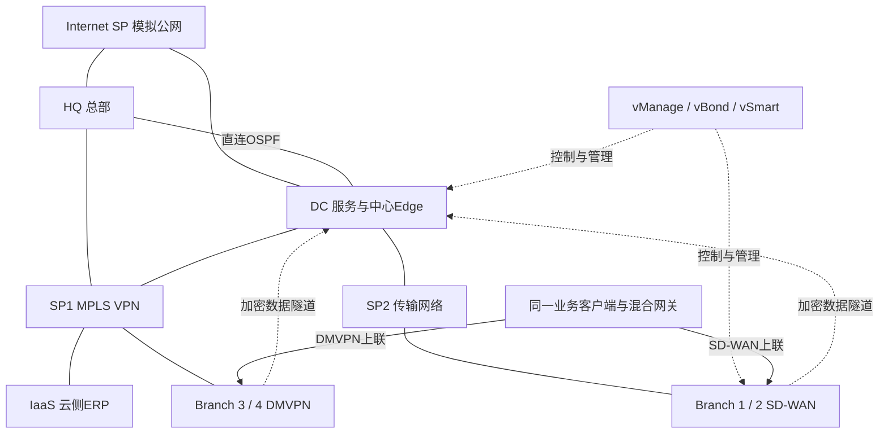

**导入 EVE 虚拟机："EVE-NG5.1-Small.ova"**

**开机后会提示账号密码：root\eve**


本篇按操作顺序整理，命令、接线和检查放在同一篇。目标是部署当前企业多站点项目：HQ、DC、IaaS、运营商、传统分支、真实 SD-WAN、员工与 Guest，以及业务和运维扩展。G0 是基础练习，不需要先把 G0 四台练习路由器接进正式项目。

本文覆盖网络、SD-WAN、业务分流、ERP迁移和运维的完整部署顺序。出现 `<…>` 时先按参数表替换；证书、身份和密钥在新环境生成。现有项目已有对应运行结果。


## 1 环境与材料准备

### 1.1 管理入口

启动 EVE，在虚拟机控制台使用管理员账户登录。执行：

```bash
ip -br address
ip route
free -h
df -h
lscpu
```

记录 pnet0 的 IPv4 地址，在 Windows 浏览器打开 `http://实际管理地址/`。本项目环境当前使用 `192.168.1.19`，新环境以控制台输出为准。**网页初始账户（admin\eve）**与 Linux 账户分别登录；首次配置过的密码按实际值使用，不重新初始化已有环境。


EVE 登录页面选择 HTML5 console，进入 File manager。使用 HTML5 可以先跳过 Native 客户端关联。若切换物理网络导致管理地址变化，只更新管理入口，不改本项目内部地址。

### 1.2 文件与参数

Windows 工作目录为 `E:\WangAnStudy\资料书籍\RH\ALL\07 CCIE`。以下所有 Windows 命令从该目录执行。

| 材料 | 用途 |
| --- | --- |
| `Exports_unetlab_export-20260115-131809.zip` | 课程初始实验定义；不包含本项目后续全部新增节点 |
| `_Exports_unetlab_export-20210613-164440.zip` | 课程补充导出材料，使用前核对内部实验名称 |
| `CCIE EI-Real Lab v1.0-M2.pdf` | 原始任务与接口参考 |
| `i86bi_linux_l2-adventerprisek9-ms.SSA.high_iron_20190423.bin` | IOL 二层交换镜像 |
| `i86bi-linux-l3-adventerprisek9-15.4.2T4.bin` | 文件夹内三层镜像；与运行配置实际镜像不完全相同，不能直接视为已验证替代版本 |
| `csr1000vng-universalk9.16.12.02s-serial/` | 真实 CSR1000v |
| `vtmgmt-18.4.3/`、`vtbond-18.4.3/`、`vtsmart-18.4.3/`、`vtedge-18.4.3/` | 真实 SD-WAN 镜像 |
| `课程补充镜像-下载校验.json` | 补充镜像文件名、大小与本地 SHA-256 |

全篇替换参数：`<设备登录密码>` 为新设备登录密码，`<DMVPN共享密钥>` 在 Hub/Spoke 保持一致；OSPF key-chain 的同一链路两端使用相同密钥。`<对应实验密钥>` 按所属配置项设置，不把登录密码、OSPF认证和CA私钥混成一个值。密钥写入本地私有记录，不写入公开截图。

### 1.3 镜像上传

用 WinSCP/SFTP 连接 EVE 的实际管理地址。IOL 文件放入 `/opt/unetlab/addons/iol/bin/`，QEMU 镜像按下表目录上传。目录名和磁盘名必须与模板匹配。

| QEMU 目录（位于 `/opt/unetlab/addons/qemu/`） | 磁盘 |
| --- | --- |
| csr1000vng-universalk9.16.12.02s-serial | virtioa.qcow2 |
| vtbond-18.4.3 | virtioa.qcow2 |
| vtedge-18.4.3 | virtioa.qcow2 |
| vtmgmt-18.4.3 | virtioa.qcow2、virtiob.qcow2 |
| vtsmart-18.4.3 | hda.qcow2 |

在 EVE 执行：

```bash
ls -lh /opt/unetlab/addons/iol/bin/
ls -lh /opt/unetlab/addons/qemu/
/opt/unetlab/wrappers/unl_wrapper -a fixpermissions
qemu-img info /opt/unetlab/addons/qemu/vtmgmt-18.4.3/virtioa.qcow2
```

IOL 授权采用已有合法实验授权。检查所用版本需要的 `iourc` 与授权环境，启动失败先看节点日志，不生成伪造授权。本项目三层 IOL 使用 `l3-AdvEnterpriseK9-M2_157_3_May_2018.bin`；若本机没有这个镜像，应先取得对应版本或完成替代版本兼容性验证。仅改文件名不等于版本一致。

### 1.4 运行资源

EVE按最终环境分配32GB内存、8个处理器，并在宿主机启用嵌套虚拟化。vManage节点设置16GB、4CPU，CSR设置4GB、1CPU，其余节点按下表配置。启动时观察free -h与宿主机内存，等待控制器应用就绪后再做业务验收；32GB是本环境配置，不保证其他宿主机具有相同并发余量。

## 2 建立工作实验与接线

在 File manager 新建 `CCIE-EI-Rebuild` 目录，工作实验命名为 `CCIE_EI_Rebuild`。可导入课程初始 ZIP 获取参考连线，也可新建空实验，按下表创建节点与桥接网段。使用新实验名，不覆盖当前正在运行的项目。

本篇设备配置从空配置开始；若导入的课程实验自动载入初始配置，先在新建副本中选择不加载该初始配置，或重建相应节点。不要把本篇全量配置直接覆盖到正在工作的原实验。

设备编号、network_id 和控制台 TCP 端口是 EVE 自动分配值。新实验不照抄旧编号；按下面的设备名、接口名与同一网段的成员接线。

### 2.1 节点与资源

按下表创建基础网络和员工接入设备。

| 节点 | 类型 / 模板 | 镜像 | RAM MiB / CPU |
| --- | --- | --- | --- |
| host12 | iol / iol | l3-AdvEnterpriseK9-M2_157_3_May_2018.bin | 1024 / — |
| sw110 | iol / iol | l2-adventerprisek9-ms.SSA.high_iron_20190423.bin | 512 / — |
| sw101 | iol / iol | l2-adventerprisek9-ms.SSA.high_iron_20190423.bin | 512 / — |
| sw212 | iol / iol | l2-adventerprisek9-ms.SSA.high_iron_20190423.bin | 512 / — |
| sw102 | iol / iol | l2-adventerprisek9-ms.SSA.high_iron_20190423.bin | 1024 / — |
| sw202 | iol / iol | l2-adventerprisek9-ms.SSA.high_iron_20190423.bin | 512 / — |
| sw211 | iol / iol | l2-adventerprisek9-ms.SSA.high_iron_20190423.bin | 512 / — |
| r12 | iol / iol | l3-AdvEnterpriseK9-M2_157_3_May_2018.bin | 1024 / — |
| r11 | iol / iol | l3-AdvEnterpriseK9-M2_157_3_May_2018.bin | 1024 / — |
| r23 | iol / iol | l3-AdvEnterpriseK9-M2_157_3_May_2018.bin | 1024 / — |
| r24 | iol / iol | l3-AdvEnterpriseK9-M2_157_3_May_2018.bin | 1024 / — |
| r22 | iol / iol | l3-AdvEnterpriseK9-M2_157_3_May_2018.bin | 1024 / — |
| r21 | iol / iol | l3-AdvEnterpriseK9-M2_157_3_May_2018.bin | 1024 / — |
| sw201 | iol / iol | l2-adventerprisek9-ms.SSA.high_iron_20190423.bin | 512 / — |
| host11 | vpcs / vpcs |  | — / — |
| Internet_SP | iol / iol | l3-AdvEnterpriseK9-M2_157_3_May_2018.bin | 512 / — |
| r1 | iol / iol | l3-AdvEnterpriseK9-M2_157_3_May_2018.bin | 512 / — |
| r2 | iol / iol | l3-AdvEnterpriseK9-M2_157_3_May_2018.bin | 512 / — |
| r3 | iol / iol | l3-AdvEnterpriseK9-M2_157_3_May_2018.bin | 512 / — |
| r4 | iol / iol | l3-AdvEnterpriseK9-M2_157_3_May_2018.bin | 512 / — |
| r5 | iol / iol | l3-AdvEnterpriseK9-M2_157_3_May_2018.bin | 512 / — |
| r6 | iol / iol | l3-AdvEnterpriseK9-M2_157_3_May_2018.bin | 512 / — |
| Global_SP2 | iol / iol | l3-AdvEnterpriseK9-M2_157_3_May_2018.bin | 512 / — |
| r30-IOL-IPv6 | iol / iol | l3-AdvEnterpriseK9-M2_157_3_May_2018.bin | 512 / — |
| r61 | iol / iol | l3-AdvEnterpriseK9-M2_157_3_May_2018.bin | 512 / — |
| r62 | iol / iol | l3-AdvEnterpriseK9-M2_157_3_May_2018.bin | 512 / — |
| r70 | iol / iol | l3-AdvEnterpriseK9-M2_157_3_May_2018.bin | 512 / — |
| sw601 | iol / iol | l2-adventerprisek9-ms.SSA.high_iron_20190423.bin | 512 / — |
| sw602 | iol / iol | l2-adventerprisek9-ms.SSA.high_iron_20190423.bin | 512 / — |
| sw610 | iol / iol | l2-adventerprisek9-ms.SSA.high_iron_20190423.bin | 512 / — |
| sw700 | iol / iol | l2-adventerprisek9-ms.SSA.high_iron_20190423.bin | 512 / — |
| host61 | vpcs / vpcs |  | — / — |
| host62 | vpcs / vpcs |  | — / — |
| host71 | vpcs / vpcs |  | — / — |
| host72 | vpcs / vpcs |  | — / — |
| r30-CSR-G6 | qemu / csr1000vng | csr1000vng-universalk9.16.12.02s-serial | 4096 / 1 |
| vManage-Real | qemu / vtmgmt | vtmgmt-18.4.3 | 16384 / 4 |
| vBond-Real | qemu / vtbond | vtbond-18.4.3 | 1024 / 1 |
| vSmart-Real | qemu / vtsmart | vtsmart-18.4.3 | 2048 / 2 |
| vEdge21-Real | qemu / vtedge | vtedge-18.4.3 | 1024 / 1 |
| vEdge22-Real | qemu / vtedge | vtedge-18.4.3 | 1024 / 1 |
| host31 | qemu / slax | slax-mini-VM | 1024 / 1 |
| vEdge41-Real | qemu / vtedge | vtedge-18.4.3 | 1024 / 1 |
| host42-SDWAN-Test | vpcs / vpcs |  | — / — |
| vEdge51-Real | qemu / vtedge | vtedge-18.4.3 | 1024 / 1 |
| host52-SDWAN-Test | vpcs / vpcs |  | — / — |
| G5-Hybrid-GW | iol / iol | l3-AdvEnterpriseK9-M2_157_3_May_2018.bin | 512 / — |
| vEdge52-Real | qemu / vtedge | vtedge-18.4.3 | 1024 / 1 |
| host41-Employees | vpcs / vpcs |  | — / — |
| host51-Employees | vpcs / vpcs |  | — / — |

IOL 的 Ethernet 数量按实际接口覆盖范围选择；需要 e2/x 的交换机不能只建一组接口。`G5-Hybrid-GW` 是同一业务客户端的双路径网关，使用512MiB内存。本阶段先不部署 DNAC、ISE 和 SDA Fabric，占位图标不承担产品功能。

### 2.2 接线清单

相同一行的所有接口连接同一个 bridge。两成员行表示一条独立链路；多成员行表示共享网段。不要把多条点到点链路合并到一个网桥。pnet0 是外部管理接入，使用 Management/Cloud0 类型。

| 网段编号（仅供对照） | 网段名 | 接口成员 |
| --- | --- | --- |
| 2 | Net-sw1iface_16 | host12 e0/0；sw110 e0/1 |
| 16 | Net-host11iface_0 | sw110 e0/0；host11 eth0 |
| 7 | Net-sw1iface_1 | sw110 e1/0；sw101 e1/2 |
| 8 | Net-sw1iface_17 | sw110 e1/1；sw101 e1/3 |
| 5 | Net-sw1iface_33 | sw110 e1/2；sw102 e1/2 |
| 6 | Net-sw1iface_49 | sw110 e1/3；sw102 e1/3 |
| 9 | Net-sw2iface_0 | sw101 e0/0；r11 e0/3 |
| 12 | Net-sw2iface_16 | sw101 e0/1；r12 e0/2 |
| 37 | Net-sw201iface_33 | sw101 e0/2；sw201 e1/2 |
| 3 | Net-sw2iface_2 | sw101 e2/0；sw102 e2/0 |
| 4 | Net-sw2iface_18 | sw101 e2/1；sw102 e2/1 |
| 35 | Net-sw3iface_0 | sw212 e0/0；sw202 e1/1 |
| 36 | Net-sw201iface_1 | sw212 e0/1；sw201 e1/0 |
| 31 | Net-sw19iface_32 | sw212 e0/2；sw211 e0/2 |
| 70 | Net-r23iface_32 | sw212 e0/3；r23 e0/2 |
| 76 | Net-r24iface_32 | sw212 e1/0；r24 e0/2 |
| 77 | Net-vManageiface_0 | sw212 e1/2；vManage-Real eth0 |
| 10 | Net-sw4iface_0 | sw102 e0/0；r12 e0/3 |
| 13 | Net-sw4iface_16 | sw102 e0/1；r11 e0/2 |
| 86 | Net-sw102iface_32 | sw102 e0/2；sw202 e1/2 |
| 26 | Net-sw10iface_0 | sw202 e0/0；r22 e0/3 |
| 29 | Net-r50iface_32 | sw202 e0/1；r21 e0/2 |
| 82 | Net-vEdge21iface_16 | sw202 e0/2；vEdge21-Real ge0/1 |
| 25 | Net-sw201iface_48 | sw202 e0/3；sw201 e0/3 |
| 39 | Net-sw19iface_16 | sw202 e1/0；sw211 e0/1 |
| 83 | Net-vEdge22iface_16 | sw202 e1/3；vEdge22-Real ge0/1 |
| 81 | Net-sw201iface_17 | sw211 e0/0；sw201 e1/1 |
| 69 | Net-r23iface_16 | sw211 e0/3；r23 e0/1 |
| 75 | Net-r24iface_16 | sw211 e1/0；r24 e0/1 |
| 67 | Net-vBondiface_0 | sw211 e1/2；vBond-Real ge0/0 |
| 68 | Net-vSmartiface_0 | sw211 e1/3；vSmart-Real eth0 |
| 63 | DC-ERP-Linux | sw211 e2/0 |
| 1 | Internet-r12 | r12 e0/0；Internet_SP e0/0 |
| 11 | Net-r25iface_16 | r12 e0/1；r11 e0/1 |
| 22 | 100.3.11 | r11 e0/0；r3 e0/1 |
| 14 | Internet-r23 | r23 e0/0；Internet_SP e0/1 |
| 30 | Net-r23iface_48 | r23 e0/3；vEdge21-Real ge0/2 |
| 15 | Internet-r24 | r24 e0/0；Internet_SP e0/2 |
| 78 | Net-r24iface_48 | r24 e0/3；vEdge22-Real ge0/2 |
| 27 | 101.22.0 | r22 e0/0；Global_SP2 e0/0 |
| 24 | Net-r50iface_16 | r22 e0/1；r21 e0/1 |
| 38 | Net-sw201iface_16 | r22 e0/2；sw201 e0/1 |
| 23 | 100.3.21 | r21 e0/0；r3 e0/2 |
| 80 | Net-sw201iface_0 | r21 e0/3；sw201 e0/0 |
| 87 | Net-vEdge22iface_0 | sw201 e0/2；vEdge22-Real ge0/0 |
| 74 | Net-vEdge21iface_0 | sw201 e1/3；vEdge21-Real ge0/0 |
| 17 | 100.0.12 | r1 e0/0；r2 e0/0 |
| 18 | 100.0.13 | r1 e0/1；r3 e0/0 |
| 19 | 100.0.15 | r1 e0/2；r5 e0/0 |
| 20 | 100.0.24 | r2 e0/1；r4 e0/0 |
| 21 | 100.0.26 | r2 e0/2；r6 e0/0 |
| 28 | IaaS-routing | r4 e0/1；r30-IOL-IPv6 e0/0 |
| 32 | r5-r61 | r5 e0/1；r61 e0/0 |
| 33 | r6-r62 | r6 e0/1；r62 e0/0 |
| 34 | r6-r70 | r6 e0/2；r70 e0/0 |
| 59 | SP2-vEdge40 | Global_SP2 e0/1；vEdge41-Real ge0/1 |
| 60 | SP2-vEdge51 | Global_SP2 e0/2；vEdge51-Real ge0/1 |
| 58 | SP2-vEdge52 | Global_SP2 e0/3；vEdge52-Real ge0/1 |
| 64 | Cloud-ERP-Linux | r30-IOL-IPv6 e0/1 |
| 40 | r61-r62 | r61 e0/1；r62 e0/1 |
| 41 | r61-sw602 | r61 e0/2；sw602 e0/1 |
| 42 | r61-sw601 | r61 e0/3；sw601 e0/2 |
| 43 | r62-sw601 | r62 e0/2；sw601 e0/1 |
| 44 | r62-sw602 | r62 e0/3；sw602 e0/2 |
| 50 | r70-sw700 | r70 e0/2；sw700 e0/2 |
| 51 | r70-sw700 | r70 e0/3；sw700 e0/3 |
| 45 | sw601-sw602 | sw601 e0/0；sw602 e0/0 |
| 46 | sw601-sw610 | sw601 e0/3；sw610 e0/2 |
| 47 | sw602-sw610 | sw602 e0/3；sw610 e0/3 |
| 48 | sw610-host61 | sw610 e0/0；host61 eth0；G5-Hybrid-GW e0/2 |
| 49 | sw610-host62 | sw610 e0/1；host62 eth0 |
| 52 | sw700-host71 | sw700 e0/0；host71 eth0 |
| 53 | sw700-host72 | sw700 e0/1；host72 eth0 |
| 54 | G6-Management | r30-CSR-G6 Gi1；vManage-Real eth1；vBond-Real eth0；vSmart-Real eth1；vEdge21-Real eth0；vEdge22-Real eth0；vEdge41-Real eth0；vEdge51-Real eth0；vEdge52-Real eth0 |
| 55 | G6-host31-LAN | r30-CSR-G6 Gi2；host31 e0 |
| 61 | BR1-Employees | vEdge41-Real ge0/0；G5-Hybrid-GW e0/1；host41-Employees eth0 |
| 56 | G5-Branch1-Guest-Test | vEdge41-Real ge0/2；host42-SDWAN-Test eth0 |
| 62 | BR2-Employees | vEdge51-Real ge0/0；vEdge52-Real ge0/0；host51-Employees eth0 |
| 57 | G5-Branch2-Guest-Test | vEdge51-Real ge0/2；host52-SDWAN-Test eth0 |
| 65 | Hybrid-Users-Linux | G5-Hybrid-GW e0/0 |

### 2.3 项目拓扑


端口以接线表为准。以下只画主要区域和逻辑业务关系，不代替物理接线；



同一客户端正常访问DC入口走SD-WAN，访问云侧入口走DMVPN，单路故障改走另一条。两类隧道外层由对应运营商网络承载；控制器不承担这些业务报文的中转。

### 2.4 启动次序

先启动 SP1 的 r1—r6、Global_SP2、Internet_SP，再启动 DC 交换与边界路由器，随后 HQ、传统分支。SD-WAN 的传输路径稳定后启动控制器和 Edge。最后启动测试终端与运维 CSR。

每台 IOS 首次出现初始配置问答时选择不进入向导，进入 `enable`。打开控制台后，确认提示符对应本节设备，再输入配置。`write memory` 保存 IOS；SD-WAN 使用 `commit and-quit`；VPCS 使用 `save`。

## 3 基础网络逐台配置

以下命令按设备执行。先替换密码和密钥，再进入对应控制台。代码框内 `! 中文说明` 用于解释接下来的操作。IOS 可忽略这种注释；在 SD-WAN 控制台输入时跳过中文说明行，只执行命令。

`exit` 退回上一层，`exit-address-family` 退出地址族，`end` 结束 IOS 配置。缩进表示配置所属层级，实际输入不依赖空格。

先配置基础网络，再配置双路径与 ERP 的新增网段。

### 3.1 SP1 核心与客户边缘

#### r1 控制台

```text
! 进入特权模式
enable

! 进入全局配置；下面按用途配置，最后统一保存
configure terminal

! 设置设备名称，确认当前控制台对应本台设备
hostname r1
no aaa new-model
no ip domain lookup
ipv6 unicast-routing

! 配置逻辑接口，地址用于设备标识、路由或服务目标
interface Loopback0
 no shutdown
 ip address 100.255.254.1 255.255.255.255
 ip ospf 1 area 0

! 退回上一层配置；下面切换到其他接口或功能，不结束本台配置
exit

! 配置 Ethernet0/0；本段地址、协议和启用状态都作用于该接口
interface Ethernet0/0
 no shutdown
 ip address 100.0.12.1 255.255.255.252
 ip ospf network point-to-point
 ip ospf 1 area 0
 mpls ip
exit

! 配置 Ethernet0/1；本段地址、协议和启用状态都作用于该接口
interface Ethernet0/1
 no shutdown
 ip address 100.0.13.1 255.255.255.252
 ip ospf network point-to-point
 ip ospf 1 area 0
 mpls ip
exit

! 配置 Ethernet0/2；本段地址、协议和启用状态都作用于该接口
interface Ethernet0/2
 no shutdown
 ip address 100.0.15.1 255.255.255.252
 ip ospf network point-to-point
 ip ospf 1 area 0
 mpls ip
exit

! 配置 OSPF 进程，交换内部路由
router ospf 1
exit
no ip http server
no ip http secure-server
mpls ldp router-id Loopback0 force

! 设置控制台或远程登录线路
line con 0
 exec-timeout 0 0
 logging synchronous
exit

! 设置控制台或远程登录线路
line vty 0 4
 login
 transport input none
exit

! 结束配置，回到特权模式；此时还未保存到启动配置
end

! 保存本台配置
write memory
```

#### r2 控制台

```text
! 进入特权模式
enable

! 进入全局配置；下面按用途配置，最后统一保存
configure terminal

! 设置设备名称，确认当前控制台对应本台设备
hostname r2
no aaa new-model
no ip domain lookup
ipv6 unicast-routing

! 配置逻辑接口，地址用于设备标识、路由或服务目标
interface Loopback0
 no shutdown
 ip address 100.255.254.2 255.255.255.255
 ip ospf 1 area 0

! 退回上一层配置；下面切换到其他接口或功能，不结束本台配置
exit

! 配置 Ethernet0/0；本段地址、协议和启用状态都作用于该接口
interface Ethernet0/0
 no shutdown
 ip address 100.0.12.2 255.255.255.252
 ip ospf network point-to-point
 ip ospf 1 area 0
 mpls ip
exit

! 配置 Ethernet0/1；本段地址、协议和启用状态都作用于该接口
interface Ethernet0/1
 no shutdown
 ip address 100.0.24.1 255.255.255.252
 ip ospf network point-to-point
 ip ospf 1 area 0
 mpls ip
exit

! 配置 Ethernet0/2；本段地址、协议和启用状态都作用于该接口
interface Ethernet0/2
 no shutdown
 ip address 100.0.26.1 255.255.255.252
 ip ospf network point-to-point
 ip ospf 1 area 0
 mpls ip
exit

! 配置 OSPF 进程，交换内部路由
router ospf 1
exit
no ip http server
no ip http secure-server
mpls ldp router-id Loopback0 force

! 设置控制台或远程登录线路
line con 0
 exec-timeout 0 0
 logging synchronous
exit

! 设置控制台或远程登录线路
line vty 0 4
 login
 transport input none
exit

! 结束配置，回到特权模式；此时还未保存到启动配置
end

! 保存本台配置
write memory
```

#### r3 控制台

```text
! 进入特权模式
enable

! 进入全局配置；下面按用途配置，最后统一保存
configure terminal

! 设置设备名称，确认当前控制台对应本台设备
hostname r3

! 建立独立路由表，隔离指定业务或隧道外层网络
vrf definition fabd2
 rd 10000:3

! 进入相应地址族，配置本地址族的路由交换
 address-family ipv4
  route-target export 10000:1
  route-target import 10000:1
  route-target import 10000:3682
  exit-address-family

! 进入相应地址族，配置本地址族的路由交换
 address-family ipv6
  export map HQ6-EXPORT
  route-target export 10000:1
  route-target import 10000:1
  route-target import 10000:3681
  exit-address-family

! 退回上一层配置；下面切换到其他接口或功能，不结束本台配置
exit
no aaa new-model
no ip domain lookup
ipv6 unicast-routing
mpls label mode all-vrfs protocol bgp-vpnv4 per-vrf
mpls label mode all-vrfs protocol bgp-vpnv6 per-vrf
no mpls ip propagate-ttl

! 配置逻辑接口，地址用于设备标识、路由或服务目标
interface Loopback0
 no shutdown
 ip address 100.255.254.3 255.255.255.255
 ip ospf 1 area 0
exit

! 配置 Ethernet0/0；本段地址、协议和启用状态都作用于该接口
interface Ethernet0/0
 no shutdown
 ip address 100.0.13.2 255.255.255.252
 ip ospf network point-to-point
 ip ospf 1 area 0
 mpls ip
exit

! 配置 Ethernet0/1；本段地址、协议和启用状态都作用于该接口
interface Ethernet0/1
 no shutdown
 vrf forwarding fabd2
 ip address 100.3.11.1 255.255.255.252
 ipv6 address 2001:2710:311::1/64
exit

! 配置 Ethernet0/2；本段地址、协议和启用状态都作用于该接口
interface Ethernet0/2
 no shutdown
 vrf forwarding fabd2
 ip address 100.3.21.1 255.255.255.252
exit

! 配置 OSPF 进程，交换内部路由
router ospf 1
exit

! 配置 BGP，建立边界邻居并控制路由发布
router bgp 10000
 bgp log-neighbor-changes
 no bgp default ipv4-unicast
 neighbor 100.255.254.4 remote-as 10000
 neighbor 100.255.254.4 update-source Loopback0
 neighbor 100.255.254.5 remote-as 10000
 neighbor 100.255.254.5 update-source Loopback0
 neighbor 100.255.254.6 remote-as 10000
 neighbor 100.255.254.6 update-source Loopback0

! 进入相应地址族，配置本地址族的路由交换
 address-family vpnv4
  neighbor 100.255.254.4 activate
  neighbor 100.255.254.4 send-community extended
  neighbor 100.255.254.5 activate
  neighbor 100.255.254.5 send-community extended
  neighbor 100.255.254.6 activate
  neighbor 100.255.254.6 send-community extended
  exit-address-family

! 进入相应地址族，配置本地址族的路由交换
 address-family vpnv6
  neighbor 100.255.254.4 activate
  neighbor 100.255.254.4 send-community extended
  neighbor 100.255.254.5 activate
  neighbor 100.255.254.5 send-community extended
  neighbor 100.255.254.6 activate
  neighbor 100.255.254.6 send-community extended
  exit-address-family

! 进入相应地址族，配置本地址族的路由交换
 address-family ipv4 vrf fabd2
  neighbor 100.3.11.2 remote-as 65001
  neighbor 100.3.11.2 activate
  neighbor 100.3.21.2 remote-as 65002
  neighbor 100.3.21.2 activate
  exit-address-family

! 进入相应地址族，配置本地址族的路由交换
 address-family ipv6 vrf fabd2
  neighbor 100.3.11.2 remote-as 65001
  neighbor 100.3.11.2 activate
  neighbor 100.3.11.2 route-map NH6 in
  exit-address-family
exit
ip as-path access-list 15 permit ^65001_
no ip http server
no ip http secure-server

! 定义路由或流量策略；permit/deny 与后续匹配条件共同生效
route-map HQ6-EXPORT permit 10
 match as-path 15
 set extcommunity rt 10000:3681 additive
exit

! 定义路由或流量策略；permit/deny 与后续匹配条件共同生效
route-map NH6 permit 10
 set ipv6 next-hop 2001:2710:311::2
exit
mpls ldp router-id Loopback0 force

! 设置控制台或远程登录线路
line con 0
 exec-timeout 0 0
 logging synchronous
exit

! 设置控制台或远程登录线路
line vty 0 4
 login
 transport input none
exit

! 结束配置，回到特权模式；此时还未保存到启动配置
end

! 保存本台配置
write memory
```

#### r4 控制台

```text
! 进入特权模式
enable

! 进入全局配置；下面按用途配置，最后统一保存
configure terminal

! 设置设备名称，确认当前控制台对应本台设备
hostname r4

! 建立独立路由表，隔离指定业务或隧道外层网络
vrf definition giosk
 rd 10000:4

! 进入相应地址族，配置本地址族的路由交换
 address-family ipv4
  import map CLOUD-IMPORT
  route-target export 10000:3
  route-target export 10000:3682
  route-target import 10000:3
  route-target import 10000:3682
  route-target import 10000:1
  exit-address-family

! 进入相应地址族，配置本地址族的路由交换
 address-family ipv6
  route-target export 10000:3
  route-target export 10000:3681
  route-target import 10000:3
  route-target import 10000:3681
  exit-address-family

! 退回上一层配置；下面切换到其他接口或功能，不结束本台配置
exit
no aaa new-model
no ip domain lookup
ipv6 unicast-routing
mpls label mode all-vrfs protocol bgp-vpnv4 per-vrf
mpls label mode all-vrfs protocol bgp-vpnv6 per-vrf
no mpls ip propagate-ttl

! 配置逻辑接口，地址用于设备标识、路由或服务目标
interface Loopback0
 no shutdown
 ip address 100.255.254.4 255.255.255.255
 ip ospf 1 area 0
exit

! 配置 Ethernet0/0；本段地址、协议和启用状态都作用于该接口
interface Ethernet0/0
 no shutdown
 ip address 100.0.24.2 255.255.255.252
 ip ospf network point-to-point
 ip ospf 1 area 0
 mpls ip
exit

! 配置 Ethernet0/1；本段地址、协议和启用状态都作用于该接口
interface Ethernet0/1
 no shutdown
 vrf forwarding giosk
 ip address 100.4.30.1 255.255.255.252
 ipv6 address 2001:DB8:14::2/64
exit

! 配置 OSPF 进程，交换内部路由
router ospf 1
exit

! 配置 BGP，建立边界邻居并控制路由发布
router bgp 10000
 bgp log-neighbor-changes
 no bgp default ipv4-unicast
 neighbor 100.255.254.3 remote-as 10000
 neighbor 100.255.254.3 update-source Loopback0
 neighbor 100.255.254.5 remote-as 10000
 neighbor 100.255.254.5 update-source Loopback0
 neighbor 100.255.254.6 remote-as 10000
 neighbor 100.255.254.6 update-source Loopback0

! 进入相应地址族，配置本地址族的路由交换
 address-family vpnv4
  neighbor 100.255.254.3 activate
  neighbor 100.255.254.3 send-community extended
  neighbor 100.255.254.5 activate
  neighbor 100.255.254.5 send-community extended
  neighbor 100.255.254.6 activate
  neighbor 100.255.254.6 send-community extended
  exit-address-family

! 进入相应地址族，配置本地址族的路由交换
 address-family vpnv6
  neighbor 100.255.254.3 activate
  neighbor 100.255.254.3 send-community extended
  neighbor 100.255.254.5 activate
  neighbor 100.255.254.5 send-community extended
  neighbor 100.255.254.6 activate
  neighbor 100.255.254.6 send-community extended
  exit-address-family

! 进入相应地址族，配置本地址族的路由交换
 address-family ipv4 vrf giosk
  neighbor 100.4.30.2 remote-as 65003
  neighbor 100.4.30.2 activate
  exit-address-family

! 进入相应地址族，配置本地址族的路由交换
 address-family ipv6 vrf giosk
  network 2001:DB8:14::/64
  neighbor 2001:DB8:14::1 remote-as 65003
  neighbor 2001:DB8:14::1 activate
  exit-address-family
exit
no ip http server
no ip http secure-server
ip prefix-list CLOUD-IMPORT seq 5 permit 10.1.0.0/16 le 32
ip prefix-list CLOUD-IMPORT seq 10 permit 10.2.0.0/16 le 32
ip prefix-list CLOUD-IMPORT seq 15 permit 10.4.200.0/24
ip prefix-list CLOUD-IMPORT seq 20 permit 10.6.0.0/16

! 定义路由或流量策略；permit/deny 与后续匹配条件共同生效
route-map CLOUD-IMPORT permit 10
 match ip address prefix-list CLOUD-IMPORT
exit
mpls ldp router-id Loopback0 force

! 设置控制台或远程登录线路
line con 0
 exec-timeout 0 0
 logging synchronous
exit

! 设置控制台或远程登录线路
line vty 0 4
 login
 transport input none
exit

! 结束配置，回到特权模式；此时还未保存到启动配置
end

! 保存本台配置
write memory
```

#### r5 控制台

```text
! 进入特权模式
enable

! 进入全局配置；下面按用途配置，最后统一保存
configure terminal

! 设置设备名称，确认当前控制台对应本台设备
hostname r5

! 建立独立路由表，隔离指定业务或隧道外层网络
vrf definition fabd2
 rd 10000:5

! 进入相应地址族，配置本地址族的路由交换
 address-family ipv4
  route-target export 10000:1
  route-target import 10000:1
  exit-address-family

! 进入相应地址族，配置本地址族的路由交换
 address-family ipv6
  route-target export 10000:1
  route-target import 10000:1
  exit-address-family

! 退回上一层配置；下面切换到其他接口或功能，不结束本台配置
exit
no aaa new-model
no ip domain lookup
ipv6 unicast-routing
mpls label mode all-vrfs protocol bgp-vpnv4 per-vrf
mpls label mode all-vrfs protocol bgp-vpnv6 per-vrf
no mpls ip propagate-ttl

! 配置逻辑接口，地址用于设备标识、路由或服务目标
interface Loopback0
 no shutdown
 ip address 100.255.254.5 255.255.255.255
 ip ospf 1 area 0
exit

! 配置 Ethernet0/0；本段地址、协议和启用状态都作用于该接口
interface Ethernet0/0
 no shutdown
 ip address 100.0.15.2 255.255.255.252
 ip ospf network point-to-point
 ip ospf 1 area 0
 mpls ip
exit

! 配置 Ethernet0/1；本段地址、协议和启用状态都作用于该接口
interface Ethernet0/1
 no shutdown
 vrf forwarding fabd2
 ip address 100.5.61.1 255.255.255.252
exit

! 配置 OSPF 进程，交换内部路由
router ospf 1
exit

! 配置 BGP，建立边界邻居并控制路由发布
router bgp 10000
 bgp log-neighbor-changes
 no bgp default ipv4-unicast
 neighbor 100.255.254.3 remote-as 10000
 neighbor 100.255.254.3 update-source Loopback0
 neighbor 100.255.254.4 remote-as 10000
 neighbor 100.255.254.4 update-source Loopback0
 neighbor 100.255.254.6 remote-as 10000
 neighbor 100.255.254.6 update-source Loopback0

! 进入相应地址族，配置本地址族的路由交换
 address-family vpnv4
  neighbor 100.255.254.3 activate
  neighbor 100.255.254.3 send-community extended
  neighbor 100.255.254.4 activate
  neighbor 100.255.254.4 send-community extended
  neighbor 100.255.254.6 activate
  neighbor 100.255.254.6 send-community extended
  exit-address-family

! 进入相应地址族，配置本地址族的路由交换
 address-family vpnv6
  neighbor 100.255.254.3 activate
  neighbor 100.255.254.3 send-community extended
  neighbor 100.255.254.4 activate
  neighbor 100.255.254.4 send-community extended
  neighbor 100.255.254.6 activate
  neighbor 100.255.254.6 send-community extended
  exit-address-family

! 进入相应地址族，配置本地址族的路由交换
 address-family ipv4 vrf fabd2
  neighbor 100.5.61.2 remote-as 65006
  neighbor 100.5.61.2 activate
  neighbor 100.5.61.2 as-override
  exit-address-family
exit
no ip http server
no ip http secure-server
mpls ldp router-id Loopback0 force

! 设置控制台或远程登录线路
line con 0
 exec-timeout 0 0
 logging synchronous
exit

! 设置控制台或远程登录线路
line vty 0 4
 login
 transport input none
exit

! 结束配置，回到特权模式；此时还未保存到启动配置
end

! 保存本台配置
write memory
```

#### r6 控制台

```text
! 进入特权模式
enable

! 进入全局配置；下面按用途配置，最后统一保存
configure terminal

! 设置设备名称，确认当前控制台对应本台设备
hostname r6

! 建立独立路由表，隔离指定业务或隧道外层网络
vrf definition fabd2
 rd 10000:6

! 进入相应地址族，配置本地址族的路由交换
 address-family ipv4
  route-target export 10000:1
  route-target import 10000:1
  exit-address-family

! 进入相应地址族，配置本地址族的路由交换
 address-family ipv6
  route-target export 10000:1
  route-target import 10000:1
  exit-address-family

! 退回上一层配置；下面切换到其他接口或功能，不结束本台配置
exit
no aaa new-model
no ip domain lookup
ipv6 unicast-routing
mpls label mode all-vrfs protocol bgp-vpnv4 per-vrf
mpls label mode all-vrfs protocol bgp-vpnv6 per-vrf
no mpls ip propagate-ttl

! 配置逻辑接口，地址用于设备标识、路由或服务目标
interface Loopback0
 no shutdown
 ip address 100.255.254.6 255.255.255.255
 ip ospf 1 area 0
exit

! 配置 Ethernet0/0；本段地址、协议和启用状态都作用于该接口
interface Ethernet0/0
 no shutdown
 ip address 100.0.26.2 255.255.255.252
 ip ospf network point-to-point
 ip ospf 1 area 0
 mpls ip
exit

! 配置 Ethernet0/1；本段地址、协议和启用状态都作用于该接口
interface Ethernet0/1
 no shutdown
 vrf forwarding fabd2
 ip address 100.6.62.1 255.255.255.252
exit

! 配置 Ethernet0/2；本段地址、协议和启用状态都作用于该接口
interface Ethernet0/2
 no shutdown
 vrf forwarding fabd2
 ip address 100.6.70.1 255.255.255.252
exit

! 配置 OSPF 进程，交换内部路由
router ospf 1
exit

! 配置 BGP，建立边界邻居并控制路由发布
router bgp 10000
 bgp log-neighbor-changes
 no bgp default ipv4-unicast
 neighbor 100.255.254.3 remote-as 10000
 neighbor 100.255.254.3 update-source Loopback0
 neighbor 100.255.254.4 remote-as 10000
 neighbor 100.255.254.4 update-source Loopback0
 neighbor 100.255.254.5 remote-as 10000
 neighbor 100.255.254.5 update-source Loopback0

! 进入相应地址族，配置本地址族的路由交换
 address-family vpnv4
  neighbor 100.255.254.3 activate
  neighbor 100.255.254.3 send-community extended
  neighbor 100.255.254.4 activate
  neighbor 100.255.254.4 send-community extended
  neighbor 100.255.254.5 activate
  neighbor 100.255.254.5 send-community extended
  exit-address-family

! 进入相应地址族，配置本地址族的路由交换
 address-family vpnv6
  neighbor 100.255.254.3 activate
  neighbor 100.255.254.3 send-community extended
  neighbor 100.255.254.4 activate
  neighbor 100.255.254.4 send-community extended
  neighbor 100.255.254.5 activate
  neighbor 100.255.254.5 send-community extended
  exit-address-family

! 进入相应地址族，配置本地址族的路由交换
 address-family ipv4 vrf fabd2
  neighbor 100.6.62.2 remote-as 65006
  neighbor 100.6.62.2 activate
  neighbor 100.6.62.2 as-override
  neighbor 100.6.70.2 remote-as 65007
  neighbor 100.6.70.2 activate
  neighbor 100.6.70.2 as-override
  exit-address-family
exit
no ip http server
no ip http secure-server
mpls ldp router-id Loopback0 force

! 设置控制台或远程登录线路
line con 0
 exec-timeout 0 0
 logging synchronous
exit

! 设置控制台或远程登录线路
line vty 0 4
 login
 transport input none
exit

! 结束配置，回到特权模式；此时还未保存到启动配置
end

! 保存本台配置
write memory
```

本组配置完成后检查接口和邻居，再继续下一组：

```text
show ip interface brief
show ip route
show ip ospf neighbor
show ip bgp summary
```

### 3.2 模拟互联网与第二运营商

#### Internet_SP 控制台

```text
! 进入特权模式
enable

! 进入全局配置；下面按用途配置，最后统一保存
configure terminal

! 设置设备名称，确认当前控制台对应本台设备
hostname Internet_SP
no aaa new-model
no ip domain lookup

! 配置逻辑接口，地址用于设备标识、路由或服务目标
interface Loopback0
 no shutdown
 ip address 8.8.8.8 255.255.255.255

! 退回上一层配置；下面切换到其他接口或功能，不结束本台配置
exit

! 配置 Ethernet0/0；本段地址、协议和启用状态都作用于该接口
interface Ethernet0/0
 no shutdown
 ip address 200.99.12.1 255.255.255.252
exit

! 配置 Ethernet0/1；本段地址、协议和启用状态都作用于该接口
interface Ethernet0/1
 no shutdown
 ip address 200.99.23.1 255.255.255.252
exit

! 配置 Ethernet0/2；本段地址、协议和启用状态都作用于该接口
interface Ethernet0/2
 no shutdown
 ip address 200.99.24.1 255.255.255.252
exit

! 配置 BGP，建立边界邻居并控制路由发布
router bgp 19999
 bgp router-id 8.8.8.8
 bgp log-neighbor-changes
 network 8.8.8.8 mask 255.255.255.255
 neighbor 200.99.12.2 remote-as 65001
 neighbor 200.99.12.2 default-originate
 neighbor 200.99.23.2 remote-as 65002
 neighbor 200.99.23.2 default-originate
 neighbor 200.99.24.2 remote-as 65002
 neighbor 200.99.24.2 default-originate
exit
no ip http server
no ip http secure-server

! 设置控制台或远程登录线路
line con 0
 exec-timeout 0 0
 logging synchronous
exit

! 设置控制台或远程登录线路
line vty 0 4
 login
 transport input none
exit

! 结束配置，回到特权模式；此时还未保存到启动配置
end

! 保存本台配置
write memory
```

#### Global_SP2 控制台

```text
! 进入特权模式
enable

! 进入全局配置；下面按用途配置，最后统一保存
configure terminal

! 设置设备名称，确认当前控制台对应本台设备
hostname Global_SP2
no aaa new-model
no ip domain lookup

! 配置 Ethernet0/0；本段地址、协议和启用状态都作用于该接口
interface Ethernet0/0
 no shutdown
 ip address 101.22.0.1 255.255.255.252

! 退回上一层配置；下面切换到其他接口或功能，不结束本台配置
exit

! 配置 BGP，建立边界邻居并控制路由发布
router bgp 10001
 bgp log-neighbor-changes
 neighbor 101.22.0.2 remote-as 65002
exit
no ip http server
no ip http secure-server

! 设置控制台或远程登录线路
line con 0
 exec-timeout 0 0
 logging synchronous
exit

! 设置控制台或远程登录线路
line vty 0 4
 login
 transport input none
exit

! 结束配置，回到特权模式；此时还未保存到启动配置
end

! 保存本台配置
write memory
```

本组配置完成后检查接口和邻居，再继续下一组：

```text
show ip interface brief
show ip route
show ip ospf neighbor
show ip bgp summary
```

### 3.3 数据中心

#### sw201 控制台

```text
! 进入特权模式
enable

! 进入全局配置；下面按用途配置，最后统一保存
configure terminal
service compress-config

! 设置设备名称，确认当前控制台对应本台设备
hostname sw201
no aaa new-model
clock timezone EET 2 0
no ip domain-lookup

! 建立协议认证密钥链；密钥与对端保持一致
key chain ccie
 key 1
  key-string <对应实验密钥>
  cryptographic-algorithm hmac-sha-384

! 退回上一层配置；下面切换到其他接口或功能，不结束本台配置
 exit
exit
spanning-tree mode pvst
spanning-tree extend system-id
vlan 3999
 name "SDA Underlay"
exit
vlan 4000
 name "SD-WAN Underlay"
exit
no cdp run

! 配置逻辑接口，地址用于设备标识、路由或服务目标
interface Loopback0
 no shutdown
 ip address 10.2.255.201 255.255.255.255
 ip ospf 1 area 0
exit

! 配置 Ethernet0/0；本段地址、协议和启用状态都作用于该接口
interface Ethernet0/0
 no shutdown
 description https://ccielabcenter.com
 no switchport
 ip address 10.2.10.2 255.255.255.252
 ip ospf 1 area 0
 duplex full
exit

! 配置 Ethernet0/1；本段地址、协议和启用状态都作用于该接口
interface Ethernet0/1
 no shutdown
 description https://ccielabcenter.com
 no switchport
 ip address 10.2.12.2 255.255.255.252
 ip ospf 1 area 0
 duplex full
exit

! 配置 Ethernet0/2；本段地址、协议和启用状态都作用于该接口
interface Ethernet0/2
 no shutdown
 description https://ccielabcenter.com
 switchport trunk encapsulation dot1q
 switchport trunk native vlan 4000
 switchport mode trunk
exit

! 配置 Ethernet0/3；本段地址、协议和启用状态都作用于该接口
interface Ethernet0/3
 no shutdown
 description https://ccielabcenter.com
 no switchport
 ip address 10.2.109.1 255.255.255.252
 ip ospf 1 area 0
 duplex full
exit

! 配置 Ethernet1/0；本段地址、协议和启用状态都作用于该接口
interface Ethernet1/0
 no shutdown
 description https://ccielabcenter.com
 no switchport
 ip address 10.2.23.1 255.255.255.252
 ip ospf 1 area 0
 duplex full
exit

! 配置 Ethernet1/1；本段地址、协议和启用状态都作用于该接口
interface Ethernet1/1
 no shutdown
 description https://ccielabcenter.com
 no switchport
 ip address 10.2.20.1 255.255.255.252
 ip ospf 1 area 0
 duplex full
exit

! 配置 Ethernet1/2；本段地址、协议和启用状态都作用于该接口
interface Ethernet1/2
 no shutdown
 description https://ccielabcenter.com
 no switchport
 ip address 10.2.241.1 255.255.255.252
 ip ospf authentication key-chain ccie
 ip ospf bfd
 ip ospf 1 area 0
 duplex full
 bfd interval 100 min_rx 100 multiplier 3
exit

! 配置 Ethernet1/3；本段地址、协议和启用状态都作用于该接口
interface Ethernet1/3
 no shutdown
 switchport trunk encapsulation dot1q
 switchport trunk native vlan 4000
 switchport mode trunk
exit

! 配置 Vlan3999；本段地址、协议和启用状态都作用于该接口
interface Vlan3999
 no shutdown
 ip address 10.2.201.11 255.255.255.248
 ip ospf 1 area 0
exit

! 配置 Vlan4000；本段地址、协议和启用状态都作用于该接口
interface Vlan4000
 no shutdown
 ip address 10.2.201.3 255.255.255.248
 ip ospf prefix-suppression disable
 ip ospf 1 area 0
exit

! 配置 OSPF 进程，交换内部路由
router ospf 1
exit
ip http server
ip http secure-server
ip ssh server algorithm encryption aes128-ctr aes192-ctr aes256-ctr
ip ssh client algorithm encryption aes128-ctr aes192-ctr aes256-ctr

! 设置控制台或远程登录线路
line con 0
 exec-timeout 0 0
 privilege level 15
 logging synchronous
exit

! 设置控制台或远程登录线路
line vty 0 4
 privilege level 15
 no login
 transport input all
exit

! 结束配置，回到特权模式；此时还未保存到启动配置
end

! 保存本台配置
write memory
```

#### sw202 控制台

```text
! 进入特权模式
enable

! 进入全局配置；下面按用途配置，最后统一保存
configure terminal
service compress-config

! 设置设备名称，确认当前控制台对应本台设备
hostname sw202
no aaa new-model
clock timezone EET 2 0
no ip domain-lookup

! 建立协议认证密钥链；密钥与对端保持一致
key chain ccie
 key 1
  key-string <对应实验密钥>
  cryptographic-algorithm hmac-sha-384

! 退回上一层配置；下面切换到其他接口或功能，不结束本台配置
 exit
exit
spanning-tree mode pvst
spanning-tree extend system-id
vlan 3999
 name "SDA Underlay"
exit
vlan 4000
 name "SD-WAN Underlay"
exit
no cdp run

! 配置逻辑接口，地址用于设备标识、路由或服务目标
interface Loopback0
 no shutdown
 ip address 10.2.255.202 255.255.255.255
 ip ospf 1 area 0
exit

! 配置 Ethernet0/0；本段地址、协议和启用状态都作用于该接口
interface Ethernet0/0
 no shutdown
 description https://ccielabcenter.com
 no switchport
 ip address 10.2.11.2 255.255.255.252
 ip ospf 1 area 0
 duplex full
exit

! 配置 Ethernet0/1；本段地址、协议和启用状态都作用于该接口
interface Ethernet0/1
 no shutdown
 description https://ccielabcenter.com
 no switchport
 ip address 10.2.13.2 255.255.255.252
 ip ospf 1 area 0
 duplex full
exit

! 配置 Ethernet0/2；本段地址、协议和启用状态都作用于该接口
interface Ethernet0/2
 no shutdown
 description https://ccielabcenter.com
 switchport trunk encapsulation dot1q
 switchport trunk native vlan 4000
 switchport mode trunk
exit

! 配置 Ethernet0/3；本段地址、协议和启用状态都作用于该接口
interface Ethernet0/3
 no shutdown
 description https://ccielabcenter.com
 no switchport
 ip address 10.2.109.2 255.255.255.252
 ip ospf 1 area 0
 duplex full
exit

! 配置 Ethernet1/0；本段地址、协议和启用状态都作用于该接口
interface Ethernet1/0
 no shutdown
 description https://ccielabcenter.com
 no switchport
 ip address 10.2.22.1 255.255.255.252
 ip ospf 1 area 0
 duplex full
exit

! 配置 Ethernet1/1；本段地址、协议和启用状态都作用于该接口
interface Ethernet1/1
 no shutdown
 description https://ccielabcenter.com
 no switchport
 ip address 10.2.21.1 255.255.255.252
 ip ospf 1 area 0
 duplex full
exit

! 配置 Ethernet1/2；本段地址、协议和启用状态都作用于该接口
interface Ethernet1/2
 no shutdown
 description https://ccielabcenter.com
 no switchport
 ip address 10.2.242.1 255.255.255.252
 ip ospf authentication key-chain ccie
 ip ospf bfd
 ip ospf 1 area 0
 duplex full
 bfd interval 100 min_rx 100 multiplier 3
exit

! 配置 Ethernet1/3；本段地址、协议和启用状态都作用于该接口
interface Ethernet1/3
 no shutdown
 switchport trunk encapsulation dot1q
 switchport trunk native vlan 4000
 switchport mode trunk
exit

! 配置 Vlan3999；本段地址、协议和启用状态都作用于该接口
interface Vlan3999
 no shutdown
 ip address 10.2.202.11 255.255.255.248
 ip mtu 1496
 ip ospf 1 area 0
exit

! 配置 Vlan4000；本段地址、协议和启用状态都作用于该接口
interface Vlan4000
 no shutdown
 ip address 10.2.202.3 255.255.255.248
 ip ospf prefix-suppression disable
 ip ospf 1 area 0
exit

! 配置 OSPF 进程，交换内部路由
router ospf 1
exit
ip http server
ip http secure-server
ip ssh server algorithm encryption aes128-ctr aes192-ctr aes256-ctr
ip ssh client algorithm encryption aes128-ctr aes192-ctr aes256-ctr

! 设置控制台或远程登录线路
line con 0
 exec-timeout 0 0
 privilege level 15
 logging synchronous
exit

! 设置控制台或远程登录线路
line vty 0 4
 privilege level 15
 no login
 transport input all
exit

! 结束配置，回到特权模式；此时还未保存到启动配置
end

! 保存本台配置
write memory
```

#### sw211 控制台

```text
! 进入特权模式
enable

! 进入全局配置；下面按用途配置，最后统一保存
configure terminal
service compress-config

! 设置设备名称，确认当前控制台对应本台设备
hostname sw211
no aaa new-model
clock timezone EET 2 0
ip dhcp excluded-address 10.1.100.1 10.1.100.100
ip dhcp excluded-address 10.1.101.1 10.1.101.100
ip dhcp excluded-address 10.6.100.1 10.6.100.100
ip dhcp excluded-address 10.6.101.1 10.6.101.100
ip dhcp excluded-address 10.7.1.1 10.7.1.100
ip dhcp excluded-address 10.4.198.1 10.4.198.100
ip dhcp excluded-address 10.4.200.1 10.4.200.100
ip dhcp excluded-address 10.5.198.1 10.5.198.100
ip dhcp excluded-address 10.5.200.1 10.5.200.100

! 配置 DHCP 地址池与分配参数
ip dhcp pool hq_2000
 network 10.1.100.0 255.255.255.0
 default-router 10.1.100.1

! 退回上一层配置；下面切换到其他接口或功能，不结束本台配置
exit

! 配置 DHCP 地址池与分配参数
ip dhcp pool hq_2001
 network 10.1.101.0 255.255.255.0
 default-router 10.1.101.1
exit

! 配置 DHCP 地址池与分配参数
ip dhcp pool br3_v2000
 network 10.6.100.0 255.255.255.0
 default-router 10.6.100.1
exit

! 配置 DHCP 地址池与分配参数
ip dhcp pool br3_v2001
 network 10.6.101.0 255.255.255.0
 default-router 10.6.101.1
exit

! 配置 DHCP 地址池与分配参数
ip dhcp pool br_v1
 network 10.7.1.0 255.255.255.0
 default-router 10.7.1.1
exit

! 配置 DHCP 地址池与分配参数
ip dhcp pool br1_iot
 network 10.4.198.0 255.255.255.0
 default-router 10.4.198.1
exit

! 配置 DHCP 地址池与分配参数
ip dhcp pool br1_emp
 network 10.4.200.0 255.255.255.0
 default-router 10.4.200.1
exit

! 配置 DHCP 地址池与分配参数
ip dhcp pool br2_iot
 network 10.5.198.0 255.255.255.0
 default-router 10.5.198.1
exit

! 配置 DHCP 地址池与分配参数
ip dhcp pool br2_emp
 network 10.5.200.0 255.255.255.0
 default-router 10.5.200.1
exit
no ip domain-lookup
spanning-tree mode pvst
spanning-tree extend system-id
no cdp run

! 配置逻辑接口，地址用于设备标识、路由或服务目标
interface Loopback0
 no shutdown
 ip address 10.2.255.211 255.255.255.255
 ip ospf 1 area 0
exit

! 配置 Ethernet0/0；本段地址、协议和启用状态都作用于该接口
interface Ethernet0/0
 no shutdown
 description https://ccielabcenter.com
 no switchport
 ip address 10.2.20.2 255.255.255.252
 ip ospf 1 area 0
 duplex full
exit

! 配置 Ethernet0/1；本段地址、协议和启用状态都作用于该接口
interface Ethernet0/1
 no shutdown
 description https://ccielabcenter.com
 no switchport
 ip address 10.2.22.2 255.255.255.252
 ip ospf 1 area 0
 duplex full
exit

! 配置 Ethernet0/2；本段地址、协议和启用状态都作用于该接口
interface Ethernet0/2
 no shutdown
 description https://ccielabcenter.com
 no switchport
 ip address 10.2.119.1 255.255.255.252
 ip ospf 1 area 0
 duplex full
exit

! 配置 Ethernet0/3；本段地址、协议和启用状态都作用于该接口
interface Ethernet0/3
 no shutdown
 description https://ccielabcenter.com
 no switchport
 ip address 10.2.115.2 255.255.255.252
 ip ospf 1 area 0
 duplex full
exit

! 配置 Ethernet1/0；本段地址、协议和启用状态都作用于该接口
interface Ethernet1/0
 no shutdown
 description https://ccielabcenter.com
 no switchport
 ip address 10.2.114.2 255.255.255.252
 ip ospf 1 area 0
 duplex full
exit

! 配置 Ethernet1/1；本段地址、协议和启用状态都作用于该接口
interface Ethernet1/1
 no shutdown
 description https://ccielabcenter.com
 no switchport
 ip address 10.2.252.1 255.255.255.0
 ip ospf 1 area 0
exit

! 配置 Ethernet1/2；本段地址、协议和启用状态都作用于该接口
interface Ethernet1/2
 no shutdown
 description https://ccielabcenter.com
 no switchport
 ip address 10.2.251.1 255.255.255.0
 ip ospf 1 area 0
exit

! 配置 Ethernet1/3；本段地址、协议和启用状态都作用于该接口
interface Ethernet1/3
 no shutdown
 description https://ccielabcenter.com
 no switchport
 ip address 10.2.250.1 255.255.255.0
 ip ospf 1 area 0
exit

! 配置 Ethernet2/0；本段地址、协议和启用状态都作用于该接口
interface Ethernet2/0
 no shutdown
 description DC-ERP-Linux
 no switchport
 ip address 10.2.100.1 255.255.255.0
 ip ospf 1 area 0
exit

! 配置 OSPF 进程，交换内部路由
router ospf 1
 passive-interface Ethernet1/1
 passive-interface Ethernet1/2
 passive-interface Ethernet1/3
exit
ip http server
ip http secure-server
ip ssh server algorithm encryption aes128-ctr aes192-ctr aes256-ctr
ip ssh client algorithm encryption aes128-ctr aes192-ctr aes256-ctr

! 设置控制台或远程登录线路
line con 0
 exec-timeout 0 0
 privilege level 15
 logging synchronous
exit

! 设置控制台或远程登录线路
line vty 0 4
 privilege level 15
 no login
 transport input all
exit

! 结束配置，回到特权模式；此时还未保存到启动配置
end

! 保存本台配置
write memory
```

#### sw212 控制台

```text
! 进入特权模式
enable

! 进入全局配置；下面按用途配置，最后统一保存
configure terminal
service compress-config

! 设置设备名称，确认当前控制台对应本台设备
hostname sw212
no aaa new-model
clock timezone EET 2 0
no ip domain-lookup
spanning-tree mode pvst
spanning-tree extend system-id
no cdp run

! 配置逻辑接口，地址用于设备标识、路由或服务目标
interface Loopback0
 no shutdown
 ip address 10.2.255.212 255.255.255.255
 ip ospf 1 area 0

! 退回上一层配置；下面切换到其他接口或功能，不结束本台配置
exit

! 配置 Ethernet0/0；本段地址、协议和启用状态都作用于该接口
interface Ethernet0/0
 no shutdown
 description https://ccielabcenter.com
 no switchport
 ip address 10.2.21.2 255.255.255.252
 ip ospf 1 area 0
exit

! 配置 Ethernet0/1；本段地址、协议和启用状态都作用于该接口
interface Ethernet0/1
 no shutdown
 description https://ccielabcenter.com
 no switchport
 ip address 10.2.23.2 255.255.255.252
 ip ospf 1 area 0
exit

! 配置 Ethernet0/2；本段地址、协议和启用状态都作用于该接口
interface Ethernet0/2
 no shutdown
 description https://ccielabcenter.com
 no switchport
 ip address 10.2.119.2 255.255.255.252
 ip ospf 1 area 0
exit

! 配置 Ethernet0/3；本段地址、协议和启用状态都作用于该接口
interface Ethernet0/3
 no shutdown
 description https://ccielabcenter.com
 no switchport
 ip address 10.2.215.2 255.255.255.252
 ip ospf 1 area 0
exit

! 配置 Ethernet1/0；本段地址、协议和启用状态都作用于该接口
interface Ethernet1/0
 no shutdown
 description https://ccielabcenter.com
 no switchport
 ip address 10.2.214.2 255.255.255.252
 ip ospf 1 area 0
exit

! 配置 Ethernet1/1；本段地址、协议和启用状态都作用于该接口
interface Ethernet1/1
 no shutdown
 description https://ccielabcenter.com
 no switchport
 ip address 10.2.254.1 255.255.255.0
 ip ospf 1 area 0
exit

! 配置 Ethernet1/2；本段地址、协议和启用状态都作用于该接口
interface Ethernet1/2
 no shutdown
 description https://ccielabcenter.com
 no switchport
 ip address 10.2.253.1 255.255.255.0
 ip ospf 1 area 0
exit

! 配置 OSPF 进程，交换内部路由
router ospf 1
 prefix-suppression
 passive-interface Ethernet1/1
 passive-interface Ethernet1/2
exit
no ip http server
no ip http secure-server
ip ssh server algorithm encryption aes128-ctr aes192-ctr aes256-ctr
ip ssh client algorithm encryption aes128-ctr aes192-ctr aes256-ctr

! 设置控制台或远程登录线路
line con 0
 exec-timeout 0 0
 privilege level 15
 logging synchronous
exit

! 设置控制台或远程登录线路
line vty 0 4
 privilege level 15
 no login
 transport input all
exit

! 结束配置，回到特权模式；此时还未保存到启动配置
end

! 保存本台配置
write memory
```

#### r21 控制台

```text
! 进入特权模式
enable

! 进入全局配置；下面按用途配置，最后统一保存
configure terminal

! 设置设备名称，确认当前控制台对应本台设备
hostname r21
no aaa new-model
clock timezone EET 2 0
no ip domain lookup
no cdp run

! 配置逻辑接口，地址用于设备标识、路由或服务目标
interface Loopback0
 no shutdown
 ip address 10.2.255.21 255.255.255.255
 ip ospf 1 area 0

! 退回上一层配置；下面切换到其他接口或功能，不结束本台配置
exit

! 配置 Ethernet0/0；本段地址、协议和启用状态都作用于该接口
interface Ethernet0/0
 no shutdown
 description https://ccielabcenter.com
 ip address 100.3.21.2 255.255.255.252
exit

! 配置 Ethernet0/1；本段地址、协议和启用状态都作用于该接口
interface Ethernet0/1
 no shutdown
 description https://ccielabcenter.com
 ip address 10.2.99.1 255.255.255.252
 ip ospf 1 area 0
exit

! 配置 Ethernet0/2；本段地址、协议和启用状态都作用于该接口
interface Ethernet0/2
 no shutdown
 description https://ccielabcenter.com
 ip address 10.2.13.1 255.255.255.252
 ip ospf 1 area 0
exit

! 配置 Ethernet0/3；本段地址、协议和启用状态都作用于该接口
interface Ethernet0/3
 no shutdown
 description https://ccielabcenter.com
 ip address 10.2.10.1 255.255.255.252
 ip ospf 1 area 0
exit

! 配置 OSPF 进程，交换内部路由
router ospf 1
 prefix-suppression
 redistribute bgp 65002 subnets tag 150
exit

! 配置 BGP，建立边界邻居并控制路由发布
router bgp 65002
 bgp router-id 10.2.255.21
 bgp log-neighbor-changes
 network 10.2.255.21 mask 255.255.255.255
 redistribute ospf 1 match external 1 external 2 route-map TAG
 neighbor 10.2.255.22 remote-as 65002
 neighbor 10.2.255.22 update-source Loopback0
 neighbor 10.2.255.22 next-hop-self
 neighbor 100.3.21.1 remote-as 10000
 neighbor 100.3.21.1 prefix-list HQ-NO-SP out
 neighbor 100.3.21.1 filter-list 1 in
exit
ip as-path access-list 1 deny _65001_
ip as-path access-list 1 permit .*
no ip http server
no ip http secure-server
ip prefix-list HQ-NO-SP seq 5 deny 10.1.0.0/16 le 32
ip prefix-list HQ-NO-SP seq 10 permit 0.0.0.0/0 le 32

! 定义路由或流量策略；permit/deny 与后续匹配条件共同生效
route-map TAG deny 10
 match tag 150
exit

! 定义路由或流量策略；permit/deny 与后续匹配条件共同生效
route-map TAG permit 20
exit

! 设置控制台或远程登录线路
line con 0
 exec-timeout 0 0
 privilege level 15
 logging synchronous
 stopbits 1
exit

! 设置控制台或远程登录线路
line vty 0 4
 privilege level 15
 no login
 transport input all
exit

! 结束配置，回到特权模式；此时还未保存到启动配置
end

! 保存本台配置
write memory
```

#### r22 控制台

```text
! 进入特权模式
enable

! 进入全局配置；下面按用途配置，最后统一保存
configure terminal

! 设置设备名称，确认当前控制台对应本台设备
hostname r22
no aaa new-model
clock timezone EET 2 0
no ip domain lookup
no cdp run

! 配置逻辑接口，地址用于设备标识、路由或服务目标
interface Loopback0
 no shutdown
 ip address 10.2.255.22 255.255.255.255
 ip ospf 1 area 0

! 退回上一层配置；下面切换到其他接口或功能，不结束本台配置
exit

! 配置 Ethernet0/0；本段地址、协议和启用状态都作用于该接口
interface Ethernet0/0
 no shutdown
 description https://ccielabcenter.com
 ip address 101.22.0.2 255.255.255.252
exit

! 配置 Ethernet0/1；本段地址、协议和启用状态都作用于该接口
interface Ethernet0/1
 no shutdown
 description https://ccielabcenter.com
 ip address 10.2.99.2 255.255.255.252
 ip ospf 1 area 0
exit

! 配置 Ethernet0/2；本段地址、协议和启用状态都作用于该接口
interface Ethernet0/2
 no shutdown
 description https://ccielabcenter.com
 ip address 10.2.12.1 255.255.255.252
 ip ospf 1 area 0
exit

! 配置 Ethernet0/3；本段地址、协议和启用状态都作用于该接口
interface Ethernet0/3
 no shutdown
 description https://ccielabcenter.com
 ip address 10.2.11.1 255.255.255.252
 ip ospf 1 area 0
exit

! 配置 OSPF 进程，交换内部路由
router ospf 1
 prefix-suppression
 redistribute bgp 65002 subnets tag 150
exit

! 配置 BGP，建立边界邻居并控制路由发布
router bgp 65002
 bgp router-id 10.2.255.22
 bgp log-neighbor-changes
 network 10.2.255.22 mask 255.255.255.255
 redistribute ospf 1 match internal external 1 external 2 route-map TAG
 neighbor 10.2.255.21 remote-as 65002
 neighbor 10.2.255.21 update-source Loopback0
 neighbor 10.2.255.21 next-hop-self
 neighbor 101.22.0.1 remote-as 10001
 neighbor 101.22.0.1 prefix-list HQ-NO-SP out
 neighbor 101.22.0.1 filter-list 1 in
exit
ip as-path access-list 1 deny _65001_
ip as-path access-list 1 permit .*
no ip http server
no ip http secure-server
ip prefix-list HQ-NO-SP seq 5 deny 10.1.0.0/16 le 32
ip prefix-list HQ-NO-SP seq 10 permit 0.0.0.0/0 le 32

! 定义路由或流量策略；permit/deny 与后续匹配条件共同生效
route-map TAG deny 10
 match tag 150
exit

! 定义路由或流量策略；permit/deny 与后续匹配条件共同生效
route-map TAG permit 20
exit

! 设置控制台或远程登录线路
line con 0
 exec-timeout 0 0
 privilege level 15
 logging synchronous
 stopbits 1
exit

! 设置控制台或远程登录线路
line vty 0 4
 privilege level 15
 no login
 transport input all
exit

! 结束配置，回到特权模式；此时还未保存到启动配置
end

! 保存本台配置
write memory
```

#### r23 控制台

```text
! 进入特权模式
enable

! 进入全局配置；下面按用途配置，最后统一保存
configure terminal

! 设置设备名称，确认当前控制台对应本台设备
hostname r23

! 建立独立路由表，隔离指定业务或隧道外层网络
vrf definition Guest
 rd 65002:199

! 进入相应地址族，配置本地址族的路由交换
 address-family ipv4
  exit-address-family

! 退回上一层配置；下面切换到其他接口或功能，不结束本台配置
exit
no aaa new-model
clock timezone EET 2 0
ip dhcp use vrf remote
ip dhcp excluded-address vrf Guest 10.4.199.1 10.4.199.100
ip dhcp excluded-address vrf Guest 10.5.199.1 10.5.199.100

! 配置 DHCP 地址池与分配参数
ip dhcp pool br1_guest
 vrf Guest
 network 10.4.199.0 255.255.255.0
 default-router 10.4.199.1
exit

! 配置 DHCP 地址池与分配参数
ip dhcp pool br2_guest
 vrf Guest
 network 10.5.199.0 255.255.255.0
 default-router 10.5.199.1
exit
no ip domain lookup
no cdp run

! 配置逻辑接口，地址用于设备标识、路由或服务目标
interface Loopback0
 no shutdown
 ip address 10.2.255.23 255.255.255.255
 ip ospf 1 area 0
exit

! 配置逻辑接口，地址用于设备标识、路由或服务目标
interface Loopback1
 no shutdown
 vrf forwarding Guest
 ip address 10.2.255.211 255.255.255.255
exit

! 配置 Ethernet0/0；本段地址、协议和启用状态都作用于该接口
interface Ethernet0/0
 no shutdown
 description https://ccielabcenter.com
 ip address 200.99.23.2 255.255.255.252
 ip nat outside
 ip virtual-reassembly in
exit

! 配置 Ethernet0/1；本段地址、协议和启用状态都作用于该接口
interface Ethernet0/1
 no shutdown
 description https://ccielabcenter.com
 ip address 10.2.115.1 255.255.255.252
 ip nat inside
 ip virtual-reassembly in
 ip ospf 1 area 0
exit

! 配置 Ethernet0/2；本段地址、协议和启用状态都作用于该接口
interface Ethernet0/2
 no shutdown
 description https://ccielabcenter.com
 ip address 10.2.215.1 255.255.255.252
 ip nat inside
 ip virtual-reassembly in
 ip ospf 1 area 0
exit

! 配置 Ethernet0/3；本段地址、协议和启用状态都作用于该接口
interface Ethernet0/3
 no shutdown
 description https://ccielabcenter.com
 vrf forwarding Guest
 ip address 10.2.123.1 255.255.255.0
 ip nat inside
 ip virtual-reassembly in
exit

! 配置 OSPF 进程，交换内部路由
router ospf 1
 prefix-suppression
 default-information originate
exit

! 配置 BGP，建立边界邻居并控制路由发布
router bgp 65002
 bgp log-neighbor-changes
 neighbor 200.99.23.1 remote-as 19999

! 进入相应地址族，配置本地址族的路由交换
 address-family ipv4 vrf Guest
  network 0.0.0.0
  network 10.2.255.211 mask 255.255.255.255
  neighbor 10.2.123.2 remote-as 65002
  neighbor 10.2.123.2 activate
  exit-address-family
exit
no ip http server
no ip http secure-server
ip nat inside source list NAT interface Ethernet0/0 overload
ip nat inside source list NAT interface Ethernet0/0 vrf Guest overload
ip route vrf Guest 0.0.0.0 0.0.0.0 200.99.23.1 global

! 定义流量匹配范围，供过滤或 NAT 等功能引用
ip access-list standard NAT
 permit 10.0.0.0 0.255.255.255
exit

! 设置控制台或远程登录线路
line con 0
 exec-timeout 0 0
 privilege level 15
 logging synchronous
 stopbits 1
exit

! 设置控制台或远程登录线路
line vty 0 4
 privilege level 15
 no login
 transport input all
exit

! 结束配置，回到特权模式；此时还未保存到启动配置
end

! 保存本台配置
write memory
```

#### r24 控制台

```text
! 进入特权模式
enable

! 进入全局配置；下面按用途配置，最后统一保存
configure terminal

! 设置设备名称，确认当前控制台对应本台设备
hostname r24

! 建立独立路由表，隔离指定业务或隧道外层网络
vrf definition Guest
 rd 65002:199

! 进入相应地址族，配置本地址族的路由交换
 address-family ipv4
  exit-address-family

! 退回上一层配置；下面切换到其他接口或功能，不结束本台配置
exit
no aaa new-model
clock timezone EET 2 0
no ip domain lookup
no cdp run

! 配置 IKE 协商参数，供 IPsec 对端建立安全关联
crypto isakmp policy 10
 encr 3des
 authentication pre-share
 group 2
exit
crypto isakmp key <DMVPN共享密钥> address 0.0.0.0

! 定义 IPsec 加密与完整性保护组合
crypto ipsec transform-set trans esp-3des esp-md5-hmac
 mode tunnel
exit

! 将 IPsec 参数组成配置文件，供隧道引用
crypto ipsec profile prof
 set security-association lifetime seconds 900
 set transform-set trans
exit

! 配置逻辑接口，地址用于设备标识、路由或服务目标
interface Loopback0
 no shutdown
 ip address 10.2.255.24 255.255.255.255
 ip ospf 1 area 0
exit

! 配置逻辑接口，地址用于设备标识、路由或服务目标
interface Loopback14
 no shutdown
 ip address 14.14.14.14 255.255.255.255
 ip pim sparse-mode
exit

! 配置逻辑接口，地址用于设备标识、路由或服务目标
interface Loopback114
 no shutdown
 ip address 14.14.14.114 255.255.255.255
 ip pim sparse-mode
 ip igmp join-group 239.1.1.70
exit

! 配置 Tunnel0；本段地址、协议和启用状态都作用于该接口
interface Tunnel0
 no shutdown
 ip address 10.200.0.1 255.255.255.0
 no ip redirects
 ip mtu 1440
 ip pim sparse-mode
 ip nhrp network-id 1010
 ip nhrp redirect
 tunnel source Loopback0
 tunnel mode gre multipoint
 tunnel protection ipsec profile prof
exit

! 配置 Ethernet0/0；本段地址、协议和启用状态都作用于该接口
interface Ethernet0/0
 no shutdown
 description https://ccielabcenter.com
 ip address 200.99.24.2 255.255.255.252
 ip nat outside
 ip virtual-reassembly in
exit

! 配置 Ethernet0/1；本段地址、协议和启用状态都作用于该接口
interface Ethernet0/1
 no shutdown
 description https://ccielabcenter.com
 ip address 10.2.114.1 255.255.255.252
 ip nat inside
 ip virtual-reassembly in
 ip ospf 1 area 0
exit

! 配置 Ethernet0/2；本段地址、协议和启用状态都作用于该接口
interface Ethernet0/2
 no shutdown
 description https://ccielabcenter.com
 ip address 10.2.214.1 255.255.255.252
 ip nat inside
 ip virtual-reassembly in
 ip ospf 1 area 0
exit

! 配置 Ethernet0/3；本段地址、协议和启用状态都作用于该接口
interface Ethernet0/3
 no shutdown
 description https://ccielabcenter.com
 vrf forwarding Guest
 ip address 10.2.224.1 255.255.255.0
 ip nat inside
 ip virtual-reassembly in
exit

! 配置 EIGRP；后续地址族和接口设置属于该进程
router eigrp ccie

! 进入相应地址族，配置本地址族的路由交换
 address-family ipv4 unicast autonomous-system 65006
  af-interface default
   passive-interface
   exit-af-interface
  af-interface Tunnel0
   summary-address 0.0.0.0 0.0.0.0
   no passive-interface
   exit-af-interface
  topology base
   exit-af-topology
  network 10.200.0.0 0.0.0.255
  network 14.0.0.0
  network 14.14.14.14 0.0.0.0
  network 14.14.14.114 0.0.0.0
  exit-address-family
exit

! 配置 OSPF 进程，交换内部路由
router ospf 1
 router-id 10.2.255.24
 prefix-suppression
 summary-address 10.6.0.0 255.255.0.0
 summary-address 14.0.0.0 255.0.0.0 not-advertise
 redistribute eigrp 65006 subnets tag 150
 default-information originate route-map INTERNET
exit

! 配置 BGP，建立边界邻居并控制路由发布
router bgp 65002
 bgp log-neighbor-changes
 neighbor 200.99.24.1 remote-as 19999
 distance 4 200.99.24.1 0.0.0.0

! 进入相应地址族，配置本地址族的路由交换
 address-family ipv4 vrf Guest
  network 0.0.0.0
  neighbor 10.2.224.2 remote-as 65002
  neighbor 10.2.224.2 activate
  exit-address-family
exit
no ip http server
no ip http secure-server
ip pim rp-address 14.14.14.14 override
ip nat inside source list NAT interface Ethernet0/0 overload
ip nat inside source list NAT interface Ethernet0/0 vrf Guest overload
ip route vrf Guest 0.0.0.0 0.0.0.0 200.99.24.1 global

! 定义流量匹配范围，供过滤或 NAT 等功能引用
ip access-list standard NAT
 permit 10.0.0.0 0.255.255.255
exit
ip prefix-list INTERNET seq 5 permit 0.0.0.0/0

! 定义路由或流量策略；permit/deny 与后续匹配条件共同生效
route-map INTERNET permit 10
 match ip address prefix-list INTERNET
 match tag 19999
exit

! 设置控制台或远程登录线路
line con 0
 exec-timeout 0 0
 privilege level 15
 logging synchronous
 stopbits 1
exit

! 设置控制台或远程登录线路
line vty 0 4
 privilege level 15
 no login
 transport input all
exit

! 结束配置，回到特权模式；此时还未保存到启动配置
end

! 保存本台配置
write memory
```

本组配置完成后检查接口和邻居，再继续下一组：

```text
show ip interface brief
show ip route
show ip ospf neighbor
show ip bgp summary
```

### 3.4 总部

#### sw110 控制台

```text
! 进入特权模式
enable

! 进入全局配置；下面按用途配置，最后统一保存
configure terminal
service compress-config

! 设置设备名称，确认当前控制台对应本台设备
hostname sw110
no aaa new-model
clock timezone EET 2 0
ip dhcp snooping vlan 2000-2001
ip dhcp snooping
no ip domain-lookup
spanning-tree mode rapid-pvst
spanning-tree portfast edge default
spanning-tree extend system-id
spanning-tree pathcost method long
vlan 2000-2001

! 退回上一层配置；下面切换到其他接口或功能，不结束本台配置
exit
no cdp run

! 配置 Port-channel1；本段地址、协议和启用状态都作用于该接口
interface Port-channel1
 no shutdown
 switchport trunk encapsulation dot1q
 switchport mode trunk
 ip dhcp snooping trust
exit

! 配置 Port-channel2；本段地址、协议和启用状态都作用于该接口
interface Port-channel2
 no shutdown
 switchport trunk encapsulation dot1q
 switchport mode trunk
 ip dhcp snooping trust
exit

! 配置 Ethernet0/0；本段地址、协议和启用状态都作用于该接口
interface Ethernet0/0
 no shutdown
 description https://ccielabcenter.com
 switchport access vlan 2000
 switchport mode access
exit

! 配置 Ethernet0/1；本段地址、协议和启用状态都作用于该接口
interface Ethernet0/1
 no shutdown
 description https://ccielabcenter.com
 switchport access vlan 2001
 switchport mode access
 duplex full
exit

! 配置 Ethernet0/2；本段地址、协议和启用状态都作用于该接口
interface Ethernet0/2
 no shutdown
 description https://ccielabcenter.com
exit

! 配置 Ethernet0/3；本段地址、协议和启用状态都作用于该接口
interface Ethernet0/3
 no shutdown
 description https://ccielabcenter.com
exit

! 配置 Ethernet1/0；本段地址、协议和启用状态都作用于该接口
interface Ethernet1/0
 no shutdown
 description https://ccielabcenter.com
 switchport trunk encapsulation dot1q
 switchport mode trunk
 channel-group 1 mode on
 ip dhcp snooping trust
exit

! 配置 Ethernet1/1；本段地址、协议和启用状态都作用于该接口
interface Ethernet1/1
 no shutdown
 description https://ccielabcenter.com
 switchport trunk encapsulation dot1q
 switchport mode trunk
 channel-group 1 mode on
 ip dhcp snooping trust
exit

! 配置 Ethernet1/2；本段地址、协议和启用状态都作用于该接口
interface Ethernet1/2
 no shutdown
 description https://ccielabcenter.com
 switchport trunk encapsulation dot1q
 switchport mode trunk
 channel-group 2 mode active
 ip dhcp snooping trust
exit

! 配置 Ethernet1/3；本段地址、协议和启用状态都作用于该接口
interface Ethernet1/3
 no shutdown
 description https://ccielabcenter.com
 switchport trunk encapsulation dot1q
 switchport mode trunk
 channel-group 2 mode active
 ip dhcp snooping trust
exit

! 配置 Ethernet2/0；本段地址、协议和启用状态都作用于该接口
interface Ethernet2/0
 no shutdown
 description https://ccielabcenter.com
exit

! 配置 Ethernet2/1；本段地址、协议和启用状态都作用于该接口
interface Ethernet2/1
 no shutdown
 description https://ccielabcenter.com
exit

! 配置 Ethernet2/2；本段地址、协议和启用状态都作用于该接口
interface Ethernet2/2
 no shutdown
 description https://ccielabcenter.com
exit

! 配置 Ethernet2/3；本段地址、协议和启用状态都作用于该接口
interface Ethernet2/3
 no shutdown
 description https://ccielabcenter.com
exit
ip http server
ip http secure-server
ip ssh server algorithm encryption aes128-ctr aes192-ctr aes256-ctr
ip ssh client algorithm encryption aes128-ctr aes192-ctr aes256-ctr

! 设置控制台或远程登录线路
line con 0
 exec-timeout 0 0
 privilege level 15
 logging synchronous
exit

! 设置控制台或远程登录线路
line vty 0 4
 privilege level 15
 no login
 transport input all
exit

! 结束配置，回到特权模式；此时还未保存到启动配置
end

! 保存本台配置
write memory
```

#### sw101 控制台

```text
! 进入特权模式
enable

! 进入全局配置；下面按用途配置，最后统一保存
configure terminal
service compress-config

! 设置设备名称，确认当前控制台对应本台设备
hostname sw101
no aaa new-model
clock timezone EET 2 0
no ip domain-lookup
ipv6 unicast-routing

! 建立协议认证密钥链；密钥与对端保持一致
key chain ccie
 key 1
  key-string <对应实验密钥>
  cryptographic-algorithm hmac-sha-384

! 退回上一层配置；下面切换到其他接口或功能，不结束本台配置
 exit
exit
spanning-tree mode rapid-pvst
spanning-tree extend system-id
spanning-tree pathcost method long
spanning-tree vlan 2000 priority 0
vlan 2000-2001
exit
no cdp run
track 11 stub-object
 default-state up
exit
track 12 stub-object
 default-state up
exit

! 配置逻辑接口，地址用于设备标识、路由或服务目标
interface Loopback0
 no shutdown
 ip address 10.1.255.101 255.255.255.255
 ip ospf 1 area 0
exit

! 配置 Port-channel1；本段地址、协议和启用状态都作用于该接口
interface Port-channel1
 no shutdown
 switchport trunk encapsulation dot1q
 switchport mode trunk
exit

! 配置 Port-channel3；本段地址、协议和启用状态都作用于该接口
interface Port-channel3
 no shutdown
 switchport trunk encapsulation dot1q
 switchport mode trunk
exit

! 配置 Ethernet0/0；本段地址、协议和启用状态都作用于该接口
interface Ethernet0/0
 no shutdown
 description https://ccielabcenter.com
 no switchport
 ip address 10.1.10.2 255.255.255.252
 ip ospf 1 area 0
 duplex full
 ipv6 address FE80::101 link-local
exit

! 配置 Ethernet0/1；本段地址、协议和启用状态都作用于该接口
interface Ethernet0/1
 no shutdown
 description https://ccielabcenter.com
 no switchport
 ip address 10.1.12.2 255.255.255.252
 ip ospf 1 area 0
 duplex full
 ipv6 address FE80::101 link-local
exit

! 配置 Ethernet0/2；本段地址、协议和启用状态都作用于该接口
interface Ethernet0/2
 no shutdown
 description https://ccielabcenter.com
 no switchport
 ip address 10.2.241.2 255.255.255.252
 ip ospf authentication key-chain ccie
 ip ospf bfd
 ip ospf 1 area 0
 duplex full
 bfd interval 100 min_rx 100 multiplier 3
exit

! 配置 Ethernet0/3；本段地址、协议和启用状态都作用于该接口
interface Ethernet0/3
 no shutdown
 description https://ccielabcenter.com
exit

! 配置 Ethernet1/0；本段地址、协议和启用状态都作用于该接口
interface Ethernet1/0
 no shutdown
 description https://ccielabcenter.com
exit

! 配置 Ethernet1/1；本段地址、协议和启用状态都作用于该接口
interface Ethernet1/1
 no shutdown
 description https://ccielabcenter.com
exit

! 配置 Ethernet1/2；本段地址、协议和启用状态都作用于该接口
interface Ethernet1/2
 no shutdown
 description https://ccielabcenter.com
 switchport trunk encapsulation dot1q
 switchport mode trunk
 channel-group 1 mode on
exit

! 配置 Ethernet1/3；本段地址、协议和启用状态都作用于该接口
interface Ethernet1/3
 no shutdown
 description https://ccielabcenter.com
 switchport trunk encapsulation dot1q
 switchport mode trunk
 channel-group 1 mode on
exit

! 配置 Ethernet2/0；本段地址、协议和启用状态都作用于该接口
interface Ethernet2/0
 no shutdown
 description https://ccielabcenter.com
 switchport trunk encapsulation dot1q
 switchport mode trunk
 channel-group 3 mode active
exit

! 配置 Ethernet2/1；本段地址、协议和启用状态都作用于该接口
interface Ethernet2/1
 no shutdown
 description https://ccielabcenter.com
 switchport trunk encapsulation dot1q
 switchport mode trunk
 channel-group 3 mode active
exit

! 配置 Ethernet2/2；本段地址、协议和启用状态都作用于该接口
interface Ethernet2/2
 no shutdown
 description https://ccielabcenter.com
exit

! 配置 Ethernet2/3；本段地址、协议和启用状态都作用于该接口
interface Ethernet2/3
 no shutdown
 description https://ccielabcenter.com
exit

! 配置 Vlan2000；本段地址、协议和启用状态都作用于该接口
interface Vlan2000
 no shutdown
 description https://ccielabcenter.com
 ip dhcp relay information trusted
 ip address 10.1.100.2 255.255.255.0
 ip helper-address 10.2.255.211
 ip ospf 1 area 0
 ipv6 address FE80::101 link-local
 ipv6 address 2001:DB8:1:100::1/64
 ipv6 nd router-preference High
 ipv6 nd ra lifetime 3
 ipv6 nd ra interval msec 1000
 vrrp 100 ip 10.1.100.1
 vrrp 100 priority 120
 vrrp 100 track 11 decrement 11
 vrrp 100 track 12 decrement 11
exit

! 配置 Vlan2001；本段地址、协议和启用状态都作用于该接口
interface Vlan2001
 no shutdown
 description https://ccielabcenter.com
 ip dhcp relay information trusted
 ip address 10.1.101.2 255.255.255.0
 ip helper-address 10.2.255.211
 ip ospf 1 area 0
 ipv6 address FE80::101 link-local
 ipv6 address 2001:DB8:1:101::1/64
 ipv6 nd ra lifetime 3
 ipv6 nd ra interval msec 1000
 vrrp 101 ip 10.1.101.1
exit

! 配置 EIGRP；后续地址族和接口设置属于该进程
router eigrp ccie

! 进入相应地址族，配置本地址族的路由交换
 address-family ipv6 unicast autonomous-system 65001
  af-interface default
   shutdown
   passive-interface
   exit-af-interface
  af-interface Ethernet0/0
   no shutdown
   no passive-interface
   exit-af-interface
  af-interface Ethernet0/1
   no shutdown
   no passive-interface
   exit-af-interface
  af-interface Vlan2000
   no shutdown
   exit-af-interface
  af-interface Vlan2001
   no shutdown
   exit-af-interface
  topology base
   exit-af-topology
  exit-address-family
exit

! 配置 OSPF 进程，交换内部路由
router ospf 1
 passive-interface Vlan2000
 passive-interface Vlan2001
exit
ip http server
ip http secure-server
ip ssh server algorithm encryption aes128-ctr aes192-ctr aes256-ctr
ip ssh client algorithm encryption aes128-ctr aes192-ctr aes256-ctr

! 配置可达性探测，供 track 跟踪状态
ip sla 1
 icmp-echo 10.1.255.11 source-interface Vlan2000
 threshold 400
 timeout 400
 frequency 5
exit
ip sla schedule 1 life forever start-time now

! 配置可达性探测，供 track 跟踪状态
ip sla 2
 icmp-echo 10.1.255.12 source-interface Vlan2000
 threshold 400
 timeout 400
 frequency 5
exit
ip sla schedule 2 life forever start-time now

! 配置可达性探测，供 track 跟踪状态
ip sla reaction-configuration 1 react timeout threshold-type consecutive 3 action-type trapOnly

! 配置可达性探测，供 track 跟踪状态
ip sla reaction-configuration 2 react timeout threshold-type consecutive 3 action-type trapOnly

! 配置可达性探测，供 track 跟踪状态
ip sla enable reaction-alerts

! 设置控制台或远程登录线路
line con 0
 exec-timeout 0 0
 privilege level 15
 logging synchronous
exit

! 设置控制台或远程登录线路
line vty 0 4
 privilege level 15
 no login
 transport input all
exit

! 配置事件联动，按探测结果调整跟踪状态
event manager applet M2_SLA1_COUNT3
 event ipsla operation-id 1 reaction-type timeout
 action 1.0 cli command "enable"
 action 2.0 cli command "configure terminal"
 action 3.0 cli command "track 11 stub-object"
 action 4.0 if $_ipsla_condition eq "Occurred"
 action 5.0  cli command "default-state down"
 action 6.0 else
 action 7.0  cli command "default-state up"
 action 8.0 end
 action 9.0 cli command "end"
 action 9.1 syslog msg "M2_SLA1 condition=$_ipsla_condition threshold=3"
exit

! 配置事件联动，按探测结果调整跟踪状态
event manager applet M2_SLA2_COUNT3
 event ipsla operation-id 2 reaction-type timeout
 action 1.0 cli command "enable"
 action 2.0 cli command "configure terminal"
 action 3.0 cli command "track 12 stub-object"
 action 4.0 if $_ipsla_condition eq "Occurred"
 action 5.0  cli command "default-state down"
 action 6.0 else
 action 7.0  cli command "default-state up"
 action 8.0 end
 action 9.0 cli command "end"
 action 9.1 syslog msg "M2_SLA2 condition=$_ipsla_condition threshold=3"
exit

! 结束配置，回到特权模式；此时还未保存到启动配置
end

! 保存本台配置
write memory
```

#### sw102 控制台

```text
! 进入特权模式
enable

! 进入全局配置；下面按用途配置，最后统一保存
configure terminal
service compress-config

! 设置设备名称，确认当前控制台对应本台设备
hostname sw102
no aaa new-model
clock timezone EET 2 0
no ip domain-lookup
ipv6 unicast-routing

! 建立协议认证密钥链；密钥与对端保持一致
key chain ccie
 key 1
  key-string <对应实验密钥>
  cryptographic-algorithm hmac-sha-384

! 退回上一层配置；下面切换到其他接口或功能，不结束本台配置
 exit
exit
spanning-tree mode rapid-pvst
spanning-tree extend system-id
spanning-tree pathcost method long
spanning-tree vlan 2001 priority 0
vlan 2000-2001
exit
no cdp run
track 11 stub-object
 default-state up
exit
track 12 stub-object
 default-state up
exit

! 配置逻辑接口，地址用于设备标识、路由或服务目标
interface Loopback0
 no shutdown
 ip address 10.1.255.102 255.255.255.255
 ip ospf 1 area 0
exit

! 配置 Port-channel2；本段地址、协议和启用状态都作用于该接口
interface Port-channel2
 no shutdown
 switchport trunk encapsulation dot1q
 switchport mode trunk
exit

! 配置 Port-channel3；本段地址、协议和启用状态都作用于该接口
interface Port-channel3
 no shutdown
 switchport trunk encapsulation dot1q
 switchport mode trunk
exit

! 配置 Ethernet0/0；本段地址、协议和启用状态都作用于该接口
interface Ethernet0/0
 no shutdown
 description https://ccielabcenter.com
 no switchport
 ip address 10.1.11.2 255.255.255.252
 ip ospf 1 area 0
 duplex full
 ipv6 address FE80::102 link-local
exit

! 配置 Ethernet0/1；本段地址、协议和启用状态都作用于该接口
interface Ethernet0/1
 no shutdown
 description https://ccielabcenter.com
 no switchport
 ip address 10.1.13.2 255.255.255.252
 ip ospf 1 area 0
 duplex full
 ipv6 address FE80::102 link-local
exit

! 配置 Ethernet0/2；本段地址、协议和启用状态都作用于该接口
interface Ethernet0/2
 no shutdown
 description https://ccielabcenter.com
 no switchport
 ip address 10.2.242.2 255.255.255.252
 ip ospf authentication key-chain ccie
 ip ospf bfd
 ip ospf 1 area 0
 duplex full
 bfd interval 100 min_rx 100 multiplier 3
exit

! 配置 Ethernet0/3；本段地址、协议和启用状态都作用于该接口
interface Ethernet0/3
 no shutdown
 description https://ccielabcenter.com
exit

! 配置 Ethernet1/0；本段地址、协议和启用状态都作用于该接口
interface Ethernet1/0
 no shutdown
 description https://ccielabcenter.com
exit

! 配置 Ethernet1/1；本段地址、协议和启用状态都作用于该接口
interface Ethernet1/1
 no shutdown
 description https://ccielabcenter.com
exit

! 配置 Ethernet1/2；本段地址、协议和启用状态都作用于该接口
interface Ethernet1/2
 no shutdown
 description https://ccielabcenter.com
 switchport trunk encapsulation dot1q
 switchport mode trunk
 channel-group 2 mode active
exit

! 配置 Ethernet1/3；本段地址、协议和启用状态都作用于该接口
interface Ethernet1/3
 no shutdown
 description https://ccielabcenter.com
 switchport trunk encapsulation dot1q
 switchport mode trunk
 channel-group 2 mode active
exit

! 配置 Ethernet2/0；本段地址、协议和启用状态都作用于该接口
interface Ethernet2/0
 no shutdown
 description https://ccielabcenter.com
 switchport trunk encapsulation dot1q
 switchport mode trunk
 channel-group 3 mode active
exit

! 配置 Ethernet2/1；本段地址、协议和启用状态都作用于该接口
interface Ethernet2/1
 no shutdown
 description https://ccielabcenter.com
 switchport trunk encapsulation dot1q
 switchport mode trunk
 channel-group 3 mode active
exit

! 配置 Ethernet2/2；本段地址、协议和启用状态都作用于该接口
interface Ethernet2/2
 no shutdown
 description https://ccielabcenter.com
exit

! 配置 Ethernet2/3；本段地址、协议和启用状态都作用于该接口
interface Ethernet2/3
 no shutdown
 description https://ccielabcenter.com
exit

! 配置 Vlan2000；本段地址、协议和启用状态都作用于该接口
interface Vlan2000
 no shutdown
 description https://ccielabcenter.com
 ip dhcp relay information trusted
 ip address 10.1.100.3 255.255.255.0
 ip helper-address 10.2.255.211
 ip ospf 1 area 0
 ipv6 address FE80::102 link-local
 ipv6 address 2001:DB8:1:100::2/64
 ipv6 nd ra lifetime 3
 ipv6 nd ra interval msec 1000
 vrrp 100 ip 10.1.100.1
exit

! 配置 Vlan2001；本段地址、协议和启用状态都作用于该接口
interface Vlan2001
 no shutdown
 description https://ccielabcenter.com
 ip dhcp relay information trusted
 ip address 10.1.101.3 255.255.255.0
 ip helper-address 10.2.255.211
 ip ospf 1 area 0
 ipv6 address FE80::102 link-local
 ipv6 address 2001:DB8:1:101::2/64
 ipv6 nd router-preference High
 ipv6 nd ra lifetime 3
 ipv6 nd ra interval msec 1000
 vrrp 101 ip 10.1.101.1
 vrrp 101 priority 120
 vrrp 101 track 11 decrement 11
 vrrp 101 track 12 decrement 11
exit

! 配置 EIGRP；后续地址族和接口设置属于该进程
router eigrp ccie

! 进入相应地址族，配置本地址族的路由交换
 address-family ipv6 unicast autonomous-system 65001
  af-interface default
   shutdown
   passive-interface
   exit-af-interface
  af-interface Ethernet0/0
   no shutdown
   no passive-interface
   exit-af-interface
  af-interface Ethernet0/1
   no shutdown
   no passive-interface
   exit-af-interface
  af-interface Vlan2000
   no shutdown
   exit-af-interface
  af-interface Vlan2001
   no shutdown
   exit-af-interface
  topology base
   exit-af-topology
  exit-address-family
exit

! 配置 OSPF 进程，交换内部路由
router ospf 1
 passive-interface Vlan2000
 passive-interface Vlan2001
exit
ip http server
ip http secure-server
ip ssh server algorithm encryption aes128-ctr aes192-ctr aes256-ctr
ip ssh client algorithm encryption aes128-ctr aes192-ctr aes256-ctr

! 配置可达性探测，供 track 跟踪状态
ip sla 1
 icmp-echo 10.1.255.11 source-interface Vlan2001
 threshold 400
 timeout 400
 frequency 5
exit
ip sla schedule 1 life forever start-time now

! 配置可达性探测，供 track 跟踪状态
ip sla 2
 icmp-echo 10.1.255.12 source-interface Vlan2001
 threshold 400
 timeout 400
 frequency 5
exit
ip sla schedule 2 life forever start-time now

! 配置可达性探测，供 track 跟踪状态
ip sla reaction-configuration 1 react timeout threshold-type consecutive 3 action-type trapOnly

! 配置可达性探测，供 track 跟踪状态
ip sla reaction-configuration 2 react timeout threshold-type consecutive 3 action-type trapOnly

! 配置可达性探测，供 track 跟踪状态
ip sla enable reaction-alerts

! 设置控制台或远程登录线路
line con 0
 exec-timeout 0 0
 privilege level 15
 logging synchronous
exit

! 设置控制台或远程登录线路
line vty 0 4
 privilege level 15
 no login
 transport input all
exit

! 配置事件联动，按探测结果调整跟踪状态
event manager applet M2_SLA1_COUNT3
 event ipsla operation-id 1 reaction-type timeout
 action 1.0 cli command "enable"
 action 2.0 cli command "configure terminal"
 action 3.0 cli command "track 11 stub-object"
 action 4.0 if $_ipsla_condition eq "Occurred"
 action 5.0  cli command "default-state down"
 action 6.0 else
 action 7.0  cli command "default-state up"
 action 8.0 end
 action 9.0 cli command "end"
 action 9.1 syslog msg "M2_SLA1 condition=$_ipsla_condition threshold=3"
exit

! 配置事件联动，按探测结果调整跟踪状态
event manager applet M2_SLA2_COUNT3
 event ipsla operation-id 2 reaction-type timeout
 action 1.0 cli command "enable"
 action 2.0 cli command "configure terminal"
 action 3.0 cli command "track 12 stub-object"
 action 4.0 if $_ipsla_condition eq "Occurred"
 action 5.0  cli command "default-state down"
 action 6.0 else
 action 7.0  cli command "default-state up"
 action 8.0 end
 action 9.0 cli command "end"
 action 9.1 syslog msg "M2_SLA2 condition=$_ipsla_condition threshold=3"
exit

! 结束配置，回到特权模式；此时还未保存到启动配置
end

! 保存本台配置
write memory
```

#### r11 控制台

```text
! 进入特权模式
enable

! 进入全局配置；下面按用途配置，最后统一保存
configure terminal

! 设置设备名称，确认当前控制台对应本台设备
hostname r11
no aaa new-model
clock timezone EET 2 0
no ip domain lookup
ipv6 unicast-routing
no cdp run

! 配置逻辑接口，地址用于设备标识、路由或服务目标
interface Loopback0
 no shutdown
 ip address 10.1.255.11 255.255.255.255
 ip ospf 1 area 0
 ipv6 address 2001:DB8:1:255::11/128
 ipv6 enable

! 退回上一层配置；下面切换到其他接口或功能，不结束本台配置
exit

! 配置 Ethernet0/0；本段地址、协议和启用状态都作用于该接口
interface Ethernet0/0
 no shutdown
 description https://ccielabcenter.com
 ip address 100.3.11.2 255.255.255.252
 ipv6 address FE80::11 link-local
 ipv6 address 2001:2710:311::2/64
exit

! 配置 Ethernet0/1；本段地址、协议和启用状态都作用于该接口
interface Ethernet0/1
 no shutdown
 description https://ccielabcenter.com
 ip address 10.1.99.1 255.255.255.252
 ip ospf 1 area 0
 ipv6 address FE80::11 link-local
exit

! 配置 Ethernet0/2；本段地址、协议和启用状态都作用于该接口
interface Ethernet0/2
 no shutdown
 description https://ccielabcenter.com
 ip address 10.1.13.1 255.255.255.252
 ip ospf 1 area 0
 ipv6 address FE80::11 link-local
exit

! 配置 Ethernet0/3；本段地址、协议和启用状态都作用于该接口
interface Ethernet0/3
 no shutdown
 description https://ccielabcenter.com
 ip address 10.1.10.1 255.255.255.252
 ip ospf 1 area 0
 ipv6 address FE80::11 link-local
exit

! 配置 EIGRP；后续地址族和接口设置属于该进程
router eigrp ccie

! 进入相应地址族，配置本地址族的路由交换
 address-family ipv6 unicast autonomous-system 65001
  af-interface default
   shutdown
   passive-interface
   exit-af-interface
  af-interface Ethernet0/1
   no shutdown
   no passive-interface
   exit-af-interface
  af-interface Ethernet0/2
   no shutdown
   no passive-interface
   exit-af-interface
  af-interface Ethernet0/3
   no shutdown
   no passive-interface
   exit-af-interface
  af-interface Loopback0
   no shutdown
   exit-af-interface
  topology base
   redistribute bgp 65001 metric 100000 100 255 1 1500
   exit-af-topology
  exit-address-family
exit

! 配置 OSPF 进程，交换内部路由
router ospf 1
 redistribute bgp 65001 subnets tag 150
exit

! 配置 BGP，建立边界邻居并控制路由发布
router bgp 65001
 bgp log-neighbor-changes
 no bgp default ipv4-unicast
 neighbor 100.3.11.1 remote-as 10000

! 进入相应地址族，配置本地址族的路由交换
 address-family ipv4
  redistribute ospf 1 match external 1 external 2 route-map TAG
  neighbor 100.3.11.1 activate
  neighbor 100.3.11.1 filter-list 20 in
  distance bgp 115 200 200
  exit-address-family

! 进入相应地址族，配置本地址族的路由交换
 address-family ipv6
  redistribute eigrp 65001
  neighbor 100.3.11.1 activate
  neighbor 100.3.11.1 route-map NH6 in
  exit-address-family
exit
ip as-path access-list 20 deny _65002_
ip as-path access-list 20 permit .*
no ip http server
no ip http secure-server

! 定义路由或流量策略；permit/deny 与后续匹配条件共同生效
route-map NH6 permit 10
 set ipv6 next-hop 2001:2710:311::1
exit

! 定义路由或流量策略；permit/deny 与后续匹配条件共同生效
route-map TAG deny 10
 match tag 150
exit

! 定义路由或流量策略；permit/deny 与后续匹配条件共同生效
route-map TAG permit 20
exit

! 设置控制台或远程登录线路
line con 0
 exec-timeout 0 0
 privilege level 15
 logging synchronous
exit

! 设置控制台或远程登录线路
line vty 0 4
 privilege level 15
 no login
 transport input all
exit

! 结束配置，回到特权模式；此时还未保存到启动配置
end

! 保存本台配置
write memory
```

#### r12 控制台

```text
! 进入特权模式
enable

! 进入全局配置；下面按用途配置，最后统一保存
configure terminal

! 设置设备名称，确认当前控制台对应本台设备
hostname r12
no aaa new-model
clock timezone EET 2 0
no ip domain lookup
ipv6 unicast-routing
no cdp run

! 配置逻辑接口，地址用于设备标识、路由或服务目标
interface Loopback0
 no shutdown
 ip address 10.1.255.12 255.255.255.255
 ip ospf 1 area 0
 ipv6 address 2001:DB8:1:255::12/128

! 退回上一层配置；下面切换到其他接口或功能，不结束本台配置
exit

! 配置 Ethernet0/0；本段地址、协议和启用状态都作用于该接口
interface Ethernet0/0
 no shutdown
 description https://ccielabcenter.com
 ip address 200.99.12.2 255.255.255.252
 ip nat outside
 ip virtual-reassembly in
exit

! 配置 Ethernet0/1；本段地址、协议和启用状态都作用于该接口
interface Ethernet0/1
 no shutdown
 description https://ccielabcenter.com
 ip address 10.1.99.2 255.255.255.252
 ip nat inside
 ip virtual-reassembly in
 ip ospf 1 area 0
 ipv6 address FE80::12 link-local
exit

! 配置 Ethernet0/2；本段地址、协议和启用状态都作用于该接口
interface Ethernet0/2
 no shutdown
 description https://ccielabcenter.com
 ip address 10.1.12.1 255.255.255.252
 ip nat inside
 ip virtual-reassembly in
 ip ospf 1 area 0
 ipv6 address FE80::12 link-local
exit

! 配置 Ethernet0/3；本段地址、协议和启用状态都作用于该接口
interface Ethernet0/3
 no shutdown
 description https://ccielabcenter.com
 ip address 10.1.11.1 255.255.255.252
 ip nat inside
 ip virtual-reassembly in
 ip ospf 1 area 0
 ipv6 address FE80::12 link-local
exit

! 配置 EIGRP；后续地址族和接口设置属于该进程
router eigrp ccie

! 进入相应地址族，配置本地址族的路由交换
 address-family ipv6 unicast autonomous-system 65001
  af-interface default
   shutdown
   passive-interface
   exit-af-interface
  af-interface Ethernet0/1
   no shutdown
   no passive-interface
   exit-af-interface
  af-interface Ethernet0/2
   no shutdown
   no passive-interface
   exit-af-interface
  af-interface Ethernet0/3
   no shutdown
   no passive-interface
   exit-af-interface
  af-interface Loopback0
   no shutdown
   exit-af-interface
  topology base
   exit-af-topology
  exit-address-family
exit

! 配置 OSPF 进程，交换内部路由
router ospf 1
 default-information originate metric 50000
exit

! 配置 BGP，建立边界邻居并控制路由发布
router bgp 65001
 bgp log-neighbor-changes
 neighbor 200.99.12.1 remote-as 19999
exit
no ip http server
no ip http secure-server
ip nat inside source list NAT interface Ethernet0/0 overload

! 定义流量匹配范围，供过滤或 NAT 等功能引用
ip access-list standard NAT
 permit 10.0.0.0 0.255.255.255
exit

! 设置控制台或远程登录线路
line con 0
 exec-timeout 0 0
 privilege level 15
 logging synchronous
exit

! 设置控制台或远程登录线路
line vty 0 4
 privilege level 15
 no login
 transport input all
exit

! 结束配置，回到特权模式；此时还未保存到启动配置
end

! 保存本台配置
write memory
```

本组配置完成后检查接口和邻居，再继续下一组：

```text
show ip interface brief
show ip route
show ip ospf neighbor
show ip bgp summary
```

### 3.5 传统分支

#### r61 控制台

```text
! 进入特权模式
enable

! 进入全局配置；下面按用途配置，最后统一保存
configure terminal

! 设置设备名称，确认当前控制台对应本台设备
hostname r61

! 建立独立路由表，隔离指定业务或隧道外层网络
vrf definition WAN
 rd 65006:61

! 进入相应地址族，配置本地址族的路由交换
 address-family ipv4
  exit-address-family

! 退回上一层配置；下面切换到其他接口或功能，不结束本台配置
exit
no aaa new-model
no ip domain lookup
crypto keyring KR vrf WAN
 pre-shared-key address 0.0.0.0 0.0.0.0 key cisco
exit

! 配置 IKE 协商参数，供 IPsec 对端建立安全关联
crypto isakmp policy 10
 encr 3des
 authentication pre-share
 group 2
exit

! 定义 IPsec 加密与完整性保护组合
crypto ipsec transform-set trans esp-3des esp-md5-hmac
 mode tunnel
exit

! 将 IPsec 参数组成配置文件，供隧道引用
crypto ipsec profile prof
 set security-association lifetime seconds 900
 set transform-set trans
exit

! 配置逻辑接口，地址用于设备标识、路由或服务目标
interface Loopback0
 no shutdown
 vrf forwarding WAN
 ip address 10.6.255.61 255.255.255.255
exit

! 配置 Tunnel0；本段地址、协议和启用状态都作用于该接口
interface Tunnel0
 no shutdown
 ip address 10.200.0.61 255.255.255.0
 no ip redirects
 ip mtu 1440
 ip nhrp map 10.200.0.1 10.2.255.24
 ip nhrp map multicast 10.2.255.24
 ip nhrp network-id 1010
 ip nhrp nhs 10.200.0.1
 tunnel source Loopback0
 tunnel mode gre multipoint
 tunnel vrf WAN
 tunnel protection ipsec profile prof
exit

! 配置 Ethernet0/0；本段地址、协议和启用状态都作用于该接口
interface Ethernet0/0
 no shutdown
 vrf forwarding WAN
 ip address 100.5.61.2 255.255.255.252
exit

! 配置 Ethernet0/1；本段地址、协议和启用状态都作用于该接口
interface Ethernet0/1
 no shutdown
 ip address 10.6.99.1 255.255.255.252
exit

! 配置 Ethernet0/2；本段地址、协议和启用状态都作用于该接口
interface Ethernet0/2
 no shutdown
 ip address 10.6.12.1 255.255.255.252
exit

! 配置 Ethernet0/3；本段地址、协议和启用状态都作用于该接口
interface Ethernet0/3
 no shutdown
 ip address 10.6.10.1 255.255.255.252
exit

! 配置 EIGRP；后续地址族和接口设置属于该进程
router eigrp ccie

! 进入相应地址族，配置本地址族的路由交换
 address-family ipv4 unicast autonomous-system 65006
  af-interface default
   passive-interface
   exit-af-interface
  af-interface Tunnel0
   no passive-interface
   exit-af-interface
  af-interface Ethernet0/1
   no passive-interface
   exit-af-interface
  af-interface Ethernet0/2
   no passive-interface
   exit-af-interface
  af-interface Ethernet0/3
   no passive-interface
   exit-af-interface
  topology base
   exit-af-topology
  network 10.6.0.0 0.0.255.255
  network 10.200.0.0 0.0.0.255
  exit-address-family
exit

! 配置 BGP，建立边界邻居并控制路由发布
router bgp 65006
 bgp log-neighbor-changes

! 进入相应地址族，配置本地址族的路由交换
 address-family ipv4 vrf WAN
  network 10.6.255.61 mask 255.255.255.255
  neighbor 100.5.61.1 remote-as 10000
  neighbor 100.5.61.1 activate
  exit-address-family
exit
no ip http server
no ip http secure-server

! 设置控制台或远程登录线路
line con 0
 exec-timeout 0 0
 logging synchronous
exit

! 设置控制台或远程登录线路
line vty 0 4
 login
 transport input none
exit

! 结束配置，回到特权模式；此时还未保存到启动配置
end

! 保存本台配置
write memory
```

#### r62 控制台

```text
! 进入特权模式
enable

! 进入全局配置；下面按用途配置，最后统一保存
configure terminal

! 设置设备名称，确认当前控制台对应本台设备
hostname r62

! 建立独立路由表，隔离指定业务或隧道外层网络
vrf definition WAN
 rd 65006:62

! 进入相应地址族，配置本地址族的路由交换
 address-family ipv4
  exit-address-family

! 退回上一层配置；下面切换到其他接口或功能，不结束本台配置
exit
no aaa new-model
no ip domain lookup
crypto keyring KR vrf WAN
 pre-shared-key address 0.0.0.0 0.0.0.0 key cisco
exit

! 配置 IKE 协商参数，供 IPsec 对端建立安全关联
crypto isakmp policy 10
 encr 3des
 authentication pre-share
 group 2
exit

! 定义 IPsec 加密与完整性保护组合
crypto ipsec transform-set trans esp-3des esp-md5-hmac
 mode tunnel
exit

! 将 IPsec 参数组成配置文件，供隧道引用
crypto ipsec profile prof
 set security-association lifetime seconds 900
 set transform-set trans
exit

! 配置逻辑接口，地址用于设备标识、路由或服务目标
interface Loopback0
 no shutdown
 vrf forwarding WAN
 ip address 10.6.255.62 255.255.255.255
exit

! 配置 Tunnel0；本段地址、协议和启用状态都作用于该接口
interface Tunnel0
 no shutdown
 ip address 10.200.0.62 255.255.255.0
 no ip redirects
 ip mtu 1440
 ip nhrp map 10.200.0.1 10.2.255.24
 ip nhrp map multicast 10.2.255.24
 ip nhrp network-id 1010
 ip nhrp nhs 10.200.0.1
 tunnel source Loopback0
 tunnel mode gre multipoint
 tunnel vrf WAN
 tunnel protection ipsec profile prof
exit

! 配置 Ethernet0/0；本段地址、协议和启用状态都作用于该接口
interface Ethernet0/0
 no shutdown
 vrf forwarding WAN
 ip address 100.6.62.2 255.255.255.252
exit

! 配置 Ethernet0/1；本段地址、协议和启用状态都作用于该接口
interface Ethernet0/1
 no shutdown
 ip address 10.6.99.2 255.255.255.252
exit

! 配置 Ethernet0/2；本段地址、协议和启用状态都作用于该接口
interface Ethernet0/2
 no shutdown
 ip address 10.6.13.1 255.255.255.252
exit

! 配置 Ethernet0/3；本段地址、协议和启用状态都作用于该接口
interface Ethernet0/3
 no shutdown
 ip address 10.6.11.1 255.255.255.252
exit

! 配置 EIGRP；后续地址族和接口设置属于该进程
router eigrp ccie

! 进入相应地址族，配置本地址族的路由交换
 address-family ipv4 unicast autonomous-system 65006
  af-interface default
   passive-interface
   exit-af-interface
  af-interface Tunnel0
   no passive-interface
   exit-af-interface
  af-interface Ethernet0/1
   no passive-interface
   exit-af-interface
  af-interface Ethernet0/2
   no passive-interface
   exit-af-interface
  af-interface Ethernet0/3
   no passive-interface
   exit-af-interface
  topology base
   exit-af-topology
  network 10.6.0.0 0.0.255.255
  network 10.200.0.0 0.0.0.255
  exit-address-family
exit

! 配置 BGP，建立边界邻居并控制路由发布
router bgp 65006
 bgp log-neighbor-changes

! 进入相应地址族，配置本地址族的路由交换
 address-family ipv4 vrf WAN
  network 10.6.255.62 mask 255.255.255.255
  neighbor 100.6.62.1 remote-as 10000
  neighbor 100.6.62.1 activate
  exit-address-family
exit
no ip http server
no ip http secure-server

! 设置控制台或远程登录线路
line con 0
 exec-timeout 0 0
 logging synchronous
exit

! 设置控制台或远程登录线路
line vty 0 4
 login
 transport input none
exit

! 结束配置，回到特权模式；此时还未保存到启动配置
end

! 保存本台配置
write memory
```

#### r70 控制台

```text
! 进入特权模式
enable

! 进入全局配置；下面按用途配置，最后统一保存
configure terminal

! 设置设备名称，确认当前控制台对应本台设备
hostname r70

! 建立独立路由表，隔离指定业务或隧道外层网络
vrf definition WAN
 rd 65007:70

! 进入相应地址族，配置本地址族的路由交换
 address-family ipv4
  exit-address-family

! 退回上一层配置；下面切换到其他接口或功能，不结束本台配置
exit
no aaa new-model
no ip domain lookup
crypto keyring KR vrf WAN
 pre-shared-key address 0.0.0.0 0.0.0.0 key cisco
exit

! 配置 IKE 协商参数，供 IPsec 对端建立安全关联
crypto isakmp policy 10
 encr 3des
 authentication pre-share
 group 2
exit

! 定义 IPsec 加密与完整性保护组合
crypto ipsec transform-set trans esp-3des esp-md5-hmac
 mode tunnel
exit

! 将 IPsec 参数组成配置文件，供隧道引用
crypto ipsec profile prof
 set security-association lifetime seconds 900
 set transform-set trans
exit

! 配置逻辑接口，地址用于设备标识、路由或服务目标
interface Loopback0
 no shutdown
 vrf forwarding WAN
 ip address 10.7.255.70 255.255.255.255
exit

! 配置 Tunnel0；本段地址、协议和启用状态都作用于该接口
interface Tunnel0
 no shutdown
 ip address 10.200.0.70 255.255.255.0
 no ip redirects
 ip mtu 1440
 ip nhrp map 10.200.0.1 10.2.255.24
 ip nhrp map multicast 10.2.255.24
 ip nhrp network-id 1010
 ip nhrp nhs 10.200.0.1
 tunnel source Loopback0
 tunnel mode gre multipoint
 tunnel vrf WAN
 tunnel protection ipsec profile prof
exit

! 配置 Ethernet0/0；本段地址、协议和启用状态都作用于该接口
interface Ethernet0/0
 no shutdown
 vrf forwarding WAN
 ip address 100.6.70.2 255.255.255.252
exit

! 配置 Ethernet0/2；本段地址、协议和启用状态都作用于该接口
interface Ethernet0/2
 no shutdown
 ip address 10.7.1.1 255.255.255.0
 ip helper-address 10.2.255.211
exit

! 配置 EIGRP；后续地址族和接口设置属于该进程
router eigrp ccie

! 进入相应地址族，配置本地址族的路由交换
 address-family ipv4 unicast autonomous-system 65006
  af-interface default
   passive-interface
   exit-af-interface
  af-interface Tunnel0
   no passive-interface
   exit-af-interface
  topology base
   exit-af-topology
  network 10.7.0.0 0.0.255.255
  network 10.200.0.0 0.0.0.255
  exit-address-family
exit

! 配置 BGP，建立边界邻居并控制路由发布
router bgp 65007
 bgp log-neighbor-changes

! 进入相应地址族，配置本地址族的路由交换
 address-family ipv4 vrf WAN
  network 10.7.255.70 mask 255.255.255.255
  neighbor 100.6.70.1 remote-as 10000
  neighbor 100.6.70.1 activate
  exit-address-family
exit
no ip http server
no ip http secure-server

! 设置控制台或远程登录线路
line con 0
 exec-timeout 0 0
 logging synchronous
exit

! 设置控制台或远程登录线路
line vty 0 4
 login
 transport input none
exit

! 结束配置，回到特权模式；此时还未保存到启动配置
end

! 保存本台配置
write memory
```

#### sw601 控制台

```text
! 进入特权模式
enable

! 进入全局配置；下面按用途配置，最后统一保存
configure terminal
service compress-config

! 设置设备名称，确认当前控制台对应本台设备
hostname sw601
no aaa new-model
no ip domain-lookup
spanning-tree mode rapid-pvst
spanning-tree extend system-id
spanning-tree vlan 2000 priority 0
vlan 2000-2001

! 退回上一层配置；下面切换到其他接口或功能，不结束本台配置
exit
track 1 interface Ethernet0/1 line-protocol
exit
track 2 interface Ethernet0/2 line-protocol
exit

! 配置 Ethernet0/0；本段地址、协议和启用状态都作用于该接口
interface Ethernet0/0
 no shutdown
 no switchport
 ip address 10.6.109.1 255.255.255.252
exit

! 配置 Ethernet0/1；本段地址、协议和启用状态都作用于该接口
interface Ethernet0/1
 no shutdown
 no switchport
 ip address 10.6.13.2 255.255.255.252
exit

! 配置 Ethernet0/2；本段地址、协议和启用状态都作用于该接口
interface Ethernet0/2
 no shutdown
 no switchport
 ip address 10.6.10.2 255.255.255.252
exit

! 配置 Ethernet0/3；本段地址、协议和启用状态都作用于该接口
interface Ethernet0/3
 no shutdown
 switchport trunk allowed vlan 2000,2001
 switchport trunk encapsulation dot1q
 switchport mode trunk
exit

! 配置 Vlan2000；本段地址、协议和启用状态都作用于该接口
interface Vlan2000
 no shutdown
 ip address 10.6.100.2 255.255.255.0
 ip helper-address 10.2.255.211 redundancy BR3_V2000
 standby version 2
 standby 100 ip 10.6.100.1
 standby 100 priority 110
 standby 100 preempt
 standby 100 name BR3_V2000
 standby 100 track 1 shutdown
 standby 100 track 2 shutdown
exit

! 配置 Vlan2001；本段地址、协议和启用状态都作用于该接口
interface Vlan2001
 no shutdown
 ip address 10.6.101.2 255.255.255.0
 ip helper-address 10.2.255.211 redundancy BR3_V2001
 standby version 2
 standby 101 ip 10.6.101.1
 standby 101 preempt
 standby 101 name BR3_V2001
 standby 101 track 1 shutdown
 standby 101 track 2 shutdown
exit

! 配置 EIGRP；后续地址族和接口设置属于该进程
router eigrp ccie

! 进入相应地址族，配置本地址族的路由交换
 address-family ipv4 unicast autonomous-system 65006
  af-interface default
   passive-interface
   exit-af-interface
  af-interface Ethernet0/0
   no passive-interface
   exit-af-interface
  af-interface Ethernet0/1
   no passive-interface
   exit-af-interface
  af-interface Ethernet0/2
   no passive-interface
   exit-af-interface
  topology base
   distribute-list route-map UPLINK out Ethernet0/1
   distribute-list route-map UPLINK out Ethernet0/2
   exit-af-topology
  network 10.6.0.0 0.0.255.255
  eigrp stub connected leak-map LEAK
  exit-address-family
exit
ip http server
ip http secure-server
ip ssh server algorithm encryption aes128-ctr aes192-ctr aes256-ctr
ip ssh client algorithm encryption aes128-ctr aes192-ctr aes256-ctr
ip prefix-list PERMIT seq 5 permit 0.0.0.0/0

! 定义路由或流量策略；permit/deny 与后续匹配条件共同生效
route-map LEAK permit 10
 match ip address prefix-list PERMIT
exit

! 定义路由或流量策略；permit/deny 与后续匹配条件共同生效
route-map UPLINK deny 10
 match ip address prefix-list PERMIT
exit

! 定义路由或流量策略；permit/deny 与后续匹配条件共同生效
route-map UPLINK permit 20
exit

! 设置控制台或远程登录线路
line con 0
 exec-timeout 0 0
 logging synchronous
exit

! 设置控制台或远程登录线路
line vty 0 4
exit

! 结束配置，回到特权模式；此时还未保存到启动配置
end

! 保存本台配置
write memory
```

#### sw602 控制台

```text
! 进入特权模式
enable

! 进入全局配置；下面按用途配置，最后统一保存
configure terminal
service compress-config

! 设置设备名称，确认当前控制台对应本台设备
hostname sw602
no aaa new-model
no ip domain-lookup
spanning-tree mode rapid-pvst
spanning-tree extend system-id
spanning-tree vlan 2001 priority 0
vlan 2000-2001

! 退回上一层配置；下面切换到其他接口或功能，不结束本台配置
exit
track 1 interface Ethernet0/1 line-protocol
exit
track 2 interface Ethernet0/2 line-protocol
exit

! 配置 Ethernet0/0；本段地址、协议和启用状态都作用于该接口
interface Ethernet0/0
 no shutdown
 no switchport
 ip address 10.6.109.2 255.255.255.252
exit

! 配置 Ethernet0/1；本段地址、协议和启用状态都作用于该接口
interface Ethernet0/1
 no shutdown
 no switchport
 ip address 10.6.12.2 255.255.255.252
exit

! 配置 Ethernet0/2；本段地址、协议和启用状态都作用于该接口
interface Ethernet0/2
 no shutdown
 no switchport
 ip address 10.6.11.2 255.255.255.252
exit

! 配置 Ethernet0/3；本段地址、协议和启用状态都作用于该接口
interface Ethernet0/3
 no shutdown
 switchport trunk allowed vlan 2000,2001
 switchport trunk encapsulation dot1q
 switchport mode trunk
exit

! 配置 Vlan2000；本段地址、协议和启用状态都作用于该接口
interface Vlan2000
 no shutdown
 ip address 10.6.100.3 255.255.255.0
 ip helper-address 10.2.255.211 redundancy BR3_V2000
 standby version 2
 standby 100 ip 10.6.100.1
 standby 100 preempt
 standby 100 name BR3_V2000
 standby 100 track 1 shutdown
 standby 100 track 2 shutdown
exit

! 配置 Vlan2001；本段地址、协议和启用状态都作用于该接口
interface Vlan2001
 no shutdown
 ip address 10.6.101.3 255.255.255.0
 ip helper-address 10.2.255.211 redundancy BR3_V2001
 standby version 2
 standby 101 ip 10.6.101.1
 standby 101 priority 110
 standby 101 preempt
 standby 101 name BR3_V2001
 standby 101 track 1 shutdown
 standby 101 track 2 shutdown
exit

! 配置 EIGRP；后续地址族和接口设置属于该进程
router eigrp ccie

! 进入相应地址族，配置本地址族的路由交换
 address-family ipv4 unicast autonomous-system 65006
  af-interface default
   passive-interface
   exit-af-interface
  af-interface Ethernet0/0
   no passive-interface
   exit-af-interface
  af-interface Ethernet0/1
   no passive-interface
   exit-af-interface
  af-interface Ethernet0/2
   no passive-interface
   exit-af-interface
  topology base
   distribute-list route-map UPLINK out Ethernet0/1
   distribute-list route-map UPLINK out Ethernet0/2
   exit-af-topology
  network 10.6.0.0 0.0.255.255
  eigrp stub connected leak-map LEAK
  exit-address-family
exit
ip http server
ip http secure-server
ip ssh server algorithm encryption aes128-ctr aes192-ctr aes256-ctr
ip ssh client algorithm encryption aes128-ctr aes192-ctr aes256-ctr
ip prefix-list PERMIT seq 5 permit 0.0.0.0/0

! 定义路由或流量策略；permit/deny 与后续匹配条件共同生效
route-map LEAK permit 10
 match ip address prefix-list PERMIT
exit

! 定义路由或流量策略；permit/deny 与后续匹配条件共同生效
route-map UPLINK deny 10
 match ip address prefix-list PERMIT
exit

! 定义路由或流量策略；permit/deny 与后续匹配条件共同生效
route-map UPLINK permit 20
exit

! 设置控制台或远程登录线路
line con 0
 exec-timeout 0 0
 logging synchronous
exit

! 设置控制台或远程登录线路
line vty 0 4
exit

! 结束配置，回到特权模式；此时还未保存到启动配置
end

! 保存本台配置
write memory
```

#### sw610 控制台

```text
! 进入特权模式
enable

! 进入全局配置；下面按用途配置，最后统一保存
configure terminal
service compress-config

! 设置设备名称，确认当前控制台对应本台设备
hostname sw610
no aaa new-model
no ip domain-lookup
spanning-tree mode rapid-pvst
spanning-tree extend system-id
vlan 2000-2001

! 退回上一层配置；下面切换到其他接口或功能，不结束本台配置
exit

! 配置 Ethernet0/0；本段地址、协议和启用状态都作用于该接口
interface Ethernet0/0
 no shutdown
 switchport access vlan 2000
 switchport mode access
 spanning-tree portfast edge
exit

! 配置 Ethernet0/1；本段地址、协议和启用状态都作用于该接口
interface Ethernet0/1
 no shutdown
 switchport access vlan 2001
 switchport mode access
 spanning-tree portfast edge
exit

! 配置 Ethernet0/2；本段地址、协议和启用状态都作用于该接口
interface Ethernet0/2
 no shutdown
 switchport trunk allowed vlan 2000,2001
 switchport trunk encapsulation dot1q
 switchport mode trunk
exit

! 配置 Ethernet0/3；本段地址、协议和启用状态都作用于该接口
interface Ethernet0/3
 no shutdown
 switchport trunk allowed vlan 2000,2001
 switchport trunk encapsulation dot1q
 switchport mode trunk
exit
ip http server
ip http secure-server
ip ssh server algorithm encryption aes128-ctr aes192-ctr aes256-ctr
ip ssh client algorithm encryption aes128-ctr aes192-ctr aes256-ctr

! 设置控制台或远程登录线路
line con 0
 exec-timeout 0 0
 logging synchronous
exit

! 设置控制台或远程登录线路
line vty 0 4
exit

! 结束配置，回到特权模式；此时还未保存到启动配置
end

! 保存本台配置
write memory
```

#### sw700 控制台

```text
! 进入特权模式
enable

! 进入全局配置；下面按用途配置，最后统一保存
configure terminal
service compress-config

! 设置设备名称，确认当前控制台对应本台设备
hostname sw700
no aaa new-model
no ip domain-lookup
spanning-tree mode rapid-pvst
spanning-tree extend system-id

! 配置 Ethernet0/0；本段地址、协议和启用状态都作用于该接口
interface Ethernet0/0
 no shutdown
 switchport mode access
 spanning-tree portfast edge

! 退回上一层配置；下面切换到其他接口或功能，不结束本台配置
exit

! 配置 Ethernet0/1；本段地址、协议和启用状态都作用于该接口
interface Ethernet0/1
 no shutdown
 switchport mode access
 spanning-tree portfast edge
exit

! 配置 Ethernet0/2；本段地址、协议和启用状态都作用于该接口
interface Ethernet0/2
 no shutdown
 switchport mode access
 spanning-tree portfast edge
exit
ip http server
ip http secure-server
ip ssh server algorithm encryption aes128-ctr aes192-ctr aes256-ctr
ip ssh client algorithm encryption aes128-ctr aes192-ctr aes256-ctr

! 设置控制台或远程登录线路
line con 0
 exec-timeout 0 0
 logging synchronous
exit

! 设置控制台或远程登录线路
line vty 0 4
exit

! 结束配置，回到特权模式；此时还未保存到启动配置
end

! 保存本台配置
write memory
```

本组配置完成后检查接口和邻居，再继续下一组：

```text
show ip interface brief
show ip route
show ip ospf neighbor
show ip bgp summary
```

### 3.6 IaaS 与运维设备

#### r30-IOL-IPv6 控制台

```text
! 进入特权模式
enable

! 进入全局配置；下面按用途配置，最后统一保存
configure terminal

! 设置设备名称，确认当前控制台对应本台设备
hostname r30-IOL-IPv6
no aaa new-model
no ip domain lookup
ipv6 unicast-routing

! 配置逻辑接口，地址用于设备标识、路由或服务目标
interface Loopback100
 no shutdown
 description Simulated-IaaS-Service
 ip address 10.3.100.10 255.255.255.255

! 退回上一层配置；下面切换到其他接口或功能，不结束本台配置
exit

! 配置 Ethernet0/0；本段地址、协议和启用状态都作用于该接口
interface Ethernet0/0
 no shutdown
 ip address 100.4.30.2 255.255.255.252
 ipv6 address 2001:DB8:14::1/64
exit

! 配置 Ethernet0/1；本段地址、协议和启用状态都作用于该接口
interface Ethernet0/1
 no shutdown
 description Cloud-ERP-Linux
 ip address 10.3.101.1 255.255.255.0
exit

! 配置 BGP，建立边界邻居并控制路由发布
router bgp 65003
 bgp router-id 10.3.255.30
 bgp log-neighbor-changes
 no bgp default ipv4-unicast
 neighbor 2001:DB8:14::2 remote-as 10000
 neighbor 100.4.30.1 remote-as 10000

! 进入相应地址族，配置本地址族的路由交换
 address-family ipv4
  network 10.3.100.10 mask 255.255.255.255
  network 10.3.101.0 mask 255.255.255.0
  neighbor 100.4.30.1 activate
  exit-address-family

! 进入相应地址族，配置本地址族的路由交换
 address-family ipv6
  network 2001:DB8:14::/64
  neighbor 2001:DB8:14::2 activate
  exit-address-family
exit
no ip http server
no ip http secure-server

! 设置控制台或远程登录线路
line con 0
 exec-timeout 0 0
 logging synchronous
exit

! 设置控制台或远程登录线路
line vty 0 4
 login
 transport input none
exit

! 结束配置，回到特权模式；此时还未保存到启动配置
end

! 保存本台配置
write memory
```

#### r30-CSR-G6 控制台

```text
! 进入特权模式
enable

! 进入全局配置；下面按用途配置，最后统一保存
configure terminal
service call-home
platform qfp utilization monitor load 80
platform punt-keepalive disable-kernel-core

! 设置设备名称，确认当前控制台对应本台设备
hostname r30-CSR-G6

! 建立独立路由表，隔离指定业务或隧道外层网络
vrf definition LAB4
 rd 65003:4

! 进入相应地址族，配置本地址族的路由交换
 address-family ipv4
  exit-address-family

! 退回上一层配置；下面切换到其他接口或功能，不结束本台配置
exit

! 建立独立路由表，隔离指定业务或隧道外层网络
vrf definition LAB6
 rd 65003:6

! 进入相应地址族，配置本地址族的路由交换
 address-family ipv6
  exit-address-family
exit

! 建立独立路由表，隔离指定业务或隧道外层网络
vrf definition LABDUAL
 rd 65003:46

! 进入相应地址族，配置本地址族的路由交换
 address-family ipv4
  exit-address-family

! 进入相应地址族，配置本地址族的路由交换
 address-family ipv6
  exit-address-family
exit
no aaa new-model
call-home
 contact-email-addr sch-smart-licensing@cisco.com
 profile "CiscoTAC-1"
  active
  destination transport-method http
  no destination transport-method email
 exit
exit
ip domain name ccie.lab
ipv6 unicast-routing
crypto pki trustpoint SLA-TrustPoint
 enrollment pkcs12
 revocation-check crl
exit
crypto pki certificate pool
 cabundle nvram:ios_core.p7b
exit
memory free low-watermark processor 72342
spanning-tree extend system-id
username labadmin privilege 15 secret <设备登录密码>

! 配置逻辑接口，地址用于设备标识、路由或服务目标
interface Loopback104
 no shutdown
 vrf forwarding LAB4
 ip address 192.0.2.4 255.255.255.255
exit

! 配置逻辑接口，地址用于设备标识、路由或服务目标
interface Loopback106
 no shutdown
 vrf forwarding LAB6
 no ip address
 ipv6 address 2001:DB8:6::1/128
exit

! 配置逻辑接口，地址用于设备标识、路由或服务目标
interface Loopback146
 no shutdown
 vrf forwarding LABDUAL
 ip address 198.51.100.46 255.255.255.255
 ipv6 address 2001:DB8:46::1/128
exit

! 配置 VirtualPortGroup0；本段地址、协议和启用状态都作用于该接口
interface VirtualPortGroup0
 no shutdown
 ip address 192.168.255.1 255.255.255.0
 no mop enabled
 no mop sysid
exit

! 配置 GigabitEthernet1；本段地址、协议和启用状态都作用于该接口
interface GigabitEthernet1
 no shutdown
 ip address dhcp
 ip access-group G6-MGMT-IN in
 no mop enabled
 no mop sysid
exit

! 配置 GigabitEthernet2；本段地址、协议和启用状态都作用于该接口
interface GigabitEthernet2
 no shutdown
 description G6-host31-LAN
 ip address 10.3.11.1 255.255.255.0
 no mop enabled
 no mop sysid
exit

! 配置 GigabitEthernet3；本段地址、协议和启用状态都作用于该接口
interface GigabitEthernet3
 no shutdown
 no ip address
 shutdown
 no mop enabled
 no mop sysid
exit

! 配置 GigabitEthernet4；本段地址、协议和启用状态都作用于该接口
interface GigabitEthernet4
 no shutdown
 no ip address
 shutdown
 no mop enabled
 no mop sysid
exit
iox
ip http server
ip http authentication local
ip http secure-server
ip http client source-interface GigabitEthernet1

! 定义流量匹配范围，供过滤或 NAT 等功能引用
ip access-list extended G6-MGMT-IN
 10 deny   tcp any any eq www
 20 permit ip any any
exit

! 设置控制台或远程登录线路
line con 0
 stopbits 1
exit

! 设置控制台或远程登录线路
line vty 0 4
 login local
 transport input all
exit
app-hosting appid guestshell
 app-vnic gateway1 virtualportgroup 0 guest-interface 0
  guest-ipaddress 192.168.255.2 netmask 255.255.255.0
 exit
 app-default-gateway 192.168.255.1 guest-interface 0
exit
restconf
r30-CSR-G6

! 结束配置，回到特权模式；此时还未保存到启动配置
end

! 保存本台配置
write memory
```

#### host12 控制台

```text
! 进入特权模式
enable

! 进入全局配置；下面按用途配置，最后统一保存
configure terminal

! 设置设备名称，确认当前控制台对应本台设备
hostname host12
no aaa new-model
clock timezone EET 2 0
ipv6 unicast-routing
no cdp run

! 配置 Ethernet0/0；本段地址、协议和启用状态都作用于该接口
interface Ethernet0/0
 no shutdown
 description https://ccielabcenter.com
 ip address dhcp
 ipv6 address autoconfig default

! 退回上一层配置；下面切换到其他接口或功能，不结束本台配置
exit

! 配置 Ethernet0/1；本段地址、协议和启用状态都作用于该接口
interface Ethernet0/1
 no shutdown
 description https://ccielabcenter.com
 no ip address
exit

! 配置 Ethernet0/2；本段地址、协议和启用状态都作用于该接口
interface Ethernet0/2
 no shutdown
 description https://ccielabcenter.com
 no ip address
exit

! 配置 Ethernet0/3；本段地址、协议和启用状态都作用于该接口
interface Ethernet0/3
 no shutdown
 description https://ccielabcenter.com
 no ip address
exit
no ip http server
no ip http secure-server

! 设置控制台或远程登录线路
line con 0
 logging synchronous
exit

! 设置控制台或远程登录线路
line vty 0 4
 login
 transport input none
exit

! 结束配置，回到特权模式；此时还未保存到启动配置
end

! 保存本台配置
write memory
```

本组配置完成后检查接口和邻居，再继续下一组：

```text
show ip interface brief
show ip route
show ip ospf neighbor
show ip bgp summary
```

## 4 总部与传统分支终端

host11、host61/62、host71/72 使用 VPCS，先确认终端接入网关已启动，再分别执行：

```text
ip dhcp
show ip
save
```

host12 是 IOS 客户端，使用上一节的设备配置。进入特权模式后检查：

```text
enable
show dhcp lease
show ipv6 interface brief
show ipv6 routers
show ipv6 route ::/0
```

| 终端 | 用户网段 | 网关 |
| --- | --- | --- |
| host11 | 10.1.100.0/24 | 10.1.100.1 |
| host12 | 10.1.101.0/24 | 10.1.101.1 |
| host61 | 10.6.100.0/24 | 10.6.100.1 |
| host62 | 10.6.101.0/24 | 10.6.101.1 |
| host71/72 | 10.7.1.0/24 | 10.7.1.1 |

先 ping 各自网关，再 ping DC `10.2.255.211`。HQ 终端追加 `8.8.8.8` 和云侧 IPv6 `2001:db8:14::1`。传统分支追加相互访问。DHCP 服务器标识可能是实际回复接口地址，不把 Option54 与配置的 relay 目标混为一谈。

## 5 真实 SD-WAN 控制器与 Edge

### 5.1 控制器首次启动

三台控制器的组织名统一为 `CCIE-EI-LAB`，设备时间先校准，再生成证书。VPN0用于传输，VPN512用于管理。管理口 DHCP 地址从控制台查看，不照抄旧环境租约。

| 角色 | system-ip | VPN0地址 | 默认下一跳 |
| --- | --- | --- | --- |
| vBond | 10.2.255.221 | 10.2.251.2/24 | 10.2.251.1 |
| vSmart | 10.2.255.222 | 10.2.250.2/24 | 10.2.250.1 |
| vManage | 10.2.255.223 | 10.2.253.2/24 | 10.2.253.1 |

vManage 首启若要求选择数据盘，确认选中新增的数据盘而非系统盘，再按提示初始化。已有数据环境不重新格式化。启动过程中等待应用服务实际就绪，再访问管理 GUI；登录提示出现不等于 Web 应用已就绪。

#### vBond-Real 控制台

```text
! 进入全局配置；下面按用途配置，最后统一保存
config
system

! 设置设备名称，确认当前控制台对应本台设备
 host-name               vBond-Real
 system-ip               10.2.255.221
 site-id                 2
 admin-tech-on-failure
 no route-consistency-check
 organization-name       CCIE-EI-LAB
 vbond 10.2.251.2 local
 aaa
  auth-order local radius tacacs
  usergroup basic
   task system read write
   task interface read write

! 退回上一层配置；下面切换到其他接口或功能，不结束本台配置
  exit
  usergroup netadmin
  exit
  usergroup operator
   task system read
   task interface read
   task policy read
   task routing read
   task security read
  exit
  usergroup tenantadmin
  exit
  user admin
   password <对应实验密钥>
  exit
 exit
 logging
  disk

! 进入特权模式
   enable
  exit
 exit
exit
omp
 no shutdown
 graceful-restart
 advertise connected
 advertise static
exit
security
 ipsec
  authentication-type ah-sha1-hmac sha1-hmac
 exit
exit

! 进入 VPN 0，配置该 VPN 的接口和路由
vpn 0

! 配置 ge0/0；本段地址、协议和启用状态都作用于该接口
 interface ge0/0
  ip address 10.2.251.2/24
  ipv6 dhcp-client
  tunnel-interface
   encapsulation ipsec
   allow-service all
   no allow-service bgp
   allow-service dhcp
   allow-service dns
   allow-service icmp
   no allow-service sshd
   no allow-service netconf
   no allow-service ntp
   no allow-service ospf
   no allow-service stun
   allow-service https
  exit
  no shutdown
 exit
 ip route 0.0.0.0/0 10.2.251.1
exit

! 进入 VPN 512，配置该 VPN 的接口和路由
vpn 512

! 配置 eth0；本段地址、协议和启用状态都作用于该接口
 interface eth0
  ip dhcp-client
  no shutdown
 exit
exit

! 保存本台配置并退出配置模式
commit and-quit
```

#### vSmart-Real 控制台

```text
! 进入全局配置；下面按用途配置，最后统一保存
config
system

! 设置设备名称，确认当前控制台对应本台设备
 host-name             vSmart-Real
 system-ip             10.2.255.222
 site-id               2
 admin-tech-on-failure
 organization-name     CCIE-EI-LAB
 vbond 10.2.251.2
 aaa
  auth-order local radius tacacs
  usergroup basic
   task system read write
   task interface read write

! 退回上一层配置；下面切换到其他接口或功能，不结束本台配置
  exit
  usergroup netadmin
  exit
  usergroup operator
   task system read
   task interface read
   task policy read
   task routing read
   task security read
  exit
  usergroup tenantadmin
  exit
  user admin
   password <对应实验密钥>
  exit
 exit
 logging
  disk

! 进入特权模式
   enable
  exit
 exit
exit
omp
 no shutdown
 graceful-restart
exit

! 进入 VPN 0，配置该 VPN 的接口和路由
vpn 0

! 配置 eth0；本段地址、协议和启用状态都作用于该接口
 interface eth0
  ip address 10.2.250.2/24
  ipv6 dhcp-client
  tunnel-interface
   allow-service all
   allow-service dhcp
   allow-service dns
   allow-service icmp
   no allow-service sshd
   no allow-service netconf
   no allow-service ntp
   no allow-service stun
  exit
  no shutdown
 exit
 ip route 0.0.0.0/0 10.2.250.1
exit

! 进入 VPN 512，配置该 VPN 的接口和路由
vpn 512

! 配置 eth1；本段地址、协议和启用状态都作用于该接口
 interface eth1
  ip dhcp-client
  no shutdown
 exit
exit
policy
 lists
  vpn-list G5-Employees

! 进入 VPN 200，配置该 VPN 的接口和路由
   vpn 200
   exit
  exit
  vpn-list G5-Enterprise

! 进入 VPN 198，配置该 VPN 的接口和路由
   vpn 198
   exit

! 进入 VPN 200，配置该 VPN 的接口和路由
   vpn 200
   exit
  exit
  vpn-list G5-IoT

! 进入 VPN 198，配置该 VPN 的接口和路由
   vpn 198
   exit
  exit
  vpn-list G5-Underlay

! 进入 VPN 999，配置该 VPN 的接口和路由
   vpn 999
   exit
  exit
  site-list G5-Branches
   site-id 4
   site-id 5
  exit
  site-list G5-DC
   site-id 2
  exit
  prefix-list G5-Branch-Summary
   ip-prefix 10.4.0.0/15 le 32
  exit
 exit
 control-policy G5-Branch-Leak
  sequence 10
   match route
    vpn-list G5-IoT
   exit
   action accept
    set
     omp-tag 198
    exit
    export-to
     vpn-list G5-Underlay
    exit
   exit
  exit
  sequence 20
   match route
    vpn-list G5-Employees
   exit
   action accept
    set
     omp-tag 200
    exit
    export-to
     vpn-list G5-Underlay
    exit
   exit
  exit
  default-action accept
 exit
 control-policy G5-DC-Leak
  sequence 10
   match route
    prefix-list G5-Branch-Summary
    vpn-list    G5-Underlay
   exit
   action reject
   exit
  exit
  sequence 20
   match route
    vpn-list G5-Underlay
   exit
   action accept
    export-to
     vpn-list G5-Enterprise
    exit
   exit
  exit
  default-action accept
 exit
exit
apply-policy
 site-list G5-Branches
  control-policy G5-Branch-Leak in
 exit
 site-list G5-DC
  control-policy G5-DC-Leak in
 exit
exit

! 保存本台配置并退出配置模式
commit and-quit
```

#### vManage-Real 控制台

```text
! 进入全局配置；下面按用途配置，最后统一保存
config
system

! 设置设备名称，确认当前控制台对应本台设备
 host-name             vManage-Real
 system-ip             10.2.255.223
 site-id               2
 admin-tech-on-failure
 sp-organization-name  CCIE-EI-LAB
 organization-name     CCIE-EI-LAB
 vbond 10.2.251.2
 aaa
  auth-order local radius tacacs
  usergroup basic
   task system read write
   task interface read write

! 退回上一层配置；下面切换到其他接口或功能，不结束本台配置
  exit
  usergroup netadmin
  exit
  usergroup operator
   task system read
   task interface read
   task policy read
   task routing read
   task security read
  exit
  usergroup tenantadmin
  exit
  user admin
   password <对应实验密钥>
  exit
 exit
 logging
  disk

! 进入特权模式
   enable
  exit
 exit
exit

! 进入 VPN 0，配置该 VPN 的接口和路由
vpn 0

! 配置 eth0；本段地址、协议和启用状态都作用于该接口
 interface eth0
  ip address 10.2.253.2/24
  ipv6 dhcp-client
  tunnel-interface
   allow-service all
   allow-service dhcp
   allow-service dns
   allow-service icmp
   no allow-service sshd
   no allow-service netconf
   no allow-service ntp
   no allow-service stun
   allow-service https
  exit
  no shutdown
 exit
 ip route 0.0.0.0/0 10.2.253.1
exit

! 进入 VPN 512，配置该 VPN 的接口和路由
vpn 512

! 配置 eth1；本段地址、协议和启用状态都作用于该接口
 interface eth1
  ip dhcp-client
  no shutdown
 exit
exit

! 保存本台配置并退出配置模式
commit and-quit
```

### 5.2 企业 CA、证书与身份登记

控制器和 Edge 使用各自生成的CSR。不能把旧设备证书直接套在重建的设备上，也不能只复制 running-config 代替证书安装。

在独立的本地 CA 工作目录执行以下 OpenSSL 命令，生成新的实验根CA。已有有效实验CA可以沿用其根证书和私有签发过程：

```bash
openssl genrsa -out root.key 3072
openssl req -x509 -new -sha256 -key root.key -days 3650 -out root.pem -subj "/CN=CCIE-EI-LAB-ROOT"
```

vManage GUI 的 Administration / Settings 设置组织名、vBond地址，证书签发方式选择 Enterprise Root Certificate，上传根证书。在 Configuration / Devices / Controllers 中添加 vBond 和 vSmart，使用传输地址与设备登录账户。生成并下载各设备CSR。

vManage 自身的CSR也通过管理页面生成，签发后从同一管理流程安装，使设备证书与管理数据库状态一致。不能只在vManage CLI安装证书就跳过数据库登记。

每个设备的CSR分别签发；下例的device替换为设备名：

```bash
openssl req -in device.csr -noout -verify
openssl x509 -req -in device.csr -CA root.pem -CAkey root.key -CAcreateserial -out device.pem -days 365 -sha256 -extfile device.ext
```

`device.ext` 文件内容：

```text
basicConstraints=critical,CA:FALSE
keyUsage=critical,digitalSignature,keyEncipherment
extendedKeyUsage=clientAuth,serverAuth
subjectKeyIdentifier=hash
authorityKeyIdentifier=keyid,issuer
```

根证书与设备证书上传到相应设备 `/home/admin/`。vBond、vSmart及Edge按设备生成CSR并安装；其中vManage按上述GUI流程执行。

```text
request csr upload /home/admin/device.csr
request root-cert-chain install /home/admin/root.pem
request certificate install /home/admin/device.pem
show control local-properties
```

CSR命令交互询问组织等信息时使用统一实验组织。CSR要先复制到CA签发，再把签发后的证书上传回来，不连续盲贴全部命令。

Edge安装证书后，从本机输出读取实际证书序列号和机箱号，在相应控制器登记实验设备；不要沿用旧机器UUID：

```text
request vedge add serial-num <实际证书序列号> chassis-num <实际机箱号> org-name CCIE-EI-LAB
show control valid-vedges
```

vBond使用 `show orchestrator valid-vedges` 核对授权设备列表；vManage同步有效设备列表并确认Edge可发现。该步骤是本实验Enterprise CA入网过程，生产授权条件另按实际环境处理。

把五台新Edge的实际序列号与chassis逐台记录在本地私有清单。控制器完整重启后，先检查各自valid-vedges；若手工清单丢失，在vBond、vSmart、vManage重放这五条实际登记命令，再检查控制连接、OMP和vManage可达性。资料中的restore_lab_identities.py含原环境身份，重建环境不得直接沿用其中UUID。

### 5.3 五台 Edge 配置

DC先配置，两台分支随后配置。新增设备使用自身生成的身份与证书，AAA中的密码替换后再提交。

#### vEdge21-Real 控制台

```text
! 进入全局配置；下面按用途配置，最后统一保存
config
system

! 设置设备名称，确认当前控制台对应本台设备
 host-name               vEdge21-Real
 system-ip               10.2.255.224
 site-id                 2
 admin-tech-on-failure
 no route-consistency-check
 organization-name       CCIE-EI-LAB
 vbond 10.2.251.2
 aaa
  auth-order local radius tacacs
  usergroup basic
   task system read write
   task interface read write

! 退回上一层配置；下面切换到其他接口或功能，不结束本台配置
  exit
  usergroup netadmin
  exit
  usergroup operator
   task system read
   task interface read
   task policy read
   task routing read
   task security read
  exit
  usergroup tenantadmin
  exit
  user admin
   password <对应实验密钥>
  exit
 exit
 logging
  disk

! 进入特权模式
   enable
  exit
 exit
exit
omp
 no shutdown
 graceful-restart
 advertise ospf external
 advertise connected
 advertise static
exit
security
 ipsec
  authentication-type ah-sha1-hmac sha1-hmac
 exit
exit

! 进入 VPN 0，配置该 VPN 的接口和路由
vpn 0

! 配置 ge0/0；本段地址、协议和启用状态都作用于该接口
 interface ge0/0
  ip address 10.2.201.1/29
  ipv6 dhcp-client
  tunnel-interface
   encapsulation ipsec
   allow-service all
   no allow-service bgp
   allow-service dhcp
   allow-service dns
   allow-service icmp
   no allow-service sshd
   no allow-service netconf
   no allow-service ntp
   no allow-service ospf
   no allow-service stun
   allow-service https
  exit
  no shutdown
 exit

! 配置 ge0/1；本段地址、协议和启用状态都作用于该接口
 interface ge0/1
  ip address 10.2.202.1/29
  tunnel-interface
   encapsulation ipsec
   color biz-internet
   allow-service all
   no allow-service bgp
   allow-service dhcp
   allow-service dns
   allow-service icmp
   no allow-service sshd
   no allow-service netconf
   no allow-service ntp
   no allow-service ospf
   no allow-service stun
   allow-service https
  exit
  no shutdown
 exit
 ip route 0.0.0.0/0 10.2.201.3
 ip route 0.0.0.0/0 10.2.202.3
exit

! 进入 VPN 199，配置该 VPN 的接口和路由
vpn 199
 name Guest
 router
  bgp 65002
   router-id 10.2.255.224

! 进入相应地址族，配置本地址族的路由交换
   address-family ipv4-unicast
    redistribute omp
   exit
   neighbor 10.2.123.1
    no shutdown
    remote-as 65002

! 进入相应地址族，配置本地址族的路由交换
    address-family ipv4-unicast
   exit
  exit
 exit

! 配置 ge0/2；本段地址、协议和启用状态都作用于该接口
 interface ge0/2
  ip address 10.2.123.2/24
  no shutdown
 exit
 omp
  advertise bgp
 exit
exit

! 进入 VPN 512，配置该 VPN 的接口和路由
vpn 512

! 配置 eth0；本段地址、协议和启用状态都作用于该接口
 interface eth0
  ip dhcp-client
  no shutdown
 exit
exit

! 进入 VPN 999，配置该 VPN 的接口和路由
vpn 999
 name SDA-Underlay
 router
  ospf
   router-id 10.2.255.224
   timers spf 200 1000 10000
   redistribute omp
   area 0

! 配置 ge0/0.3999；本段地址、协议和启用状态都作用于该接口
    interface ge0/0.3999
    exit

! 配置 ge0/1.3999；本段地址、协议和启用状态都作用于该接口
   interface ge0/1.3999
   exit
  exit

! 配置 ge0/0.3999；本段地址、协议和启用状态都作用于该接口
 interface ge0/0.3999
  ip address 10.2.201.9/29
  mtu      1496
  no shutdown
 exit

! 配置 ge0/1.3999；本段地址、协议和启用状态都作用于该接口
 interface ge0/1.3999
  ip address 10.2.202.9/29
  mtu      1496
  no shutdown
 exit
exit

! 保存本台配置并退出配置模式
commit and-quit
```

#### vEdge22-Real 控制台

```text
! 进入全局配置；下面按用途配置，最后统一保存
config
system

! 设置设备名称，确认当前控制台对应本台设备
 host-name               vEdge22-Real
 system-ip               10.2.255.225
 site-id                 2
 admin-tech-on-failure
 no route-consistency-check
 organization-name       CCIE-EI-LAB
 vbond 10.2.251.2
 aaa
  auth-order local radius tacacs
  usergroup basic
   task system read write
   task interface read write

! 退回上一层配置；下面切换到其他接口或功能，不结束本台配置
  exit
  usergroup netadmin
  exit
  usergroup operator
   task system read
   task interface read
   task policy read
   task routing read
   task security read
  exit
  usergroup tenantadmin
  exit
  user admin
   password <对应实验密钥>
  exit
 exit
 logging
  disk

! 进入特权模式
   enable
  exit
 exit
exit
omp
 no shutdown
 graceful-restart
 advertise ospf external
 advertise connected
 advertise static
exit
security
 ipsec
  authentication-type ah-sha1-hmac sha1-hmac
 exit
exit

! 进入 VPN 0，配置该 VPN 的接口和路由
vpn 0

! 配置 ge0/0；本段地址、协议和启用状态都作用于该接口
 interface ge0/0
  ip address 10.2.201.2/29
  ipv6 dhcp-client
  tunnel-interface
   encapsulation ipsec
   allow-service all
   no allow-service bgp
   allow-service dhcp
   allow-service dns
   allow-service icmp
   no allow-service sshd
   no allow-service netconf
   no allow-service ntp
   no allow-service ospf
   no allow-service stun
   allow-service https
  exit
  no shutdown
 exit

! 配置 ge0/1；本段地址、协议和启用状态都作用于该接口
 interface ge0/1
  ip address 10.2.202.2/29
  tunnel-interface
   encapsulation ipsec
   color biz-internet
   allow-service all
   no allow-service bgp
   allow-service dhcp
   allow-service dns
   allow-service icmp
   no allow-service sshd
   no allow-service netconf
   no allow-service ntp
   no allow-service ospf
   no allow-service stun
   allow-service https
  exit
  no shutdown
 exit
 ip route 0.0.0.0/0 10.2.201.3
 ip route 0.0.0.0/0 10.2.202.3
exit

! 进入 VPN 199，配置该 VPN 的接口和路由
vpn 199
 name Guest
 router
  bgp 65002
   router-id 10.2.255.225

! 进入相应地址族，配置本地址族的路由交换
   address-family ipv4-unicast
    redistribute omp
   exit
   neighbor 10.2.224.1
    no shutdown
    remote-as 65002

! 进入相应地址族，配置本地址族的路由交换
    address-family ipv4-unicast
   exit
  exit
 exit

! 配置 ge0/2；本段地址、协议和启用状态都作用于该接口
 interface ge0/2
  ip address 10.2.224.2/24
  no shutdown
 exit
 omp
  advertise bgp
 exit
exit

! 进入 VPN 512，配置该 VPN 的接口和路由
vpn 512

! 配置 eth0；本段地址、协议和启用状态都作用于该接口
 interface eth0
  ip dhcp-client
  no shutdown
 exit
exit

! 进入 VPN 999，配置该 VPN 的接口和路由
vpn 999
 name SDA-Underlay
 router
  ospf
   router-id 10.2.255.225
   timers spf 200 1000 10000
   redistribute omp
   area 0

! 配置 ge0/0.3999；本段地址、协议和启用状态都作用于该接口
    interface ge0/0.3999
    exit

! 配置 ge0/1.3999；本段地址、协议和启用状态都作用于该接口
   interface ge0/1.3999
   exit
  exit

! 配置 ge0/0.3999；本段地址、协议和启用状态都作用于该接口
 interface ge0/0.3999
  ip address 10.2.201.10/29
  mtu      1496
  no shutdown
 exit

! 配置 ge0/1.3999；本段地址、协议和启用状态都作用于该接口
 interface ge0/1.3999
  ip address 10.2.202.10/29
  mtu      1496
  no shutdown
 exit
exit

! 保存本台配置并退出配置模式
commit and-quit
```

#### vEdge41-Real 控制台

```text
! 进入全局配置；下面按用途配置，最后统一保存
config
system

! 设置设备名称，确认当前控制台对应本台设备
 host-name               vEdge41-Real
 system-ip               10.4.255.41
 site-id                 4
 admin-tech-on-failure
 no route-consistency-check
 organization-name       CCIE-EI-LAB
 vbond 10.2.251.2
 aaa
  auth-order local radius tacacs
  usergroup basic
   task system read write
   task interface read write

! 退回上一层配置；下面切换到其他接口或功能，不结束本台配置
  exit
  usergroup netadmin
  exit
  usergroup operator
   task system read
   task interface read
   task policy read
   task routing read
   task security read
  exit
  usergroup tenantadmin
  exit
  user admin
   password <对应实验密钥>
  exit
 exit
 logging
  disk

! 进入特权模式
   enable
  exit
 exit
exit
omp
 no shutdown
 graceful-restart
 advertise connected
 advertise static
exit
security
 ipsec
  authentication-type ah-sha1-hmac sha1-hmac
 exit
exit

! 进入 VPN 0，配置该 VPN 的接口和路由
vpn 0

! 配置 ge0/1；本段地址、协议和启用状态都作用于该接口
 interface ge0/1
  ip address 101.40.0.2/30
  tunnel-interface
   encapsulation ipsec
   color biz-internet
   allow-service all
   no allow-service bgp
   allow-service dhcp
   allow-service dns
   allow-service icmp
   no allow-service sshd
   no allow-service netconf
   no allow-service ntp
   no allow-service ospf
   no allow-service stun
   allow-service https
  exit
  no shutdown
 exit
 ip route 0.0.0.0/0 101.40.0.1
exit

! 进入 VPN 198，配置该 VPN 的接口和路由
vpn 198
 name IoT
exit

! 进入 VPN 199，配置该 VPN 的接口和路由
vpn 199
 name Guest

! 配置 ge0/2；本段地址、协议和启用状态都作用于该接口
 interface ge0/2
  ip address 10.4.199.1/24
  dhcp-helper 10.2.123.1
  no shutdown
 exit
exit

! 进入 VPN 200，配置该 VPN 的接口和路由
vpn 200
 name Employees

! 配置 ge0/0；本段地址、协议和启用状态都作用于该接口
 interface ge0/0
  ip address 10.4.200.1/24
  no shutdown
 exit
exit

! 进入 VPN 512，配置该 VPN 的接口和路由
vpn 512

! 配置 eth0；本段地址、协议和启用状态都作用于该接口
 interface eth0
  ip dhcp-client
  no shutdown
 exit
exit

! 进入 VPN 999，配置该 VPN 的接口和路由
vpn 999
 name SDA-Underlay
 router
  ospf
   router-id 10.4.255.41
   timers spf 200 1000 10000
   redistribute omp route-policy G5-No-Feedback
  exit
 exit
exit
policy
 route-policy G5-No-Feedback
  sequence 10
   match
    omp-tag 198
   exit
   action reject
   exit
  exit
  sequence 20
   match
    omp-tag 200
   exit
   action reject
   exit
  exit
  default-action accept
 exit
exit

! 保存本台配置并退出配置模式
commit and-quit
```

#### vEdge51-Real 控制台

```text
! 进入全局配置；下面按用途配置，最后统一保存
config
system

! 设置设备名称，确认当前控制台对应本台设备
 host-name               vEdge51-Real
 system-ip               10.5.255.51
 site-id                 5
 admin-tech-on-failure
 no route-consistency-check
 organization-name       CCIE-EI-LAB
 vbond 10.2.251.2
 aaa
  auth-order local radius tacacs
  usergroup basic
   task system read write
   task interface read write

! 退回上一层配置；下面切换到其他接口或功能，不结束本台配置
  exit
  usergroup netadmin
  exit
  usergroup operator
   task system read
   task interface read
   task policy read
   task routing read
   task security read
  exit
  usergroup tenantadmin
  exit
  user admin
   password <对应实验密钥>
  exit
 exit
 logging
  disk

! 进入特权模式
   enable
  exit
 exit
exit
omp
 no shutdown
 graceful-restart
 advertise connected
 advertise static
exit
security
 ipsec
  authentication-type ah-sha1-hmac sha1-hmac
 exit
exit

! 进入 VPN 0，配置该 VPN 的接口和路由
vpn 0

! 配置 ge0/1；本段地址、协议和启用状态都作用于该接口
 interface ge0/1
  ip address 101.51.0.2/30
  tunnel-interface
   encapsulation ipsec
   color biz-internet
   allow-service all
   no allow-service bgp
   allow-service dhcp
   allow-service dns
   allow-service icmp
   no allow-service sshd
   no allow-service netconf
   no allow-service ntp
   no allow-service ospf
   no allow-service stun
   allow-service https
  exit
  no shutdown
 exit
 ip route 0.0.0.0/0 101.51.0.1
exit

! 进入 VPN 198，配置该 VPN 的接口和路由
vpn 198
 name IoT
exit

! 进入 VPN 199，配置该 VPN 的接口和路由
vpn 199
 name Guest

! 配置 ge0/2；本段地址、协议和启用状态都作用于该接口
 interface ge0/2
  ip address 10.5.199.1/24
  dhcp-helper 10.2.123.1
  no shutdown
 exit
exit

! 进入 VPN 200，配置该 VPN 的接口和路由
vpn 200
 name Employees

! 配置 ge0/0；本段地址、协议和启用状态都作用于该接口
 interface ge0/0
  ip address 10.5.200.2/24
  no shutdown
  vrrp 1
   priority  110
   track-omp
   ipv4 10.5.200.1
  exit
 exit
exit

! 进入 VPN 512，配置该 VPN 的接口和路由
vpn 512

! 配置 eth0；本段地址、协议和启用状态都作用于该接口
 interface eth0
  ip dhcp-client
  no shutdown
 exit
exit

! 进入 VPN 999，配置该 VPN 的接口和路由
vpn 999
 name SDA-Underlay
 router
  ospf
   router-id 10.5.255.51
   timers spf 200 1000 10000
   redistribute omp route-policy G5-No-Feedback
  exit
 exit
exit
policy
 route-policy G5-No-Feedback
  sequence 10
   match
    omp-tag 198
   exit
   action reject
   exit
  exit
  sequence 20
   match
    omp-tag 200
   exit
   action reject
   exit
  exit
  default-action accept
 exit
exit

! 保存本台配置并退出配置模式
commit and-quit
```

#### vEdge52-Real 控制台

```text
! 进入全局配置；下面按用途配置，最后统一保存
config
system

! 设置设备名称，确认当前控制台对应本台设备
 host-name               vEdge52-Real
 system-ip               10.5.255.52
 site-id                 5
 admin-tech-on-failure
 no route-consistency-check
 organization-name       CCIE-EI-LAB
 vbond 10.2.251.2
 aaa
  auth-order local radius tacacs
  usergroup basic
   task system read write
   task interface read write

! 退回上一层配置；下面切换到其他接口或功能，不结束本台配置
  exit
  usergroup netadmin
  exit
  usergroup operator
   task system read
   task interface read
   task policy read
   task routing read
   task security read
  exit
  usergroup tenantadmin
  exit
  user admin
   password <对应实验密钥>
  exit
 exit
 logging
  disk

! 进入特权模式
   enable
  exit
 exit
exit
omp
 no shutdown
 graceful-restart
 advertise connected
 advertise static
exit
security
 ipsec
  authentication-type ah-sha1-hmac sha1-hmac
 exit
exit

! 进入 VPN 0，配置该 VPN 的接口和路由
vpn 0

! 配置 ge0/1；本段地址、协议和启用状态都作用于该接口
 interface ge0/1
  ip address 101.52.0.2/30
  tunnel-interface
   encapsulation ipsec
   color biz-internet
   no allow-service bgp
   allow-service dhcp
   allow-service dns
   allow-service icmp
   no allow-service sshd
   no allow-service netconf
   no allow-service ntp
   no allow-service ospf
   no allow-service stun
   allow-service https
  exit
  no shutdown
 exit
 ip route 0.0.0.0/0 101.52.0.1
exit

! 进入 VPN 198，配置该 VPN 的接口和路由
vpn 198
 name IoT
exit

! 进入 VPN 200，配置该 VPN 的接口和路由
vpn 200
 name Employees

! 配置 ge0/0；本段地址、协议和启用状态都作用于该接口
 interface ge0/0
  ip address 10.5.200.3/24
  no shutdown
  vrrp 1
   track-omp
   ipv4 10.5.200.1
  exit
 exit
exit

! 进入 VPN 512，配置该 VPN 的接口和路由
vpn 512

! 配置 eth0；本段地址、协议和启用状态都作用于该接口
 interface eth0
  ip dhcp-client
  no shutdown
 exit
exit

! 进入 VPN 999，配置该 VPN 的接口和路由
vpn 999
 name SDA-Underlay
 router
  ospf
   router-id 10.5.255.52
   timers spf 200 1000 10000
   redistribute omp route-policy G5-No-Feedback
  exit
 exit
exit
policy
 route-policy G5-No-Feedback
  sequence 10
   match
    omp-tag 198
   exit
   action reject
   exit
  exit
  sequence 20
   match
    omp-tag 200
   exit
   action reject
   exit
  exit
  default-action accept
 exit
exit

! 保存本台配置并退出配置模式
commit and-quit
```

### 5.4 vSmart 业务策略与 vManage 模板

设备控制连接正常后部署路由策略。VPN200员工前缀需要到DC VPN999，VPN199保持Guest独立出口。vSmart最终策略配置已包含在5.1对应设备块中；策略启用后再查路由，不重复创建同名策略。

vManage Configuration / Templates 新建CLI模板，绑定对应Edge。模板输入使用该Edge完整配置，移除设备只读身份字段（例如chassis-number），预览Config Diff，提交并检查任务成功。按UUID选择目标设备，不能把同一台Edge的身份写进所有模板。已有DC模板管理的设备，后续修改先更新模板，防止同步覆盖CLI改动。

检查：

```text
show control connections
show omp peers
show bfd sessions
show ip routes vpn 199
show ip routes vpn 200
show ip routes vpn 999
```

预期OMP为Up，BFD对应实际远端Edge为Up；VPN200有远端员工与允许的企业路由，VPN199有Guest出口默认路径。不同设备角色不一定存在全部三个业务VPN。路由表每条路径的TLOC是Edge标识，不是控制器转发业务。

### 5.5 员工与 Guest 终端

host41-Employees接Branch 1员工网，host51-Employees接Branch 2双Edge员工网。分别在VPCS配置：

```text
ip 10.4.200.101/24 10.4.200.1
save
show ip
ping 10.5.200.101 -c 5
ping 10.2.255.211 -c 5
```

```text
ip 10.5.200.101/24 10.5.200.1
save
show ip
ping 10.4.200.101 -c 5
ping 10.2.255.211 -c 5
```

Branch 2虚拟网关为10.5.200.1；两台Edge实际接口分别.2、.3，正常vEdge51为Master，vEdge52为Backup。员工使用静态地址，不与Guest DHCP混写。

Guest测试口接VPN199；本项目的helper兼容地址为10.2.123.1。按以下临时客户端完成地址获取和隔离验证，不把服务器绑定表当作终端成功证据。

新建一台256MiB的IOL三层节点 `Guest-Check`，Ethernet0/0先接Branch 1的Guest bridge。在其控制台执行：

```text
! 进入特权模式
enable

! 进入全局配置；下面按用途配置，最后统一保存
configure terminal

! 设置设备名称，确认当前控制台对应本台设备
hostname Guest-Check
no service config
no ip domain lookup
no ip routing

! 配置 Ethernet0/0；本段地址、协议和启用状态都作用于该接口
interface Ethernet0/0
 ip address dhcp
 no shutdown

! 退回上一层配置；下面切换到其他接口或功能，不结束本台配置
exit

! 结束配置，回到特权模式；此时还未保存到启动配置
end
show dhcp lease
show ip route
ping 8.8.8.8
ping 10.2.255.201
```

预期地址属于10.4.199.0/24，网关10.4.199.1，模拟公网可达，指定企业地址不可达。停止临时客户端，将同一接口改接Branch 2 Guest bridge再启动；地址应属于10.5.199.0/24、网关10.5.199.1，重复相同探测。切换后若仍保留原租约，在该接口执行no ip address后重新ip address dhcp；不要把旧租约当作新网段结果。

验证完停止临时客户端；它不承担正式路由或双路径网关。host42-SDWAN-Test、host52-SDWAN-Test是VPCS测试节点，可用ip dhcp尝试；已知本镜像组合曾停在DORRR，因此本篇选用已验证的IOS DHCP客户端完成这一步。企业隔离结论只覆盖实际测试的目标，扩展范围另测。

## 6 可编程运维

### 6.1 host31 与脚本传输

host31使用 `slax-mini-VM`，1GiB内存，通过 `G6-host31-LAN` 连接CSR GigabitEthernet2。需要与节点表相符的Slax镜像；文件夹中没有对应基础盘时，先从现有EVE合法实验材料补齐，不能把任意Linux镜像改名当作同一版本。

在host31的Linux终端检查接口名并配置地址：

```bash
ip address show
ip link set ens3 up
ip addr replace 10.3.11.31/24 dev ens3
ping -c 3 10.3.11.1
python --version
```

本环境网卡是ens3；若新镜像使用eth0，替换命令中的网卡名。该地址是实验临时配置，重启后重新设置，未配置默认路由也可访问同网段CSR。

Windows项目根目录将脚本传给EVE：

```powershell
ssh root@192.168.1.19 "mkdir -p /opt/ccie-execution-files"
scp tools/G6/host31_restconf.py tools/G6/ribdump.py root@192.168.1.19:/opt/ccie-execution-files/
```

在EVE SSH终端执行，LAB指向新实验实际路径：

```bash
LAB='/opt/unetlab/labs/CCIE-EI-Rebuild/CCIE_EI_Rebuild.unl'
BRIDGE=$(python3 - "$LAB" <<'PY'
import sys,xml.etree.ElementTree as ET
r=ET.parse(sys.argv[1]).getroot()
net=[x for x in r.findall('.//network') if x.get('name')=='G6-host31-LAN']
assert len(net)==1, 'Check the G6-host31-LAN bridge name'
print('vnet0_'+net[0].get('id'))
PY
)
ip address add 10.3.11.254/24 dev "$BRIDGE"
python3 -m http.server 8089 --bind 10.3.11.254 --directory /opt/ccie-execution-files
```

文件服务在前台运行。在host31下载脚本；CSR也可从同一临时地址读取ribdump.py。仅传输实验脚本，不在该目录放密码、私钥或配置备份。

```bash
wget http://10.3.11.254:8089/host31_restconf.py -O g6b.py
```

### 6.2 RESTCONF 修改与回读

在CSR配置中已启用HTTPS、RESTCONF和labadmin账户。若需要重现VTY修复，在CSR先设实验故障基线，然后从host31执行API，不能用控制台直接改成all代替API验证。

#### r30-CSR-G6 运维操作

```text
! 设置待修复的VTY基线，host31稍后通过RESTCONF修改
enable
configure terminal
line vty 0 4
 transport input none
exit
end

! 下载Guest Shell脚本；此时EVE的临时文件服务仍需运行
copy http://10.3.11.254:8089/ribdump.py bootflash:ribdump.py

! 启用IOx与Guest Shell，等待容器真正进入RUNNING
configure terminal
iox
end
guestshell enable
show app-hosting list
guestshell run python --version
```

`copy`询问目标文件名时接受默认值。Guest Shell尚未就绪时先等待并复查，不继续粘贴后续容器命令。

host31使用Python2.7，执行：

```bash
python g6b.py
```

输入labadmin密码。脚本对实际返回的全部VTY范围执行GET、PATCH、GET，保存before.json、patch.json、after.json；预期input从none变为all，HTTP PATCH返回204。该脚本的自签名TLS例外仅用于本实验；业务ERP探测则校验证书。

Python3管理机的通用操作从项目根目录执行：

```powershell
python -m pip install requests
python tools/G6/restconf_ops.py vty-plan 10.3.11.1 --username labadmin --out tests/rebuild/restconf --insecure-lab
python tools/G6/restconf_ops.py vty-apply 10.3.11.1 --username labadmin --out tests/rebuild/restconf --insecure-lab
python tools/G6/restconf_ops.py backup 10.3.11.1 --username labadmin --out tests/rebuild/restconf --insecure-lab
```

管理机没有到10.3.11.1的路由时，目标改用CSR GigabitEthernet1的实际管理地址，或在具备该路由的管理环境执行；不要把API不可达当成脚本认证错误。host31路径的验收仍以host31执行结果为准。

### 6.3 Guest Shell 路由采集与清理

在CSR特权模式执行：

```text
guestshell run cp /bootflash/ribdump.py /home/guestshell/ribdump.py
guestshell run python /home/guestshell/ribdump.py
show running-config | section line vty
write memory
```

ribdump.py动态读取VRF与启用地址族，只查询非默认VRF的有效IPv4/IPv6表。CSR基础配置中的LAB4、LAB6、LABDUAL是脚本测试样本，不作为企业业务网段发布。

脚本传输完毕，在EVE文件服务终端按Ctrl+C停止服务，再执行：

```bash
ip address del 10.3.11.254/24 dev "$BRIDGE"
```

后续恢复需要保留ribdump.py与Guest Shell运行环境。RESTCONF native JSON、IOS CLI文本与EVE实验ZIP是三种不同内容，不能把JSON直接粘贴成IOS命令。

## 7 双路径业务与模拟 ERP

### 7.1 服务网段与接线

建立三个 bridge 网络对象，名称分别为 `DC-ERP-Linux`、`Cloud-ERP-Linux`、`Hybrid-Users-Linux`。前两者连接 sw211 Ethernet2/0 与 r30-IOL-IPv6 Ethernet0/1，第三个连接 G5-Hybrid-GW Ethernet0/0。完整接线表已经包含这些网段，按前文建好后无需再次建立。

Linux 服务和客户端使用 EVE 主机的 network namespace。拓扑中的同名网络对象表示二层接入口，实际 Python 进程通过 veth 接入，不额外创建四台大型 Linux 虚机。

| Linux 环境 | 地址 | 网关 | 接入位置 |
| --- | --- | --- | --- |
| ccie-dc | 10.2.100.20/24 | 10.2.100.1 | DC-ERP-Linux |
| ccie-cloud | 10.3.101.20/24 | 10.3.101.1 | Cloud-ERP-Linux |
| ccie-hq | 10.1.101.110/24 | 10.1.101.1 | HQ host12 所在 VLAN2001 |
| ccie-branch | 10.4.210.110/24 | 10.4.210.1 | Hybrid-Users-Linux |

sw211 的服务口、r30 的云侧接口与 BGP 发布、r4 的 CLOUD-IMPORT 回程前缀均已合并进第3节对应设备配置。新建环境按前文一次配置即可。检查 r30 能学到 `10.4.200.0/24`、`10.6.0.0/16`，否则 PAT 后的返回流量不能正确回到两个上联。

### 7.2 双路径网关

G5-Hybrid-GW 使用 IOL、512MiB RAM，至少一组以太网接口。Ethernet0/1接Branch 1员工网，Ethernet0/2接Branch 3的host61所在VLAN，Ethernet0/0接新用户LAN。

同一客户端访问 DC 原入口时优先走 SD-WAN，访问云侧网段时优先走 DMVPN；任一路径不可达时，浮动静态路由选择另一条。PAT 将用户源地址转换成实际使用的上联地址，TCP MSS 1300 适应隧道封装。

网关完整命令放在下面的四级标题中；本台只执行一次，随后查询track、静态路由与NAT。

#### G5-Hybrid-GW 控制台

```text
! 进入特权模式
enable

! 进入全局配置；下面按用途配置，最后统一保存
configure terminal

! 设置设备名称，确认当前控制台对应本台设备
hostname G5-Hybrid-GW
no aaa new-model
no ip domain lookup
track 41 ip sla 41 reachability

! 退回上一层配置；下面切换到其他接口或功能，不结束本台配置
exit
track 61 ip sla 61 reachability
exit

! 配置 Ethernet0/0；本段地址、协议和启用状态都作用于该接口
interface Ethernet0/0
 no shutdown
 ip address 10.4.210.1 255.255.255.0
 ip nat inside
 ip virtual-reassembly in
 ip tcp adjust-mss 1300
exit

! 配置 Ethernet0/1；本段地址、协议和启用状态都作用于该接口
interface Ethernet0/1
 no shutdown
 ip address 10.4.200.254 255.255.255.0
 ip nat outside
 ip virtual-reassembly in
exit

! 配置 Ethernet0/2；本段地址、协议和启用状态都作用于该接口
interface Ethernet0/2
 no shutdown
 ip address 10.6.100.254 255.255.255.0
 ip nat outside
 ip virtual-reassembly in
exit
no ip http server
no ip http secure-server
ip nat inside source route-map VIA-DMVPN interface Ethernet0/2 overload
ip nat inside source route-map VIA-SDWAN interface Ethernet0/1 overload
ip route 0.0.0.0 0.0.0.0 10.4.200.1 track 41
ip route 10.3.101.0 255.255.255.0 10.4.200.1 200 track 41
ip route 0.0.0.0 0.0.0.0 10.6.100.1 200 track 61
ip route 10.3.101.0 255.255.255.0 10.6.100.1 track 61
ip route 10.2.255.211 255.255.255.255 10.4.200.1
ip route 10.200.0.1 255.255.255.255 10.6.100.1

! 定义流量匹配范围，供过滤或 NAT 等功能引用
ip access-list standard HYBRID-USERS
 permit 10.4.210.0 0.0.0.255
exit

! 配置可达性探测，供 track 跟踪状态
ip sla 41
 icmp-echo 10.2.255.211 source-interface Ethernet0/1
 frequency 5
exit
ip sla schedule 41 life forever start-time now

! 配置可达性探测，供 track 跟踪状态
ip sla 61
 icmp-echo 10.200.0.1 source-interface Ethernet0/2
 frequency 5
exit
ip sla schedule 61 life forever start-time now

! 定义路由或流量策略；permit/deny 与后续匹配条件共同生效
route-map VIA-DMVPN permit 10
 match ip address HYBRID-USERS
 match interface Ethernet0/2
exit

! 定义路由或流量策略；permit/deny 与后续匹配条件共同生效
route-map VIA-SDWAN permit 10
 match ip address HYBRID-USERS
 match interface Ethernet0/1
exit

! 设置控制台或远程登录线路
line con 0
 logging synchronous
exit

! 设置控制台或远程登录线路
line vty 0 4
 login
 transport input none
exit

! 结束配置，回到特权模式；此时还未保存到启动配置
end

! 保存本台配置
write memory
show track
show ip route static
```

两台 DC Edge 的 `omp / advertise ospf external` 已包含在第5.3节各自配置中。它使通过OSPF进入DC的云侧外部前缀可由OMP传播；遗漏这条会导致DMVPN故障时，SD-WAN备用路径缺少云侧路由。DC Edge采用模板管理时，将这条命令一并写入对应vManage CLI模板，预览差异并下发，确认两台任务均为Success。不要只修改本机后让旧模板覆盖。

### 7.3 准备 Linux 服务文件

以下操作从 Windows 项目根目录执行。先确保 `ssh root@192.168.1.19` 能登录，并核对主机指纹；新环境替换实际管理地址。

```powershell
ssh root@192.168.1.19 "mkdir -p /opt/ccie-business-lab && chmod 700 /opt/ccie-business-lab"
scp tools/G6/erp_lab.py root@192.168.1.19:/opt/ccie-business-lab/erp_lab.py
scp tools/G6/business_probe.py root@192.168.1.19:/opt/ccie-business-lab/probe.py
scp tools/deployment/setup_business.py root@192.168.1.19:/opt/ccie-business-lab/setup_business.py
scp tools/deployment/migrate_erp.py root@192.168.1.19:/opt/ccie-business-lab/migrate_erp.py
```

脚本完整内容也放在第9节。缺少本地文件时按相应文件名保存，目录结构保持不变。服务采用 Python3 标准库 HTTPS、SQLite 与随机访问密码，不需要安装数据库服务或 Web 框架。

在 EVE SSH 终端执行：

```bash
# 检查Python、OpenSSL和命名空间工具
python3 --version
openssl version
ip netns list

# 改为新建工作实验实际保存的UNL路径；引号保留
LAB='/opt/unetlab/labs/CCIE-EI-Rebuild/CCIE_EI_Rebuild.unl'

# 先启动连接这些网段的设备，再从实验定义读取实际网段编号并创建服务
python3 /opt/ccie-business-lab/setup_business.py --lab-file "$LAB"

# 查看四个Linux环境与生成的网桥映射
ip netns list
cat /opt/ccie-business-lab/bridge-map.json
```

新实验在创建时命名为 `CCIE_EI_Rebuild`，保存目录为 `CCIE-EI-Rebuild`；若采用其他名称，相应修改LAB变量。脚本通过三个网络对象名称与host12接入口定位网桥，默认EVE admin租户0。若是其他租户，先用 `ip -br link show type bridge` 核对，再显式指定四个 `--dc-bridge`、`--cloud-bridge`、`--hq-bridge`、`--branch-bridge` 参数；不得凭旧编号猜网桥。

脚本在全部桥存在且类型正确后创建 namespace、地址、默认路由、证书与初始订单，生成 `start.sh` 并启动服务。若提示网桥不存在，先检查对应设备是否启动、接线和实际实验路径。重跑保留现有数据库、证书和迁移状态，不会重新覆盖订单。

### 7.4 迁移前检查

在 EVE SSH 终端执行：

```bash
# HQ通过企业网络访问DC订单服务
ip netns exec ccie-hq python3 /opt/ccie-business-lab/probe.py https://10.2.100.20:8443/api/orders

# 同一个分支客户端分别访问DC入口和云侧入口
ip netns exec ccie-branch python3 /opt/ccie-business-lab/probe.py https://10.2.100.20:8443/api/orders
ip netns exec ccie-branch python3 /opt/ccie-business-lab/probe.py https://10.3.101.20:8443/api/orders

# 匿名访问必须被拒绝
ip netns exec ccie-hq python3 /opt/ccie-business-lab/probe.py https://10.2.100.20:8443/api/orders --anonymous
```

迁移前DC返回 `status=200`、`backend=dc`、`order_count=3`；云侧尚未复制订单，返回200但订单数为0。匿名请求返回401。正常查询脚本读取受限权限的凭据文件，不把密码写到终端命令或输出。

在混合网关连续查询 `show ip nat translations`，对照DC请求的源转换为10.4.200.254、云侧请求的源转换为10.6.100.254。转换条目会超时，应在持续或刚完成请求时采样，空表不单独作为失败结论。

### 7.5 迁移订单与保持原入口

该模拟业务只读，迁移过程中没有并发写入；在EVE执行：

```bash
# 复制SQLite数据库，核对订单内容一致后切换DC入口的后台
python3 /opt/ccie-business-lab/migrate_erp.py

# 继续使用迁移前相同的DC URL
ip netns exec ccie-hq python3 /opt/ccie-business-lab/probe.py https://10.2.100.20:8443/api/orders

# 分支也应同时能访问两个入口
ip netns exec ccie-branch python3 /opt/ccie-business-lab/probe.py https://10.2.100.20:8443/api/orders
ip netns exec ccie-branch python3 /opt/ccie-business-lab/probe.py https://10.3.101.20:8443/api/orders
```

预期DC原URL返回 `backend=cloud`、`entrypoint=dc-stable-url`，两个入口均为200、3条订单，`data_sha256`相同。初始三条模拟订单的摘要为 `b7569e248fca528bf6206b7f3452e1b6b1fa6185a789bb24e51bc38c3b5fbb84`；自行修改订单后以迁移前后实际内容一致为准。

入口保留通过DC的HTTPS转发实现，DC仍是访问链路中的一环；这不是DNS迁移，也不是生产ERP在线写入迁移。需要将入口切回DC本地数据库时执行：

```bash
# 保留原数据库，仅切回本地读取
printf '%s' local > /opt/ccie-business-lab/dc/mode
ip netns exec ccie-hq python3 /opt/ccie-business-lab/probe.py https://10.2.100.20:8443/api/orders
```

此时backend应为dc。继续后续验收前，再运行migrate_erp.py恢复云侧后台，避免把回退状态误当最终迁移状态。

### 7.6 诊断与双路径接管

在Windows安装脚本依赖：

```powershell
python -m pip install paramiko requests
```

诊断脚本读取网关控制台和两个HTTPS入口，不改变设备配置。`--gateway-port` 使用新实验 G5-Hybrid-GW 的实际 Telnet TCP 端口；在EVE切换Native console后查看节点控制台链接中的端口，不能沿用原实验32820。若EVE提供的控制台端口只能从服务端访问，先建立SSH端口转发后按本机端口调整调用。

```powershell
python tools/deployment/diagnose_business.py --eve-host 192.168.1.19 --gateway-port <网关控制台端口> --label normal
```

输入EVE SSH密码。参数占位替换成数字后执行。脚本需要此前ssh/scp登录时确认并保存的EVE主机指纹；若设备设置了额外enable密码，先通过控制台进入特权模式再采样。结果保存在 `tests/rebuild/business/`，正常预期PASS。

#### G5-Hybrid-GW 单路故障操作

同一代码框按三个阶段操作；到“检查”处暂停，运行Windows诊断命令采样后再继续。不要把整块一次粘贴，以免关断后马上恢复而没有采集窗口。

```text
! 阶段一：关闭SD-WAN上联，等待track与路由收敛后采样
enable
configure terminal
interface Ethernet0/1
 shutdown
exit
end
show track
show ip route static

! 检查：Windows运行诊断脚本，label改为sdwan-down；两个入口应200，报告DEGRADED并指出Ethernet0/1
! 采样完成后恢复SD-WAN，确认track41重新Up，再进行下一阶段
configure terminal
interface Ethernet0/1
 no shutdown
exit
end
show track

! 阶段二：关闭DMVPN上联，等待track与路由收敛后采样
configure terminal
interface Ethernet0/2
 shutdown
exit
end
show track
show ip route static

! 检查：Windows运行诊断脚本，label改为dmvpn-down；两个入口应200，报告DEGRADED并指出Ethernet0/2
! 采样完成后恢复DMVPN
configure terminal
interface Ethernet0/2
 no shutdown
exit
end

! 阶段三：确认两路恢复、业务正常后保存
show track
show ip interface brief
show ip route static
write memory
```

最后运行诊断脚本，label改为restored；两track为Up，两入口200，报告PASS。SLA周期5秒，采样要等待状态实际变化；不根据一次成功探测宣称无损切换或原TCP会话迁移。

### 7.7 审计、服务恢复与备份

服务只提供认证后的订单查询，TLS最低1.2；探测脚本使用本实验server.crt验证服务端证书。证书验证、认证和审计属于实验安全控制，不代表已经完成等保三级认证。

在EVE执行：

```bash
# 查看应用请求审计；401、200分别对应未认证和成功访问
tail -n 10 /opt/ccie-business-lab/dc/audit.jsonl
tail -n 10 /opt/ccie-business-lab/cloud/audit.jsonl

# EVE重启、相关设备启动后，恢复命名空间和服务；不重新执行迁移
bash /opt/ccie-business-lab/start.sh

# 创建业务备份，包含数据库、私有凭据、证书、脚本与网桥映射
tar -czf /root/ccie-business-backup.tar.gz -C /opt ccie-business-lab
```

将tar.gz通过SFTP保存到本地私有目录，和EVE UNL/ZIP、设备配置及QEMU恢复材料一起保存。实验改名、重新导入或网桥编号变化后，重新运行setup_business.py并指向新的UNL，以更新start.sh；原数据库与迁移状态保持不变。

## 8 验收、故障恢复与保存

先完成正常矩阵，再逐个故障测试。一次只操作一个故障，恢复确认后再做下一项。关闭接口期间不保存故障配置。

| 范围 | 正常检查 | 故障检查 | 恢复检查 |
| --- | --- | --- | --- |
| HQ交换 | 聚合成员P、根桥、trunk/VLAN | 单成员关闭，业务探测 | 成员全部P |
| HQ网关 | sw101/102按VLAN分主备 | 一个网关/跟踪目标失效 | 主备回归、终端可达 |
| HQ—DC | OSPF FULL、BFD Up | 一条直连断开 | 邻居和路径恢复 |
| SP1 | OSPF、LDP、VPN路由及标签 | 客户业务双向检查 | 业务与策略不回退 |
| Internet | 终端ping及实际NAT条目 | r23出口关闭后r24接管 | r23邻居与默认路由恢复 |
| DMVPN | 三Spoke、SA计数、跨分支 | 单Spoke路径故障 | 注册、加解密和终端恢复 |
| HSRP | 两交换机分VLAN主备 | sw601单上联关闭 | track Up与主备回归 |
| SD-WAN | OMP、BFD、业务VPN路由 | Branch2主员工接口关闭 | vEdge51 Master、52 Backup |
| Guest | DHCP、公网允许、企业拒绝 | 不放宽策略换取ping成功 | 原隔离保持 |
| 运维 | RESTCONF修改回读、脚本输出 | 独立恢复副本启动 | 路由与业务再次通过 |

以sw601为例，关闭和恢复同一个接口：

```text
! 进入特权模式
enable

! 进入全局配置；下面按用途配置，最后统一保存
configure terminal

! 配置 Ethernet0/1；本段地址、协议和启用状态都作用于该接口
interface Ethernet0/1
shutdown

! 结束配置，回到特权模式；此时还未保存到启动配置
end
show track
show standby brief
```

另一台sw602查询show standby brief，host61探测DC；完成采样后立即在sw601恢复：

```text
configure terminal
interface Ethernet0/1
no shutdown
end
show track
show standby brief
write memory
```

track恢复Up，sw601为VLAN2000 Active/VLAN2001 Standby，sw602相反。Speak是中间状态，等待稳定后再记录。BFD参数100ms×3、RA lifetime3秒均是配置值，精确业务恢复时间需要连续探测与时间证据。

最后逐台IOS执行write memory，Edge执行commit，VPCS执行save。导出新实验ZIP，同时另存QEMU差分盘、基础镜像清单、控制器数据库与CA材料、业务数据库和脚本。配置ZIP不是完整虚机备份。独立导入、启动、业务恢复都实测通过后，才将执行书标为从零复现通过。

## 9 随文脚本

以下文件在Windows项目根目录下按标题所列路径保存。第6、7节给出运行位置与命令；Python依赖为requests、paramiko，EVE端服务仅用Python3标准库。g7_console.py供诊断脚本导入，不单独运行。

### tools/G6/restconf_ops.py

```python
"""RESTCONF VTY repair and native configuration backup. Real IOS-XE required."""
import argparse, copy, getpass, hashlib, json, os
from pathlib import Path
from datetime import datetime, timezone
import requests

HEADERS = {"Accept": "application/yang-data+json", "Content-Type": "application/yang-data+json"}
ROOT = "/restconf/data/Cisco-IOS-XE-native:native"

def evidence_path(stem, suffix):
    return stem.parent / (stem.name + suffix)

def vty_patch(document):
    keys = [k for k in document if k.split(":")[-1] == "vty"]
    if len(keys) != 1 or not isinstance(document[keys[0]], list) or not document[keys[0]]:
        raise ValueError("Expected a nonempty YANG vty list")
    entries = []
    for row in document[keys[0]]:
        if "first" not in row:
            raise ValueError("Missing VTY list key first")
        item = {k: copy.deepcopy(row[k]) for k in ("first", "last") if k in row}
        item["transport"] = {"input": {"all": [None]}}
        entries.append(item)
    return {keys[0]: entries}

def checked_json(response):
    response.raise_for_status()
    value = response.json()
    if not isinstance(value, dict) or not value or any(k.split(":")[-1] == "errors" for k in value):
        raise ValueError("Invalid or error RESTCONF document")
    return value

def main():
    p = argparse.ArgumentParser()
    p.add_argument("action", choices=["backup", "vty-plan", "vty-apply"])
    p.add_argument("hosts", nargs="+")
    p.add_argument("--username", default="admin")
    p.add_argument("--out", type=Path, required=True)
    p.add_argument("--insecure-lab", action="store_true", help="Explicitly allow lab self-signed TLS")
    a = p.parse_args()
    password = os.environ.get("CCIE_RESTCONF_PASSWORD") or getpass.getpass("RESTCONF password: ")
    a.out.mkdir(parents=True, exist_ok=True)
    failed = False
    for host in a.hosts:
        try:
            import ipaddress
            ipaddress.IPv4Address(host)
            base = "https://" + host + ROOT
            s = requests.Session(); s.auth = (a.username, password); s.headers.update(HEADERS)
            s.verify = not a.insecure_lab
            path = base if a.action == "backup" else base + "/line/vty"
            before = checked_json(s.get(path, timeout=(5, 30)))
            stamp = datetime.now(timezone.utc).strftime("%Y%m%dT%H%M%S%fZ")
            stem = a.out / (host + "-" + stamp)
            raw = json.dumps(before, ensure_ascii=False, indent=2).encode()
            evidence_path(stem, ".before.json").write_bytes(raw)
            if a.action == "backup":
                if not any(k.split(":")[-1] == "native" for k in before):
                    raise ValueError("Native root missing; not a configuration backup")
            else:
                patch = vty_patch(before)
                evidence_path(stem, ".patch.json").write_text(json.dumps(patch, indent=2))
                if a.action == "vty-apply":
                    s.patch(path, json=patch, timeout=(5, 30)).raise_for_status()
                    after = checked_json(s.get(path, timeout=(5, 30)))
                    evidence_path(stem, ".after.json").write_text(json.dumps(after, indent=2))
                    key = next(k for k in after if k.split(":")[-1] == "vty")
                    expected = {(r["first"], r.get("last")) for r in next(iter(patch.values()))}
                    actual = {(r["first"], r.get("last")) for r in after[key]}
                    if expected != actual or any(r.get("transport", {}).get("input") != {"all": [None]} for r in after[key]):
                        raise RuntimeError("VTY read-back did not match all configurable ranges")
            evidence_path(stem, ".manifest.json").write_text(json.dumps({"host":host,"action":a.action,"sha256":hashlib.sha256(raw).hexdigest(),"time":stamp,"verified_http":True},indent=2))
            print(host + ": " + a.action + " succeeded")
        except (requests.RequestException, ValueError, KeyError, TypeError, RuntimeError, OSError) as exc:
            failed = True; print(host + ": FAILED: " + str(exc))
        finally:
            if "s" in locals(): s.close()
    raise SystemExit(1 if failed else 0)

if __name__ == "__main__":
    main()
```

### tools/G6/host31_restconf.py

```python
from __future__ import print_function
import urllib2,ssl,json,base64,getpass
url='https://10.3.11.1/restconf/data/Cisco-IOS-XE-native:native/line/vty'
password=getpass.getpass('RESTCONF password: ')
headers={'Authorization':'Basic '+base64.b64encode('labadmin:'+password),'Accept':'application/yang-data+json','Content-Type':'application/yang-data+json'}
def call(method,data=None):
 r=urllib2.Request(url,json.dumps(data) if data is not None else None,headers)
 r.get_method=lambda:method
 response=urllib2.urlopen(r,context=ssl._create_unverified_context(),timeout=30)
 text=response.read()
 print(method,response.getcode(),text)
 return json.loads(text) if text else None
before=call('GET')
open('before.json','w').write(json.dumps(before,indent=2))
key=list(before.keys())[0]
rows=before[key]
assert all('none' in x['transport']['input'] for x in rows)
patch={key:[dict(first=x['first'],last=x['last'],transport={'input':{'all':[None]}}) for x in rows]}
open('patch.json','w').write(json.dumps(patch,indent=2))
call('PATCH',patch)
after=call('GET')
open('after.json','w').write(json.dumps(after,indent=2))
assert [(x['first'],x['last']) for x in after[key]]==[(x['first'],x['last']) for x in rows]
assert all('all' in x['transport']['input'] for x in after[key])
print('PASS: all returned VTY ranges changed from none to all via host31')
```

### tools/G6/ribdump.py

```python
"""Run inside real IOS-XE Guest Shell; no default VRF and no disabled AF queries."""
import re

def vrfs(text):
    result = []
    for line in text.splitlines():
        m = re.match(r"^\s*(\S+)\s+(?:<not set>|\S+)\s+(ipv46?)\b", line)
        if m and m.group(1).lower() not in ("default", "global"):
            result.append((m.group(1), re.findall(r"ipv[46]", m.group(2))))
    return result

def dump(execute):
    for name, families in vrfs(execute("show vrf brief")):
        if not re.match(r"^[A-Za-z0-9_.:-]+\Z", name):
            raise ValueError("Unsupported VRF name: " + repr(name))
        for af in families:
            command = ("show ip route vrf " if af == "ipv4" else "show ipv6 route vrf ") + name
            print("\n### " + command)
            print(execute(command))

if __name__ == "__main__":
    from cli import cli
    dump(cli)
```

### tools/G6/erp_lab.py

```python
"""Small authenticated SQLite order service for the EVE migration exercise."""
import base64
import hashlib
import hmac
import json
import os
import sqlite3
import ssl
import sys
import urllib.request
from datetime import datetime, timezone
from http.server import BaseHTTPRequestHandler, ThreadingHTTPServer
from pathlib import Path

ROOT = Path(sys.argv[1])
SITE = sys.argv[2]
DB = ROOT / SITE / 'orders.sqlite'
CREDS = json.loads((ROOT / 'credentials.json').read_text())
AUTH = 'Basic ' + base64.b64encode((CREDS['user']+':'+CREDS['password']).encode()).decode()

class Handler(BaseHTTPRequestHandler):
    def log_message(self, *args):
        pass

    def audit(self, status):
        with (ROOT / SITE / 'audit.jsonl').open('a') as f:
            f.write(json.dumps({'time':datetime.now(timezone.utc).isoformat(),
                'client':self.client_address[0], 'method':self.command,
                'path':self.path, 'status':status, 'site':SITE})+'\n')

    def reply(self, status, data):
        raw=json.dumps(data,ensure_ascii=False).encode()
        self.send_response(status)
        self.send_header('Content-Type','application/json; charset=utf-8')
        self.send_header('Content-Length',str(len(raw)))
        self.send_header('Cache-Control','no-store')
        self.end_headers(); self.wfile.write(raw); self.audit(status)

    def do_GET(self):
        if not hmac.compare_digest(self.headers.get('Authorization',''), AUTH):
            return self.reply(401,{'error':'authentication required'})
        if self.path != '/api/orders':
            return self.reply(404,{'error':'not found'})
        mode=(ROOT / SITE / 'mode').read_text().strip()
        if mode == 'proxy-cloud':
            try:
                req=urllib.request.Request('https://10.3.101.20:8443/api/orders',headers={'Authorization':AUTH})
                with urllib.request.urlopen(req,context=ssl.create_default_context(cafile=str(ROOT/'server.crt')),timeout=6) as r:
                    data=json.load(r)
                data['entrypoint']='dc-stable-url'
                return self.reply(200,data)
            except Exception as e:
                return self.reply(502,{'error':type(e).__name__})
        with sqlite3.connect(DB) as c:
            rows=c.execute('SELECT id, customer, item, quantity FROM orders ORDER BY id').fetchall()
        digest=hashlib.sha256(json.dumps(rows,separators=(',',':')).encode()).hexdigest()
        self.reply(200,{'backend':SITE,'order_count':len(rows),'data_sha256':digest,'orders':rows})

context=ssl.SSLContext(ssl.PROTOCOL_TLS_SERVER)
context.minimum_version=ssl.TLSVersion.TLSv1_2
context.load_cert_chain(str(ROOT/'server.crt'),str(ROOT/'server.key'))
server=ThreadingHTTPServer(('0.0.0.0',8443),Handler)
server.socket=context.wrap_socket(server.socket,server_side=True)
server.serve_forever()
```

### tools/G6/business_probe.py

```python
"""Run inside a lab namespace; credentials never appear in stdout."""
import base64,json,ssl,sys,urllib.request,urllib.error,time
from pathlib import Path
p=Path('/opt/ccie-business-lab')
c=json.loads((p/'credentials.json').read_text())
url=sys.argv[1]
headers={} if '--anonymous' in sys.argv else {'Authorization':'Basic '+base64.b64encode((c['user']+':'+c['password']).encode()).decode()}
start=time.monotonic()
try:
    with urllib.request.urlopen(urllib.request.Request(url,headers=headers),context=ssl.create_default_context(cafile=str(p/'server.crt')),timeout=10) as r:
        result={'url':url,'status':r.status,'body':json.load(r)}
except urllib.error.HTTPError as e:result={'url':url,'status':e.code,'body':e.read().decode()}
except Exception as e:result={'url':url,'error':str(e)}
result['elapsed_seconds']=round(time.monotonic()-start,3)
print(json.dumps(result))
sys.exit(0 if result.get('status')==(401 if '--anonymous' in sys.argv else 200) else 1)
```

### tools/deployment/setup_business.py

```python
"""Run on EVE as root; connect Linux namespaces to explicitly selected bridges."""
import argparse
import json
import os
from pathlib import Path
import re
import secrets
import shlex
import sqlite3
import subprocess
import xml.etree.ElementTree as ET

BASE = Path('/opt/ccie-business-lab')

def run(*args):
    return subprocess.run(args, check=True, text=True, capture_output=True).stdout

def main():
    parser = argparse.ArgumentParser()
    parser.add_argument('--lab-file',type=Path)
    for name in ('dc', 'cloud', 'hq', 'branch'):
        parser.add_argument('--'+name+'-bridge')
    args = parser.parse_args()
    if os.geteuid() != 0:
        raise SystemExit('Run as root on EVE.')
    if args.lab_file:
        tree=ET.parse(args.lab_file).getroot()
        for role,network in [('dc','DC-ERP-Linux'),('cloud','Cloud-ERP-Linux'),('branch','Hybrid-Users-Linux')]:
            if not getattr(args,role+'_bridge'):
                matches=[x for x in tree.findall('.//network') if x.get('name')==network]
                if len(matches)!=1:raise ValueError('Expected one network named '+network)
                setattr(args,role+'_bridge','vnet0_'+matches[0].get('id'))
        if not args.hq_bridge:
            hosts=[x for x in tree.findall('.//node') if x.get('name')=='host12']
            if len(hosts)!=1:raise ValueError('Expected host12 to identify HQ VLAN2001 bridge.')
            interfaces=[x for x in hosts[0].findall('interface') if x.get('name') in ('e0/0','Ethernet0/0')]
            if len(interfaces)!=1:raise ValueError('Expected host12 Ethernet0/0.')
            args.hq_bridge='vnet0_'+interfaces[0].get('network_id')
    if not all(getattr(args,n+'_bridge') for n in ('dc','cloud','hq','branch')):
        parser.error('Supply --lab-file or all four bridge names.')
    specs = [('dc', args.dc_bridge, '10.2.100.20/24', '10.2.100.1'),
             ('cloud', args.cloud_bridge, '10.3.101.20/24', '10.3.101.1'),
             ('hq', args.hq_bridge, '10.1.101.110/24', '10.1.101.1'),
             ('branch', args.branch_bridge, '10.4.210.110/24', '10.4.210.1')]
    for _, bridge, _, _ in specs:
        if not re.fullmatch(r'[A-Za-z0-9_.:-]{1,15}', bridge):
            raise ValueError('Invalid bridge name: '+bridge)
        link = json.loads(run('ip', '-d', '-j', 'link', 'show', bridge))[0]
        if link.get('linkinfo', {}).get('info_kind') != 'bridge':
            raise ValueError('Not a Linux bridge: '+bridge)
    BASE.mkdir(mode=0o700, parents=True, exist_ok=True)
    if not (BASE/'erp_lab.py').is_file() or not (BASE/'probe.py').is_file():
        raise SystemExit('Upload erp_lab.py and probe.py into '+str(BASE)+' first.')
    credentials = BASE/'credentials.json'
    if not credentials.exists():
        credentials.write_text(json.dumps({'user':'erp-lab','password':secrets.token_urlsafe(24)}))
    credentials.chmod(0o600)
    for site in ('dc', 'cloud'):
        folder=BASE/site;folder.mkdir(mode=0o700, exist_ok=True)
        with sqlite3.connect(folder/'orders.sqlite') as conn:
            conn.execute('CREATE TABLE IF NOT EXISTS orders(id INTEGER PRIMARY KEY, customer TEXT, item TEXT, quantity INTEGER)')
            if site=='dc' and conn.execute('SELECT count(*) FROM orders').fetchone()[0]==0:
                conn.executemany('INSERT INTO orders VALUES(?,?,?,?)',[(1001,'Demo-A','Router',2),(1002,'Demo-B','Switch',5),(1003,'Demo-C','Service',1)])
        conn.close()
        if not (folder/'mode').exists(): (folder/'mode').write_text('local')
    if not (BASE/'server.crt').exists():
        run('openssl','req','-x509','-newkey','rsa:2048','-nodes',
            '-keyout',str(BASE/'server.key'),'-out',str(BASE/'server.crt'),'-days','365',
            '-subj','/CN=CCIE-ERP-LAB','-addext','subjectAltName=IP:10.2.100.20,IP:10.3.101.20')
    (BASE/'server.key').chmod(0o600)
    lines=['#!/bin/bash','set -euo pipefail']
    for name, bridge, address, gateway in specs:
        ns='ccie-'+name;veth='erp-'+name
        lines += [f'ip netns list | grep -q "^{ns} " || ip netns add {ns}',
                  f'ip link show {veth} >/dev/null 2>&1 || ip link add {veth} type veth peer name eth0 netns {ns}',
                  f'ip link set {veth} master {bridge}', f'ip link set {veth} up',
                  f'ip -n {ns} link set lo up', f'ip -n {ns} link set eth0 up',
                  f'ip -n {ns} address replace {address} dev eth0',
                  f'ip -n {ns} route replace default via {gateway}']
    for site in ('dc','cloud'):
        pattern=f'python3 {BASE}/erp_lab.py {BASE} {site}'
        lines += [f'if ! ip netns pids ccie-{site} | xargs -r ps -o args= -p | grep -Fq {shlex.quote(pattern)}; then',
                  f'  ip netns exec ccie-{site} nohup {pattern} >{BASE}/{site}/service.log 2>&1 &',
                  f'  echo $! > {BASE}/{site}/pid', 'fi']
    start=BASE/'start.sh';start.write_text('\n'.join(lines)+'\n');start.chmod(0o700)
    (BASE/'bridge-map.json').write_text(json.dumps(specs,indent=2))
    run('bash',str(start))
    print('Namespace services started. Credentials stay in '+str(credentials))

if __name__=='__main__':
    main()
```

### tools/deployment/migrate_erp.py

```python
"""Run on EVE: migrate the read-only order demo, verify content, switch entrypoint."""
import hashlib
import json
from pathlib import Path
import sqlite3
from contextlib import closing

root=Path('/opt/ccie-business-lab')
def rows(site):
    with closing(sqlite3.connect(root/site/'orders.sqlite')) as c:
        return c.execute('SELECT * FROM orders ORDER BY id').fetchall()

with sqlite3.connect(root/'dc/orders.sqlite') as source, sqlite3.connect(root/'cloud/orders.sqlite') as target:
    source.backup(target)
source.close()
target.close()
before,after=rows('dc'),rows('cloud')
if before!=after or not before:
    raise SystemExit('Migration verification failed; entrypoint unchanged.')
digest=hashlib.sha256(json.dumps(after,separators=(',',':')).encode()).hexdigest()
(root/'dc/mode').write_text('proxy-cloud')
report={'order_count':len(after),'data_sha256':digest,'backend':'cloud','entrypoint':'https://10.2.100.20:8443/api/orders'}
(root/'migration.json').write_text(json.dumps(report,indent=2))
print(json.dumps(report))
```

### tools/deployment/diagnose_business.py

```python
"""Read-only gateway and HTTPS diagnosis; use the rebuilt lab's actual console port."""
import argparse
from datetime import datetime, timezone
import getpass
import json
from pathlib import Path
import re
import sys
import paramiko

sys.path.insert(0,str(Path(__file__).resolve().parents[1]))
from g7_console import Console

def main():
    p=argparse.ArgumentParser()
    p.add_argument('--eve-host',required=True)
    p.add_argument('--gateway-port',required=True,type=int)
    p.add_argument('--console-host',help='Optional localhost when using an SSH tunnel')
    p.add_argument('--username',default='root')
    p.add_argument('--label',default='normal')
    p.add_argument('--out',type=Path,default=Path('tests/rebuild/business'))
    a=p.parse_args();password=getpass.getpass('EVE SSH password: ')
    c=Console(a.console_host or a.eve_host,a.gateway_port);raw=c.read(.5)
    try:
        for cmd in ['','enable','terminal length 0','show ip interface brief','show track','show ip route static','show ip nat translations']:
            c.s.sendall(cmd.encode()+b'\r');raw+=c.read(1.2)
    finally:c.s.close()
    links={}
    for ident,name,interface in [(41,'SD-WAN','Ethernet0/1'),(61,'DMVPN','Ethernet0/2')]:
        match=re.search(r'Track '+str(ident)+r'\s*\n(.*?)(?=\nTrack |\n\w+[>#]|\Z)',raw,re.S)
        state=re.search(r'Reachability is (\w+)',match.group(1)) if match else None
        iface=next((x.strip() for x in raw.splitlines() if x.startswith(interface+' ')),None)
        links[name]={'track':state.group(1) if state else 'unknown','interface':iface}
    s=paramiko.SSHClient();s.load_system_host_keys();s.set_missing_host_key_policy(paramiko.RejectPolicy())
    s.connect(a.eve_host,username=a.username,password=password,timeout=10)
    apps=[]
    try:
        for address in ['10.2.100.20','10.3.101.20']:
            _,o,e=s.exec_command('ip netns exec ccie-branch python3 /opt/ccie-business-lab/probe.py https://'+address+':8443/api/orders')
            body=o.read().decode();error=e.read().decode()
            try:apps.append(json.loads(body))
            except ValueError:apps.append({'error':error or body})
    finally:s.close()
    findings=[]
    for name,item in links.items():
        if item['track']!='Up':
            reason='本地上联被管理性关闭' if 'administratively down' in (item['interface'] or '') else '探测目标不可达或采集不完整，检查接口、下一跳、隧道与回程'
            findings.append(name+'：'+reason)
    healthy=all(x.get('status')==200 for x in apps)
    report={'time':datetime.now(timezone.utc).isoformat(),'label':a.label,
            'status':'PASS' if healthy and not findings else 'DEGRADED' if healthy else 'FAIL',
            'links':links,'applications':apps,'diagnosis':findings or ['接口探测正常；结合应用结果判断业务状态']}
    a.out.mkdir(parents=True,exist_ok=True)
    stamp=datetime.now(timezone.utc).strftime('%Y%m%dT%H%M%S%fZ')
    (a.out/(stamp+'-gateway.txt')).write_text(raw,encoding='utf-8')
    (a.out/(stamp+'-diagnosis.json')).write_text(json.dumps(report,ensure_ascii=False,indent=2),encoding='utf-8')
    print(json.dumps(report,ensure_ascii=False,indent=2))

if __name__=='__main__':main()
```

### tools/g7_console.py

```python
"""Collect EVE lab console evidence using explicitly selected console ports."""
import argparse, socket, time, re
from pathlib import Path

class Console:
    def __init__(self, host, port):
        self.s = socket.create_connection((host, port), 5)
        self.s.settimeout(.25)
        self.pending = b''
    def read(self, seconds=2):
        end = time.monotonic() + seconds
        out = bytearray()
        while time.monotonic() < end:
            try: data = self.pending + self.s.recv(65536)
            except socket.timeout: continue
            self.pending = b''
            if not data: break
            i = 0
            while i < len(data):
                if data[i] != 255:
                    out.append(data[i]); i += 1; continue
                if i + 1 >= len(data): self.pending = data[i:]; break
                cmd = data[i+1]
                if cmd == 255: out.append(255); i += 2
                elif cmd in (251,252,253,254):
                    if i+2 >= len(data): self.pending = data[i:]; break
                    opt=data[i+2]
                    if cmd == 251: self.s.sendall(bytes([255,253 if opt in (0,1,3) else 254,opt]))
                    elif cmd == 253: self.s.sendall(bytes([255,251 if opt in (0,3) else 252,opt]))
                    i += 3
                elif cmd == 250:
                    stop=data.find(b'\xff\xf0',i+2)
                    if stop < 0: self.pending=data[i:]; break
                    i=stop+2
                else: i += 2
        text=out.decode('utf-8','replace')
        text=re.sub(r'\x1b\][^\x07]*(?:\x07)', '', text)
        return re.sub(r'\x1b\[[0-?]*[ -/]*[@-~]', '', text).replace('\r','')
    def send(self, command): self.s.sendall(command.encode()+b'\r\n')

if __name__ == '__main__':
    p=argparse.ArgumentParser()
    p.add_argument('port',type=int); p.add_argument('name')
    p.add_argument('commands',nargs='*'); p.add_argument('--wait',type=float,default=2)
    a=p.parse_args()
    c=Console('192.168.1.19',a.port)
    output=c.read(1); c.send(''); output+=c.read(1)
    for cmd in a.commands:
        c.send(cmd); output+=c.read(a.wait)
    c.s.close()
    dest=Path(__file__).resolve().parents[1]/'tests'/'G7-restore'
    dest.mkdir(parents=True,exist_ok=True)
    (dest/(a.name+'.txt')).write_text(output,encoding='utf-8')
    print(output)
```


---

本系列：[G0]() · [G1]() · [G2]() · [G3]() · [G4]() · [G5]() · [G6]() · [完整部署]()
